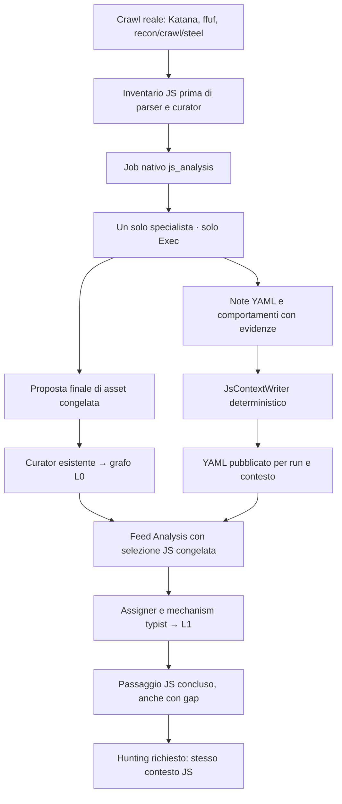
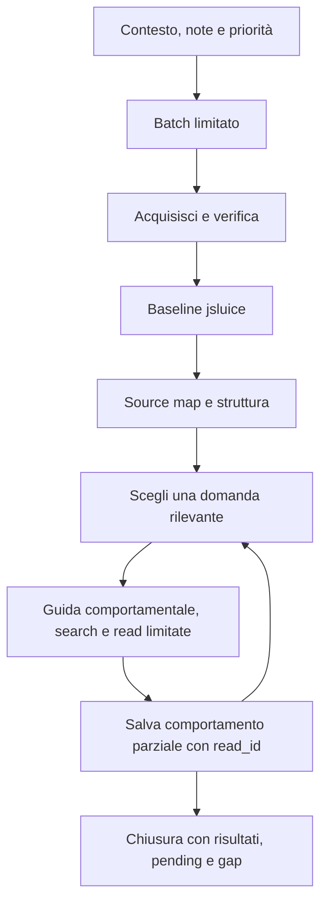
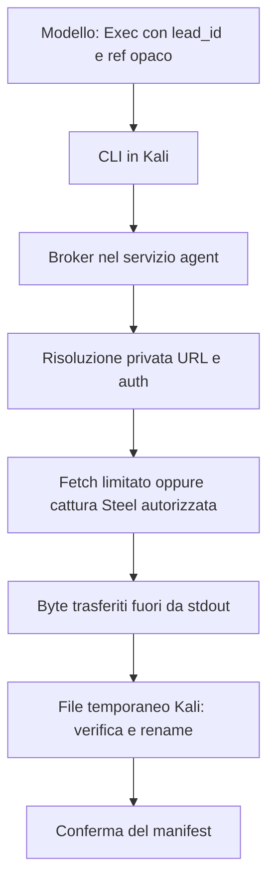

## 1. Obiettivo e confini

Lo specialista ricostruisce **comportamenti del client a partire da evidenze JS**:
come vengono costruite richieste, gestiti token e stato, trasformati input e
attivati effetti. Pubblica un contesto sintetico utile ad Analysis e hunting,
oltre a proporre al curator gli asset compatibili con il modello L0 esistente.

Il percorso precedente eseguiva `jsluice` sugli Endpoint rimasti nel grafo e
aveva un job separato `webpack_chunks` basato su euristiche per costruire URL.
Il nuovo percorso sostituisce quei job con **un job nativo `js_analysis`**.
`jsluice` resta uno strumento interno di estrazione; la risoluzione dei chunk
richiede invece riferimenti dimostrati nel codice. Non si assume un pattern
universale come `<id>.<hash>.js`.

La feature non è un secondo crawler, un verificatore di vulnerabilità o una
ricostruzione completa dell’applicazione. Un controllo nel browser non dimostra
autorizzazione sul server; una richiesta ricostruita non è una richiesta eseguita.
L’output può essere utile e al tempo stesso dichiaratamente parziale.

**Compatibilità:** runtime/sessioni condivise, job e feed esistenti, curator e
schema del grafo conservati. Il filtro degli Endpoint statici in Analysis non è
stato rimosso. Non vengono aggiunti nodi grafo per conservare i sorgenti JS.

## 2. Flusso complessivo



Analysis continua a consumare i risultati recon in streaming. Il passaggio JS
arriva nello stesso feed, **anche quando il curator accetta zero asset**.
Hunting legato a quel workflow deve aspettare la conclusione del passaggio JS
in Analysis; può partire anche con gap espliciti, rispettando le altre condizioni
di lancio. Non viene attivato hunting automaticamente dove non era richiesto.

Riferimenti: [registrazione del job](../../src/polymerhus/recon/control/jobs.py),
[pipeline](../../src/polymerhus/recon/control/pipeline.py),
[esecuzione e finalizzazione](../../src/polymerhus/recon/control/js_analysis_job.py),
[tracker del consumo](../../src/polymerhus/analysis/js_context_application.py).

## 3. Dati iniziali: l’inventario non è il grafo

Ogni pod produttore deposita un JSONL privato della run prima della curation.
L’inventario conserva URL esatto, provenienza, contesto auth, modalità di
discovery, status/MIME quando disponibili e completezza dell’output produttore.
Il reader espone una vista limitata e redatta, selezionata attraverso un
riferimento opaco legato a progetto/run/auth.

Le classi hanno significati diversi:

| Origine | Cosa dimostra |
| --- | --- |
| `browser_requested` | Il browser ha richiesto la risorsa; non prova da solo che il codice sia stato eseguito. |
| Discovery del crawler | Il tool ha trovato un URL; non è una richiesta browser osservata. |
| Probe | È stato sondato un percorso; status e contenuto vanno interpretati. |
| `debugger_script` | Il debugger ha osservato il riferimento di uno script; non prova che il browser lo abbia richiesto né che il body sia disponibile. |
| `code_derived` | Un riferimento dimostrato nel codice ha motivato una successiva acquisizione. |

Inventario mancante, output parziale e risultato completo con zero lead sono
esiti distinti. I JSONL non dipendono dai limiti di cattura delle trace Langfuse.
Katana viene letto per newline fisici: separatori Unicode nelle response body
non devono spezzare un record JSON valido.

Un `ScriptAsset` debugger con URL HTTP(S) valido è un lead anche senza suffisso
JS. L'estrattore conserva query esatta solo nel percorso privato, `script_ids`
e classi di discovery concorrenti; non inventa status, MIME o richiesta browser.
URL malformati o schemi non acquisibili rendono l'estrazione parziale tramite
gli esiti già esistenti: non possono produrre un falso `complete_zero_result`.
Le regole di acquisizione e isolamento auth restano quelle del broker.

Nel campione storico ComfyUI, l’unione Steel/Katana conteneva 524 URL JS; sette
non erano nel grafo ed erano librerie/runtime. Questo misura una perdita limitata
su quel target, non dimostra che il grafo sia sempre un inventario sufficiente.
Da qui la scelta di un adattatore pre-curator circoscritto.

**Filtro del rumore:** nessuna cancellazione automatica perché il path contiene
`vendor`, `node_modules` o `vue`. Lo specialista dà priorità al codice
applicativo e ai file collegati alla domanda; approfondisce librerie quando
servono a spiegare un meccanismo. L’inventario può conservarne il riferimento
senza scaricare, leggere o archiviare tutti i byte.

Codice: [store ed estrazione](../../src/polymerhus/recon/js_intake/store.py),
[reader scoped](../../src/polymerhus/recon/js_intake/reader.py),
[hook Steel e session fan-out](../../src/polymerhus/recon/crawl/crawl_pod.py),
[acquisizione HTTP/Cdp](../../src/polymerhus/recon/crawl/steel/live.py),
[hook pod generico](../../src/polymerhus/recon/domain/pod.py).

## 4. Specialista: task, skill e strumenti

È una sola sessione specializzata per unità di lavoro progetto/run/contesto auth,
non un agente per file o per skill. Usa la stessa infrastruttura di sessione,
provider e compaction degli altri ruoli. Il modello vede **solo Exec**:
l’applicazione ne limita i comandi al CLI JS autorizzato, con riferimento opaco.

| Task | Skill nel repository | Operazioni/strumenti | Risultato |
| --- | --- | --- | --- |
| Inventario e selezione | `js-inventory-intake` | `context`, `notes`, `inventory`, `lead` | Batch limitato, priorità, contesto auth e gap. |
| Acquisizione e baseline | `js-code-acquisition` | `acquire`, `scan`, `scan-results`; broker e jsluice `urls`/`secrets` | File verificato e candidati estratti; stati separati. |
| Recupero sorgenti | `js-sourcemap-recovery` | `recover`, `recovered-sources`, `recovered-source` | Occorrenze dei sorgenti, contenuti disponibili e provenienza. |
| Struttura | `js-bundle-structure` | `structure`, `structure-items`, `structure-item`, `acquire-reference` | Import, factory e dipendenze supportate, span e riferimenti irrisolti. |
| Scelta delle evidenze | `js-evidence-triage` | `search-code`, `read-code`, `triage-select/update/list` | Domande e shortlist con stato esplicito. |
| Ricostruzione | `js-behavior-reconstruction` | `behavior-save`, `behavior-list` | Record concisi supportati da letture consegnate. |

Il modello carica la prima skill, legge contesto e note, poi riceve presto la
guida di triage. La guida serve a pianificare; l’analisi effettiva comincia con
ricerche, letture e selezioni. Dopo aver scelto una domanda deve caricare il
contratto comportamentale **prima** di approfondirla e salvare una risposta
parziale utile prima di passare a un’altra domanda.



Una scan fallita non impedisce recovery/struttura su byte validi. Una map
assente non impedisce di leggere il bundle. Le skill sono istruzioni operative
modulari del repository, non una garanzia che il modello scelga bene le evidenze.
Il runtime impone i limiti e valida gli esiti; la correttezza semantica richiede
verifiche ulteriori.

La guida attuale privilegia costruzione delle richieste e azioni su risorse,
poi auth/storage e stato applicativo. DOM source/sink e confini di persistenza
possono motivare gruppi indipendenti. OAuth/OIDC, PKCE, identificatori di risorsa
o merge dinamici sono piste da seguire quando il codice le supporta: non esistono
verificatori completi dedicati per ogni classe. Distinti nomi come Firebase,
API key e Authorization possono appartenere allo stesso dataflow e non valgono
automaticamente come tre meccanismi diversi.

Riferimenti: [runner e limiti](../../src/polymerhus/recon/js_specialist/agent.py),
[prompt](../../src/polymerhus/recon/js_specialist/prompts/specialist.md),
[skill](../../skills/internal/tools/js-inventory-intake/SKILL.md),
[contratto comportamentale](../../skills/internal/tools/js-behavior-reconstruction/SKILL.md),
[ruolo provider](../../src/polymerhus/app/llm/providers.py).

## 5. Acquisizione, autenticazione e confine agent/Kali

Il **broker** è il codice applicativo che esegue l’acquisizione privata nel
servizio agent: non è un altro modello o un servizio da avviare separatamente.
Risolve URL e materiale AuthStore. Il modello non copia
cookie o token nei comandi. Kali richiede `lead_id` e riferimento opaco, riceve
i byte dal broker, scrive `.part`, verifica dimensione/hash, rinomina atomicamente
e conferma. **`.part` è il file di trasferimento ancora incompleto**; viene
rinominato solo dopo verifica. Il **manifest è un registro JSON privato** di
stati, hash, dimensioni, provenienza e fallimenti. Solo dopo conferma registra
`acquired`: la sola presenza di un file non prova un’acquisizione conclusa.



Il fetch controlla scope a ogni redirect e rimuove credenziali al cambio origine.
401, HTML di login, trasporto, MIME e quota producono esiti espliciti. Un contesto
`browser_only` non viene degradato silenziosamente a un fetch anonimo.

I test hanno mostrato che un cookie finale può non recuperare un JS già ricevuto
dal browser: il cookie può essere ruotato e quello precedente invalidato. Per
questo la cattura delle response JS durante Steel è disponibile **esplicitamente
quando la pipeline seleziona il consumatore JS e il crawl è autenticato**.
Il crawl ordinario non archivia implicitamente i body. La cattura è associata a
progetto/run/pod/auth/lead/URL; versioni ambigue non vengono scelte arbitrariamente.

Il crawl Steel corrente usa il ciclo sessioni `recon/crawl/sessions.py` e il
manifest `steel-crawl/v2`; ogni sessione conserva account, ruolo, provenienza e
fallimenti. La cattura passiva CDP è la sola sorgente HTTP del crawl: i suoi
flow vengono normalizzati per l’edge history e, quando il consumatore JS è
selezionato, i body script 2xx con stato di cattura integro sono proiettati nello
store JS. Non esiste un secondo motore di cattura e un record debugger non viene
promosso a richiesta HTTP. La proiezione byte segue l’account selezionato dal
gateway; l’inventario conserva separatamente anche le altre sessioni.

Riferimenti: [broker e limiti](../../src/polymerhus/recon/js_acquisition/service.py),
[manifest](../../src/polymerhus/recon/js_acquisition/manifest.py),
[catture](../../src/polymerhus/recon/js_acquisition/capture.py),
[opt-in pipeline](../../src/polymerhus/recon/control/pipeline.py),
[sessioni Steel](../../src/polymerhus/recon/crawl/sessions.py),
[manifest v2](../../src/polymerhus/recon/crawl/steel/manifest.py).

## 6. Recovery e struttura: cosa viene trasformato

**Source map:** collega codice distribuito e sorgenti originali; `sourcesContent`
può già contenere i testi. Il recovery usa `@jridgewell/trace-mapping` **0.3.31**,
con adapter, validazione e writer del repository. Gestisce riferimenti dichiarati,
inline, URL finale del bundle, `sourceRoot`, sezioni e stati missing/null/empty.
I nomi fisici derivano dall’hash, evitando collisioni e traversal. Le occorrenze
restano distinte anche quando i byte vengono deduplicati.

**Struttura:** usa `@babel/parser` **8.0.8** con adapter e binding per le strutture
supportate. Conserva hash e offset UTF-8 sui byte originali. Non esegue il bundle.
Import statici/lazy e registry Webpack sono indizi strutturali; un riferimento
dinamico non risolto resta tale. `acquire-reference` riusa scope/auth/broker e non
avvia un’espansione ricorsiva dei chunk.

`ast-grep` è stato confrontato come strumento di query; non è il parser primario
del percorso prodotto. Webcrack non è incluso nel percorso scelto; Wakaru resta
un riferimento/fallback sperimentato, non una fase automatica installata.
Formatting/deminificazione non sono passaggi obbligatori: sorgenti recuperati e
struttura spesso bastano. Deoffuscazione ed esecuzione di codice target non sono
un’escalation automatica implementata in questo incremento.

Riferimenti: [recovery](../../src/polymerhus/recon/js_acquisition/recovery.py),
[struttura](../../src/polymerhus/recon/js_acquisition/structure.py),
[indice](../../src/polymerhus/recon/js_acquisition/structure_store.py),
[versioni locked](../../src/polymerhus/recon/js_acquisition/parser/package.json).

## 7. Dalla lettura al comportamento salvato

Il CLI offre ricerche letterali e finestre limitate di codice. La redazione viene
calcolata sul contenuto intero prima di ritagliare la finestra, per proteggere
valori sensibili che attraversano i confini. La ricerca riusa la preparazione
per contenuti identici nella stessa scansione, con deadline e cursore di ripresa.

Una lettura preparata non è ancora una lettura ricevuta: il runner conferma
`delivered` dopo aver accettato l’output. Solo queste ricevute possono supportare
lo stato `inspected` e i fatti inviati a `behavior-save`.

| Identificatore | Identifica |
| --- | --- |
| `lead_id` | Un’occorrenza di discovery autorizzata, non i byte del file. |
| SHA-256 | Il contenuto esatto acquisito/recuperato o un documento. |
| `source_id` | Un’occorrenza originale recuperata con la sua provenienza. |
| `index_id` / `item_id` | Uno snapshot strutturale e un elemento con span. |
| `read_id` | Una lettura consegnata, vincolata a sorgente/hash/range/contesto. |
| `behavior_id` + revisione | Una risposta salvata alla domanda selezionata. |
| `context_id` | Contesto pubblicato: progetto, origine esplicita e auth ref. |

`behavior-save` è un comando del CLI eseguito tramite Exec. Valida
`question_ref`, `steps`, `assumptions` e `gaps`, controlla i `read_id`, applica la
redazione e aggiunge una revisione alle **note YAML di lavoro**. Non è lo YAML
finale e non è un tool nativo aggiuntivo del modello.

Il limite attuale è **4.096 byte di JSON canonico per record**, non per YAML
finale. È stato aumentato da 2.048 dopo rifiuti reali su White Jotter; non è un
ottimo dimostrato. Gli errori mostrano dimensione effettiva/massima o posizioni
dei riferimenti invalidi senza esporre contenuti o ricevute estranee. Un retry
identico è idempotente; un contenuto diverso crea una revisione append-only.

Una ricevuta valida prova la consegna, **non la verità dell’interpretazione**.
Condizioni, catch, ordine asincrono e effetti client devono essere descritti
fedelmente. Un ramo non letto o una garanzia server non osservata resta un gap.

**Esempio concreto:** il crawl scopre `/assets/app.js`; la sua map contiene
`src/api.ts` e `src/upload.ts`. Lo specialista legge la funzione che costruisce
`FormData` e chiama `api.fetchApi('/upload/image', ...)`. Salva input, campi del
body, ramo di errore e gestione della risposta con le ricevute delle letture.
Se non ha letto come `fetchApi` costruisce la base URL, lo indica come gap.
Il writer può pubblicare questo comportamento anche se il percorso relativo
non ha ancora dati sufficienti per diventare un Endpoint nella proposta grafo.

Codice: [letture](../../src/polymerhus/recon/js_acquisition/code_access.py),
[ricerca](../../src/polymerhus/recon/js_acquisition/code_search.py),
[redazione](../../src/polymerhus/recon/js_acquisition/code_redaction.py),
[triage](../../src/polymerhus/recon/js_specialist/triage.py),
[record comportamentali](../../src/polymerhus/recon/js_specialist/behavior.py),
[contratto dimensioni CLI](../../src/polymerhus/recon/js_intake/cli.py).

## 8. Dove vengono salvati i dati

```text
data/<project-id>/
├── recon/
│   ├── js-intake/<run-id>/<pod-id>.jsonl
│   ├── js_analysis/<run-id>/
│   │   ├── manifest.json
│   │   ├── notes.yaml
│   │   ├── captures/                 # catture private, quando abilitate
│   │   └── context-publications/     # snapshot congelati prima della pubblicazione
│   └── js-artifacts/blobs/<sha256>.blob
└── js-client-side/<context-id>/
    ├── <run-id>.yml
    └── current.json

Kali: /work/js-analysis/<run-id>/...   # scratch, non archivio permanente
PostgreSQL: js_artifacts + js_evidence_links   # metadati, non note/sorgenti
```

L’albero mostra le destinazioni principali, non tutti gli indici e lock interni.
Inventario, manifest e note sono aggiornati durante il lavoro; lo YAML pubblico
arriva alla finalizzazione. Non serve aspettare la fine della run per salvare
un comportamento o iniziare la retention delle sue evidenze.

La retention seleziona i **file completi dietro le letture citate** nei record
salvati; altre dipendenze autorizzate richiedono una motivazione. I blob sono
deduplicati per SHA-256 nel progetto; SQL collega run/auth/lettura/comportamento
e revisione. Non si conservano automaticamente tutti i bundle, map e vendor.
Il reader downstream legge lo YAML, non i byte privati dei blob.

Salvataggio del record e retention hanno stati separati: un record può esistere
con archivio pending/partial/gap. Le prenotazioni concorrenti rispettano quota e
deduplica; conferme perse restano incerte. Alla ripresa lo specialista tenta una
riconciliazione limitata prima del modello, riusando lo stesso servizio.
Non esistono eviction o sweeper globali automatici. Non è implementata una
raccolta automatica dei file scratch basata sul loro valore semantico.

Riferimenti: [note](../../src/polymerhus/recon/js_specialist/notes.py),
[retention](../../src/polymerhus/recon/js_retention/service.py),
[blob](../../src/polymerhus/recon/js_retention/blobs.py),
[schema SQL](../../db/postgres/init.sql).

## 9. Due output finali, due responsabilità

### Proposta al grafo

Scanner e import strutturali verificati alimentano una proposta finale versionata
e congelata. La proiezione rispetta le identità esistenti; per i Secret conserva
il `value_hash` SHA-1 compatibile con il vecchio percorso. Questo non cambia lo
SHA-256 usato per integrità dei file e deduplica blob.

Un import relativo può usare la `parent_final_url` dimostrata dell’indice; una
richiesta API relativa richiede una base e fatti di operazione autorevoli.
Non si converte una semplice stringa in Endpoint GET per supposizione. I casi
irrisolti restano outcome/gap. **Il curator invariato decide cosa scrivere**;
lo specialista non scrive direttamente nel grafo.

### YAML comportamentale

`JsContextWriter.prepare()` raccoglie le revisioni salvate della run, ricevute e
metadati retention e costruisce un documento validato. Non fa un altro turno
LLM e non aggiunge interpretazioni. Lo snapshot privato viene congelato prima
di `publish_prepared()`; schema pubblico: `schema_version`, `context`,
`behaviors`, `evidence`, con le evidenze indicizzate una sola volta.

Lo store pubblica atomicamente un file per run/contesto. Un retry identico riusa
il contenuto; modifiche incompatibili della stessa run generano un conflitto
esplicito, non una seconda versione pubblica. `current.json` è un puntatore
operativo, **non una selezione del risultato più ricco**. I file delle altre run
non vengono usati come fallback quando manca quello richiesto.

L’origine autorevole attraversa la pipeline come envelope esplicito
`{status, value}`. Il writer lo valida e normalizza al proprio confine, insieme
ai chiamanti storici che passano una stringa o `None`; un envelope incoerente o
un’origine con credenziali, path o query fallisce e non viene trasformato in
`unknown`. Bundle, endpoint e URL di evidenza non sono mai fonti dell’origine.

Grafo vuoto non blocca lo YAML; errore YAML non annulla gli asset già confermati.
Il retry riusa proposta, receipt e snapshot senza rilanciare lo specialista.
Inventario pulito vuoto può chiudere senza modello/YAML; un’analisi su lead reali
che non salva comportamenti può invece pubblicare uno YAML vuoto con gap.

Riferimenti: [proiezione pura](../../src/polymerhus/recon/domain/js_graph_proposal.py),
[proposta e curator](../../src/polymerhus/recon/control/js_graph_proposal.py),
[writer](../../src/polymerhus/recon/control/js_context_writer.py),
[schema](../../src/polymerhus/app/js_context/records.py),
[store](../../src/polymerhus/app/js_context/store.py).

## 10. Consumo downstream e ordine temporale

`js_context` è un **tool nativo condiviso**, costruito dall’applicazione con il
progetto associato: non è un comando Exec. Offre `list` e `read` con paginazione,
selezione esplicita run/current e sezioni metadata/context/behaviors/evidence.
Non consente scritture, percorsi arbitrari o accesso ai sorgenti.

Il pattern è quello dei tool applicativi associati al progetto, come AuthStore;
non si riusa il medesimo reader auth per leggere gli YAML JS. Il binding esiste
per assigner, mechanism typist, hunting threat modeller, hunter, pod runner e
pod triager. La guida cortex è condivisa; lo specialista JS resta Exec-only.

Il feed trasporta una selezione immutabile di progetto, producing run, auth,
contesto, documento/hash e gap, non una copia dello YAML. Le sessioni Analysis
si resettano fra chunk: il binding viene ricostruito dall’applicazione, non dalla
memoria del modello. La selezione resta ferma anche se un’altra run avanza
`current`.

`js_context_application` distingue lavoro pendente e concluso. La conclusione
riuscita richiede gli esiti normali dei due propositori e **letture di contenuto
effettivamente consegnate**; list/metadata/gap da soli non bastano. Mancata
lettura o fallimento chiudono con `settled_gap`, non un successo fittizio.
Il gate hunting aspetta questa conclusione e accetta anche la degradazione
esplicita: non garantisce che hunting userà bene il contesto.

Il resume recupera `hunting_runs.stats.js_context_selection` prima dell'esecuzione.
API e runtime verificano progetto, producing run, auth/origine, identità e hash
del documento originale con resolver/store esistenti. Documento mancante o
corrotto dà un rifiuto esplicito; non si sostituisce con `current` o un nuovo
produttore. Una run legacy priva di selezione resta senza JS. La rimozione di
una selezione già ammessa non può essere reinterpretata come legacy.

Anche il lancio modeller-only passa dalla stessa admission, sia via API sia
direttamente nel runtime: pending rifiuta prima dell'intake; gli esiti settled
previsti restano ammessi. Il runtime ricontrolla l'esito congelato: se un nuovo
workflow appare dopo un'ammissione legacy, rifiuta il cambiamento. Il reader
hunter è costruito per invocazione, così factory precedente allo scope e riuso
del dispatcher mantengono coerenti dichiarazione ed executor. Un errore di
binding produce un esito degradato, non una conclusione apparentemente riuscita.

Riferimenti: [tool](../../src/polymerhus/app/js_context/tool.py),
[selezione](../../src/polymerhus/app/js_context/selection.py),
[tracker Analysis](../../src/polymerhus/analysis/js_context_application.py),
[ammissione hunting](../../src/polymerhus/attack/hunting/js_context_admission.py).

## 11. Limiti operativi del codice congelato

| Risorsa | Default del prodotto |
| --- | --- |
| Sessione specialista | `max_attempts: null`, `triage_budget: null`: nessun tetto di chiamate Exec né suddivisione per fase. Deadline 300 s, comando 45 s, batch massimo 3. |
| Output Exec | 16 KiB per risposta, 128 KiB complessivi. Restano limiti di byte, distinti da token e chiamate modello. |
| Acquisizione | 8 MiB/file, 64 MiB/run, massimo 5 redirect. |
| Recovery | Map 32 MiB, sorgente 8 MiB, 5.000 occorrenze, profondità sezioni 8, deadline 35 s. |
| Struttura | Memoria configurata 384 MiB; Node e dipendenze locked richiesti. |
| Lettura codice | Finestra default 4 KiB, massimo 8 KiB. |
| Record behavior | 4.096 byte JSON canonico, input grezzo 8 KiB, comando save massimo 32 Ki caratteri per il quoting. |
| Retention | 32 MiB di contenuti unici per progetto; trasferimento massimo 8 MiB/file. |
| Tool `js_context` | Default 5, massimo 10 record/pagina, risposta UTF-8 entro 16 KiB. |

Nelle valutazioni qualitative conservate è stato usato un **override del solo
harness**: nessun tetto cumulativo di token/richieste modello e deadline LLM
condiviso di 1.200 s. Questo non è il default globale dell’applicazione e non
certifica il completamento entro i 300 s del prodotto. La vecchia policy
44/28/16/2 resta una configurazione opzionale, disattivata nel percorso ordinario.

I valori sono configurabili, non ottimi dimostrati. Il controllo RSS del parser
usa polling; un pass di redazione può non essere interrompibile; un timeout
client può lasciare lavoro server ancora in corso. Questi esiti rimangono
pending/gap da riconciliare, non cancellazioni certe.

## 12. Capacità verificate e prove conservate

Il codice è congelato al 10 novembre 2026 per una PR di revisione. Le prove
seguenti sono **tre verifiche distinte**: una run nativa, un replay deterministico
della pubblicazione e una prova consumer con input preparato. Non costituiscono
un’unica E2E verde e non dimostrano maggiore scoperta di vulnerabilità.

| Componente | Evidenza osservata | Limite |
| --- | --- | --- |
| Analisi specialistica ComfyUI | Inventario 480 lead; una sessione Exec-only; due comportamenti con letture consegnate. Revisione: 11 claim supported, uno supported con precisazione, uno insufficient_evidence. | Copertura partial; nessuna garanzia di completezza o affidabilità su target diversi. |
| Contributo L0 | Proposta congelata e curator confirmed; due asset upsert già presenti dal crawl. | Nessun nuovo nodo dimostrato da quei due upsert; un asset proposto non confermato. |
| Pubblicazione | Il fix del contratto origine attraversa pipeline→job→writer→store. Replay: due comportamenti invariati, tre ricevute, snapshot/YAML/current, zero nuovi turni specialista o curator. | La run live originale si era fermata prima dello YAML. Il replay non riscrive quell’esito. |
| Retention | Probe PostgreSQL isolato: riserva, blob, conferma, link, retry idempotente e reconcile riusciti con quota 32 MiB. | Nella run storica zero artifact/link; causa non conservata. Le tre evidenze pubblicate sono `receipt_only`. |
| Tool condiviso | `js_context` consegna behaviors ed evidence via ToolMessage e mantiene selezione e isolamento. | La consegna non certifica interpretazione corretta. |
| Mechanism typist | Ha letto due comportamenti e tre evidenze, prodotto tre Systems e sei enrichment con riferimenti concreti al contesto. | Revisione di 12 claim selezionati: 7 supported, 4 ambiguous, 1 incorrect. |
| Assigner | Tool disponibile; lettura metadata e receipt empty. | Nessuna lettura di contenuto comportamentale; Analysis chiude `settled_gap`. |
| Hunting | Admission del documento e producing run riuscita. | Arresto prima del primo intake/run-record e di ogni turno modello; punto esatto unknown. Nessun consumo hunting dimostrato. |

### 12.1 Cosa descrive lo YAML reale

Il primo comportamento ricostruisce la conversione e l’upload di un Blob audio:
`FormData`, campi `image`, `subfolder=audio`, `type=temp`, chiamata POST a
`/upload/image`, gestione del risultato ed errore. Il secondo descrive identità
client in `localStorage`, assegnazione `api.user` e propagazione dell’header
`Comfy-User` nel wrapper `fetchApi`. Il documento preserva il limite fra identità
client-controlled e validazione/autorizzazione server non osservata.

Il controllo HTTP 200-only appartiene alla funzione di upload, **non al wrapper
fetchApi in generale**: nella prova consumer il typist ha esteso erroneamente
questa proprietà. L’esempio `/extensions` nel record non ha evidenza sufficiente;
`cache: no-cache` è un default sovrascrivibile. La valutazione manuale e il
contenuto originale sono conservati, senza correggere retroattivamente i claim.

Lo [YAML pubblicato](evidence/js-analysis/2026-11-10/published.yml) contiene due
comportamenti e tre evidenze `delivered`/`receipt_only`, con hash/range e
`retention_metadata_missing`. È un risultato utile ma parziale, non una prova
che i byte originali siano ancora disponibili nell’archivio permanente.

### 12.2 Uso osservato e costi

Il consumer è stato valutato su un grafo L0 **minimale**, ripristinato dai soli
asset conservati: Domain, BaseURL e un Endpoint del bundle. Non è il grafo completo
del target. Il typist ha incorporato i fatti dello YAML in L1; l’assigner si è
fermato ai metadati. I conteggi L1 non sono un confronto controllato con/senza JS.

| Prova | Provider | Input/output effettivi | Costo registrato |
| --- | ---: | ---: | ---: |
| Run nativa ComfyUI | 39 richieste | 1.161.961 / 20.482 token | $0.02834079 |
| Replay pubblicazione | 0 richieste | 0 / 0 | Nessun nuovo costo modello |
| Consumer con input preparato | 13 richieste | 216.605 / 10.345 token | $0.012148374 |

Sono misure di quelle configurazioni, non stime di costo per ogni run futura.
Il consumer Analysis termina in circa 182 s; hunting attende fino al deadline
condiviso senza generare turni. L’assenza di esecuzioni sul target nella prova
consumer è intenzionale e limita le conclusioni a lettura e inferenza.

### 12.3 Come leggere le evidenze

Il [pacchetto di evidenze](evidence/js-analysis/2026-11-10/README.md) conserva
YAML, risultati strutturati, valutazioni manuali e transcript consumer sanificato.
[Provenienza](evidence/js-analysis/2026-11-10/provenance.json) e
[checksum](evidence/js-analysis/2026-11-10/SHA256SUMS) identificano le copie esatte.
Non sono inclusi dotenv, credenziali, runtime privati o archivi completi dei target.
Le valutazioni sono campioni manuali, non un ground truth esaustivo.

Le precedenti prove White Jotter dimostravano acquisizione/recovery e in alcuni
candidati un comportamento utile; una QA successiva produceva YAML vuoto. Non
sono una verifica della revisione congelata attuale: la generalizzazione oltre
ComfyUI resta aperta.

## 13. Limiti aperti nello stato congelato

1. **Uptake dell’assigner.** Con il solo contesto JS ha letto metadata ma non
   contenuti. Non è dimostrata l’integrazione da entrambi i propositori.
2. **Fedeltà semantica.** Sono possibili generalizzazioni fra funzioni, perdita
   di condizioni ed esempi non supportati. Validazione di schema e ricevute non
   le impedisce; il downstream può propagare gli errori.
3. **Hunting non esercitato.** L’admission è verificata, ma il blocco prima del
   primo intake resta senza causa precisa. Non viene attribuito al modello o
   alla mancanza di unità L1: nella prova c’erano tre unità testabili.
4. **Retention della run reale.** Il probe isolato è riuscito, ma non spiega il
   vecchio `retention_reservation_uncertain`; il replay mantiene il gap.
5. **Copertura, selezione e tempi.** Una sessione può esaurire output, tempo o
   budget dei file senza attraversare i flussi importanti. Non esiste una quota
   minima di comportamenti né una garanzia di copertura completa.
6. **Manutenzione dei dati.** Nessuna eviction o sweeper globale automatico.
   Cleanup e prenotazioni abbandonate richiedono gestione esplicita.
7. **Validazione della distribuzione.** Le immagini devono includere Node e i
   parser locked; un precedente harness ne era privo. I controlli freschi del candidato espongono test scaffold/blob/roster
   rossi, cinque assert cortex upstream incompatibili col verbatim corrente e
   un errore di collection per nomi duplicati. Il riepilogo di freeze li
   distingue dai test verdi. Nessuna dichiarazione di suite completa verde o merge-ready.

Non sono stati aggiunti nuovi fix o nuove eval per chiudere artificialmente
questi punti. La PR rende revisionabile codice, contratti ed evidenze; non è
una dichiarazione di feature pronta alla distribuzione.

## 14. Mappa del codice


| Responsabilità | Posizione principale |
| --- | --- |
| Scheduling e job nativo | [recon/control/jobs.py](../../src/polymerhus/recon/control/jobs.py), [js_analysis_job.py](../../src/polymerhus/recon/control/js_analysis_job.py) |
| Inventory producer/reader/CLI | [recon/js_intake](../../src/polymerhus/recon/js_intake) |
| Byte, auth, scan, recovery e struttura | [recon/js_acquisition](../../src/polymerhus/recon/js_acquisition) |
| Sessione, prompt, note, triage e behavior | [recon/js_specialist](../../src/polymerhus/recon/js_specialist) |
| Retention e blob | [recon/js_retention](../../src/polymerhus/recon/js_retention) |
| Grafo: proiezione pura / orchestrazione | [domain/js_graph_proposal.py](../../src/polymerhus/recon/domain/js_graph_proposal.py), [control/js_graph_proposal.py](../../src/polymerhus/recon/control/js_graph_proposal.py) |
| Writer finale | [control/js_context_writer.py](../../src/polymerhus/recon/control/js_context_writer.py) |
| Schema, store, selezione e tool condiviso | [app/js_context](../../src/polymerhus/app/js_context) |
| Integrazione Analysis | [feed.py](../../src/polymerhus/analysis/feed.py), [js_context_application.py](../../src/polymerhus/analysis/js_context_application.py), [supervisor.py](../../src/polymerhus/analysis/supervisor.py) |
| Ammissione e binding hunting | [js_context_admission.py](../../src/polymerhus/attack/hunting/js_context_admission.py), [pod/agents.py](../../src/polymerhus/attack/hunting/pod/agents.py) |
| Crawl Steel e sessioni | [recon/crawl/steel](../../src/polymerhus/recon/crawl/steel), [sessions.py](../../src/polymerhus/recon/crawl/sessions.py) |
| Ruoli hunting correnti | [threat_modeller.py](../../src/polymerhus/attack/hunting/threat_modeller.py), [hunter_tools.py](../../src/polymerhus/attack/hunting/hunter_tools.py), [pod/agents.py](../../src/polymerhus/attack/hunting/pod/agents.py) |
| Skill operative | [skills/README.md](../../skills/README.md) e le sei skill JS elencate sopra |
| Evidenze selezionate | [pacchetto di freeze](evidence/js-analysis/2026-11-10/README.md) |

La collocazione segue la separazione del repository: Recon possiede il lavoro
specialistico e la sua orchestrazione, `app` possiede gli strumenti condivisi,
Analysis possiede le inferenze L1, hunting le decisioni operative. I molti file
di test/esperimento non sono altrettanti servizi runtime. La coerenza con il
[coding standard](../../CODING_STANDARD.md) e la
[strategia di test](testing-strategy.md) resta un criterio della review, non una
conseguenza automatica del nome delle directory.


## 15. Riproducibilità del freeze

Il diff della PR viene costruito rispetto al `dev` aggiornato usando un elenco
esplicito dei sorgenti JS e dei collaboratori modificati. Il worktree originale
rimane preservato; dipendenze installate (`node_modules`), env, directory runtime,
archivi e modifiche estranee non appartengono alla PR.

Il [riepilogo del freeze](evidence/js-analysis/2026-11-10/README.md) distingue
prove storiche e controlli locali freschi, riporta versione base e manifest dei
file e mantiene i gap aperti. I test non avviano nuove chiamate LLM, crawl o
servizi condivisi. Un nuovo candidato o una diversa immagine richiede nuove
verifiche: i vecchi risultati non vengono attribuiti automaticamente al nuovo
codice.
