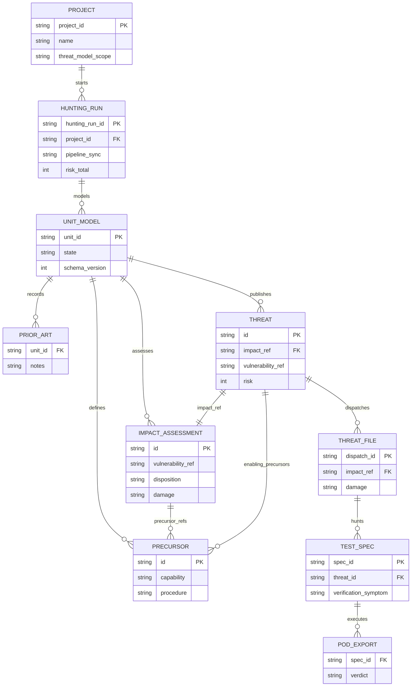
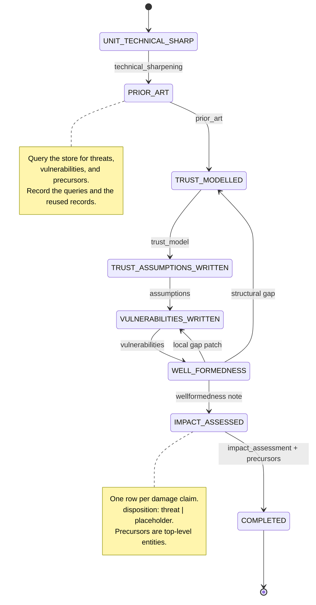
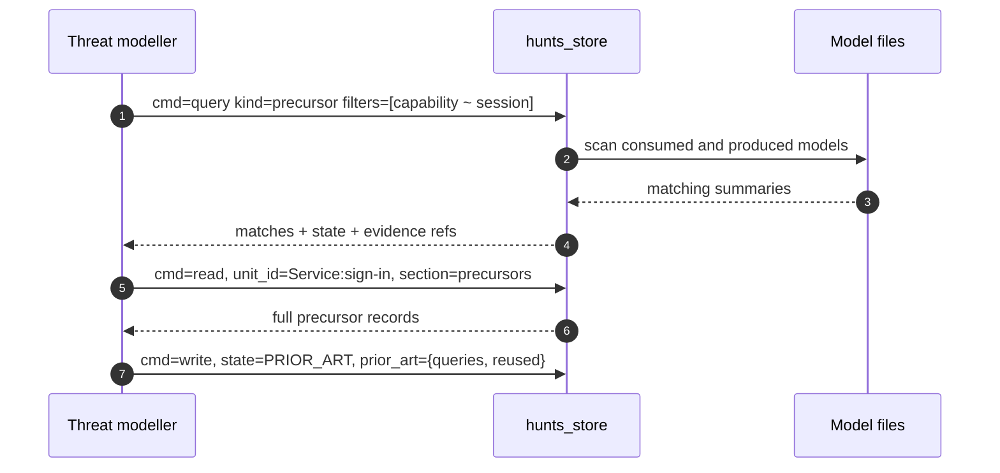
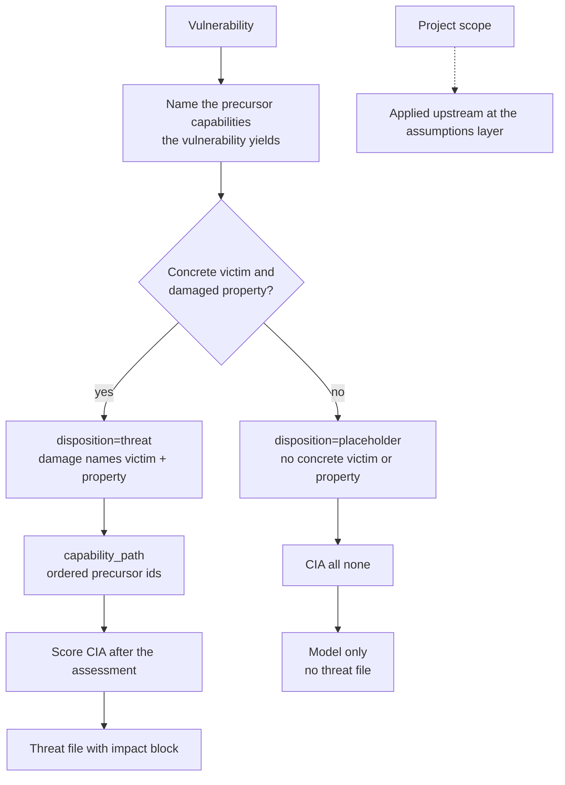
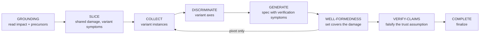
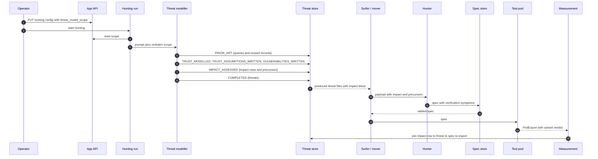

# Impact assessment system - prototype

*Status: prototype (design-shaped), 2026-10-26.*
*Companion to `docs/design/impact-assessment-system-spec.md`.*
*This document rewrites the earlier damage-bearing prototype. It removes the heuristic damage families, the victim classes, the damage symptom, the damage verdict, the precursor-use enum, the cross-unit leads, and the run-record damage fields.*

## 1. What the system does

The modeller turns one L1 unit into one unit threat model.
The model has seven gates.
The new `PRIOR_ART` gate queries the store for prior threats, vulnerabilities, and precursors.
The new `IMPACT_ASSESSED` gate writes the impact rows and the precursor entities.
A row with a concrete victim and damaged property is a `threat`.
A row without one is a `placeholder`.
A `precursor` is a capability entity, not a row.
The CIA score is authored after the impact assessment.
The hunter receives the impact and the precursors as context.
The spec and the pod stay variant-specific.

## 2. Typed surface

```python
class Project(BaseModel):
    project_id: str
    name: str
    created_at: datetime
    threat_model_scope: str = ""


class FieldFilter(BaseModel):
    path: str
    regex: str
    flags: str = "i"


class ThreatQuery(BaseModel):
    kind: Literal["threat", "vulnerability", "precursor", "assumption", "impact"]
    filters: list[FieldFilter]
    limit: int = 20


class ThreatQueryMatch(BaseModel):
    unit_id: str
    record_id: str
    kind: str
    label: str
    web_vulnerability_class: str
    disposition: str | None = None
    summary: str
    state: str
    evidence_refs: list[str]
    matched: list[dict] = Field(default_factory=list)


class ThreatQueryResult(BaseModel):
    matches: list[ThreatQueryMatch]
    count: int
    truncated: bool


class PriorArtQuery(BaseModel):
    kind: Literal["threat", "vulnerability", "precursor", "assumption", "impact"]
    filters: list[FieldFilter]
    result_count: int


class PriorArtReuse(BaseModel):
    unit_id: str
    record_id: str
    kind: str
    reason: str


class PriorArt(BaseModel):
    queries: list[PriorArtQuery]
    reused: list[PriorArtReuse] = Field(default_factory=list)
    notes: str


class Precursor(BaseModel):
    id: str
    capability: str
    procedure: str
    evidence_refs: list[str]


class ImpactDisposition(StrEnum):
    THREAT = "threat"
    PLACEHOLDER = "placeholder"


class ImpactAssessment(BaseModel):
    id: str
    vulnerability_ref: str
    disposition: ImpactDisposition
    damage: str
    precursor_refs: list[str]
    capability_path: list[str]
    evidence_refs: list[str]


class Threat(BaseModel):
    id: str
    fault_ref: str
    vulnerability_ref: str
    canonical_class: str
    web_vulnerability_class: str
    likelihood: Likelihood
    likelihood_rationale: str
    risk_factors: RiskFactors
    confidence: Confidence
    evidences: list[Evidence]
    impact_ref: str
    enabling_precursors: list[str]
    impact: Impact
    impact_weight: int = 0
    risk: int = 0


class Impact(BaseModel):
    confidentiality: ImpactLevel = ImpactLevel.NONE
    integrity: ImpactLevel = ImpactLevel.NONE
    availability: ImpactLevel = ImpactLevel.NONE
```

The `damage` field is the only damage text.
It names the victim and the damaged property.
The prompt catalog is:

| Victim | Property |
|---|---|
| An end user (PII, account, access) | Confidentiality, integrity, availability |
| The application (persisted data, configuration, audit or telemetry, availability) | Confidentiality, integrity, availability |
| The infrastructure (host, runtime, network, cloud account) | Confidentiality, integrity, availability, privileged code execution |

A `threat` names a concrete victim and property.
A `placeholder` states that no concrete victim or property is affected.

## 3. Artifact layout

One `produced` and one `consumed` directory per store.
The impact assessment and the precursors live inside `<unit>.yaml`.
The threat files stay in the same unit directory.

```text
data/<project_id>/hunting/
├── threat_modeller/
│   ├── produced/<unit>/<unit>.yaml            # model: prior_art, impact_assessment, precursors, threats
│   ├── produced/<unit>/threat-*.yaml          # dispatch record with the impact block
│   ├── consumed/<unit>/<unit>.yaml
│   ├── consumed/<unit>/threat-*.yaml
│   └── abandoned/<unit>/...
├── hunter/test-specs/<unit>__<threat>/
│   ├── produced/<class>__<value>__<value>.yaml
│   ├── consumed/<class>__<value>__<value>.yaml
│   └── terminal.yaml
└── test-executor-pod/<spec_id>/<run_id>.yaml
```

## 4. Data model



## 5. Modeller workflow



`WELL_FORMEDNESS` is a reasoning phase, not a persisted gate.
The persisted gates are the seven `ModelState` values.

## 6. Prior-art query



The query excludes the bound unit unless `unit_id` names it.
The query is project-scoped.
The query rejects an empty filter.
The query returns summaries.
The `read` command returns the full model or one section.

## 7. Impact assessment



The project scope is not a branch in this decision.
It is applied before the assumptions: the excluded trust boundary is never modelled, so the excluded assumption and fault are never made.

## 8. Hunter workflow



The hunter does not write a damage claim or a damage symptom.
The impact is context.
The verification symptoms are variant-specific.
The pod verdict is variant-specific.

## 9. Lifecycle



## 10. Worked example

A unit has two vulnerabilities.

**V-1: the exact-path authorization bypass.**

- Precursor `P-1`: `capability: "reach an exact-path-gated handler"`, `procedure: "append a trailing separator to the path"`, evidence `exec:api-02`.
- Impact `IA-1`: `disposition=placeholder`, `damage: "No user or application data, state, or availability is affected; the handler returns a generic envelope."`, `precursor_refs=[P-1]`, `capability_path=[]`.
- CIA: all none.
- No threat file.

**V-2: the exposed management surface.**

- Precursor `P-2`: `capability: "read the management route table"`, `procedure: "resolve the management base path outside the API filter"`, evidence `exec:api-36`.
- Precursor `P-3`: `capability: "fetch a heap dump"`, `procedure: "call the exposed heap-dump handle"`, evidence `exec:api-35`.
- Precursor `P-4`: `capability: "read live session material"`, `procedure: "extract a session secret from the dump"`, evidence `exec:api-35`.
- Impact `IA-2`: `disposition=threat`, `damage: "An unauthenticated caller reads live session material from the process dump and can authenticate as an active user."`, `precursor_refs=[P-2, P-3, P-4]`, `capability_path=[P-2, P-3, P-4]`.
- CIA: `C=high`, `I=medium`, `A=none`.
- Threat `threat-1`: `impact_ref=IA-2`, `enabling_precursors=[P-2, P-3, P-4]`, `impact={C: high, I: medium, A: none}`.
- Threat file with the impact block.

The metric:

| Row | Disposition | CIA | Colour |
|---|---|---|---|
| `IA-1` | placeholder | N/N/N | red |
| `IA-2` | threat | H/M/N | green |

`impact_rows=2`, `threats=1`, `placeholders=1`, `green_share=0.5`, `placeholder_share=0.5`.
The precursor count is 4.
The prior-art section records at least one query for threats, one for vulnerabilities, and one for precursors.

## 11. What changed from the earlier prototype

| Earlier prototype | This prototype |
|---|---|
| `damage_family` enum | Removed. The `damage` field names the victim and the property. |
| `victim_class` enum | Removed. The victim is in the `damage` field. |
| `victim_asset` plus `damage_statement` | Merged into `damage`. |
| `precursor_use` enum | Removed. A precursor is a capability entity; it is queried, not consumed by a use enum. |
| `enables_ref`, `cross_unit_lead`, `exclusion_ref` | Removed. The threat references `enabling_precursors`; the scope is upstream. |
| `confidence` on the impact row and precursor | Removed. The existing claim confidence is an open question. |
| `damage_symptom` on the spec | Removed. The verification symptoms stay variant-specific. |
| `damage_verdict` on the pod export | Removed. The pod verdict stays variant-specific. |
| Run record damage counts and leads | Removed. The model and the files are the source of truth. |
| Separate impact artifact | The impact assessment is a section of `<unit>.yaml`. |
| New directory family | One `produced` and one `consumed` directory. |
| Class-based green gate | Retired. The metric is the CIA red/green share. |
