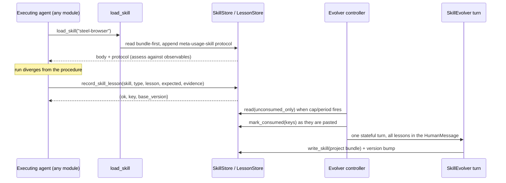

# Skill evolution (#232) - the intended end production system

*Status: RATIFIED + AMENDED 2026-09-23 by the operator grilling; TOPOLOGY AMENDED 2026-10-20 (the project skill area is `skills/target-specific-procedure/<project_id>/`, and the minting-and-shadowing rule replaces the withdrawn admission-gate claim). (two rounds: the open questions below and the lesson-taxonomy adversarial review). The binding decisions are the numbered ledger in `skill-evolution-232-decisions.md` (D232-1..D232-14); where this narrative and the ledger disagree, the ledger wins.*
*Base: `dev` HEAD `3af0f14` (the #222/#234/#220/#221/#223 workstreams merged). Companions: `progressive-skill-lifecycle-adr.md` (the session ADRs, parts A/B - its B6/B7/B9 clauses are superseded as recorded in the #232 ledger), `progressive-skill-lifecycle-system.md` (the earlier high-level draft), `skill-writing-primitives-spec.md` + `skill-writing-primitives-234-decisions.md` (the transitory system that landed), `skills-typed-surface-spec.md` and `skill-runtime-loading-222-decisions.md` (the #222 loader rules), issue #232 (the source spec).*
*Where this document contradicts an earlier draft, this document wins; the earlier draft's decisions were taken before the current code existed and several are now evidenced-wrong (see section 1).*
*Implementation status 2026-09-23 on `feat/232-skill-evolution`: increments A/B/C (lesson store, `record_skill_lesson`, universal binding), D (key-coded consumption + read filters), E (SkillEvolver pass, controller, role, prompt, REST trigger, hunting wiring), F (usage-protocol migration) and G (lesson scaffold dir, corpus move + A3 enrichment) have landed; the assertions phase (`/to-assertions`) and the adversarial review remain.*

---

## 0. The three gaps

The transitory #234 system landed the skill read surface and the `write_skill` executor path.
The intended end system of #232 still misses three things:

1. **A skill-usage lesson layer.** The executing agent must be able to emit a reusable lesson about a skill it used, from every module, without choosing storage. Today no such surface exists (section 1).
2. **A `SkillEvolver`.** The agent that turns accumulated lessons plus existing skills into candidate revisions, with a profile, a lifecycle, a trigger, and a verifiability story (section 2).
3. **A layout refactor of the persisted notes layer.** The hunting notes surfaces are module-scoped, fault-keyed, and threefold; skill lessons are skill-scoped and cross-module. The persisted layer must move to one app-owned, skill-scoped home (section 3).

---

## 1. The skill-usage lesson layer

### 1.1 Evidence: the "notes store" the earlier draft assumed does not exist

The #234 draft (ADR B6) said lessons ride "the existing notes store; no new store and no new typed schema", keyed `skill:<skill_name>:<lesson_header>`.
The current code contradicts that premise on four points.

- **There are three notes surfaces, not one, and all are hunting-scoped.**
  - `NotesTool` (`src/polymerhus/attack/hunting/hunter_tools.py:514`) over `HunterMemoryStore` -> `<data>/<project_id>/hunting/hunter/notes.yaml` (`hunter_memory.py:242`).
  - `ProjectMemoryStore` (`hunt_store.py:625`).
  - `PodNoteTool` (`src/polymerhus/attack/hunting/pod/note_tool.py:81`) over `PodMemoryStore` -> `<root>/notes.yaml` (`pod_memory.py:223`).
- **The tool hard-requires a hunt identity.** `NotesTool._write` requires `fault_key` and validates it against a `HuntStore` (`_fault_key_violation`, returning `fault_key_mismatch`); `HunterMemoryStore.write_note` calls `_validate_fault_key`, which demands the 3-part config key `<unit_id>_<CWE_ID>_<vulnerability_class>` (`hunter_memory.py:267-279`). A `skill:<skill_name>:<header>` key is neither that grammar nor backed by a config, so it fails closed.
- **The note vocabulary is hunt-specific.** `kind` is `hypothesis_refusal | implicit_test_primitive | freeform`; `provenance` is the typed hunt `NoteProvenance` (`source`, `run_id`, `verdict_stub`, `probe_refs`). `PodNoteTool` has a third vocabulary and a `spec_id` + variant `order` identity.
- **Recon and analysis have no notes surface at all.** No notes tool, no store, no bucket. `PROJECT_SCAFFOLD` (`src/polymerhus/app/data_root.py:41`) reserves only `skills`, `auth`, `hunting/*`; there is no `recon/` or `analysis/` dir.
- D234-13 explicitly records the hole: "`source_note_ids` is a reserved parameter with **no notes system behind it**".

**Confirmed:** instrumenting all agents is not "just bind a tool" against an existing store. There is no generic store to bind, and the one that exists cannot accept a skill-scoped key.

### 1.2 Reflection: replicate the pattern, but for a new skill-scoped artifact

The question is whether to replicate the established data-model pattern for recon, or to introduce a new data model.

The established pattern, repeated three times in the codebase, is: an explicit-root per-project store resolved through `app.data_root.project_dir`, atomic whole-file writes (`temp + os.replace`), one `threading.Lock` per project, fail-open reads, strict writes, coded in-band envelopes (`hunt_store`, `app/auth/store.py`, `SkillStore`).

The lesson is **about a skill**, not about a hunt fault, a pod spec, or a recon run.
Its owner is therefore the skills-access domain (ADR B1), and it must be readable by the `SkillEvolver` alongside lessons written by any other module about the same skill.

A module-scoped notes store (a "recon notes") is the wrong axis: a lesson about `steel-browser` written during a recon run must sit beside a lesson about `steel-browser` written during a hunting run, not in a recon bucket.

**Decision (recommended): replicate the data-model pattern, but for a new skill-scoped artifact owned by the skills domain.**
This is simpler than reuse (no hunt coupling, no `fault_key`, no `HuntStore`) and simpler than per-module stores (one store, one binding edit instruments every agent), and it preserves domain ownership.
It supersedes ADR B6's "no new store" clause, whose premise was evidenced-wrong.

The alternative - a generic notes store in the app layer that every module keys arbitrarily - is rejected as the first move: it re-creates the exact "one store, many owners, no domain" ambiguity that produced the three hunting notes surfaces.

### 1.3 Proposal

**Layout (D232-1; topology amended 2026-10-20).** The project's skill area is the `target-specific-procedure/<project_id>/` branch of the live `skills/` root; the lesson shards live under its `lessons/` subdirectory. The data-root scaffold no longer carries the skills entries: the stores create the branch lazily.

```diff
 skills/target-specific-procedure/<project_id>/
 ├── skills/
-│   ├── <skill>/                # project skill bundles (existing #234)
-│   │   ├── SKILL.md
-│   │   └── references/
+│   ├── <skill>/                 # project skill bundles (existing #234)
+│   │   ├── SKILL.md
+│   │   └── references/
+│   ├── lessons/                # NEW: one <skill>.yaml shard per skill
+│   │   └── <skill>.yaml
 ├── auth/
 └── hunting/
```

`PROJECT_SCAFFOLD` does not carry the skills entries (they were removed with the topology amendment); the shard resolves only through the `SkillStore`/`LessonStore` project area under `skills/target-specific-procedure/<project_id>/lessons/`, so no module hand-builds a path.

**Record (D232-2).** A minimal typed envelope with free-text values; the store stamps the facts the agent must not own:

```yaml
- key: "skill:<skill>:<ordinal>"            # store-generated, monotonic per shard
  type: specification | extension | defect  # D232-3 semantics
  lesson: "probe the token field directly before the full submission"
  expected: "the procedure asserts the form carries no CSRF token"
  evidence: ["http-artifact:...", "run 41 step 7"]  # concrete identifiers
  base_version: "1.0"                        # store-stamped via SkillStore.meta
  agent: {role_id: "pod_runner", session_id: "<thread id>"}  # tool-stamped
  written_at: "2026-09-23T..."               # store-stamped
  # consumption is key-encoded: `skill:<skill>:<ordinal>:consumed`
```

**Tool (D232-4/5).** `record_skill_lesson(skill, type, lesson, expected, evidence)`, bound to the project, one call, coded in-band envelope, never a raise.
The agent supplies no version, no provenance, no key: the store stamps `base_version`, the tool stamps the agent identity from the binding's `role_id` and the ambient session thread.
This respects D234-13's ruling that the reading agent receives skill text, never frontmatter metadata.

```text
record_skill_lesson(skill, type, lesson, expected="", evidence=[])
  -> {ok: true, key, base_version} | {ok: false, error: skill_unknown|lesson_invalid|store_unavailable}
```

**Binding (D232-4).** One edit instruments every agent: the lesson tool rides the same `SkillAgentBinding` as `load_skill`, so every bound (non-exempt) role gets it for free, and the exempt roster keeps paying nothing.

```diff
-def build_skill_tools(project_id, with_write_skill=False, store=None):
-    tools = [build_load_skill_tool(project_id, store=store)]
+def build_skill_tools(project_id, with_write_skill=False, store=None,
+                      lesson_store=None, role_id=None):
+    tools = [build_load_skill_tool(project_id, store=store),
+             build_record_lesson_tool(project_id, store=lesson_store,
+                                      role_id=role_id)]
     if with_write_skill:
         tools.append(build_write_skill_tool(project_id, store=store))
     return tools
```

**Why not route this through `write_skill`.** `write_skill` mutates the procedure; it stays gated to the auth-executing agents and the evolver.
`record_skill_lesson` is a cheap, safe, append-only observation; it is the one surface that is safe to bind universally, which is exactly what "instrument all agents" requires.
The trust boundary of #232 section 9 is preserved: an executor can always record a lesson but cannot publish a revision without the evolver (the evaluation gate stays future).

### 1.4 Interaction, end to end



### 1.5 Resolved decisions (grilling, 2026-09-23)

1. **Single file vs per-skill shard** - operator ruling: per-skill shards `skills/target-specific-procedure/<project_id>/lessons/<skill>.yaml` under the project branch (D232-1; topology amended 2026-10-20).
2. **Typed envelope vs free text** - minimal typed envelope, free-text values, three lesson types (D232-2, D232-3).
3. **Consumed tracking without a cursor** - consumption is key-encoded (`:consumed` suffix) at load-for-pasting time; no `consumed_by` stamp and no high-water mark (D232-2).
4. **Lesson key uniqueness** - store-generated monotonic ordinals; duplicate prose appends (D232-2).
5. **`meta-usage-skill` migration boundary** - operator ruling: the body migrates in THIS ticket to the lesson lifecycle; authoring stays with the authoring meta-skills (D232-6).

---

## 2. The `SkillEvolver`

### 2.1 Profile

| Facet | Design |
|---|---|
| **Role id** | `skill_evolver` (`ROLE_SKILLS["skill_evolver"] = ("meta/meta-write-skill",)`; a session-mode, stateful agent with the app-owned `Role("skill_evolver", "LLM_SKILL_EVOLVER", "session", "high")` record). |
| **Domain** | Skills-access (app layer), beside the loader/store/writer (`app/llm/evolver.py`). Not recon, analysis, or hunting. There is no skills module (D232-7). |
| **Goal** | Turn accumulated lessons plus existing skills into candidate skill revisions (or new skills), grounded in cross-task/historical evidence, never opportunistically. |
| **Context** | The project's skill bundles, the shared catalogue, the lesson store, and version history. It never touches the live target, the graph, the auth records, or the hunt stores. |
| **Tools** | `load_skill`, `record_skill_lesson` (the bound pair), plus project-bound `write_skill` armed for the pass. The harness selects and pastes the lessons; there is no `read_lessons` agent tool and no consumed-marking primitive (consumption is key-encoded by the harness, D232-2). |
| **Skills** | `meta/meta-write-skill` (the authoring discipline, reused unchanged - content-stable per D234-9); task-specific `meta/*` skills (e.g. `meta/authn-skill-writing`) as they land. `meta-usage-skill` is NOT appended to the evolver (it is a usage protocol, not an authoring one). |
| **Data access** | Read+write `skills/target-specific-procedure/<pid>/**` (bundles, revisions, lessons, evolution records); read the shared catalogue branches; read the lesson store. Nothing else. |
| **Observability** | Langfuse run trace: the consumed lesson keys, the produced revision, the new version, and the outcome as metadata; fail-open (the existing observability canon). |
| **Functional verifiability** | A revision is structurally valid (frontmatter, `name == dir`), the store bumps the version, and the consumed set is deterministic (same lesson set -> same selection). |
| **Quality verifiability** | The produced procedure meets the `writing-great-skills` bar (compact, no sediment, no no-ops, positive instruction, disclosure ladder) and the claim-criticality rule (D234-13: every divergence/lack claim grounded on objective evidence) - guaranteed structurally by the role prompt's workflow and guardrail verbatims (D232-9). Automated quality evaluation is deferred to `/to-assertions` (D232-13). |

### 2.2 Workflow

The #232 section 5 procedure, made concrete (the first build's shape, D232-9):

```text
arun_evolution_pass(project_id, skill)
  inspect        resolve the skill + its version + its unconsumed lessons
  decide         create a new skill | update the existing one | no write (zero-skip)
  produce        draft the candidate procedure (meta-write-skill discipline)
  validate       structural: the store's frontmatter re-validation on write
  publish        the agent calls write_skill(project body) + the store bumps metadata.version
```

- **Zero-skip default.** No objectively-grounded change -> no write (D234-13's anti-oscillation rule). An unevidenced flip-flop has no path. No lessons -> no model call at all.
- **One revision per skill per pass.** Bounded blast radius and a clean audit trail.
- **Project bundle only.** A project's skill version is its own from the minting on: the loader probes the project area first and falls over to the shared catalogue only on absence, so the project version shadows the baseline for that project (operator ruling 2026-10-20). No promotion into the shared catalogue is in scope for this build.
- **Content-only revisions.** The revision touches the body; `name`/`description`/`version` stay store-owned (D234-15).
- **Evaluate/iterate deferred.** The LLM-judge quality gate and the synthetic-case scoring are not in this build; the operator deferred them to `/to-assertions` (D232-13). The prompt's guardrail verbatims are the quality instrument for now.

### 2.3 Lifecycle and trigger

- **One controller loop, armed by the hunting phase (D232-8).** The controller runs on the shared module runtime worker loop as a per-hunting-run task (scheduled by the hunting bootstrap alongside the orchestrator pass and the surfer, cancelled with the run). Per tick it checks each skill with lessons: unconsumed count >= cap (5) OR period since the last pass elapsed (300 s) -> one pass. Both are env-overridable (`SKILL_EVOLVER_LESSON_CAP`, `SKILL_EVOLVER_PERIOD_S`, `SKILL_EVOLVER_TICK_S`).
- **Manual trigger (D232-10).** `POST /projects/{project_id}/skills/{skill}/evolve` forces an immediate pass and may inject posted lessons into that pass, so the flow is testable and operable without a hunting run.
- **Coverage without a cursor.** The pass selects the shard's unconsumed keys and marks them consumed as it pastes them (`:consumed` key code, D232-2). A previously consumed lesson re-surfaces through the revision's `source_note_ids` only as audit, never re-selected.
- **Idempotent re-entry.** Re-running a pass with no new lessons produces no write and no model call.
- **Reap/stop** follows the run's cancellation (the controller is a per-run session), never a module-wide drain blocker.

### 2.4 Meta-skill-writing skill

- `meta/meta-write-skill` is the authoring procedure and is reused **unchanged** (the content-stability test of the #234 migration).
- The #232 section 5 "`skill-creator` / `skill-evolver`" meta-skill is therefore `meta-write-skill`; no new authoring skill is required for the first build.
- The evolution *procedure* (inspect/decide/validate/evaluate/publish) is the evolver's harness workflow, not a skill - it is code, not procedural knowledge the agent loads.
- If a distinct evolution-procedure meta-skill is later wanted, it lands under `skills/meta/` and is exempt by the existing `is_meta_skill` path rule.

### 2.5 Trust boundary and the project-skill shadow

- Executors write lessons (section 1) and, transitionally, their own project bundle.
- The evolver writes project bundles.
- The project's version shadows the baseline from its minting on; the loader's project-first probe is structural, and a present-but-unreadable project bundle degrades instead of serving the baseline.
- Canonical publication, admission policy, and rollback (#232 sections 5-6) remain out of scope for this build.
- A revision is reversible: `metadata.version` is monotonic, the base version is cited, and traces carry the run.

---

## 3. The persisted notes-layer layout refactor

### 3.1 Current state

Three hunting-scoped notes files plus a project-config file, all under the app root after #234's migration but each module-keyed by fault/config/spec.

### 3.2 Target

```diff
 data/<project_id>/
 ├── skills/
-│   ├── lessons.yaml          # skill lessons (NEW, section 1)
-│   └── <skill>/
+│   ├── <skill>/
+│   │   ├── SKILL.md
+│   │   └── references/
+│   └── lessons/              # skill lessons (NEW, section 1), one shard per skill
+│       └── <skill>.yaml
 ├── auth/
 └── hunting/
     ├── orchestration/
     │   ├── hunt_configs/{produced,consumed}/
     │   └── notes.yaml        # orchestrator notes (config-keyed) - stay put
     ├── hunter/
     │   ├── test-specs/<fault_key>/
     │   └── notes.yaml        # hunter notes (fault-keyed) - stay put
     └── test-executor-pod/
         └── notes.yaml        # pod notes (spec-keyed) - stay put
```

- The hunting notes files are domain-correct as they are: they are keyed by hunting identities and consumed by hunting agents. They are **not** refactored into the lesson store; that would be the wrong axis (section 1.2).
- The refactor the target system needs is the **addition** of the skill-scoped lesson shards and their owner, not the migration of the hunting notes.
- The one genuine layout concern is consistency: the project stores resolve the `skills/target-specific-procedure/<project_id>/` area through the one `SkillStore`/`LessonStore` path builder, so no new path spelling exists (topology amended 2026-10-20).

### 3.3 Resolved decision (grilling, 2026-09-23)

- **A single app-layer notes abstraction is not built.** Four notes-shaped surfaces with four contracts exist after this change; they stay separate and share only the physical idiom (atomic write + per-project lock), because a unifying `read_notes(scope, filters)` risks re-creating the "many owners, one store" ambiguity that produced the three hunting notes surfaces.

---

## 4. Mapping to #232

| #232 | This design |
|---|---|
| section 1 learning signal | the lesson record (section 1.3) |
| section 2 `SkillProvider` | the two-source store seam (`SkillStore` + catalogue) is the proto-provider; a filesystem/REST abstraction stays future |
| section 3 progressive access | bundle layout + `references/` pointers (already landed) |
| section 4 `SkillEvolver` | section 2 |
| section 5 meta-writing skill | `meta/meta-write-skill`, reused |
| section 5.5 usage protocol | `meta-usage-skill`, appended by `load_skill`; its body migrates to the lesson lifecycle in this build (D232-6) |
| section 6 evaluation/admission | deferred: structural validation + prompt guardrails now; the evaluation suite lands with `/to-assertions`; canonical publication stays future |
| section 7 trajectory/knowledge/skill split | lessons (experience) vs bundles (skill); two stores |
| section 8 versioning/provenance | `metadata.version` + `source_note_ids` + lesson `base_version` + the captured agent session id (D232-11) |
| section 9 trust boundary | executors write lessons; bundles by evolver; the project version shadows the baseline from minting on |

---

## 5. Build order (this ticket, D232 ledger)

1. The lesson store + `record_skill_lesson` + the universal binding (section 1) - unblocks the evolver and instruments all agents.
2. Key-coded consumption + the read filters (same store).
3. The `SkillEvolver` pass + controller + role prompt + role record, and the REST endpoint (section 2).
4. `meta-usage-skill` body migration (lesson emission; D232-6) by a specialised authoring subagent.
5. Scaffold entry + external-corpus move and A3 header enrichment (D232-12).
6. `/to-assertions` - the integration/e2e assertion catalogue and the fabricated-lesson evolver walkthrough (D232-13).

## 6. Out of scope

- Evaluation-gate policy, canonical publication and rollback (#232 sections 5-6); the evaluation suite itself is deferred to `/to-assertions` (D232-13).
- `SkillProvider` as a filesystem/REST abstraction; the external corpus is in-repo now (D232-12).
- Any change to the hunting notes contracts or to the #234 `write_skill` contract.
