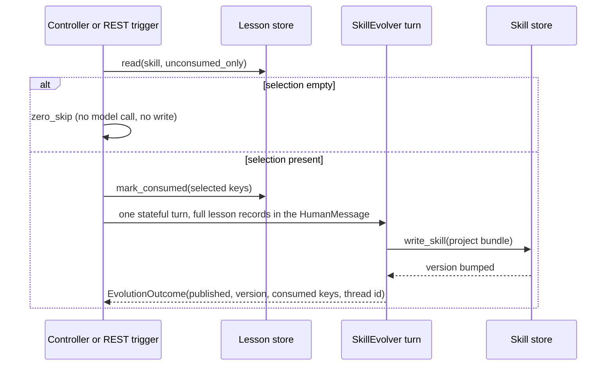

# Spec: generalized skill authoring and evolution (#232)

*Provenance: this specification compiles the ratified decision ledger `docs/design/skill-evolution-232-decisions.md` (D232-1..D232-14) and the narrative design `docs/design/skill-evolution-232-design.md` into one coherent, exhaustive statement.*
*Source issue: #232. Implementation branch: `feat/232-skill-evolution`. Superseding notes: `progressive-skill-lifecycle-adr.md` Part C (C1-C7 supersede B6/B7/B9).*
*Domain vocabulary used below is defined in `src/polymerhus/app/CONTEXT.md` (skill lesson, lesson type, consumed lesson, skill-evolution pass, revision).*

## Problem Statement

Agents already use skills, and while executing them they routinely discover that the procedure diverges from reality: a target fact the skill did not know, a step that must not be done, a genuine error in the illustrated procedure.
Today that discovery evaporates with the session: there is no place to record it, no selection mechanism to surface it, and no agent whose job is to turn accumulated observations into a revised procedure.
The only available mutation path (`write_skill`) is bound to auth-executing agents and lets an executor rewrite the procedure opportunistically, with no grounding and no audit.
At the same time the useful external skill corpus lives outside the repository (`~/purple-swan/skills`), so it is invisible to loading, indexing, and the conformance sweep.
The operator is left hand-editing procedures, and the system's procedural knowledge stagnates exactly where it accumulates the most evidence.

## Solution

A lesson layer plus one bounded evolution loop, both inside the app's skills-access surface.

- Every bound agent gains a `record_skill_lesson` tool automatically: one call records a typed, evidence-carrying observation about a skill, stamped with the skill's base version and the writing agent's identity.
- A new `SkillEvolver` role runs one bounded **skill-evolution pass** per `(project, skill)`: it inspects all unconsumed lessons, decides create/update/no-write, and publishes through the existing project-bound `write_skill`, which bumps the revision version monotonically.
- A **controller** armed with the hunting phase triggers passes on cap-or-period, so evolution runs only while a producer exists.
- A REST trigger forces a pass on demand and can inject lessons, so the whole loop is operable and testable without a hunting run.
- The external corpus moves into the repository catalogue, losslessly and enriched to the A3 dialect, so one catalogue serves everything.
- The usage protocol teaches the lesson pathway; direct `write_skill` leaves the usage protocol.

## System View

### Stack and placement

```text
project-management API (the launch surface)
  └─ module runtime worker loop (one shared asyncio.Runner thread; per-module gates)
       ├─ hunting bootstrap: module context + run sessions + run-terminal flush
       │    ├─ orchestrator pass, inbox surfer (existing)
       │    └─ evolver controller (new sibling session, cancelled with the run)
       └─ stateful turn seam (arun_session_turn)
            ├─ provider/role resolution (skill_evolver -> LLM_SKILL_EVOLVER)
            ├─ skill-index middleware (L1 index in the system message)
            ├─ bound tools (load_skill + record_skill_lesson [+ write_skill])
            └─ Langfuse callbacks (fail-open)
data root (one layout owner)
  └─ data/<project_id>/skills/{<skill>/SKILL.md, lessons/<skill>.yaml}
```

### Seams touched

| Seam | Contract | Pattern it follows |
|---|---|---|
| app data-root layout owner + project scaffold | one resolver for every path; the scaffold owns the fixed `skills/lessons` directory | the #234 one-resolver rule |
| skills-access store (`SkillStore`) | bundle-first, catalogue-second read; store-owned frontmatter and version bump | #234 |
| lesson store (new) | per-skill shard; append/read/mark-consumed; coded exceptions; fail-open reads, fail-loud atomic writes under the per-project lock | hunt-store and auth-store idiom |
| lesson tool (new) | verbatim contract constant; coded in-band envelope; never raises | #197 `GRAPH_VIEW_CONTRACT`, #222 `SKILL_LOAD_CONTRACT` |
| skill tools factory + role binding | read-only pair bound universally; `write_skill` gated; `role_id` stamped | #234/#221 |
| auth-capable binding | composition over the skill binding, never a fork; `role_id` threaded so the lesson tool can stamp the writer | #220 |
| conversation scope | ambient session identity read for the `agent.session_id` stamp | #94 |
| session turn seam | one stateful turn; the lesson payload rides one HumanMessage | #94 |
| module context + module index | the controller's thread resolves the hunting index; archived by the module drain flush | #120/#211 |
| runtime schedule/cancel | fire-and-forget run registration; admission refusal mapped to 503 | #118/#122 |
| role prompt reader | module-owned prompt file, fail-closed, memoised | ADR A1 |

### Flows

Capture (every bound role):

```text
agent turn
  └─ record_skill_lesson(skill, type, lesson, expected, evidence)
       ├─ resolve base_version through the skill store (bundle first, catalogue second)
       ├─ append under the per-project lock (atomic same-directory replace)
       └─ envelope {ok, key, base_version} | {ok: false, error, detail}
```

Evolution pass:



Controller: scheduled by the hunting bootstrap as a sibling session of the orchestrator pass and the surfer, tick loop with cap-or-period check per skill, cancelled at the run terminal, fail-open, never counted as quiesce work.

REST trigger: `POST /projects/{project_id}/skills/{skill}/evolve` with an optional `{lessons: [...]}` body appends the posted lessons and forces one pass through the runtime; the response carries the outcome.

### Patterns applied

- Verbatim contract constant, pinned by test.
- Coded in-band envelopes for every agent-facing outcome; nothing raises into a turn.
- Explicit-root stores with injected seams; no I/O at import.
- Fail-open reads and fail-loud, atomic, per-project-locked writes.
- Server- or tool-stamped facts only: the agent never supplies key, version, identity, or timestamp.
- One-edit universal binding: the lesson tool rides the shared skill-tools factory, so every bound role gets it and exempt roles keep paying nothing.
- Role prompts live with the owning module, never under `skills/`.
- Module context and run-terminal flush chokepoints, never ad-hoc paths.

### Dependencies

- Existing: the session turn seam, the checkpointer module index, the runtime manager, the skill store and loader, the provider/role table.
- New operator action: `LLM_SKILL_EVOLVER` must be set on every deployment, because the role is registered in the app-owned roster and validated at boot (recorded in `STATE.md` High Priority).
- Data: the 63-skill external corpus, moved in-repo.
- No new external libraries.

## User Stories

1. As an executing agent of any bound role, I want `record_skill_lesson` bound automatically, so that I can capture a reusable observation with no per-role wiring.
2. As a hunting pod runner, I want my lesson stamped with my session identity, so that the observation traces back to the exact session that produced it.
3. As an executing agent, I want a coded in-band error rather than a raise, so that a malformed lesson never breaks my turn.
4. As an executing agent, I want the skill's current version stamped on my lesson, so that the evolver knows which procedure text my observation was made against.
5. As an executing agent, I want three lesson types with concise semantics, so that I can file an observation without taxonomy anxiety.
6. As an executing agent, I want to record the skill's stated expectation next to my lesson, so that the divergence is legible without quoting the procedure.
7. As an executing agent, I want to attach concrete evidence identifiers, so that my claim is auditable and the evolver can ground its change.
8. As an operator, I want per-skill lesson shards under the project's skills tree, so that selection and reads stay scoped and cheap.
9. As an operator, I want consumption encoded in the lesson key, so that selection needs no cursor and no second state to keep consistent.
10. As the skill evolver, I want all unconsumed lessons of a skill pasted into one turn in their full stored shape, so that I can decide a grounded revision without a retrieval tool.
11. As the skill evolver, I want a per-`(project, skill)` session thread, so that consecutive passes resume my prior reasoning.
12. As the skill evolver, I want the zero-skip default, so that an unevidenced flip-flop has no path and a pass without lessons costs no model call.
13. As the skill evolver, I want at most one revision per skill per pass, so that the blast radius and the audit trail stay bounded.
14. As the skill evolver, I want to publish through the existing project-bound `write_skill`, so that the store stays the single writer and the version bumps monotonically.
15. As an operator, I want a controller armed with the hunting phase, so that evolution runs while a producer exists and never without one.
16. As an operator, I want cap and period triggers with env knobs, so that I can tune evolution without a code change.
17. As an operator, I want the controller cancelled with the run and never counted as quiesce work, so that a 300 s tick can never delay a run's completion.
18. As an operator, I want a force-pass endpoint that accepts injected lessons, so that I can drive evolution for repair or testing without a hunting run.
19. As an operator, I want admission refusal mapped to 503 and an unknown project to 404, so that the endpoint obeys the established launch contract.
20. As an operator, I want `LLM_SKILL_EVOLVER` validated at boot, so that a misconfigured deployment fails loudly instead of degrading silently.
21. As a maintainer, I want the external corpus moved flat into the repository catalogue, so that one catalogue serves loading, indexing, and conformance.
22. As a maintainer, I want the corpus headers enriched to the A3 dialect, so that the conformance sweep governs them.
23. As a maintainer, I want the stale duplicate group tree dropped and its unique material preserved as references, so that the move is lossless.
24. As a maintainer, I want the usage protocol rewritten to the lesson lifecycle, so that agents are taught the new pathway and direct `write_skill` leaves the usage protocol.
25. As a maintainer, I want the hunting notes contracts untouched, so that no existing store, path, or test changes behavior.
26. As a future agent, I want the writing session id captured on every lesson, so that transcript-grounded evolution is a pure read later.
27. As an e2e or eval agent, I want both the controller and the endpoint paths drivable without a live hunt, so that evolution is verifiable end to end.
28. As a project owner, I want lessons and revisions confined to my project's bundle, so that the canonical catalogue is never mutated by an evolution pass.
29. As a reviewer, I want the consumed lesson keys and the new version in the pass outcome, so that every revision is auditable.
30. As a reviewer, I want the agent-facing tool description to be a pinned verbatim constant, so that the contract cannot drift.

## Implementation Decisions

### 1. Lesson layer

1. **Store and layout.** A new lesson store lives in the skills-access surface.
   Layout: one shard per skill, `data/<project_id>/skills/lessons/<skill>.yaml`, resolved through the one app data-root resolver.
   The project scaffold gains exactly one fixed entry (`skills/lessons`); no module creates it.
   A skill literally named `lessons` is refused as `lesson_invalid` (the shard directory name is reserved by the scaffold).
2. **Record schema.** Minimal typed envelope, free-text values, store/tool-stamped facts:

   ```yaml
   - key: "skill:<skill>:<ordinal>"            # store-generated, monotonic per shard
     type: specification | extension | defect  # the lesson type
     lesson: "<free prose: the reusable lesson>"
     expected: "<the skill's stated expectation, extracted with minimum divergence>"
     evidence: ["<concrete identifier>", ...]  # artifact ids, run/session ids, request/response refs
     base_version: "<major.minor>"             # store-stamped through the skill store
     agent: {role_id: "<role>", session_id: "<thread id>"}  # tool-stamped
     written_at: "<ISO-8601>"                  # store-stamped
   ```

   The agent supplies only `skill`, `type`, `lesson`, `expected`, `evidence`.
   The skill name is not a record field (the shard path is structural), but the tool contract takes it.
   Duplicate prose appends as a new record; keys are monotonic by construction.
3. **State vocabularies (distinct, never conflated).**
   Lesson **type** (what the lesson asserts): `specification` (target attack-surface knowledge), `extension` (new steps, an optimised grouping, an anti-pattern, or a technique-scope extension), `defect` (a genuine error in the illustrated procedure).
   Lesson **status** (where the lesson is in the pass lifecycle): exactly `unconsumed` and `consumed`, encoded idiomatically in the key: the reserved `:consumed` suffix is appended when the controller loads a lesson for pasting, and stripped when un-marked.
   There is no consumed flag field, no `consumed_by` stamp, and no high-water-mark cursor; `unconsumed_only` is a key-shape filter.
   The tool's error vocabulary is the closed set `lesson_invalid | skill_unknown | store_unavailable`.
   `base_version` is a stamped fact, never agent-supplied.
4. **Lesson tool.** `record_skill_lesson(skill, type, lesson, expected="", evidence=[])` returns `{ok: true, key, base_version}` or `{ok: false, error, detail}`; nothing raises into a turn.
   Its description is a single verbatim contract constant, mirrored in the catalogue README and pinned by test.
   The factory binds the project (tool-owned default) and the `role_id` stamp; the ambient conversation scope supplies `agent.session_id` when present, else the empty string.
5. **Universal binding.** The skill-tools factory returns `[load_skill, record_skill_lesson]`, appending `write_skill` only when the write flag is set.
   One edit in the role binding instruments every bound role; an exempt role still binds nothing.
   The write trust boundary is preserved: an executor can record a lesson but cannot publish a revision without the evolver.
   The auth-capable binding is the auth capability's composition over the skill binding; it is not forked, and its only change here is threading `role_id` into the skill-tools factory so the lesson tool can stamp the writer.

### 2. SkillEvolver

6. **Role.** `skill_evolver`, app-owned and registered in the app roster as a session-mode role with a high thinking level, keyed by `LLM_SKILL_EVOLVER`; boot validation requires the key.
   Roster: the evolver's bounded skill set is the authoring meta-skill (`meta/meta-write-skill`); the usage protocol is not appended to it.
   Role prompt lives with the owning module (`app/llm/prompts/`), never under `skills/`.
   There is no skills module; the evolution logic lives in the app layer beside the skill store.
7. **Pass.** `arun_evolution_pass(project_id, skill) -> EvolutionOutcome`, one bounded pass, six steps:
   inspect (resolve skill and version; unresolvable -> `skill_unknown`, no write);
   select (all unconsumed lessons; empty -> `zero_skip`, no model call, no write);
   mark (rewrite exactly the selected keys consumed as they are loaded for pasting);
   produce (one stateful turn on the per-`(project, skill)` thread, all selected records pasted into a single HumanMessage, the workflow and the authoring guardrails in the role prompt, the agent holding its bound skill surface plus the armed project-bound `write_skill`);
   publish (the agent calls `write_skill`; the store re-validates structurally, bumps the revision version one minor, and records the consumed lesson keys as source note ids);
   outcome (`EvolutionOutcome` carries the decision `published | zero_skip | skill_unknown | no_write | degraded`, the new version read back from the store, the consumed keys, and the thread id).
   One revision per skill per pass; re-running with no new lessons writes nothing and calls no model.
   Project bundle only: the canonical catalogue is never written by a pass.
8. **Payload contract.** The pass pastes the **full stored shape** of every selected record - key, type, lesson, expected, evidence list, base_version, agent role and session id, written_at - rendered as YAML (the same shape the shard holds), each record introduced by its key, plus a header naming the skill, its current version, and the instruction.
   It never pastes only the lesson prose and never a digest.
   The current procedure text comes from the bound `load_skill` on the same turn, so the model sees body plus versions plus full lessons.
   Selection is complete by construction: the cap triggers a pass, it never truncates one.
9. **Identity and thread.** The pass runs as a module-scoped session under the hunting module context with the synthetic run segment `skill-evolution:<project_id>`, discriminator = skill, role = `skill_evolver`.
   This makes the thread per-`(project, skill)` and continuous across hunting runs.
   Consequence: the run-terminal flush filters on the hunting run id and does not archive this thread; it stays in the hunting module index (latest-only, one per skill) and is archived by the module drain or shutdown flush.
   A crash therefore loses only an in-flight pass's scratch reasoning, never its durable effects (consumed keys, revision).

### 3. Controller and triggers

10. **Controller placement.** The controller is not a module and not a child of the run coroutine: it is one session in the hunting run's registry, a sibling of the orchestrator pass and the surfer, scheduled by the hunting bootstrap and cancelled at the run terminal.
    It is admitted, held, paused, drained, stopped, and cancelled only through the hunting module lifecycle plus its own per-session verbs; no other module's verbs reach it.
    It is not part of the quiesce predicate, and its failure is fail-open and never flips the run status.
11. **Timing.** Per tick (default 60 s, `SKILL_EVOLVER_TICK_S`) the controller checks each skill that has lessons: unconsumed count at or above the cap (default 5, `SKILL_EVOLVER_LESSON_CAP`) OR period since that skill's last pass elapsed (default 300 s, `SKILL_EVOLVER_PERIOD_S`) triggers one pass.
    A skill seen for the first time gets its last-pass time initialised at first sight, so the period batches rather than firing immediately.
    The last-pass timestamps are controller-local and in-memory; consumption is the only durable state.
12. **REST trigger.** `POST /projects/{project_id}/skills/{skill}/evolve` forces one immediate pass through the runtime, mapping admission refusal to 503 like the other launches and an unknown project to 404.
    An optional body `{lessons: [...]}` is appended to the shard (store-stamped, agent = operator) before the pass, so an operator or e2e run can drive evolution without a hunting phase.
    The response carries the `EvolutionOutcome`.
13. **Outcome semantics.** `degraded` names any fail-open seam failure (model transport, store unavailable during a read) and never raises to the caller; `no_write` is a completed turn whose decision was no change; `zero_skip` is the no-lessons short-circuit.

### 4. Catalogue and corpus

14. **Corpus move.** The external 63-skill corpus moves into the repository catalogue flat (`skills/<name>/SKILL.md`), preserving content; headers are enriched to the A3 dialect by adding `metadata.version: '1.0'` (name and description already present).
    The corpus's group directories are stale duplicates (verified byte-identical except one unique SSTI bullet), so they are dropped and the unique material is preserved as a reference inside the owning bundle; empty directories and placeholder files are dropped.
    The conformance sweep governs the enlarged catalogue; the role roster is unchanged (binding remains a deliberate per-role edit).
15. **Usage protocol migration.** The usage-protocol body is rewritten in this ticket to the lesson lifecycle: after using a skill, assess against the observables and emit a lesson through `record_skill_lesson` using the stated type semantics.
    The direct `write_skill` direction leaves the usage protocol; authoring stays with the authoring meta-skills.
    Composition rules are untouched (appended on every `load_skill` except meta-family skills, always read from the shared catalogue, byte-separated).

### 5. Fences (unchanged contracts)

16. The hunting notes contracts and their stores and tests are untouched.
17. The `write_skill` contract (typed target, store-owned frontmatter, one-minor version bump, coded envelopes) is untouched.
18. The catalogue frontmatter contract and the meta-family exemption rule are untouched.
19. Role prompts never live under `skills/`; the deprecated recon skills shim is never imported.
20. Fail-open reads, fail-loud writes, atomic writes under the per-project lock, and no I/O at import are invariant.

## Testing Decisions

A good test here asserts external behavior only: the store's public round-trip, the tool's envelope vocabulary, the binding's composition, the pass's outcome for a given lesson set and a scripted turn, the controller's due logic, and the endpoint's status contract.
No test asserts private structure, and no test reaches into another module's internals.

- **Unit tier, lesson store and tool.** Injected temp root; append/read/mark-consumed round trips, key monotonicity across consumed keys, type and keyword filters, reservation of the `lessons` name, corrupt-shard fail-open reads, fail-loud writes, and the tool's three coded refusals plus the success envelope.
  Prior art: the existing skill store and seam tests, and the new lesson test module landed with this work.
- **Binding composition.** Bound roles carry the read-only pair; exempt roles carry nothing; the write flag appends `write_skill`; the auth composition keeps its three paths.
  Prior art: the skill seam and auth seam tests.
- **Evolution pass.** Injected fake turn function and temp-root stores: `skill_unknown` (unresolvable skill), `zero_skip` with no model call, `published` via a scripted turn that writes through the store (version bump asserted), `no_write`, selection marking at load-for-pasting, and idempotent re-entry.
  Prior art: the actor and session contract tests that inject turn functions.
- **Controller.** Pure due-logic cases (cap, period, first sight, already-consumed) plus a stop-event loop test with a fake store; no timing sleeps beyond injected clocks.
- **Endpoint.** Status contract (202/404/503) and posted-lesson injection, following the existing launch-endpoint tests.
- **Scaffold and catalogue.** The scaffold test asserts the fixed `skills/lessons` entry; the conformance sweep asserts the enlarged catalogue's A3 headers.
- **Deferred to the assertions phase.** The fabricated synthetic-lesson evolver walkthrough, the quality evaluation of produced revisions, and the end-to-end controller-armed run are specified in `/to-assertions`, where realistic fixtures are fabricated from the moved corpus.

## Out of Scope

- Quality evaluation by an LLM judge, admission policy, canonical `skills/` promotion, and rollback machinery.
- Transcript loading into the evolver: the writing session id is captured now, the read is designed-not-built.
- A provider abstraction (filesystem or REST) for the catalogue; the corpus is in-repo after this change.
- Any change to the hunting notes contracts, the recon skills shim, or the catalogue meta-family exemption.
- UI or operator console surfaces beyond the REST trigger.

## Further Notes

- **Decision trace.** The exhaustive, file-level ledger with rejected alternatives is `docs/design/skill-evolution-232-decisions.md`; the narrative spec is `docs/design/skill-evolution-232-design.md`; the ADR supersessions are Part C of `progressive-skill-lifecycle-adr.md`.
- **Operator action.** `LLM_SKILL_EVOLVER` must be set on every deployment before a real app boot; it is recorded under High Priority in `STATE.md`.
- **Build order on this branch.** A/B/C lesson store, tool, and universal binding (landed); D key-coded consumption and read filters (landed with the store); E evolver pass, controller, role, prompt, and endpoint; F usage-protocol body migration; G scaffold entry and corpus move with header enrichment; then the assertions phase.
- **Carried gaps.** Type extension (`confirmation`, environment/precondition types) is the likely first taxonomy change; transcript-grounded evolution is a pure-read follow-up; canonical promotion waits for the future evaluation and admission work.
