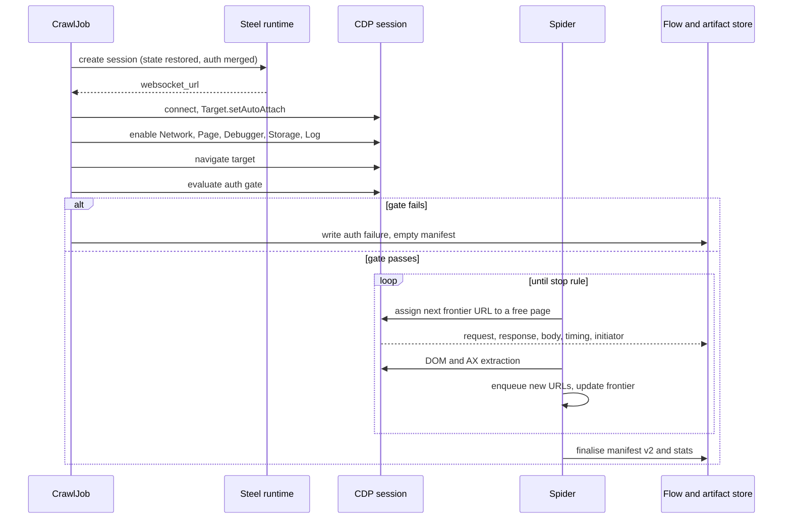
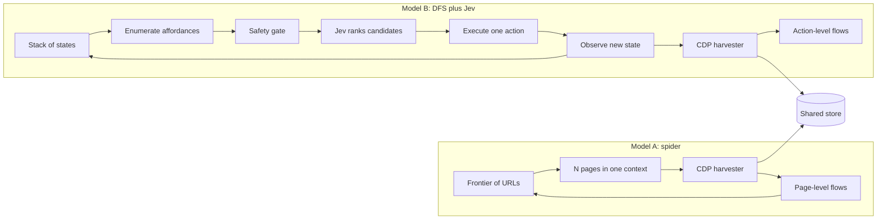
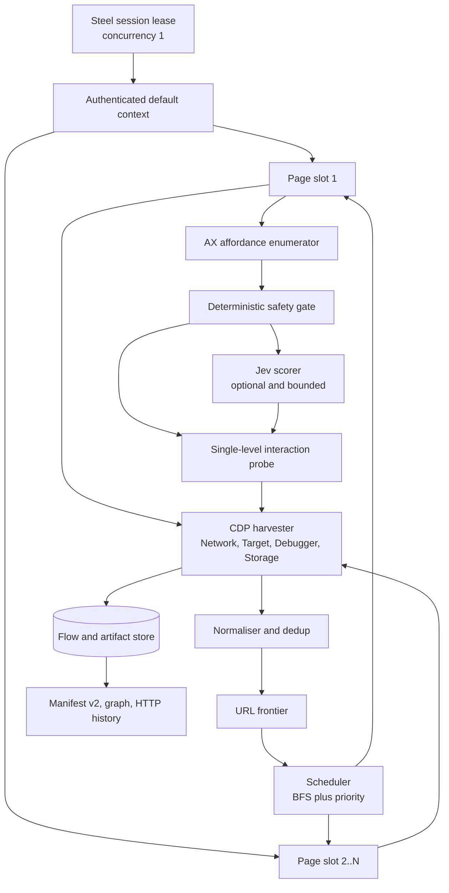

# steel_crawl rewrite: exhaustive CDP spider vs DFS with a Jev policy

**Status: ANALYSIS, 2026-10-26.**
This document compares two implementation models for the `steel_crawl` rewrite.
It is not a ratified design and it changes no source.
Every empirical claim about the current code cites a file.
Every empirical claim about an external system cites its owning document.
Predictions about the two models are labelled as predictions, not results.

**Inputs.**
Issues #92, #360, #38, #50, #51, #353, #239.
PenScope (`spider12223/PenScope`, `src/background.js`, `hunt.js`).
TypeSafe docs (System One, primitives, confidence, models, patterns, function calling, Jev 1.13 jaggedness).
Chrome DevTools Protocol `browser_protocol.json`.
Repo design records: `recon-pipeline-design.md`, D25 in `recon-pipeline-forward-decisions.md`, `typesafe-system-one-evaluation.md`, `steel-local-deployment-359-spec.md`, `steel-session-only-impact-map-395.md`.

---

## 0. Answer first

Build the capture plane first.
Then build a deterministic traversal engine.
Then add a bounded interaction layer.
Add Jev last, behind a flag, as a per-candidate scorer.

Do not build either model as written.

- Model A is a real capability, but it is not a spider in the PenScope sense.
  PenScope does not spider.
  Its Hunt Mode DOM crawl reads one page and harvests URLs.
  The transferable part is the capture and extraction stack, not the traversal.
- Model B is a real capability, but its hard part is not Jev.
  Its hard part is stable element identity and state replay after backtracking.
  Jev is a small classifier at the end of a large deterministic machine.
- Both models need the same capture plane.
  Issue #360 specifies that plane.
  Neither #92 nor #360 specifies a traversal policy that is ready to build.
  #92 has an empty body.
  #360 is capture-only.
- The current ReAct driver is the wrong driver.
  The #38 trace shows the failure: the agent crawled before authenticating, then stalled for 40 seconds on selector identification.
  A deterministic driver removes that failure mode by construction.
- The authenticated session is a precondition, not a step.
  #38 shows what happens when a model is asked to remember that.

The recommended shape is:

1. A deterministic breadth-first route crawl over one authenticated session.
2. CDP capture of every flow, body, header, initiator, worker, and source map.
3. A single-level interaction probe on each route, with a deterministic safety gate.
4. Jev as an optional per-candidate salience and safety scorer.
5. Deep DFS replay only for flows that evidence says need it.

That is Model A's reach, Model B's per-route depth, and none of Model B's unbounded replay cost.

---

## 1. What the inputs actually specify

The two tickets do not describe two designs at the same level of completeness.
This matters before any comparison.

### 1.1 Issue #92 is a title, not a design

The body is empty.
The title is:
"Exhaustive scraping of relevant assets from browser signals and logs, leveraging CDP capabilities - similar to what is done in PenScope browser extension".

That is an aspiration.
It contains no scope rule, no crawl order, no concurrency model, no stop rule, no data contract, and no acceptance criterion.
Any claim that Model A is "simpler" or "already specified" is unsupported.
The design in section 3 is constructed here.
It is not read out of the ticket.

**Critical consequence.**
"Depth of specification" cannot be measured from #92.
It can only be measured from the design that a team would actually build.
Once constructed, Model A is large.

### 1.2 Issue #360 is a capture specification, not a traversal specification

#360 asks for CDP Network capture of XHR and fetch traffic.
It asks for method, URL, status, headers, timing, and initiator.
It asks for HAR or per-flow records.
It asks for ingestion into HTTP history and the graph with browser provenance.
It does not mention depth-first traversal.
It does not mention Jev.
It does not mention a decision-taker at all.

**Critical consequence.**
The capture half of Model B is #360.
The DFS and Jev half is new scope.
The comparison is therefore not "ticket 92 vs ticket 360".
It is "a constructed spider vs a constructed DFS policy, on top of the same capture plane".

### 1.3 Issue #38 is about ordering, not credentials

The failure was sequencing.
The agent crawled before authenticating.
It then stalled for about 40 seconds looking for sign-in selectors.
It never logged in.
The run still reported success because the pre-login assets passed the gate.

The ticket says the credentials were valid.
A Bearer token minted from the same credentials worked for the request-based tools in the same run.

**Critical consequence.**
Any redesign must make "authenticated before traversal" a hard precondition.
A prompt instruction is not a precondition.
A gate that blocks the first navigation is a precondition.
This favours a deterministic driver over a ReAct driver.
It also favours a single observable session over a pool of pages.

### 1.4 PenScope Hunt Mode is not an exhaustive spider

Inspection of the extension source shows the following.

- `huntDomCrawl` runs `__pageEnumerateDomUrls` in the page.
- That function reads anchors, forms, iframes, area maps, embedded media, and SPA router attributes.
- It resolves relative URLs and deduplicates them.
- It filters to same-origin.
- It promotes new URLs into `tab.discoveredRoutes`.
- It performs no clicks.
- It performs no navigation.
- It runs on one page.

The rest of Hunt Mode is a probe pipeline, an auth matrix, stack packs, a chain analyser, and report generation.
Hunt Mode is a "set scope and forget" workflow over already-captured surface.
It is not a multi-page crawler.

The transferable PenScope pieces are:

- CDP attachment and domain enablement (`Network`, `Runtime`, `Page`, `Debugger`, `Log`, `Audits`).
- Request and response capture, including `Network.getResponseBody`.
- Source-map harvesting from parsed scripts.
- DOM URL enumeration.
- `DOMDebugger.getEventListeners` for real listeners, not just inline handlers.
- `Accessibility.getFullAXTree`.
- `Storage` and cookie handling for auth contexts.
- Endpoint normalisation and HAR import and export.

**Critical consequence.**
"PenScope already does this" is false at the traversal layer.
There is no prior art to copy for a parallel CDP spider.
There is strong prior art to copy for the capture and extraction layer.

### 1.5 Jev is a closed-set decision model, not an agent

The TypeSafe docs state the following.

- A System One model evaluates a state and returns typed answers and probabilities.
- Jev is text-only.
- Jev does not generate text, code, screenshots, or selectors.
- A Choice question returns one option, a probability per option, and a confidence value.
- A Choice accepts up to 255 options.
- A request can carry many questions, and each question is evaluated against the same state.
- The context limits are 64k per request and 32k per question, or 262k with the long-context header.
- Pricing is 42 USD per billion input tokens; output tokens are free.
- The model IDs are `jev-1.13.0` and `jev-1.14.0`; the alias `jev-latest` points at 1.14.0.

The documented jagged edges matter for a crawler.
Jev reads literally.
It does not count reliably.
It does not do arithmetic reliably.
It degrades when the state contains irrelevant detail.
It is moved by adversarial content in the state.
Choice option order can bias the answer.
It struggles with tasks that need several levels of indirection.

**Critical consequence.**
Jev cannot drive a browser.
It can only choose among options that code already enumerated and labelled.
The hard work is the enumeration, the labelling, and the state projection.
That work is deterministic code.
Jev is the last and smallest component.

### 1.6 The CDP surface is large and uneven

The protocol exposes the following domains that matter here.

- `Network`: request lifecycle, extra headers, response bodies, WebSocket frames, SSE messages, cache state, URL blocking, cookies, resource loading.
- `Target`: target discovery, auto-attach to pages, iframes, workers, and service workers, flattened sessions.
- `Page`: frame tree, lifecycle events, navigation, isolated worlds, script injection on new documents, MHTML capture.
- `DOM`: document tree, piercing into shadow DOM, box models, content quads.
- `DOMSnapshot`: one-shot DOM, layout, and optional style capture.
- `Accessibility`: full accessibility tree with roles, names, and states.
- `DOMDebugger`: real event listeners attached to a node.
- `Debugger`: parsed scripts and source-map URLs, script source.
- `Storage`: cookies, storage keys, usage and quota.
- `Fetch`: request interception and response-body access at response time.
- `Security`, `Log`, `Performance`, `Input`, `Emulation`, `CSS`.

Two details change the architecture.

- Network events from a worker, a service worker, or an out-of-process iframe arrive on that target's own session, not on the page session.
  A harvester that enables `Network` only on the page misses them.
- `Network.getResponseBody` must run after `loadingFinished` and before the browser evicts the body.
  A harvester that stores only event payloads cannot recover bodies later.

**Critical consequence.**
"Enable the Network domain and dump HAR" is not sufficient for exhaustive capture.
The capture plane needs target auto-attach and incremental body retrieval.

### 1.7 The current implementation is a single-page ReAct loop

The facts, from the code:

- `steel_provider.py` opens one Steel session and connects Playwright over CDP.
- It drives one page at a time.
- It captures `request` and `response` events only.
- The request record is `{url, type, method, post}`.
- The response record is `{url: status}`.
- It does not capture headers, timings, initiators, response bodies, WebSocket frames, SSE messages, or HAR.
- It builds a manifest of `endpoints` and `js_urls`.
- `_build_manifest` deduplicates by `(method, scheme, host, path)`.
- That key drops query-only variants and body variants.
- It also treats every `document` request as an endpoint, which inflates SPA shell duplicates.
- The frontier is sorted by depth on every insert.
- The agent may navigate anywhere; scope is enforced on what is recorded, not on where it goes.
- Limits default to 50 pages, depth 3, 30 iterations, and 480 seconds.
- The auth gate runs once, on the first navigation.
- The agentic loop is the driver.

This is the baseline that either model replaces.

### 1.8 The local deployment allows one session

`steel-local-deployment-359-spec.md` records D359-7.
The portability boundary includes "concurrency 1".

**Critical consequence.**
"Chrome workers" cannot mean several Steel sessions in the local deployment.
It can only mean several targets inside one session.
That caps the parallelism at whatever one local runtime can host.
It also means every worker shares the same browser profile and the same auth state.

This single fact weakens the throughput argument for Model A.
It strengthens the case that capture, not traversal, is the bottleneck.

### 1.9 The real decision

The two models are not symmetric alternatives.
They differ on four axes.

| Axis | Model A | Model B |
| - | - | - |
| Unit of expansion | URL | UI action |
| Order | Breadth-first, parallel | Depth-first, serial |
| Decision authority | None, or a priority score | Jev, over enumerated candidates |
| Attribution | Page-level | Action-level |

The capture plane is shared.
The traversal order and the decision authority are the actual choices.

---

## 2. Definitions and metrics

The brief asks for breadth, depth of specification, and implementation complexity.
Each term is ambiguous.
This section fixes the meaning before the comparison.

### 2.1 Four kinds of breadth

- **B1, route breadth**: the number of distinct URLs or client-side routes reached.
- **B2, state breadth**: the number of distinct UI states reached that are not addressable by URL.
  Examples: an open modal, a selected tab, an expanded tree, a wizard step.
- **B3, flow breadth**: the number of distinct network flows captured.
  This includes XHR, fetch, document, script, WebSocket, and SSE.
- **B4, artifact breadth**: the number of distinct JS bundles, source maps, recovered sources, storage inventories, and workers recorded.

A crawler can be broad on one axis and narrow on another.
A URL spider with no clicks has high B1 and low B2.
A click-driven DFS with a tight page budget has high B2 and low B1.
Both can have high B3 if the capture plane is good.
This decomposition is the core of the analysis.

### 2.2 Two kinds of specification depth

- **S1, design specification depth**: how much of the crawler's behaviour is fixed in advance, with a testable contract.
- **S2, application specification depth**: how much of the application's state and flow space the crawl documents as evidence.

The brief's phrase "depth of specification" can mean either.
This document reports both.
A design can be shallow in S1 and deep in S2, or the reverse.

### 2.3 Complexity

Complexity is reported as a component ledger, not as calendar time.
Each component is rated S, M, L, or XL.
The rating reflects the number of interacting states, the failure surface, and the test burden.
It does not reflect developer-days.

---

## 3. Model A: the exhaustive CDP spider

### 3.1 Shape

```text
CrawlJob
  SessionLease
    create Steel session (one, concurrency 1)
    connect over CDP
    restore state + merge auth material
  AuthGate
    navigate to target
    evaluate_auth_gate
    block traversal until authenticated
  Spider
    Frontier
    Scheduler
      page slot 1..N
    Harvester (per target)
      Network
      Target auto-attach
      Debugger
      Storage
      Page
    Extractor
      DOM
      AX tree
      links and routes
      forms
      source maps
    Normaliser
    Sink
      manifest v2
      flow store
      artifact store
```

The spider owns traversal.
The harvester owns capture.
The two communicate through a visit id.
Every flow carries the visit id that was active when the request started.

### 3.2 Lifecycle



The gate is a branch, not a prompt.
A failed gate produces an empty manifest and a named failure.
This is the #38 fix expressed as control flow.

### 3.3 Traversal

```text
spider(root, scope, budget):
  gate(root) or abort
  frontier = heap([Node(root, depth=0, source="seed")])
  visited = set()
  inflight = {}
  while frontier and not budget.exhausted():
    while free_slot() and frontier:
      node = frontier.pop()
      if node.key in visited: continue
      visited.add(node.key)
      visit_id = open_visit(node)
      inflight[slot] = visit(node, visit_id)
    done = await any(inflight)
    close_visit(done)
    for url, source in done.discovered:
      if in_scope(url) and html_like(url) and not seen(url):
        frontier.push(Node(url, depth=done.depth+1, source=source))
    budget.observe(done)
```

The default order is breadth-first by depth.
Within a depth, priority is a deterministic score.
The score combines discovery source, route likelihood, and novelty.
A network-discovered URL outranks an anchor.
A same-origin URL outranks a cross-origin URL.
A URL with a path segment outranks a query-only variant.
The score is code, not a model.

Stop rules are explicit and recorded.

- `max_pages`.
- `max_depth`.
- `max_wall_clock_s`.
- `max_flows`.
- `max_body_bytes`.
- `diminishing_returns`: stop when K consecutive pages add fewer than M new endpoint keys.

The last rule matters more than the fixed caps.
It converts a fixed budget into a coverage-aware budget.

### 3.4 Capture plane

The harvester is the largest and most valuable component.
It is shared with Model B.
Its job is to turn a live browser into a faithful, queryable record.

**Per-target session setup.**

```text
Target.setDiscoverTargets(discover=true)
Target.setAutoAttach(
  autoAttach=true,
  waitForDebuggerOnStart=true,
  flatten=true,
  filter=[page, iframe, worker, service_worker, shared_worker]
)
on attachedToTarget:
  Runtime.runIfWaitingForDebugger
  Network.enable(maxTotalBufferSize=..., maxResourceBufferSize=...)
  Page.enable
  Runtime.enable
  Log.enable
  Debugger.enable(maxScriptsCacheSize=...)
  Storage.enable? (cookies via Storage.getCookies)
```

Auto-attach is mandatory for B3.
Without it, worker and out-of-process-iframe traffic is invisible.

**Flow correlation.**

- `requestWillBeSent` opens a flow.
- A redirect reuses the `requestId`; the event carries `redirectResponse`.
  Append a hop, do not overwrite.
- `requestWillBeSentExtraInfo` supplies cookie-bearing headers and connect timing.
- `responseReceived` supplies status, mime type, headers, timing, protocol, remote address, and cache flags.
- `responseReceivedExtraInfo` supplies the raw header block and blocked cookies.
- `loadingFinished` closes the flow.
- `loadingFailed` closes it with an error.
- On close, call `Network.getResponseBody` with a bounded concurrency and a byte cap.
- Store the body in a content-addressed blob store.
- Keep a hash, a byte count, and a reference in the flow record.

**Body policy.**

- Capture bodies for `document`, `xhr`, `fetch`, `script`, and `manifest`.
- Capture bodies for `stylesheet` only when the CSS contains `url(` references that matter.
- Skip images, fonts, and media by default; record metadata only.
- Cap per-body bytes, for example 2 MiB.
- Cap total body bytes per crawl, for example 512 MiB.
- Record a `truncated` flag rather than silently dropping the body.

**Workers and service workers.**

- Worker network events arrive on the worker session.
- Service-worker fetches arrive on the service-worker session.
- A service worker may serve a response with `fromServiceWorker=true`.
- In that case the page session may not expose a body.
- `Fetch` interception at response stage is the fallback for those flows.

**WebSocket and SSE.**

- `webSocketCreated`, `webSocketWillSendHandshakeRequest`, `webSocketHandshakeResponseReceived`, `webSocketFrameSent`, `webSocketFrameReceived`, `webSocketClosed`.
- `eventSourceMessageReceived`.
- Store these as realtime channels, not as HTTP endpoints.
- Record frame direction, opcode, payload hash, and a capped payload sample.

**Source maps.**

- `Debugger.scriptParsed` gives `scriptId`, `url`, `sourceMapURL`, and line ranges.
- Fetch the map through `Network.loadNetworkResource`, so the request carries the session's cookies.
- Parse `sources`, `sourcesContent`, and `mappings`.
- Recover sources into the artifact store.
- Run the existing JS URL and secret extraction over recovered sources.
- Record the map-to-bundle edge.

**DOM and accessibility.**

- `Accessibility.getFullAXTree` for roles, names, states, and backend node ids.
- `DOMSnapshot.captureSnapshot` for the document, layout, and attributes.
- `DOM.getDocument(pierce=true)` for shadow DOM.
- `DOMDebugger.getEventListeners` for real listeners on candidate nodes.
- `Page.getFrameTree` for frame structure.
- `Runtime.evaluate` for a compact inventory of links, forms, and router attributes.
- `Storage.getCookies` and a `Runtime.evaluate` pass for localStorage and sessionStorage keys.

The AX tree is the best candidate source.
It is semantic, it filters hidden nodes, and it gives stable role and name labels.
Raw CSS selectors are brittle and unstable across SPA re-renders.

**What is captured but not used immediately.**

- Screenshots per page, if the runtime cost is acceptable.
- `Page.captureSnapshot` MHTML for archival.
- Console and CSP entries from `Log`.

These are evidence for later analysis.
They are not required for the manifest.

### 3.5 Concurrency and auth

The local runtime allows one session.
Concurrency is therefore N pages inside one default context.

```text
context = browser.contexts[0]   # authenticated context
page_i  = await context.new_page()
```

Pages in one context share cookies, localStorage, and the service worker.
That preserves auth across pages.
It also creates three hazards.

- **Server-side session races.** A rotating CSRF token or a one-time nonce can invalidate sibling pages.
- **Rate limits and WAF.** Parallel navigation looks like a burst.
- **State-changing side effects.** A page that logs out or mutates a cart affects every sibling.

Mitigations:

- Cap N at 2 or 3 until the target's tolerance is measured.
- Stagger navigation by a small deterministic delay.
- Detect 401, 403, 429, and login redirects on every page.
- On the first auth anomaly, pause the pool, re-run the gate, and resume only if it passes.
- Serialise any page visit that matches a write or auth pattern.
- Never let a page visit submit a form without the safety gate.

New browser contexts are the wrong tool for authenticated parallelism.
A new context has isolated storage.
It would need its own login.
The session-only model (#395, D20) has no autonomous login path to give it one.

So Model A's parallelism is bounded by one authenticated context, not by the number of CPU cores.
That is a material caveat to the "background worker pool" picture.

### 3.6 Normalisation and dedup

Raw URLs are not endpoints.
The normaliser does the following.

- Parse and canonicalise the URL.
- Drop fragments.
- Sort query parameters.
- Drop known tracking parameters.
- Template numeric and UUID path segments into `{id}`.
- Keep the observed variant alongside the template.
- Key an endpoint by method plus scheme plus host plus templated path.
- Keep query keys and body keys as parameters, not as part of the endpoint key.
- Mark the discovery source: seed, anchor, form, iframe, JS string, source map, network, WebSocket, SSE.
- Mark the provenance: browser, capture proxy, httpx, katana, jsluice.
- Mark whether the flow was first-party, third-party, or unknown.
- Mark whether the flow looks like telemetry or analytics.

The telemetry classifier matters.
A browser crawl sees analytics, tag managers, error reporters, and CDNs.
Those flows inflate B3 without adding attack surface.
The normaliser should classify them and keep them out of the graph by default.
Issue #239's foreign-origin no-probe rule depends on this provenance.

### 3.7 Persistence and resume

A spider that runs for minutes needs a ledger.
The ledger is append-only JSONL with these records.

- `visit_started`
- `visit_finished`
- `flow`
- `artifact`
- `enqueue`
- `error`
- `budget`

The frontier is reconstructible from the ledger.
A crash resumes by replaying the ledger and skipping completed visits.
The ledger also gives per-visit evidence, which the current implementation lacks.

### 3.8 Data contracts

Manifest v2 should be additive and versioned.

```json
{
  "version": 2,
  "target": "https://app.example.test/",
  "stats": {"pages": 0, "flows": 0, "bytes": 0, "seconds": 0},
  "pages": [
    {
      "page_id": "p1",
      "url": "https://app.example.test/#/members",
      "depth": 2,
      "parent_page_id": "p0",
      "discovery": "anchor",
      "status": 200,
      "title": "Members",
      "ax_hash": "sha256:...",
      "visited_at": "2026-10-26T00:00:00Z"
    }
  ],
  "flows": [
    {
      "flow_id": "f1",
      "page_id": "p1",
      "action_id": null,
      "request": {"method": "GET", "url": "...", "headers": {}, "post_data": null},
      "response": {"status": 200, "headers": {}, "mime": "application/json", "body_ref": "sha256:...", "bytes": 1234, "truncated": false},
      "initiator": {"type": "script", "url": "...", "line": 42},
      "resource_type": "xhr",
      "frame_id": "...",
      "from_cache": false,
      "from_service_worker": false,
      "timing": {}
    }
  ],
  "actions": [],
  "artifacts": [],
  "js_urls": [],
  "source_maps": [],
  "realtime": [],
  "errors": []
}
```

`parse_steel_crawl` must accept v1 and v2.
A v1 manifest becomes a v2 manifest with empty flow metadata.
That keeps the parser contract backward compatible while the graph gains provenance.

### 3.9 Failure modes

- **Target attach races.** A target is created and destroyed before auto-attach completes.
  Mitigation: buffer discovery events and retry attach once.
- **Body eviction.** A body is gone before `getResponseBody` runs.
  Mitigation: fetch on `loadingFinished`, cap concurrency, and use `Fetch` interception when the body is critical.
- **Service-worker short circuit.** The page sees a cached response with no body.
  Mitigation: attach to the service-worker target and intercept at response stage.
- **SPA route explosion.** Calendar pages, pagination, and ID spaces generate unbounded URLs.
  Mitigation: template normalisation, per-template caps, and a diminishing-returns stop rule.
- **Logout by GET.** A link with `href="/logout"` is a destructive action disguised as navigation.
  Mitigation: a deny list checked before enqueue and before visit.
- **Rate limit lockout.** Parallel pages trigger a WAF.
  Mitigation: low N, stagger, backoff on 429, and a global error budget.
- **Memory and disk blowup.** Response bodies dominate.
  Mitigation: byte caps, blob store, retention policy, and a hard crawl cap.
- **Duplicate shells.** Every SPA route returns the same HTML but a different DOM.
  Mitigation: dedup by DOM signature, not by URL response body.
- **Third-party noise.** Analytics and CDNs dominate the flow count.
  Mitigation: classify and exclude by default, keep for evidence.

### 3.10 Complexity ledger

| Component | Rating | Why |
| - | - | - |
| CDP session manager | M | Auto-attach, per-target domains, detach, error recovery |
| Network harvester | L | Redirects, extra info, bodies, workers, cache, errors |
| Blob and artifact store | M | Content addressing, caps, retention |
| Frontier and scope | M | Normalisation, templates, source ranking |
| Scheduler | L | N pages, quiet detection, backoff, auth anomalies |
| DOM and AX extraction | M | Shadow DOM, frames, AX mapping |
| Source-map pipeline | M | Fetch with auth, parse, recover, extract |
| Auth gate integration | M | Precondition, per-page recheck, state capture rules |
| Manifest v2 and parser | L | Schema, provenance, graph mapping, v1 compatibility |
| Observability and fixtures | L | Metrics, ledgers, red-capable tests |
| **Total** | **XL** | About ten interacting components |

The dominant risk is not any single component.
It is the interaction between the harvester, the scheduler, and the auth state.

---

## 4. Model B: deterministic DFS with CDP harvest and a Jev policy

### 4.1 Shape

```text
CrawlJob
  SessionLease
  AuthGate
  Driver
    ActionNode stack
    Enumerator (AX + DOM + listeners)
    StateSignature
    SafetyGate
    Policy
      deterministic heuristics
      Jev scorer (optional)
    Executor (trusted input)
    Replay (navigate + action prefix)
  Harvester (same as Model A, plus action ids)
  Sink
```

The driver is deterministic except for the policy's ranking.
Jev only reorders candidates that the safety gate already allowed.

### 4.2 The action graph, not the URL graph

A browser DFS is not a DFS over URLs.

- The children of a state are affordances.
- Acting on one child changes the state.
- Returning to the parent is not `history.back()` in general.
- `history.back()` may restore a page without its JavaScript state.
- A modal, a tab selection, or a scroll position is not in the URL.
- The only general way back is to navigate to the parent URL and replay the action prefix.

This is the central complexity of Model B.
It is also the reason full DFS is expensive.

```text
dfs(node):
  state = restore(node)          # navigate + replay prefix
  if state.signature in visited: return
  visited.add(state.signature)
  candidates = enumerate(state)  # AX roles + names + listeners
  candidates = safety_gate(candidates)
  ranked = policy_rank(candidates)
  for child in ranked[:K]:
     execute(child)              # trusted input at the element's box
     new_state = observe()
     record_action(node, child, new_state)
     dfs(ActionNode(url=state.url, prefix=node.prefix + [child]))
  # return is implicit in the next restore
```

`restore(node)` is `Page.navigate(url)` followed by replaying every action in the prefix.
The cost of one restore is O(depth) actions.
The cost of a full DFS is therefore much larger than the number of states.

### 4.3 Candidate enumeration

The enumerator should use the accessibility tree as its primary source.
It gives role, name, state, and a backend node id.

Candidate sources, in priority order:

- AX nodes with interactive roles: `button`, `link`, `tab`, `menuitem`, `checkbox`, `radio`, `combobox`, `textbox`, `switch`, `treeitem`, `option`.
- Anchors with `href`.
- Elements with `role` attributes that map to interactive roles.
- Elements with a real listener from `DOMDebugger.getEventListeners`.
- Elements with `cursor: pointer` and a non-empty text label.
- Form controls and their labels.
- Shadow-root descendants, reached through a pierced DOM.
- Same-origin iframe documents, reached through an isolated world.

Each candidate gets a record.

```json
{
  "cid": "c17",
  "role": "tab",
  "name": "Members",
  "context": "Settings dialog, tabs: General, Members, Billing",
  "href": null,
  "disabled": false,
  "expanded": null,
  "has_listener": true,
  "in_form": false,
  "form_method": null,
  "ordinal": 3,
  "box": {"x": 420, "y": 118, "w": 96, "h": 32}
}
```

The `context` field is a short, code-generated description of the surrounding region.
It is not the page text.
It exists to disambiguate labels like "Members" and "Billing".

### 4.4 Stable identity and replay

This is the hardest problem in Model B.

A backend node id is valid for one document.
It does not survive a reload.
A CSS selector may survive, but it breaks when the framework re-renders or reorders.
A DOM path may survive, but it breaks when a component mounts above it.

The practical solution is a composite identity.

```text
identity(candidate) =
  role
  + accessible name
  + normalised region label
  + ordinal among same (role, name) in the same region
  + optional href
```

On replay, the enumerator recomputes the candidate list and matches by identity.
If the match is ambiguous, the replay fails closed.
A failed replay marks the node unrecoverable and the DFS continues elsewhere.

A second option is to inject a marker attribute at enumeration time.

```text
element.setAttribute("data-crawl-cid", "c17")
```

This gives an exact handle for the current document.
It does not survive a reload.
It also mutates the DOM, which can trigger framework observers.
Use it only as a within-document convenience, never as the replay key.

Trusted input matters.
`element.click()` produces `isTrusted=false`.
Some applications ignore untrusted events.
`Input.dispatchMouseEvent` at the element's box produces a trusted event.
Use the box model and the content quads, not a synthetic DOM call.

### 4.5 State signature

The signature is how DFS avoids cycles and no-ops.

```text
signature =
  url
  + document.title
  + hash(visible text, normalised)
  + hash(AX roles and names, sorted)
  + open overlay flags
  + active tab labels
  + storage version
```

The AX hash is the most stable part.
Visible text alone is noisy because of timestamps and counters.
A storage version is a counter or a hash of storage keys, not values.

The signature decides three things.

- Whether a state was already visited.
- Whether an action changed anything.
- Whether a replay restored the expected state.

A no-op action is a useful signal.
It usually means the click missed, the element was disabled, or the handler did not run.

### 4.6 The Jev question set

The policy asks atomic questions about each candidate.
It does not ask "what should I do next" over the whole page.

Per candidate, the state is a small JSON object.
It contains the role, the name, the region context, the href, the disabled flag, and the form context.
It does not contain the page text.

Questions:

- `category` (Choice): navigation, disclosure, tab, form_input, submit_read, submit_write, destructive, auth, external, unknown.
- `reveals_surface` (Noul): would activating this control reveal application surface that a URL crawl of this page would not?
- `state_changing` (Noul): does this control change server-side state?
- `destructive` (Noul): is this a delete, remove, pay, send, approve, invite, revoke, or logout action?
- `external` (Noul): does this control leave the in-scope origin?

The code combines the answers.

```text
score =
    P(reveals_surface)
  * (1 - P(destructive))
  * (1 - P(external))
  * novelty_bonus(candidate)
```

Allow rules are deterministic.
Only `navigation`, `disclosure`, `tab`, `form_input`, and `submit_read` may pass.
`submit_write`, `destructive`, `auth`, and `external` are denied regardless of Jev's score.
Jev can demote a candidate.
Jev cannot promote a candidate past the deny list.

Confidence gating:

- If the category confidence is below 0.6, treat the candidate as `unknown`.
- An `unknown` candidate is skipped unless a deterministic allow rule applies.
- If the top candidate's `destructive` probability is above 0.05, skip it.
  The threshold is deliberately strict because a false negative is expensive.

The prompt must state that the label and context are untrusted page content.
The docs warn that adversarial content can move the answer.
That warning is a reason to keep the deterministic gate, not a reason to trust the model more.

### 4.7 Decision and safety gates

The order of gates is fixed.

1. **Deterministic deny list**, checked before Jev.
   Logout, delete, remove, pay, purchase, send, publish, invite, approve, revoke, disable, deactivate, rotate, reset.
   Also any form with `method=POST` and a destructive action word.
   Also any element inside an element with a destructive label.
2. **Scope and origin check**.
   Cross-origin candidates are recorded but not executed.
3. **Jev scoring**, if enabled.
4. **Confidence gate**.
5. **Budget gate**.
   Per-state action cap, per-route action cap, global action cap.
6. **Execution**.
7. **Post-condition check**.
   Did the state change?
   Did a new flow appear?
   Did auth survive?

A failed post-condition is recorded as a failed action, not retried more than once.

### 4.8 Capture and attribution

The harvester is the same as Model A.
Model B adds an `action_id` to every flow that starts during an action's settle window.

That attribution is Model B's main evidence advantage.
It can answer "which click produced this API call".
Model A can only answer "which page produced this API call".
For later analysis, the action-level link is valuable.
It turns a flat endpoint list into a causal map of the UI.

Attribution rules:

- A flow belongs to the action if `requestWillBeSent` occurs after the action starts and before the settle window closes.
- A flow that starts before the action but finishes after it belongs to the page, not the action.
- A flow with an initiator stack pointing into a script loaded by the action belongs to the action.
- Ambiguous flows keep both ids and a `confidence` field.

### 4.9 Auth

Model B is naturally auth-friendly.
It uses one page in one context.
It can check the gate after every navigation and every action.
It can stop before a write when the gate fails.

The risk is different from Model A's.
A long DFS can outlive the session.
Token refresh, idle timeout, and step-up authentication can invalidate it mid-branch.
The driver must therefore re-run the gate on a schedule and after any 401 or 403.
A failed gate must abort the current branch and restore the last known good state.
It must not continue with an anonymous session and report success.

That last rule is the #38 lesson.
The current code already returns an empty manifest when the gate fails.
Keep that behaviour.

### 4.10 Failure modes

- **Replay drift.** The parent state does not restore exactly.
  Mitigation: signature check, fail closed, mark the node unrecoverable.
- **Identity ambiguity.** Two candidates share role, name, and region.
  Mitigation: ordinal matching, and skip when ambiguous.
- **State explosion.** Every combination of tabs and modals is a new state.
  Mitigation: depth cap, per-state action cap, novelty stop rule.
- **No-op loops.** A click does nothing, but the signature changes because of a timestamp.
  Mitigation: normalise volatile text and hash only the stable regions.
- **Destructive action.** The deny list misses a synonym.
  Mitigation: a write-path detector on the resulting request, plus an allow-list mode for the first runs.
- **Jev misclassification.** The model labels a destructive action as a tab.
  Mitigation: the deterministic gate, plus a post-execution request check.
- **Jev injection.** Page text steers the classifier.
  Mitigation: treat labels as data, keep the gate, test with adversarial fixtures.
- **Latency.** One Jev call per state, serialised with the crawl.
  Mitigation: batch questions per candidate set, cache by label hash, and make Jev optional.
- **Cost.** Large page text per question.
  Mitigation: per-candidate micro-states, never whole-page state.
- **Session expiry.** A long branch outlives the session.
  Mitigation: periodic gate checks and branch abort.

### 4.11 Complexity ledger

Model B includes Model A's capture plane.
The additional components are:

| Component | Rating | Why |
| - | - | - |
| AX and DOM enumerator | M | Shadow DOM, frames, roles, labels, listeners |
| Stable identity and matching | L | Replay identity is the hard problem |
| State signature and dedup | M | Volatile text, overlays, storage version |
| Action ledger and resume | M | Append-only, replayable, per-action |
| Safety gate | M | Deny list, forms, write detection, scope |
| DFS stack and replay | L | O(depth) restore, failure recovery |
| Jev client and question builder | M | New provider, schema, thresholds, fallback |
| Per-action attribution | M | Causal link between action and flow |
| Action-quality evaluation | L | A/B harness, fixtures, ground truth |
| **Additional total** | **XL** | On top of Model A's XL |

So Model B is strictly larger than Model A.
Its extra size is mostly in identity and replay, not in Jev.
That is the most important complexity finding in this analysis.

A bounded variant changes the picture.
If the driver does single-level probes per route, it needs the enumerator, the safety gate, and an executor.
It does not need replay or a stack.
That variant is roughly Model A plus two M components.
Jev adds one more M component.

---

## 5. Self-description

The following views are the solution described to itself.
They are deliberately smaller than the full design.

### 5.1 Side by side



The shared store is the point.
Both models are producers of the same evidence.
The difference is how they choose the next thing to do.

### 5.2 What changes in the repo

```diff
 src/polymerhus/recon/crawl/
 ├── auth_gate.py              # unchanged
 ├── crawl_agent.py            # retired or reduced to a thin wrapper
 ├── crawl_agentic.py          # retired as the driver
 ├── crawl_pod.py              # unchanged graph shape, new crawl node internals
 ├── steel_client.py           # tool registry retired or narrowed
-├── steel_provider.py         # 779-line single-page ReAct provider
+├── session.py               # Steel session lease, auth precondition
+├── browser.py               # CDP connection, target auto-attach
+├── harvester.py             # Network, Debugger, Storage, WS/SSE
+├── frontier.py              # URL nodes, scope, normalise, priority
+├── scheduler.py             # page slots, quiet detection, backoff
+├── extract.py               # DOM, AX, links, forms, source maps
+├── interaction.py           # affordance enumeration and probe
+├── policy.py                # safety gate + optional Jev scorer
+├── manifest.py              # v2 schema, v1 compatibility
+└── ledger.py                # append-only visit and action records
```

The file diff is intentionally shallow.
The deep change is that the driver stops being an LLM loop and starts being a state machine.

### 5.3 The two loops

```diff
- while iterations < max:
-   action = llm.choose(prompt, tools)
-   result = tool(action)
-   prompt.append(result)
+ gate(target) or abort
+ frontier.push(target)
+ while frontier and not budget.exhausted():
+   node = frontier.pop()
+   visit(node)
+   for url in discovered(node):
+     frontier.push(url)
+   harvest()
+   budget.observe()
```

The ReAct loop is not wrong because it uses a model.
It is wrong because it puts the model between the auth gate and the first navigation.
It is also wrong because it makes the traversal order unobservable and unreplayable.

---

## 6. Hypothesis register

### 6.0 The procedure

A hypothesis is admissible only if it states five things.

1. A claim.
2. A measurable prediction.
3. A falsifier.
4. A minimal test.
5. A decision impact.

A claim without a falsifier is a preference, not a hypothesis.
The status field separates analytic claims from measured claims.
No claim below is measured yet.
The test column names the experiment that would settle it.

### 6.1 Model A hypotheses

#### HA1 - A deterministic spider beats the ReAct loop on route breadth per unit time

- **Claim**: Removing the LLM from the per-page loop increases pages per minute.
- **Prediction**: at least 5 times the current pages per minute on the same target and budget.
- **Falsifier**: the local runtime cannot sustain more than one page every 3 seconds, or the WAF blocks the crawl before 20 pages.
- **Test**: run the current driver and the spider on the same 60-route fixture with the same 50-page budget.
- **Status**: analytic.
- **Decision impact**: if false, the driver rewrite loses its main performance argument and must justify itself on determinism and auth alone.

#### HA2 - A's route breadth exceeds B's at an equal page budget

- **Claim**: breadth-first URL traversal reaches more distinct routes than depth-first action traversal.
- **Prediction**: A reaches at least twice as many distinct routes as B at 50 page visits.
- **Falsifier**: B's action exploration reaches modal-only routes that A cannot, and B's total distinct endpoint count is higher.
- **Test**: the fixture in Appendix C, same wall clock, same page budget.
- **Status**: analytic.
- **Decision impact**: this is the core breadth trade-off.
  If false, Model B dominates on both axes.

#### HA3 - Multi-page crawling preserves authentication in one context

- **Claim**: pages in the default context share cookies and stay authenticated.
- **Prediction**: zero auth losses on a target with a static session cookie and a per-request CSRF header.
- **Falsifier**: the target rotates the session or the CSRF token on every request and invalidates siblings.
- **Test**: a fixture that rotates a CSRF token per response and rejects stale tokens.
- **Status**: unverified.
- **Decision impact**: if false, concurrency must be 1 and the spider's only advantage is determinism.

#### HA4 - A misses interaction-gated surface

- **Claim**: a URL spider does not reach surface that requires a click.
- **Prediction**: A finds at most 2 of 10 modal-only endpoints, and 0 of 5 wizard endpoints.
- **Falsifier**: A finds at least 8 of 10 modal-only endpoints through URL or DOM enumeration.
- **Test**: the fixture, with endpoints only reachable after a click.
- **Status**: analytic, high confidence.
- **Decision impact**: this is the main argument for an interaction layer.
  It does not argue for full DFS.

#### HA5 - Capture volume is bounded and controllable

- **Claim**: a body cap plus a blob store keeps peak disk and memory within budget.
- **Prediction**: under 512 MiB of bodies and under 1 GiB of peak RSS for 1,000 flows.
- **Falsifier**: a single large bundle or media flow exceeds the cap and aborts the crawl.
- **Test**: a fixture with a 50 MiB JS bundle and a 100 MiB video.
- **Status**: analytic.
- **Decision impact**: if false, the capture plane needs streaming and external storage before the spider ships.

### 6.2 Model B hypotheses

#### HB1 - B reaches interaction-gated endpoints that A cannot

- **Claim**: action-level exploration reaches modal, tab, and wizard surface.
- **Prediction**: at least 3 times as many modal-only and wizard endpoints as A.
- **Falsifier**: the application exposes almost all surface as URL-addressable routes, so A's route breadth dominates total endpoint count.
- **Test**: the fixture, plus one real SPA from the eval set.
- **Status**: analytic.
- **Decision impact**: if false, the interaction layer is not worth its complexity.

#### HB2 - Jev ranking beats deterministic DOM order

- **Claim**: Jev's per-candidate salience score finds more novel endpoints per action than DOM order.
- **Prediction**: at least 1.3 times the novel endpoints per action, at equal budget.
- **Falsifier**: no significant difference, or a higher rate of no-op and destructive-probable actions.
- **Test**: A/B on the same fixture, same seed, same action budget; Jev on and off.
- **Status**: unverified.
- **Decision impact**: if false, drop Jev and keep the deterministic heuristics.
  This is the single most important experiment for Model B.

#### HB3 - DFS replay is affordable

- **Claim**: navigate-plus-replay restores parent states reliably enough to justify a stack.
- **Prediction**: replay cost below 30 percent of total actions at depth 3, and replay failure below 10 percent.
- **Falsifier**: replay cost above 60 percent, or replay failure above 20 percent.
- **Test**: instrument a depth-3 fixture with nested modals and tabs.
- **Status**: unverified.
- **Decision impact**: if false, replace full DFS with single-level probes per route.

#### HB4 - Serial traversal preserves auth better than parallel traversal

- **Claim**: one page and one action at a time avoids session races.
- **Prediction**: zero auth losses on the rotating-CSRF fixture that breaks Model A's pool.
- **Falsifier**: a long branch outlives the session and the gate cannot recover it.
- **Test**: the rotating-CSRF fixture with a 5-minute idle timeout.
- **Status**: analytic.
- **Decision impact**: if true, it is a strong argument for serial first and parallel later.

#### HB5 - Jev survives adversarial page text

- **Claim**: a deterministic safety gate plus careful prompts keeps destructive misclassification low.
- **Prediction**: under 5 percent misclassification on a fixture with prompt-injection labels, and zero destructive hits.
- **Falsifier**: above 20 percent misclassification, or one destructive hit.
- **Test**: labels that contain instructions to classify the control as safe.
- **Status**: unverified, and the docs warn that adversarial content moves the answer.
- **Decision impact**: if false, Jev may rank only, never gate.
  The deterministic gate stays regardless.

### 6.3 Cross-model hypotheses

#### HX1 - The capture plane is the larger capability gain

- **Claim**: most of the endpoint-yield improvement comes from capture, not from traversal.
- **Prediction**: adding bodies, headers, initiators, workers, and source maps increases distinct endpoint keys by at least 30 percent at a fixed page count.
- **Falsifier**: capture adds under 5 percent new keys.
- **Test**: run the current single-page driver with and without the new harvester on the fixture.
- **Status**: analytic, supported by #353.
- **Decision impact**: if true, sequence the capture plane first.
  This is the recommendation's load-bearing hypothesis.

#### HX2 - The ReAct driver is the cause of the auth-ordering defect

- **Claim**: the #38 failure is a driver property, not a one-off prompt failure.
- **Prediction**: a deterministic precondition eliminates the failure on the same target.
- **Falsifier**: the deterministic driver still navigates before the gate passes.
- **Test**: a red test where the gate fails and the crawl must produce an empty manifest and zero navigations.
- **Status**: analytic, supported by the #38 trace.
- **Decision impact**: if true, the driver rewrite is justified independently of A vs B.

#### HX3 - Local session concurrency limits A's throughput

- **Claim**: D359-7's concurrency 1 caps A's parallelism.
- **Prediction**: throughput scales with tabs only up to the runtime's tab capacity, not with CPU.
- **Falsifier**: the local runtime supports many sessions or many tabs with linear scaling.
- **Test**: measure pages per minute at 1, 2, 4, and 8 tabs.
- **Status**: unverified.
- **Decision impact**: if true, A's throughput argument is about removing the LLM, not about parallelism.

#### HS1 - A fixes more of its behaviour in testable code

- **Claim**: A has a higher design specification depth (S1) than B.
- **Prediction**: at least 90 percent of A's traversal decisions are covered by deterministic unit tests, against at most 50 percent for B's Jev path.
- **Falsifier**: B's decision surface is fully testable with a stub, and the model contributes no untested branch.
- **Test**: enumerate decision points in both designs and count the ones with a deterministic test.
- **Status**: analytic.
- **Decision impact**: if false, B's probabilistic branch is smaller than it looks and the S1 penalty is weak.

#### HS2 - B documents more application behaviour per visited route

- **Claim**: B has a higher application specification depth (S2) than A.
- **Prediction**: at least twice as many distinct action-to-flow edges per route.
- **Falsifier**: A's page-level attribution yields the same number of distinct behaviour edges.
- **Test**: count distinct action-to-flow edges on the fixture, normalised by visited routes.
- **Status**: analytic.
- **Decision impact**: if false, the interaction layer adds cost without adding explanatory evidence.

### 6.4 What would change the recommendation

- If HB1 is false, drop the interaction layer.
- If HB2 is false, drop Jev.
- If HB3 is false, replace DFS with single-level probes.
- If HA3 is false, keep concurrency at 1.
- If HX1 is false, the capture plane is not the main lever and the traversal debate matters more.
- If HX3 is true, do not build a worker pool.

The recommendation survives most outcomes.
Only HX1 being false would reorder the plan.

---

## 7. Debug-hypothesis pass

This section applies the four-phase loop to the design's likely failures.
It is a pre-mortem, not a debugging log.
The point is to name the observation that would discriminate between causes before writing a fix.

### 7.1 If Model A underperforms

**Observation**: endpoint yield plateaus after 20 pages.

Possible causes:

- **H1: SPA shell duplication.** Every route returns the same document and the same bootstrap flows.
  Test: count distinct DOM signatures and distinct endpoint keys per page.
  If both plateau together, the frontier is exhausted.
- **H2: Auth lost.** The crawl silently became anonymous.
  Test: run the gate probe before and after the plateau; inspect 401 and 403 counts.
- **H3: Scope too tight.** The scope filter rejected useful URLs.
  Test: log scope rejections with reasons; sample 50 rejected URLs.
- **H4: Bodies missing.** Flows are captured but API endpoints are not recognised.
  Test: compare flow count with manifest endpoint count.
- **H5: Budget exhausted.** The wall clock or page cap ended the run.
  Test: read the budget ledger.

The discriminating experiment is cheap.
Log the four counters on every page: new URLs, new endpoint keys, new flows, new bodies.
The plateau cause is visible in the ratios.

**Conclude**: act only on the cause the counters identify.
If the plateau is shell duplication, change the frontier, not the capture.
If it is auth loss, fix the gate, not the spider.
If it is missing bodies, fix the harvester, not the scheduler.

**Anti-bulldozer rule.**
Do not add tabs, a second spider, or a new priority model before the counters identify the cause.

### 7.2 If Model B underperforms

**Observation**: DFS stays shallow and never returns to siblings.

Possible causes:

- **H1: Replay fails.** The parent state does not restore.
  Test: after each restore, compare the state signature with the recorded one.
- **H2: Identity is ambiguous.** The candidate cannot be re-found.
  Test: log the match method and the number of ties per replay.
- **H3: State signature is unstable.** Timestamps and counters create new states.
  Test: visit the same URL twice and compare signatures.
- **H4: The stack is not popped on error.** An exception abandons the branch.
  Test: assert stack depth and branch count over time.
- **H5: The budget is spent in one branch.** The depth cap is too high relative to the budget.
  Test: plot actions per branch.

**Conclude**: a replay failure is a driver bug, an identity failure is a design gap, and a signature failure is a normalisation bug.
Do not add a second traversal mode to hide any of them.

**Observation**: Jev always chooses the first option.

Possible causes:

- **H1: Option order bias.** The docs warn about it.
  Test: shuffle the options with a seeded permutation and compare.
- **H2: State too large.** Context rot.
  Test: shrink the state to the candidate only and compare.
- **H3: Criteria are ambiguous.** The categories overlap.
  Test: rewrite the criteria with explicit exclusions and compare.
- **H4: Confidence is misread.** The code treats a probability as a confidence.
  Test: log `choice`, `probabilities`, and `confidence` together.

**Conclude**: a first-option bias is a prompt or ordering defect, not evidence that the model is unusable.
Fix the ordering and the state size before drawing a conclusion about Jev.

**Observation**: a destructive action fired.

Possible causes:

- **H1: Deny list miss.** A synonym was not covered.
  Test: replay the action ledger against the deny list offline.
- **H2: Jev promoted a denied candidate.** The gate order is wrong.
  Test: assert that no candidate reaches the executor without a gate verdict.
- **H3: The click landed on the wrong element.** The box moved between enumeration and execution.
  Test: re-read the box immediately before dispatch and compare.
- **H4: A write happened through a form submission, not a click.**
  Test: inspect the post-action request method and body.

The last cause is the most dangerous because the UI label can be innocent.
The post-execution request check is the only reliable defence.

**Conclude**: one destructive hit falsifies the safety claim.
Stop the run and audit the action ledger.
Do not tune the prompt first.

### 7.3 The anti-bulldozer rule for this design

The failure mode for this project is architectural, not local.
A team builds Model B, sees shallow coverage, and adds a second DFS, then a second model, then a worker pool.
Each addition hides the real cause.

The rule is:

1. Instrument before adding.
2. Change one component at a time.
3. Keep the deterministic baseline runnable.
4. Treat every model as removable.

The baseline is the deterministic spider with the capture plane.
Every other component must justify itself against that baseline.

---

## 8. Comparison

Ratings are judgments on a 1 to 5 scale, at an equal budget.
They are not measurements.
The justification column is the real content.

### 8.1 The required dimensions

| Dimension | A | B | Why |
| - | - | - | - |
| Route breadth (B1) | 5 | 2 | BFS over URLs reaches more distinct routes per page budget |
| State breadth (B2) | 1 | 5 | A never clicks; B exists to click |
| Flow breadth (B3) | 5 | 4 | A visits more pages; B goes deeper per page and attributes flows |
| Artifact breadth (B4) | 5 | 4 | Both capture; A visits more bundles because it visits more pages |
| Design specification depth (S1) | 4 | 2 | A is deterministic and testable; B delegates ranking to a probabilistic model |
| Application specification depth (S2) | 3 | 5 | B documents causal UI-to-flow links; A documents page-to-flow links |
| Implementation complexity (5 = simple) | 2 | 1 | B adds identity, replay, state signatures, and a model client |

The breadth and depth trade-off is now explicit.
A wins B1, B3, B4, and S1.
B wins B2 and S2.
Neither wins everything.

### 8.2 The other dimensions

| Dimension | A | B | Why |
| - | - | - | - |
| Auth fidelity | 3 | 5 | A shares one context across pages and races; B is serial and can gate every step |
| Per-action attribution | 2 | 5 | A attributes to a page; B attributes to an action |
| Determinism and replay | 4 | 2 | A's order is deterministic; B's replay is fragile |
| Local deployment fit | 3 | 5 | A wants tabs; local concurrency is 1 session; B wants one page |
| Cost efficiency | 4 | 3 | A spends no model tokens on traversal; B spends Jev tokens and replay time |
| Safety against destructive actions | 3 | 4 | B has a gate but also clicks; A clicks rarely but still can |
| Third-party data egress | 5 | 2 | B with Jev sends page labels and context to an external model; A sends nothing |
| Operational simplicity | 3 | 2 | A has fewer moving parts; B has a model dependency and a replay ledger |
| Prior art to reuse | 2 | 1 | PenScope gives capture, not traversal; nothing gives DFS replay |

The egress row is easy to miss and it matters.
Model B sends page text, including authenticated content, to TypeSafe.
That is a data-handling decision, not only a technical one.
It needs an explicit ruling before the first production run.

### 8.3 Scorecard

| Question | Answer |
| - | - |
| Which model finds more endpoints? | A on route-addressable surface; B on interaction-gated surface |
| Which model documents how the app works? | B, because it links actions to flows |
| Which model is cheaper to build? | A, by roughly one XL component set |
| Which model is cheaper to run? | A, because it spends no model tokens |
| Which model is safer for auth? | B, because it is serial and can gate every step |
| Which model is safer for destructive actions? | B only if the deterministic gate is real; otherwise A |
| Which model fits the local deployment? | B, because local session concurrency is 1 |
| Which model is ready to build from its ticket? | Neither |

---

## 9. Recommendation

### 9.1 The architecture

Build a deterministic spider with a shared capture plane and a bounded interaction probe.
Keep Jev optional.



The interaction probe is the key compromise.
It enumerates affordances on a route, executes the safe and navigation-bearing ones one at a time, records the resulting flows, and then returns to the route by reloading it.
It does not maintain a multi-level stack.
It captures most modal and tab surface without replay drift.
Deep chains remain a documented gap until evidence justifies the cost.

### 9.2 Sequencing

**Phase 0: capture plane.**
Build the harvester, the flow store, and manifest v2.
Keep the current traversal.
Extend `parse_steel_crawl` with v1 compatibility.
This phase alone addresses the #353 symptom and most of #360.

**Phase 1: deterministic driver.**
Replace the ReAct loop with the frontier and scheduler.
Make the auth gate a precondition.
Add the ledger and the stop rules.
Run at concurrency 1.

**Phase 2: interaction probe.**
Add the AX enumerator, the safety gate, and the single-level executor.
Still no Jev.
Measure the yield against Phase 1.

**Phase 3: optional Jev.**
Add the Jev client and the per-candidate scorer behind a flag.
A/B it against DOM order on the fixture.
Enable it only if HB2 survives.

**Phase 4: optional concurrency.**
Raise the page count to 2 or 3 only after HA3 and HX3 are measured.

**Phase 5: optional deep DFS.**
Add replay and the stack only if Phase 2 evidence shows a large multi-step gap.

This order is deliberately model-neutral for the first two phases.
It also front-loads the component with the highest expected payoff, HX1.

### 9.3 What not to build

- Do not build a worker pool across Steel sessions.
  Local concurrency is 1.
- Do not build a Jev-driven global traversal.
  Jev cannot emit actions, and the docs warn about context rot and adversarial content.
- Do not build full DFS before measuring replay cost.
- Do not treat PenScope as a traversal reference.
  It is a capture and extraction reference.
- Do not let an LLM sit between the auth gate and the first navigation.
- Do not send whole-page text to Jev.
  Send per-candidate micro-states.
- Do not let Jev override the deterministic safety gate.

### 9.4 Acceptance tests

The tests must be red on the current implementation.

1. **Route recall**: the fixture's 60 routes are all visited within the page budget.
2. **State recall**: the 10 modal endpoints and 5 tab endpoints are found at least 8 times out of 10.
3. **Wizard gap**: the 5 wizard endpoints are reported as a known gap in the Phase 2 manifest.
4. **Flow fidelity**: every XHR and fetch flow has status, mime, headers, initiator, and a body reference.
5. **Worker fidelity**: the worker fetch and the service-worker fetch are both captured.
6. **Realtime fidelity**: the WebSocket frames and the SSE messages are captured as realtime channels.
7. **Auth precondition**: a failing gate produces zero navigations and an empty manifest.
8. **Auth survival**: the rotating-CSRF fixture produces zero anonymous pages.
9. **Safety**: zero requests to the 3 destructive endpoints.
10. **Determinism**: two runs on the static fixture produce the same visited set.
11. **Budget**: the diminishing-returns rule stops the crawl before the hard cap on a generated route space.
12. **v1 compatibility**: an old manifest still parses into the same AssetDelta set.

---

## 10. Risks and open questions

- **Does the Steel CDP proxy expose `Target.setAutoAttach`?** If not, worker and OOPIF capture is impossible without a different connection.
- **Does the proxy allow `Fetch.enable`?** If not, service-worker body capture has a gap.
- **Does the local runtime support multiple pages per session?** If not, Model A's concurrency is 1 and the scheduler simplifies.
- **How does the target behave under 2 or 3 pages?** Rotating tokens, one-time nonces, and rate limits are target-specific.
- **What is the retention policy for response bodies?** D25 already flags capture volume as an open question.
- **May page text leave the deployment for Jev?** This needs an explicit data-handling ruling.
- **Which Jev version is pinned?** 1.13 is one release behind 1.14; confidence thresholds are version-specific.
- **Is `opencode-go:jev-1.13` real?** The current OpenCode model catalog has no Jev entry, and the repo's provider table has no TypeSafe entry.
- **Does the graph schema accept flow-level provenance?** #360 assumes it does; the current parser emits only BaseURL, Endpoint, and Parameter deltas.
- **How should browser flows dedupe against mitmproxy and httpx flows?** #360 asks for dedup but does not define the key.

Each open question has a cheap measurement or a short decision.
None of them blocks Phase 0.

---

## 11. Incidental defects observed

These are not part of the comparison.
They surfaced while reading the current provider.
They should be fixed or filed.

1. `steel_navigate`'s tool description says "Only frontier URLs are accepted".
   The implementation has no allowlist and comments that it deliberately removed one.
   The description now misleads the agent.
2. `_steel_navigate` accepts `wait_ms` and never uses it.
3. `_steel_click` reads the status for the current URL from `crawl.responses`.
   For an SPA route change there may be no document response, so the status can be stale or zero.
   The `blocked` flag can therefore be wrong.
4. `_build_manifest` deduplicates by method, scheme, host, and path.
   It drops query-only variants and body variants, which are parameter surface.
5. `_build_manifest` treats every `document` request as an endpoint.
   On an SPA this emits many copies of the same shell under different paths.
6. `_Crawl.enqueue` sorts the whole frontier on every insert.
   That is fine at 50 pages and quadratic-ish at thousands.
7. `auth_required` is true whenever `browser_auth` is non-empty, including a headers-only feed.
   Confirm that the gate still behaves correctly for a public target with a header-only feed.
8. `_finish` returns an empty manifest when the gate failed.
   That is safe, but it discards pre-auth evidence.
   Confirm that the discard is deliberate.

---

## Appendix A: sources

**Issues.**
#92 (title only, empty body).
#360 (CDP network capture, HTTP history, graph provenance).
#38 (auth ordering, false-positive success).
#50 (steel_crawl parent).
#51 (DOM delta).
#353 (XHR-only routes missed).
#239 (capture fidelity, foreign-origin no-probe).

**External.**
PenScope: `https://github.com/spider12223/PenScope`, `hunt.js`, `src/background.js`.
TypeSafe: `concepts/system-one`, `primitives`, `primitives/choice`, `confidence`, `models`, `patterns`, `cookbooks/function_calling`, `model-jaggedness/jev-1.13`.
Chrome DevTools Protocol: `browser_protocol.json`, domains `Network`, `Page`, `Target`, `DOM`, `DOMSnapshot`, `Runtime`, `Fetch`, `Storage`, `Accessibility`, `DOMDebugger`, `Debugger`, `Security`, `Log`, `Performance`, `Input`, `Emulation`, `CSS`.

**Repo.**
`src/polymerhus/recon/crawl/steel_provider.py`.
`src/polymerhus/recon/crawl/crawl_agentic.py`.
`src/polymerhus/recon/crawl/crawl_agent.py`.
`src/polymerhus/recon/crawl/crawl_pod.py`.
`src/polymerhus/recon/crawl/auth_gate.py`.
`src/polymerhus/recon/crawl/prompts/steel-crawl.md`.
`src/polymerhus/recon/domain/parsers/steel_parser.py`.
`src/polymerhus/recon/control/jobs.py`.
`src/polymerhus/recon/config.py`.
`src/polymerhus/app/llm/providers.py`.
`docs/design/recon-pipeline-design.md`.
`docs/design/recon-pipeline-forward-decisions.md` (D25).
`docs/design/typesafe-system-one-evaluation.md`.
`docs/design/steel-local-deployment-359-spec.md` (D359-7).
`docs/design/steel-session-only-impact-map-395.md`.

## Appendix B: CDP commands used

| Purpose | Commands |
| - | - |
| Target discovery and attach | `Target.setDiscoverTargets`, `Target.setAutoAttach`, `Target.attachedToTarget`, `Runtime.runIfWaitingForDebugger` |
| Request lifecycle | `Network.enable`, `Network.requestWillBeSent`, `Network.requestWillBeSentExtraInfo`, `Network.responseReceived`, `Network.responseReceivedExtraInfo`, `Network.loadingFinished`, `Network.loadingFailed` |
| Bodies | `Network.getResponseBody`, `Network.getRequestPostData`, `Network.streamResourceContent` |
| Realtime | `Network.webSocketCreated`, `Network.webSocketFrameReceived`, `Network.webSocketFrameSent`, `Network.eventSourceMessageReceived` |
| Cache and blocks | `Network.setCacheDisabled`, `Network.setBypassServiceWorker`, `Network.setBlockedURLs` |
| Interception | `Fetch.enable`, `Fetch.requestPaused`, `Fetch.getResponseBody`, `Fetch.continueRequest` |
| Page structure | `Page.enable`, `Page.getFrameTree`, `Page.navigate`, `Page.addScriptToEvaluateOnNewDocument`, `Page.createIsolatedWorld` |
| DOM | `DOM.getDocument`, `DOM.querySelectorAll`, `DOM.getBoxModel`, `DOM.getContentQuads`, `DOMSnapshot.captureSnapshot`, `DOM.getFlattenedDocument` |
| Accessibility | `Accessibility.getFullAXTree`, `Accessibility.queryAXTree` |
| Listeners | `DOMDebugger.getEventListeners` |
| Scripts and maps | `Debugger.enable`, `Debugger.scriptParsed`, `Debugger.getScriptSource` |
| Storage | `Storage.getCookies`, `Storage.getStorageKeyForFrame`, `Storage.getUsageAndQuota` |
| Input | `Input.dispatchMouseEvent`, `Input.dispatchKeyEvent` |
| Diagnostics | `Log.enable`, `Log.entryAdded`, `Security.enable`, `Security.securityStateChanged` |
| Resource fetch | `Network.loadNetworkResource` |

## Appendix C: fixture ground truth

A red-capable fixture for both models.

- 60 URL-addressable routes behind a client-side router.
- 10 endpoints reachable only after opening a modal.
- 5 endpoints reachable only after selecting a tab.
- 5 endpoints reachable only after a 3-step wizard.
- 3 destructive endpoints that must never be called.
- 2 third-party XHRs.
- 1 WebSocket with 10 frames.
- 1 SSE stream with 5 messages.
- 1 cross-origin iframe with its own XHR.
- 1 dedicated worker that performs a fetch.
- 1 service worker that serves one API response from cache.
- 10 JS bundles, 5 with source maps.
- A rotating CSRF token mode.
- A prompt-injection mode with labels that try to steer Jev.
- A generated route space for the diminishing-returns test.

Metrics: distinct routes, distinct states, distinct flows, distinct artifacts, destructive hits, auth losses, wall time, tokens, peak RSS, peak disk.

The fixture is the answer to "which model is better".
Without it, the comparison is an argument about priors.
With it, the comparison is a measurement.
