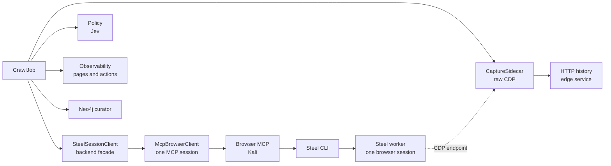

# steel_crawl specification: authenticated full-surface crawl

**Status:** design specification, 2026-10-31; implementation unit and contract tiers complete, 2026-11-02.
**P0:** passed on the local Steel deployment.
**Prototype:** passed on the public fixture.
**Implementation:** the unit and contract tiers are complete.
The live gate is the pool E2E on the eval server (`tests/e2e/test_steel_crawl_pool_e2e.py`, phase F); the retired three-target cloud/CLI bundle (`eval/steel-crawl-e2e/`) is historical setup reference and its measured runs are in `eval/steel-crawl-e2e/NFR-REPORT.md` and `eval/steel-crawl-e2e/ASSERTIONS.md`.
**Design history:** `docs/design/steel-crawl-workbench.md`.
**P0 evidence:** `docs/experiments/p0-steel-cdp-sidecar.md`.
**Prototype:** `docs/experiments/crawl_proto_local.py` and `docs/experiments/runs/crawl-proto-20261031T164759Z/`.

## 1. Scope

`steel_crawl` is one authenticated crawl of one web application.

It attaches to a pre-authenticated Steel browser session.
It drives the browser only through the Steel CLI.
It captures the network only through a passive CDP sidecar.
It traverses the application with one depth-first search.
It writes a graph-ready manifest and the HTTP-history evidence.

The crawl does not sign in.
The crawl does not repair an unauthenticated session.
The crawl does not fetch source maps.
The crawl does not infer a chunk identity or an endpoint profile.
The crawl does not stop on a fixed page or depth cap.
The Steel session is the bound.

## 2. Requirements

### 2.1 Session and authentication

| ID | Requirement | Acceptance |
| - | - | - |
| A1 | Mount exactly one durable Steel session by its stable pool key. | `browser_start(<key>)` returns the runtime id, `restored`, and the CDP endpoint. |
| A2 | Never start a twin. A name mounted elsewhere is `session_in_use`. | The crawl has no raw `start` command; the browser MCP owns the lease. |
| A3 | Run the authenticated-context oracle once before traversal. | The oracle outcome is `authenticated`. |
| A4 | The oracle is a browser fetch to `overview.auth_probe.url`. | `2xx` with `redirected: false` passes. |
| A5 | `401`, `403`, any `3xx`, or `redirected: true` fails. | The run returns `auth_precondition_failed`. |
| A6 | Anything else is indeterminate and fails closed. | The run returns `auth_precondition_failed`. |
| A7 | A missing oracle is loud. | The run logs the missing probe and uses the legacy surface gate. |
| A8 | The legacy gate rejects login redirects, `401`, `403`, and any `3xx`. | No anonymous continuation. |
| A9 | On failure, return a typed failure and let the orchestrator resurrect. | One bounded retry through the authn skill and the auth store. |
| A10 | A known loss is `session_missing` or `no_session`, not a typo. | The next stable-key start restores the saved state. |
| A11 | The pool store is the only browser-state store. | Cookies and localStorage restore; all four fields are captured. |
| A12 | The gateway records the stable key in `accounts.<account>.steel.state`. | The crawl mounts the same key. |
| A13 | The crawl budget is 600 seconds; time is the only bound. | No action cap exists. |
| A14 | An incomplete stop carries `manifest.run.partial`. | A partial manifest routes to reduced coverage. |

The oracle is never a navigation envelope.
`navigate` follows a `302` and reports success with the final `200` URL.
The fetch exposes `redirected` and the true status.
The stable key is `steel-<project_slug>` without an account and
`steel-<project_slug>-<account_slug>` with one.
The key is deterministic across runs; the run id never enters it.

### 2.2 Traversal

| ID | Requirement | Acceptance |
| - | - | - |
| T1 | Seed the frontier with the target root. | The first page visit is `/`. |
| T2 | Scope is the base host plus its subdomains. | External links are ignored. |
| T3 | Traverse with one unified DFS. | The page stack and the consumed sets drive the order. |
| T4 | Jev owns the next choice. | The policy sees the candidates and the decision tree. |
| T5 | A navigation is a normal candidate. | The result page becomes current and the parent is pushed. |
| T6 | A local action is a normal candidate. | The page is restored and the next candidate is chosen. |
| T7 | A page with no unconsumed candidate is a leaf. | The crawler pops the nearest ancestor with residue. |
| T8 | The root is the last page popped. | The run ends at frontier exhaustion or the session deadline. |
| T9 | The consumed set survives a local state change. | It is keyed by the page instance, not the state signature. |
| T10 | The stop reason is recorded. | `frontier_empty`, `session_deadline`, `session_missing`, `operator_cancel`, or a typed error. |

### 2.3 Interaction

| ID | Requirement | Acceptance |
| - | - | - |
| I1 | Enumerate the candidate surface from the cached DOM snapshot. | Every candidate has a stable identity and a channel. |
| I2 | The projection is the compact CLI snapshot, formatted like browserclaw. | The line count is bounded and the refs are document-scoped. |
| I3 | The element map decides `offer`, `collect`, or `ignore`. | No element is both offered and collected. |
| I4 | The exclusion set drops the certainly non-interactable elements. | The map covers the remaining candidates. |
| I5 | The policy chooses only from the `offer` set. | `collect` elements are never acted on. |
| I6 | The executor re-resolves a cached identity before acting. | A missing element is `stale_element` and is consumed. |
| I7 | Every variadic verb carries `--`. | No command is refused for a missing boundary. |
| I8 | `select` is proven by a read-back. | A mismatch is a failed action. |
| I9 | `press` takes one key. | Modifier chords and multi-character strings are not used. |
| I10 | Form submission uses `requestSubmit()`. | `form.submit()` is the last resort. |

### 2.4 Safety

| ID | Requirement | Acceptance |
| - | - | - |
| S1 | The forbidden categories are auth state, payment, and destruction. | The policy removes them before any choice. |
| S2 | `choose_removed` depletes the unsafe set. | It repeats until `none`. |
| S3 | A removed element is consumed and collected in place. | The declared endpoint is recorded, never submitted. |
| S4 | `choose_chosen` only sees the remaining set. | The chosen set is structurally free of removed elements. |
| S5 | There is no probability threshold. | The decision is the maximum of the supplied criteria. |
| S6 | There is no post-submit auth oracle and no per-navigation auth gate. | The precondition is the only auth check. |
| S7 | The removal is the structural guard against declassification. | The residual risk is a false negative in `choose_removed`. |
| S8 | A stale removal answer is a protocol error. | The run records it and does not execute. |

### 2.5 Capture

| ID | Requirement | Acceptance |
| - | - | - |
| C1 | Attach a passive CDP client to the session's raw CDP endpoint. | The client receives events and sends no action method. |
| C2 | Enable `Network`, `Page`, `Runtime`, and `Debugger`. | Request, response, body, navigation, and script events arrive. |
| C3 | Capture the request and response lifecycle, headers, status, mime, timing, initiator, and resource type. | Every flow has a full record. |
| C4 | Capture response bodies for `Document`, `XHR`, `Fetch`, and `Script` with a byte cap. | The body reference and the truncation state are recorded. |
| C5 | Capture the WebSocket handshake bidirectionally and both frame directions. | The handshake is an HTTP artifact; the frames are realtime records. |
| C6 | Capture HTTP/3 flows from CDP. | `http_version` is `h3`. |
| C7 | Capture `Debugger.scriptParsed` as a `ScriptAsset`. | The script URL is absolute; the script id and provenance are recorded. |
| C8 | Do not fetch or store source maps. | No source-map request is issued by the crawl. |
| C9 | Correlate every flow to a page visit and, when possible, an action. | The flow carries the page and action ids. |
| C10 | Fail the run when the sidecar is unavailable. | `capture_unavailable`; no false success. |

### 2.6 Parameters and forms

| ID | Requirement | Acceptance |
| - | - | - |
| P1 | Observe parameters only from network flows. | Query, id-looking path segments, and body attributes. |
| P2 | Record the name, location, and shape, never the value. | The graph has no parameter value. |
| P3 | A collected form records `DeclaredEndpoint` and `DeclaredField`. | The declared record is separate from the observed one. |
| P4 | A form is submitted once per state, except the removed set. | One submit record; a removed form has none. |
| P5 | The form projection carries the field contract. | Name, type, label, options, pattern, min, max. |
| P6 | Jev chooses a `ValueCatalogue` key per field. | The executor types the value locally. |
| P7 | A single matching catalogue entry skips the Jev call. | The executor uses it. |
| P8 | No matching entry uses `none` and skips the field. | A required missing field skips the form. |

### 2.7 Output and operations

| ID | Requirement | Acceptance |
| - | - | - |
| O1 | Emit manifest v2 with `run`, `endpoints`, `parameters`, `scripts`, `realtime`, `errors`, `stats`. | The schema validates. |
| O2 | Keep v1 parsing compatible. | An old manifest parses to the same deltas. |
| O3 | Pages and actions live in the observability platform. | The manifest references their ids only. |
| O4 | Flush the HTTP-history ledger on every exit. | `finalize` runs on success and failure. |
| O5 | Start partial graph ingestion on every exit. | `partial=true` and a coverage report. |
| O6 | Return a typed error and a recovery directive for every failure. | The error table covers the run. |
| O7 | Never log the connect URL, cookies, storage values, or credentials. | A secret scan of the log is clean. |
| O8 | Stop the owned session and prove the catalogue clean. | No entry for the owned name. |

## 3. Architecture



The browser MCP owns the lease and runs the CLI.
The CLI drives the one worker.
The sidecar observes the same session over the CDP endpoint the MCP returned.
The policy chooses actions and touches neither.
The observability platform owns the page and action records.
The HTTP-history edge owns the flow evidence.
The graph owns the endpoints, parameters, and scripts.

### 3.1 Modules

```text
src/polymerhus/recon/crawl/steel/
├── job.py              # CrawlJob: lifecycle, deadline, finalize
├── session.py          # SteelSessionClient + CliBackend: identity and backend facade
├── mcp_client.py       # McpBrowserClient + McpBackend: MCP session, typed errors
├── auth.py             # AuthOracle: probe fetch and classification
├── state.py            # BrowserState: page node, snapshot cache, consumed set
├── command.py          # Action -> SteelCommand -> SteelResult -> error
├── enumerate.py        # Snapshot -> compact candidates -> Element
├── forms.py            # FormLedger and the declared-form collector
├── policy/
│   ├── port.py         # Policy protocol
│   ├── jev.py          # choose_removed, choose_chosen, choose_value
│   ├── prompts.py      # the prompt contract
│   └── select.py       # choice outcome and value selection
├── safety.py           # forbidden categories and removal bookkeeping
├── parameters.py       # observed and declared records
├── frontier.py         # unified DFS, page stack, backtracking
├── run.py              # the real run loop wiring
├── capture/
│   ├── sidecar.py      # raw CDP attach, targets, events
│   ├── flow.py         # flow records and body store
│   ├── typing.py       # initiator, ScriptAsset
│   └── history.py      # normalize_cdp_flow, HTTP-history client
├── manifest.py         # v2 schema and writer
└── ledger.py           # append-only run ledger
```

### 3.2 Ownership

| Concern | Owner | Decides | Never decides |
| - | - | - | - |
| Run lifecycle | `CrawlJob` | mount, stop, deadline, finalize | element identity, safety |
| Session lifecycle | `SteelSessionClient` and the browser MCP | mount, exec, end | crawl order |
| Worker lease | Browser MCP `LeaseManager` | worker, heartbeat, TTL, release | element choice |
| Authentication | `AuthOracle` | authenticated or not | traversal, action |
| Command construction | `CommandMapper` | exact CLI string and recovery | target choice |
| Ref validity | `BrowserState` | valid or stale | element ranking |
| Candidate set | `Enumerator` | elements and order | next action |
| Next action | `Policy` | chosen action and removed element | execution |
| Safety | `Policy` (`choose_removed`) | forbidden or allowed | execution |
| Traversal | `Frontier` | next page, backtrack | action choice |
| Network capture | `CaptureSidecar` | flow records | any browser action |
| Attribution | `FlowTyper` | page, action, script | endpoint classification |
| Observability | `CrawlJob` | page and action records | graph mapping |
| HTTP history | `HistoryClient` | normalized flow batch | graph mapping |
| Graph mapping | `parse_steel_crawl` and curator | asset deltas | crawl |

## 4. Steel interaction contract

The crawl addresses the browser MCP at `KALI_BROWSER_MCP_URL`.
The MCP exposes exactly three tools: `browser_start`, `browser_exec`, and
`browser_end`.
The browser MCP runs in Kali and owns the Steel CLI, the worker lease, the
pool store, the heartbeat, and the TTL.
The crawl never runs the CLI and never sees the worker's HTTP origin.

The MCP tool results use one envelope: `success: true` plus the payload, or
`success: false` plus `error: {code, message, retryable, recovery?}`.

### 4.1 Session record

`SteelSession` carries:

```text
session_id, name, status, viewer_url, debug_url, debugger_url,
websocket_url, cdp_host, created_at, remaining_ms,
inactivity_timeout_ms, source
```

The session id and the name are the stable identity pair.
The name is the stable pool key and can be reused after a release.
The runtime id is the tiebreaker.
`websocket_url` is the CDP URL the sidecar connects to; it is secret and stays
in memory.
`cdp_host` is the Host the CDP handshake presents (`localhost:<port>`).
The browser MCP returns both from `browser_start`.

`SteelSessionRegistry` observes start, catalogue, API, and stop.
The registry never starts, stops, or releases a session.
The lifecycle owner calls the observations.

`SteelSessionClient` is a facade over one backend.
The production backend is `McpBackend` over `McpBrowserClient`; the local CLI
backend remains for a local-only deployment and for the engine contract tests.
The facade owns `cdp_endpoint` and the attachment identity; the backend owns
the transport and the error mapping.

### 4.2 Live view

A view is addressable only when the URL carries the session id in a path segment or a query value.
The self-hosted runtime exposes a shared debug player, not a session-addressed viewer.
The crawl publishes the session id with the live view.
It marks the shared player `addressable=false`.

### 4.3 Lifecycle

- The gateway mounts the stable key with `browser_start`.
  It validates the oracle in that session, signs in or mints on failure, and
  calls `browser_end`.
  A successful end captures and saves the state under the key.
  The gateway then writes `accounts.<account>.steel.state = <key>`.
- The crawl mounts the same key with `browser_start` and calls `browser_end`
  in its finalize close.
- `browser_start` restores cookies and localStorage from the pool store; all
  four captured fields are evidence on the end record.
- One MCP session is one lease.
  A name mounted elsewhere answers `session_in_use`.
  A missing lease answers `no_session`, which maps to `SessionMissing`.
- A mount failure is `restore_failed`, `pool_exhausted`, or
  `browser_unavailable`; none of them is a silent anonymous continuation.
- The MCP TTL, MCP close, and `browser_end` release the lease.
  The heartbeat keeps an idle lease alive; it is never a release signal.
- `remaining_ms` on the start result sits below the requested window.
- A foreign `default` is untouchable.

### 4.4 Envelope and errors

`browser_exec` returns the CLI's own command envelope for a command-level
result: `data`, `error`, `warning`, and the optional `steel_events`.
A refusal, a missing lease, a pool failure, or a capture failure returns the
MCP's typed error envelope instead.

`SteelResult` is the action-level projection:

```text
output, success, error, warning, steel_events, exit_code, stderr,
duration_ms, read_back
```

The CLI path fills the process facts (`exit_code`, `stderr`, `duration_ms`).
The MCP path leaves them empty or `None`; it never fabricates them.
`error` is authoritative over any success flag and over the text.

The crawl's typed errors are:

| CLI code | Meaning | Recovery |
| - | - | - |
| `unknown_session` | The name was never live. | Choose a live name. |
| `session_missing` | The name was live and is gone. | Remount the stable key with state restore. |
| `session_taken` | A start named a live session. | Reuse the live session. |
| `target_lost` | The CDP target disappeared. | Open a tab, then retry the read. |
| `browser_stuck` | The command exceeded its browser budget. | End the session and remount. |
| `invalid_command` | The CLI rejected the grammar. | Fix the command. |
| `command_failed` | The execution surface raised. | Inspect. |
| `guard_error` | The guard failed. | Surface the payload; do not route around it. |

The browser MCP's own codes map onto the same typed surface:

| MCP code | Crawl error |
| - | - |
| `no_session` | `SessionMissing` |
| `session_in_use` | `SessionTaken` |
| `invalid_command`, `invalid_argument` | `InvalidCommand` |
| `guard_error` | `GuardError` (payload preserved) |
| `pool_exhausted`, `pool_unavailable`, `browser_unavailable` | `BrowserUnavailable` |
| `restore_failed` | `RestoreFailed` |
| `store_error`, `lease_error`, `capture_failed`, `browser_error`, `internal_error` | `CommandFailed` |

### 4.5 Auth oracle

The store records `overview.auth_probe.url`, a deployment-neutral path.
The auth feed resolves it against the project's canonical origin and passes it as `browser_auth["auth_probe"]`.
The crawl navigates to the root, then runs the fetch from that page:

```text
fetch(url, {redirect: "follow", credentials: "include", cache: "no-store"})
```

The canonical script is `references/auth-oracle.sh`.
The classification is fixed:

- `2xx` with `redirected: false` -> authenticated.
- `401`, `403`, any `3xx`, or `redirected: true` -> unauthenticated.
- anything else -> indeterminate.

A navigation envelope is not the oracle.
A missing oracle is loud; the legacy surface gate is the fallback and rejects `3xx`.

### 4.6 Canonical scripts

- `auth-oracle.sh`: the fetch oracle.
- `navigate-read.sh`: navigate, title, URL, compact tree slice.
- `interact-batch.sh`: snapshot, fill, read-back.
- `session-records.py`: metadata, live view, snapshot, screenshot, record probes.
- `select-elements.py`: DOM family selection, attributes, visibility, bounded JSON.
- `load-eval.py`: load, wait, eval one expression or file, bounded JSON.
- `spider-bounded.sh`: enumerate links, same-host filter, capped navigation.

### 4.7 Batch boundary

Every variadic verb carries `--`: `fill`, `type`, `setvalue`, `select`, `upload`.
`batch` carries its own `--`, and every variadic element carries its own.
A missing boundary is `refused:variadic-boundary`, not a retry.

## 5. Traversal

The traversal is one depth-first search over page instances.
There is no separate local axis and page axis.

```text
current = root_page
stack = []                       # parent page nodes with residue
consumed = map[snapshot_key -> set[fingerprint]]
cache = map[snapshot_key -> DomSnapshot]

while current is not none and not deadline_expired:
    if not restore(current):
        mark_unrecoverable(current)
        current = pop_nearest_with_residue(stack, consumed, cache)
        continue

    candidates = [
        e for e in project(cache[current.cache_key]).candidates
        if e.channel == "offer"
        and e.fingerprint not in consumed[current.cache_key]
    ]
    if not candidates:
        current = pop_nearest_with_residue(stack, consumed, cache)
        continue

    while True:
        removed = policy.choose_removed(current, candidates)
        if removed is none:
            break
        if removed.id not in candidates:
            record_stale_removal(removed)
            break
        consumed[current.cache_key].add(removed.fingerprint)
        dom_collector.collect(removed)
        candidates.remove(removed)

    chosen = policy.choose_chosen(current, candidates)
    if chosen is none:
        current = pop_nearest_with_residue(stack, consumed, cache)
        continue

    execute(chosen)
    consumed[current.cache_key].add(chosen.fingerprint)
    result = observe()
    record_visit(result, parent=current)

    if chosen.semantics.impact == "navigate":
        stack.append(current)
        current = result.page
    else:
        restore(current)
```

`pop_nearest_with_residue` pops the stack until it finds a page with an unconsumed candidate.
The root is the last page popped.
The traversal ends when no page has residue.

### 5.1 Page instance

The page is a node in the navigation tree.
It carries the observability `page_visit_id`.
The browser-state tracker owns the DOM snapshot cache.
The cache key is:

```text
sha256(normalized_url + action_fingerprint_path)
```

The action fingerprint path is the exact ordered list of navigation fingerprints that yielded the page.
It does not include local_state actions, because they are not replayed.
The cache stores the CLI DOM snapshot, not the compact projection.
The compact projection is derived from the cached snapshot.
The consumed set is keyed by the cache key.

### 5.2 Restore

A rollback navigates to the page node's URL.
It does not replay local_state actions.
It does not re-enumerate the page into a new page instance.

The CLI's refs are document-scoped: a reload assigns a new ref registry, so the
cached `@ref` values are dead even when the URL and the surface are unchanged.
The executor therefore takes exactly one fresh snapshot after the reload and
re-projects the cached page's candidates from it; that is a ref refresh, not a
new page visit.
The fresh snapshot is stamped with the new `DocumentGeneration`.
The executor acts on a ref that belongs to the live document.
If the cached element's fingerprint is absent from the fresh projection, the
action fails with `stale_element` and the candidate is consumed.
The root needs no initial restore: the page factory just loaded it, so its
snapshot and refs are already the live document's.

### 5.3 Visited and state

`state_key = sha256(normalized_url + ax_hash + overlay_flags)`.
The `ax_hash` is the sorted hash of `(role, name)` for the visible interactive nodes.
The `overlay_flags` is the set of open dialog titles.
The visited set is keyed by `state_key`.
The page instance key is the snapshot cache key.
The `DocumentGeneration` is the ref-validity token.

### 5.4 Effect signal and its limits

The effect signal is the observable crawl state, not the full browser state.
It compares the normalized URL, the document title, the visible dialog set, and the projected interactive surface.
The projected surface carries the control facts: a target's hidden state, the target's candidate projection, and the consumed count.

The signal deliberately does not track:

- CSS classes and arbitrary attributes;
- focus, selection, and scroll position;
- input values and checked state;
- `history.length`;
- `localStorage`, `sessionStorage`, and IndexedDB;
- framework memory such as a Vuex or Redux store.

These changes are accepted as not crawl-relevant.
They do not reveal a new route, a new form, a new endpoint, or a new network flow.
A menu that only changes its active class is not new surface.
A storage write that does not change the rendered surface is not new surface.

The residual risk is explicit.
A target can hide new surface behind an attribute-only or storage-only change.
An `aria-expanded` toggle that reveals a submenu, a tab that activates a hidden panel, or a storage flag that unlocks a form can be missed.
The crawl then under-counts the effect and the policy can waste actions or miss a branch.

The mitigation is already in the projection.
A candidate whose control facts show a hidden target with unconsumed candidates is ranked above one without.
That covers the common `aria-controls` and `data-target` reveal.

If a future run shows an organic precision or recall loss from the omitted signal, the risk is reduced with a richer fingerprint:

- a full DOM or ARIA hash, not a text-length proxy;
- the visible dialog and overlay set;
- `aria-expanded`, checked, value, and focus state;
- `history.length`;
- `localStorage` and `sessionStorage` hashes.

The richer fingerprint is a measured response to observed harm, not a default.
The coarse signal is the accepted default until a run demonstrates the harm.

## 6. Element model

### 6.1 Exclusion set

These are not candidates.

| Family | Elements | Reason |
| - | - | - |
| Form fields | `input` (all types), `select`, `textarea`, `option`, `optgroup`, `datalist`, `output`, `progress`, `meter`, `[contenteditable]` | The form is the unit. Values are network-observed. |
| Text and structure | `html`, `head`, `body`, `div`, `span`, `p`, headings, lists, tables, sections, articles, labels, fieldsets, and the other text-level elements | No interaction signal, no network effect. |
| Metadata and resources | `script`, `style`, `link`, `meta` except refresh, `base`, `title`, `template`, `noscript`, `img`, `picture`, `source`, `track`, `embed`, `object`, `param`, `map`, `canvas` without a signal, `svg` without a signal, `math` without a signal | Artifacts are captured by CDP. No DOM interaction. |
| State containers | `dialog`, `details` | State containers. The controls inside are candidates. `summary` is the candidate for `details`. |
| Hidden and inert | `[hidden]`, `[inert]`, `[aria-hidden=true]`, `display:none`, `visibility:hidden` | Not visible or not interactive. |
| Non-HTTP schemes | `javascript:`, `mailto:`, `tel:`, `data:`, `blob:` | No HTTP surface. |

An unknown element with an interactive signal maps to `CUSTOM`.
An unknown element without a signal is ignored.

### 6.2 Three-layer map

| Raw signal | Internal `ElementType` | Default channel |
| - | - | - |
| `a[href]` same-origin http(s) | `LINK` | offer |
| `a[href]` cross-origin http(s) | `EXTERNAL_LINK` | ignore |
| `area[href]` same-origin | `AREA` | offer |
| `area[href]` cross-origin | `EXTERNAL_AREA` | ignore |
| `form[action]` same-origin, or form with no action | `FORM` | offer |
| `form[action]` cross-origin | `EXTERNAL_FORM` | ignore |
| `button` not submit | `BUTTON` | offer |
| `button[type=submit]` | `FORM` | offer |
| `summary` | `DISCLOSURE` | offer |
| `[role=button]` | `ROLE_BUTTON` | offer |
| `[role=link]` | `ROLE_LINK` | offer |
| `[role=tab]` | `TAB` | offer |
| `[role=menuitem]`, `[role=menuitemcheckbox]`, `[role=menuitemradio]` | `MENU_ITEM` | offer |
| `[role=treeitem]` | `TREE_ITEM` | offer |
| `iframe[src]` same-origin | `IFRAME` | offer |
| `iframe[src]` cross-origin | `EXTERNAL_IFRAME` | ignore |
| `frame[src]` same-origin | `FRAME` | offer |
| `[onclick]` on a non-field element | `CLICKABLE` | offer |
| `[tabindex]` with a role or handler | `CUSTOM` | offer |
| `[draggable=true]` | `DRAGGABLE` | offer |
| `svg[onclick]`, `svg[role=button]` | `CLICKABLE` | offer |
| `canvas[onclick]` | `CLICKABLE` | offer |
| `a[download]` or a file-extension href | `DOWNLOAD` | collect |
| `meta[http-equiv=refresh]` | `META_REFRESH` | offer |
| `dialog[open]`, `[role=dialog]`, `[aria-modal=true]` | `DIALOG_STATE` | ignore |
| custom element with a role or handler | `CUSTOM` | offer |
| custom element without a signal | `CUSTOM` | ignore |

The `ElementType` enum is closed.
The project setting maps each core type to `offer`, `collect`, or `ignore`.
It may add raw-selector rules with a core type.
A new semantic type is a code change.

### 6.3 Channels

| Channel | Offered to Jev | DOM collector | Network capture |
| - | - | - | - |
| `offer` | Yes | No | Yes, as the action is exercised |
| `collect` | No | Yes, in place | No |
| `ignore` | No | No | No |

The `collect` set is `DOWNLOAD` and the forms the project maps to collect.
A `choose_removed` element is also collected in place.
The `EXTERNAL_*` types are ignored.

### 6.4 Impact classes

| Class | Meaning |
| - | - |
| `observe` | No DOM or network change. |
| `local_state` | DOM-only change. No request. |
| `read` | A request that reads data. No server state change. |
| `write` | A request that changes server state. |
| `navigate` | A document or frame navigation. |
| `download` | A file download. Collected. |
| `external` | A cross-origin target. Ignored. |
| `context_reset` | A logout, login, or session switch. Removed before prioritisation. |

The offer order is `observe`, `local_state`, `read`, `write`, `navigate`.
`download`, `external`, and `context_reset` are not offered.

The impact class is not the capture channel.
The capture channel is `dom`, `network`, `navigation`, or `none`.
A submitted form has `impact` `write` or `navigate` and `capture` `network`, plus `navigation` when the response is a document.

### 6.5 Change semantics

```python
class ControlFact(BaseModel):
    target_id: str
    hidden: bool
    target_projection: list[str]
    consumed_count: int

class ChangeSemantics(BaseModel):
    impact: ImpactClass
    capture: Literal["dom", "network", "navigation", "none"]
    method: str | None
    action: str | None
    target: str | None
    may_navigate: bool
    controls: list[str]
    control_facts: list[ControlFact]
    handler: Literal["href", "onclick", "onsubmit", "listener", "unknown"]
    confidence: float
```

`controls` is the list of IDREFs from `aria-controls`, `data-target`, or an `href` fragment.
`control_facts` reports the current state of each target: hidden, the full compact projection of the target's candidates, and the consumed count.
Each projection line carries a consumed marker.
The symbolic layer provides the facts.
Jev evaluates the new-surface property in the decision tree.

### 6.6 Decision tree

```text
choose_chosen(candidates):
  1. If candidates is empty, return none.
  2. Group by impact. The instance impact is authoritative.
  3. For each class in [observe, local_state, read, write, navigate]:
       if the group is non-empty, rank the group and return the best candidate.
  4. rank(group):
       a. known change semantics over unknown;
       b. a candidate whose control facts show a hidden target with unconsumed candidates over one without.
  5. If the chosen impact is navigate, push the current page and make the result current.
  6. Otherwise, record the result, restore the current page, and continue.
  7. When the current page has no unconsumed candidate, pop the nearest ancestor with residue.
```

The impact order is a soft prior.
Jev owns the final choice.
A navigation is a normal candidate, not a boundary.
The browser-state module backtracks to the nearest page with residue.

### 6.7 Prompt contract

The `choose_removed` prompt:

```text
You are removing unsafe elements from the crawl candidate set.
Forbidden categories: auth state, payment, destruction.
Keywords: login, logout, signin, signout, password, reset, mfa, otp,
pay, purchase, checkout, donate, delete, destroy, deactivate, close account,
purge, revoke.
Account registration is a safe write, not auth state.
Do not remove a registration form.
Choose the single candidate that belongs to a forbidden category.
Choose none if no candidate belongs to a forbidden category.
Do not choose a candidate for any other reason.
```

The `choose_chosen` prompt:

```text
You are choosing the next element to exercise on the current page.
Impact order: observe, local_state, read, write, navigate.
Choose the lowest non-empty impact class.
Within the class, prefer known change semantics, then a candidate whose
control facts show a hidden target with unconsumed candidates.
Choose none if no candidate remains.
```

Each criterion carries the element id, type, label, impact, capture, and change semantics.
The element-type cluster is a reference, not a strict order.

## 7. Safety

The removal stage is sequential.
It repeats until `choose_removed` returns `none`.

```text
while True:
    removed = policy.choose_removed(page, candidates)
    if removed is none:
        break
    if removed.id not in candidates:
        record_stale_removal(removed)
        break
    candidates.remove(removed)
    consumed[page.cache_key].add(removed.fingerprint)
    dom_collector.collect(removed)
```

Each iteration removes one candidate.
The loop terminates in at most the candidate count.
A stale answer is a protocol error, not a reason to execute.

The forbidden categories are auth state, payment, and destruction.
The semantic deny lives in the `choose_removed` instructions.
There is no separate classifier and no Noul gate.
The removed element is collected in place.
The `choose_chosen` question only sees the remaining elements.

The crawl runs the oracle once before traversal.
It does not run a post-submit oracle.
It does not run a per-navigation gate.
The removal stage is the structural guard against declassification.
The residual risk is a false negative in `choose_removed`.
Time-based app-session expiry is a run bound, not a safety gate.
The Steel session clock or the operator stop bounds the run.

## 8. Forms, parameters, and values

### 8.1 Form contract

An offered form carries:

```text
action (absolute), method, enctype,
fields: name, type, label, options, pattern, min, max, checked, selector
```

There is no `required` field in the model.
The DOM `required` attribute may still exist; `requestSubmit()` honors native validation.
The executor fills every field it can.

### 8.2 ValueCatalogue

```json
{
  "values": {
    "email":    {"value": "qa-crawl+<run>@example.test", "kind": "email",  "description": "valid email"},
    "search":   {"value": "test",                        "kind": "text",   "description": "short search term"},
    "name":     {"value": "QA Crawler",                  "kind": "text",   "description": "person name"},
    "number":   {"value": "42",                          "kind": "number", "description": "small integer"},
    "date":     {"value": "2026-01-01",                   "kind": "date",   "description": "ISO date"},
    "url":      {"value": "https://example.test/",        "kind": "url",    "description": "valid URL"},
    "file":     {"value": "crawl-upload.txt",             "kind": "file",   "description": "small text file"},
    "first":    {"value": "__first_option__",             "kind": "option", "description": "first non-empty option"},
    "none":     {"value": null,                           "kind": "none",   "description": "leave empty"}
  }
}
```

Jev returns one choice per question.
The protocol is:

1. The form projection carries the field contract.
2. If exactly one catalogue entry matches the field kind, the executor uses it without a Jev call.
3. If more than one matches, ask a `choose_value` question over the catalogue keys.
4. If none matches, use `none` and skip the field.
5. If a required field is skipped, skip the form.
6. The manifest records the chosen `value_keys`, never the values.

The value never enters the Jev request.
The executor validates the chosen value against the pattern, min, max, and options.
The executor types the value locally.

### 8.3 Parameter sources

For an offered element, the network is the parameter source.
For a collected element, the declared DOM contract is the source.

The observed extractor records:

- URL query parameters.
- Path segments that look like identifiers.
- Body payload attributes from JSON, form-urlencoded, and multipart bodies.

The record is:

```text
ObservedParameter{endpoint_key, method, location, name, value_shape,
                  source_flow_id, content_type}
```

`value_shape` is a type and a length band, never the value.
There is no rank and no secret-value drop.
Deduplicate by `(endpoint_key, location, name, kind)`.

The DOM collector writes `DeclaredEndpoint` and `DeclaredField`, not `ObservedParameter`.
The declared field carries the field contract.
The two sources never merge silently.

### 8.4 Graph identity

The graph `Endpoint` identity is `path`, `method`, `baseurl`.
The graph props are `url`, `source`, `status_code`.
The crawl does not set `profile`; the httpx_reprofile phase sets it.

The graph `Parameter` identity is `name`, `position`, `endpoint_path`, `baseurl`.
The declared record carries the field contract.
The observed record carries the shape only.

The crawl `endpoint` record:

```text
endpoint_id, provenance, method, url, path, baseurl, status_code, source,
resource_type, http_artifact_id, source_page_id, action_id, enctype, field_names
```

The crawl `parameter` record:

```text
parameter_id, endpoint_id, provenance, endpoint_path, baseurl, position, name,
value_shape, http_artifact_id, content_type, field_type, label, options,
pattern, min, max
```

`provenance` is `observed` or `declared`.

## 9. Capture

### 9.1 Raw CDP endpoint

The browser MCP returns the CDP endpoint on `browser_start`:
`cdp_url = ws://<worker-container-ip>:3000/` and
`cdp_host = localhost:3000`.

The sidecar opens its socket to the worker container address and sends the
handshake with `Host: localhost:3000`.
The worker API's CDP proxy forwards that Host to Chrome, which rejects any
other Host.
The URI is `ws://localhost:3000/`; the `websockets` `sock` parameter separates
the connect address from the Host header.

The worker's raw Chrome debug port stays inside the worker container.
The browser MCP's reverse proxy owns the loopback public port the CLI uses;
that port is never published on the host.
The agent reaches the worker over `polymerhus-net`; it never sees the worker's
HTTP origin or its published port.

The sidecar enables:

```text
Page.enable
Network.enable
Network.setCacheDisabled
Runtime.enable
Debugger.enable
```

It sends no navigation, input, or DOM-mutating method.

### 9.2 Network events

The sidecar records:

- `Network.requestWillBeSent`: method, URL, headers, post data, resource type, initiator, frame id.
- `Network.responseReceived`: status, headers, mime type, connection, timing.
- `Network.loadingFinished`: encoded length, body fetch.
- `Network.loadingFailed`: error text.
- `Network.webSocket*`: handshake and frame events.
- `Debugger.scriptParsed`: script id, URL, source map URL ignored.
- `Page.frameNavigated`: frame URL and parent.
- `Page.javascriptDialogOpening`: auto-dismiss with `Page.handleJavaScriptDialog {accept: true, promptText: "test"}`.

The body fetch runs on `loadingFinished` for `Document`, `XHR`, `Fetch`, and `Script`.
The body is capped per response and per run.
A truncated body carries the original size and the reason.

A request URL is capped at 2 KiB.
An analytics beacon can carry a payload as a path segment or a query value; the cap keeps one flow's URL, and every graph record derived from it, bounded.
A capped URL carries `url_truncated=true` and its original length.

A realtime frame always carries its direction, opcode, size, and SHA-256 digest.
Its raw payload is a bounded prefix: 16 KiB per frame, an 8 MiB payload budget per run, and at most 20,000 frame records.
A truncated frame carries `payload_truncated=true`.
A chatty socket can therefore never grow the manifest without bound.

### 9.3 WebSocket and HTTP/3

The WebSocket handshake request and the `101` response are an HTTP artifact.
Both frame directions are realtime records.
HTTP/3 flows are captured from CDP and carry `http_version="h3"`.
The mitmproxy addon cannot see HTTP/3; that is documented.

### 9.4 Script assets

`ScriptAsset = {script_url, script_id, provenance}`.
`script_url` is absolute.
The crawl resolves relative URLs and deduplicates by URL.
The crawl does not fetch or store source maps.
The JS client-side code analysis phase owns source-map retrieval.

A script under a canonical vendor root is not a graph Endpoint.
The roots cover the common package and framework layouts: `/lib/`, `/libs/`, `/libraries/`, `/vendor/`, `/node_modules/`, `/bower_components/`, `/jspm_packages/`, `/webjars/`, `/third_party/`, `/external/`, `/deps/`, `/wp-includes/`, `/_next/`, `/_nuxt/`, `/sap/ui/`, `/etc.clientlibs/`, and the equivalent `/static/lib/`, `/js/vendor/`, and `/scripts/lib/` forms.
The script remains a `ScriptAsset`, so its URL, version, and provenance survive for outdated-library evidence.
The path is a strong prior, not proof: an observed endpoint under a vendor root whose body carries a target signal (`/api/`, a target host, `/graphql`, `/rest/`, `/wp-json/`, `/ajax`) stays in the graph.
A re-export barrel or theme-token module is never an Endpoint.
The generated-bundle rule remains separate: a fingerprinted vendor bundle (`vendor-*.js`, `runtime-*.js`) is already static noise.

### 9.5 Correlation

Each flow carries the page visit id and, when available, the action id.
The sidecar sets the current page and action before each CLI action.
An unattributed flow keeps `attribution="unknown"`.

## 10. HTTP history

### 10.1 Normalization

`normalize_cdp_flow` maps a CDP flow to `http-artifact/v1`.
It carries the request, response, headers, cookies, query, form, body references, connection, timings, error, and `capture_context`.

The normalizer strips HTTP/2 pseudo-headers.
It maps `:authority` to `host`.
Body hashes are over decoded bytes.

### 10.2 Edge service

The HTTP-history edge is a separate Kali process on `0.0.0.0:8002`.
It is published only on the compose network.
It is not an MCP tool.
The compose service supplies a shared dev default token; a non-dev deployment overrides `KALI_HTTP_HISTORY_EDGE_TOKEN`.

```text
POST /v1/ingest
Authorization: Bearer <KALI_HTTP_HISTORY_EDGE_TOKEN>
Content-Type: application/json

{
  "project_id": "...",
  "run_id": "...",
  "artifacts": [HttpArtifact, ...],
  "bodies": [{"sha256": "...", "encoding": "base64", "data": "..."}]
}

Response: {"created": N, "duplicates": N, "rejected": N, "errors": [...]}
```

The batch is 100 artifacts or 8 MiB.
The service calls `HttpHistoryStore.record_if_absent`.
The mitmproxy addon keeps its direct write path.
The read tools are unchanged.

### 10.3 Deterministic ID

The current `artifact_id` is a random ULID.
The crawl uses a content ID:

```text
http_ + 26 Crockford base32 characters of
sha256(canonical_json(project, method, canonical_url,
                      canonical_request_headers, request_body_sha256,
                      response_status, canonical_response_headers,
                      response_body_sha256))
```

Volatile headers are removed.
HTTP/2 pseudo-headers are stripped.
Body hashes are over decoded bytes.
Replays keep the caller-provided ID, so lineage is not collapsed.
The first writer's capture context is kept.

### 10.4 Finalize

The crawler appends every artifact and manifest record to a durable ledger.
A body is written to the ledger on its first occurrence only; a later artifact references the same digest, so the ledger stays proportional to the distinct capture budget, not to the flow count.
`finalize` runs on success and on every failure path.
It closes the sidecar, flushes the ledger in batches, assembles a partial manifest, and starts parse, triage, and curate with `partial=true` and a coverage report.
The flush attaches each distinct body to the first artifact that references it; the edge resolves the digest for every later reference.
The HTTP flush and the graph ingestion run in parallel.
If the process is killed, the pipeline job's `finally` runs `finalize` from the ledger.
A failed flush retries with a persisted cursor and leaves the ledger in place.
A partial run is never marked complete.

## 11. Manifest v2

The manifest is the graph input, not the observability log.
Pages and actions are emitted to the observability platform.
Flows are in the HTTP history.
The manifest carries only the graph-bearing records.

```text
schema_version: "steel-crawl/v2"
run:        {crawl_run_id, session_name, account, started_at, finished_at,
             stop_reason, partial, scope, auth}
endpoints:  [endpoint]
parameters: [parameter]
scripts:    [script]
realtime:   [realtime_record]
errors:     [error]
stats:      {endpoints, parameters, flows, bytes, duration_ms,
             removed_elements, unrecoverable_pages}
```

There is no `pages`, no `actions`, no `flows`, no `artifacts`, no `declared_endpoints`, no `declared_fields`, and no `coverage` block.

An observed endpoint carries `vendor_script` when its path is under a canonical vendor root and its body carries no target signal.
The curator drops that endpoint; the `scripts` list still carries the `ScriptAsset`.
A parameter on a vendor script path is dropped with the endpoint, so it cannot re-create it through the graph edge.

A parameter name is a route word, a query key, or a field name, never a data payload: a name longer than 256 characters is not a parameter (a base64 path segment is the canonical case).
One parameter identity is one manifest record; the same `(name, position, endpoint_path, baseurl, kind)` observed on many flows is deduplicated.
An endpoint identity is one record for the same reason.

The v1 parser remains compatible.
The v2 parser is additive.

## 12. Errors and recovery

| Code | Stage | Recovery |
| - | - | - |
| `auth_precondition_failed` | Auth | Orchestrator resurrection, one retry. |
| `session_missing` | Session | Remount the stable key; restore the saved state. |
| `no_session` | Session | Map to `session_missing`; remount the stable key. |
| `session_in_use` | Session | Reuse the mounted name; never twin it. |
| `unknown_session` | Session | Choose a live name. |
| `session_taken` | Session | Reuse the live name. |
| `restore_failed` | Session | Surface the state failure; do not crawl anonymously. |
| `pool_exhausted` | Pool | Retry after a lease ends. |
| `pool_unavailable` | Pool | Surface the pool failure; retry the run. |
| `browser_unavailable` | Pool or MCP | Surface the transport failure; retry the run. |
| `target_lost` | Browser | Open a tab, retry the read. |
| `browser_stuck` | Browser | End the session; remount the stable key. |
| `capture_unavailable` | Capture | Fail the run; do not produce a false success. |
| `session_close_failed` | Finalize | Record the failure; the run is partial. |
| `stale_element` | Executor | Consume the candidate; record the gap. |
| `policy_stale_removal` | Policy | Protocol error; do not execute. |
| `policy_invalid_choice` | Policy | Protocol error; do not execute. |
| `policy_provider_error` | Policy | The decision provider failed; do not execute; record and finalize. |
| `capture_close_failed` | Finalize | Record the close failure; the run stays partial. |
| `manifest_write_failed` | Output | Fail the run; keep the ledger. |
| `http_history_flush_failed` | Output | Retry with the cursor; keep the ledger. |
| `graph_ingest_failed` | Output | Record the failure; the partial run is not complete. |
| `session_deadline` | Run | 600-second budget; finalize as partial. |
| `operator_cancel` | Run | Finalize as partial. |
| `unrecoverable_state` | Traversal | Pop to the nearest ancestor with residue. |

The CLI errors map to `session_missing`, `target_lost`, `browser_stuck`,
`invalid_command`, `command_failed`, and `guard_error`.
The browser MCP's errors map through the table in section 4.4.
`operator_cancel`, `session_deadline`, and `session_missing` are incomplete
runs: the manifest carries `run.partial = true` and the crawl pod routes it to
reduced coverage.

## 13. Observability

The crawl emits page and action records to the observability platform.
A page record carries the visit id, URL, final URL, status, title, parent, depth, discovery source, state key, and document generation.
An action record carries the id, page id, element identity, kind, impact, capture, outcome, and error.

The manifest references the page and action ids.
It does not duplicate the records.

The `steel_events` channel is populated by the CLI path.
The MCP path carries the browser MCP's typed error envelope instead and leaves
the process facts empty; it never fabricates them.
The CDP events are the capture evidence.
The P0 evidence is in `docs/experiments/p0-steel-cdp-sidecar.md`.

## 14. Test and acceptance

### 14.1 P0

The P0 gate passes on the local deployment.

- The pinned CLI starts the session.
- The sidecar attaches to the raw CDP page target on `9223`.
- The CLI navigates and clicks.
- The sidecar captures a CLI-triggered XHR with URL, method, status, initiator, and body.

### 14.2 Prototype

The local prototype ran against `https://the-internet.herokuapp.com/`.

| Metric | Value |
| - | - |
| Pages | 59 |
| Actions | 220 |
| Flows | 1,208 |
| Endpoints | 81 (74 observed, 7 declared) |
| Parameters | 5 (1 observed, 4 declared) |
| Scripts | 24 |
| Removed | 8 |
| Errors | 0 |
| Stop | `session_deadline` |

The prototype removed four `Delete` controls, two login forms, and two password-retrieval forms.
The login and retrieval forms were collected as declared endpoints and never submitted.

The prototype is an experiment.
The production acceptance requires the Jev policy, an authenticated target, the HTTP-history edge, and the graph curation.

### 14.3 Implementation plan

| Phase | Question | Exit |
| - | - | - |
| P0 | Can the CLI and the sidecar share a session? | One CLI-triggered XHR captured. Passed. |
| P1 | Can the crawl attach, authenticate, and track the session? | Oracle passes; stale refs rejected; every command carries the session. |
| P2 | Can the crawl traverse with no model? | Fixture routes visited; element map honoured; no forbidden actions. |
| P3 | Can the crawl capture the full network surface? | Fixture ground truth matched; endpoints and parameters emitted. |
| P4 | Does Jev improve the action choice? | Coverage at or above the deterministic baseline; no safety regression. |
| P5 | Does the crawl survive an expired session? | One resurrection and resume, or a clean named failure. |

### 14.4 Implementation status (2026-11-02)

The implementation is complete in the unit and contract tiers.
The crawl package contains every module in section 3.1 plus the `forms.py`, `run.py`, and `policy/select.py` seams the integration needed.

- P1 is covered by the session, auth, state, and command suites.
- P2 is covered by the element-map and frontier suites and the two-page fixture application.
- P3 is covered by the capture, normalization, history-client, manifest-writer, and manifest-parser suites and the HTTP-history edge suite.
- P4 is covered by the policy, prompt, removal, choice, and value-selection suites.
- P5 is covered by the job lifecycle, the bounded session boundary, and the finalize suites.

The deterministic gate is `tests/recon/crawl/steel`.

### 14.5 Pool convergence status (2026-11-07)

The crawl's production executor is the browser MCP, not an agent-side CLI.
The crawl closes the session before the manifest is built, and a failed save
makes the run partial.
The stable pool key is the only browser-state key.
The pool deployment, proxy, CDP transport, MCP client, and error mapping have
unit and contract coverage:
`tests/kali/test_steel_pool_proxy.py`,
`tests/recon/crawl/steel/test_mcp_client.py`, and
`tests/recon/crawl/steel/test_live_transport.py`.
The live gate is the pool E2E
(`tests/e2e/test_steel_crawl_pool_e2e.py`) on the eval host:
the ComfyUI `steel_crawl` walkthrough and the White Jotter authenticated
walkthrough.
Both are pending phase F of the implementation plan.
The JEV engine diff against `feat/steel-crawl` is empty.
The edge gate is `tests/kali/test_http_history_edge.py`.
The full unit tier is the regression gate.
The job stops the owned session through the session client and proves the catalogue clean on the finalize path.
The form executor fills the fields, validates the chosen values, submits with the command mapper, and marks the ledger only after the dispatch-plus-2xx check.

The live P1 to P5 gate passed on three targets on 2026-11-03: ComfyUI (no auth), SiyuCMS (form login), and PrestaShop (back-office cookie).
The final runs are `e2e-comfyui-20261103T123532Z`, `e2e-siyucms-20261103T091856Z`, and `e2e-prestashop-20261103T075740Z`.
Every run has one `steel_crawl` job with `status=success`, `session_closed=true`, and the edge flush reconciled against the ledger.
The ComfyUI graph is 57 endpoints and 6 parameters after the vendor-script classifier; SiyuCMS is 78 endpoints and 6 parameters; PrestaShop is 117 manifest endpoints and 68 manifest parameters.
The full FR matrix and the HTTP-history database assessment are in `eval/steel-crawl-e2e/FR-ASSESSMENT.md`.
The integration impact map is `docs/design/steel-crawl-integration-impact-map.md`.
The authz residual risk and the coarse effect signal remain accepted as recorded in sections 5.4 and 16.

## 15. Rollout and compatibility

- Pin the CLI to `0.5.0-preview.6` in the Kali image.
- Pin the worker image `steel-browser-api:v0.5.5-beta` and build it for the
  host architecture; the eval host is arm64.
- The browser pool is part of the instance compose project.
  The baseline includes `docker-compose.pool.yml` with `deploy.replicas: 2`;
  the thin stack omits the pool file entirely.
- The browser MCP runs in Kali and owns the three tools, the reverse proxy,
  and the pool store.
- `KALI_BROWSER_MCP_URL` is the agent's only browser address.
  The base is empty; the eval overlay sets `http://kali:8003/mcp`.
- The eval `.env` carries no `STEEL_API_KEY` and no `STEEL_BROWSER_API_URL`.
  `STEEL_API_KEY` remains accepted; when present both Steel clients use the
  cloud.
- The stable key is `steel-<project_slug>[-<account_slug>]`.
  `accounts.<account>.steel.state` holds it.
- Keep the HTTP-history addon and the read tools compatible.
- Keep the v1 manifest parser.
- Keep the v2 manifest parser.
- The graph `profile` remains the httpx_reprofile phase.
- The `ScriptAsset` is the stable contract for the chunk analysis replacement.
- The source maps belong to the JS client-side code analysis phase.

## 16. Risks and limits

| Risk | Mitigation |
| - | - |
| Jev misses an unsafe element. | The residual risk is explicit; the removal is the structural guard. |
| The raw CDP port is exposed. | Publish only on the crawler network; firewall the port. |
| The app session expires by time. | The Steel session clock or the operator stop bounds the run. |
| The local API has no raw CDP route. | The `9223` publish is the current fix; a first-class route is preferred. |
| The sidecar misses OOPIF or worker flows. | Enable `Target.setAutoAttach` in production; the prototype covers the page target. |
| The standalone field controls are excluded. | This is the accepted precision trade. |
| The effect signal omits class, attribute, focus, scroll, storage, and framework-memory changes. | The omitted changes are accepted as not crawl-relevant; control facts cover the common hidden-target reveal. If a run shows an organic precision or recall loss, add the richer fingerprint in section 5.4. |
| Form result pages are not traversed. | Record the result and the declared endpoint; a later run can add the page. |
| The HTTP-history edge is not exercised by the prototype. | The production acceptance requires the edge and the graph. |
| The prototype's deterministic policy is not Jev. | The Jev policy is the P4 gate. |

## Appendix A: Command map

| Family | Command | Use |
| - | - | - |
| Session | `start --session <name> --session-timeout <ms> --inactivity-timeout <ms>` | Orchestrator only; the crawl never starts. |
| Session | `sessions` | Catalogue and liveness. |
| Session | `sessions --session <name>` and `GET /v1/sessions/<id>` | The catalogue entry (id, status, viewer URL); the API record (clocks, debugger URL, websocket). |
| Session | `stop --session <name>` | Release the owned name; prove the catalogue. |
| Navigation | `navigate <url> --wait-until domcontentloaded` | Load a page. |
| Reading | `snapshot -i -c` | Compact interactive tree. |
| Reading | `get text|html|value|attr|url|title|count|box|styles` | Bounded reads. |
| Reading | `find <css>`, `content` | DOM family selection. |
| Interaction | `click`, `dblclick`, `press`, `hover`, `focus`, `check`, `uncheck`, `clear`, `selectall`, `scroll`, `scrollintoview`, `drag` | Element actions. |
| Interaction | `fill`, `type`, `setvalue`, `select`, `upload` | Variadic: `[OPTIONS] <selector> -- <value>`. |
| Wait | `wait -t <text> | --selector <css> | -u <substr> | -f <js> | -l <state> --timeout <ms>` | Synchronize. |
| JS | `eval <js>` | Page-context evaluation. |
| State | `cookies`, `storage local|session` | Browser state reads. |
| Batch | `batch -- "<cmd>" "<cmd>"` | Multi-op; each variadic element carries its own `--`. |
| Recovery | `tab new` | Recover a lost target. |

## Appendix B: Prompt and value contract

The `choose_removed` and `choose_chosen` prompts are in section 6.7.
The `choose_value` question is one choice over the catalogue keys.
The instructions carry the field contract.
The criteria carry the keys and descriptions.
The chosen key is validated against the pattern, min, max, and options.
The value is typed locally.
The manifest records the keys, never the values.

## Appendix C: P0 evidence

The P0 capture:

```text
GET https://httpbin.org/get?p0=1
initiator: script, line 0, column 61, scriptId 10
status: 200
mime: application/json
body: 686 bytes, args.p0 = "1"
```

The evidence is in `docs/experiments/p0-steel-cdp-sidecar.md`.
