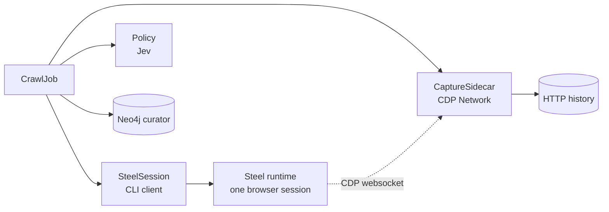
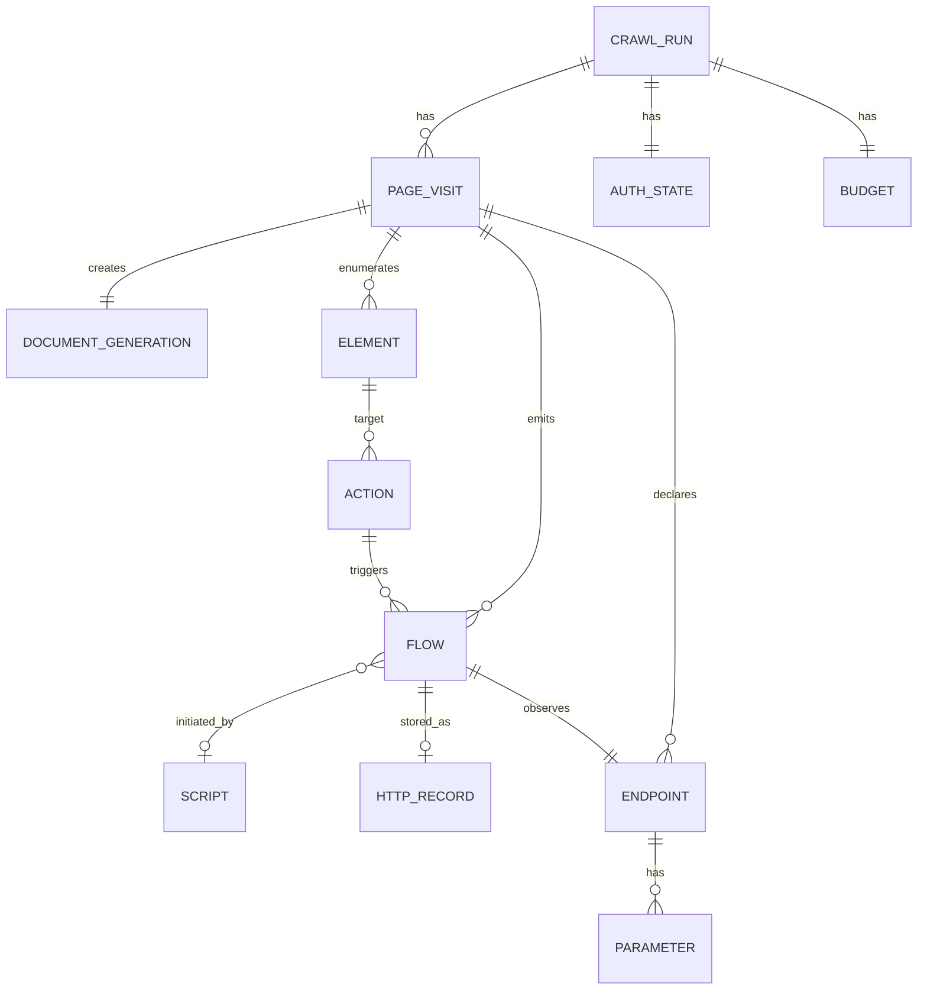
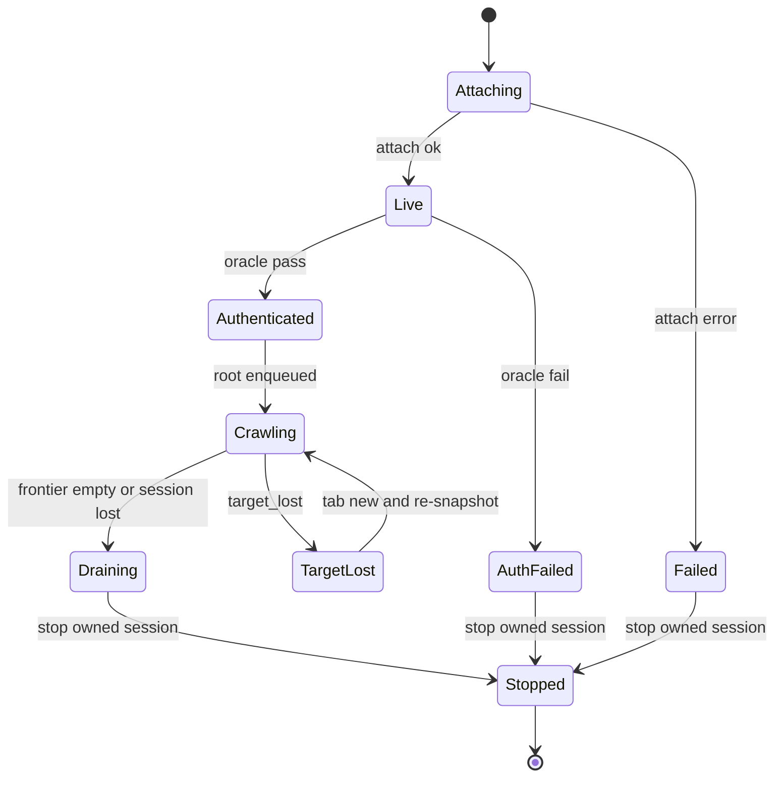
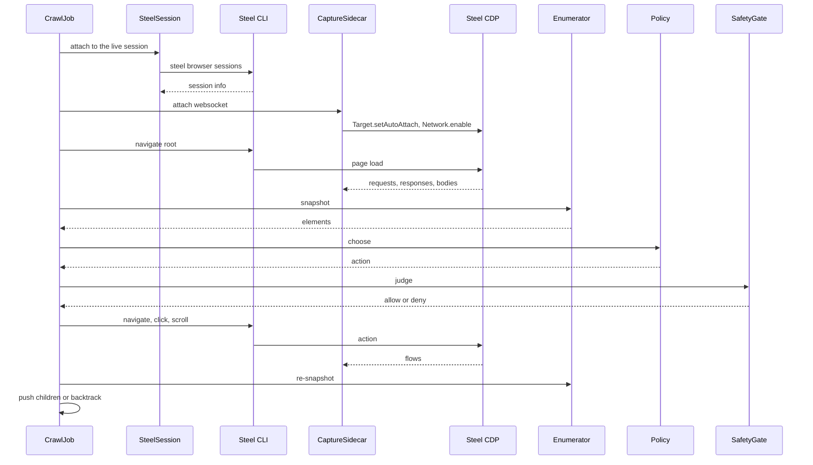
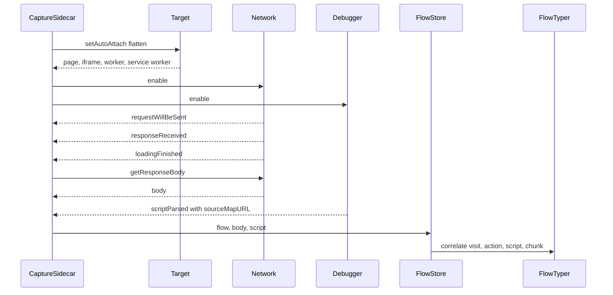
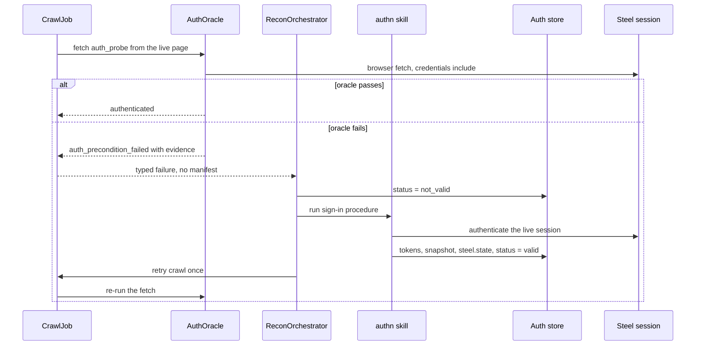

# steel_crawl workbench: authenticated full-surface crawl

**Status: DESIGN WORKBENCH, 2026-10-30.**
This is the bench for the grilling phase.
It is not a ratified specification and it changes no source.
The bench separates facts, assumptions, decisions, open questions, and risks; the sections below group them.

**Bench rules.**

1. No implementation starts until the blocking questions in section 9 are answered and the P0 spike passes.
2. A design change edits this bench first, then the code.
3. Every phase in the plan has a measurable exit criterion.
4. A claim that mixes fact, assumption, and decision is a defect in this document.

**Sources.**
`fix/395-runtime-stress-hardening` for the Steel CLI guard, contract, session registry, and skill.
`fix/395-tool-contract-hardening` for the current crawl provider and auth gate.
`docs/design/steel-crawl-redesign-analysis.md` for the capture plane.
`docs/design/crawl-policy-jev-vs-fast-llm-analysis.md` for the Jev policy.
The surveyed repositories for the off-the-shelf DOM assessment.

---

## 1. Plan

The plan is strict.
Each phase answers one question, builds the smallest thing that answers it, and stops at a measurable exit criterion.

| Phase | Question | Build | Feedback signal | Exit criterion |
| - | - | - | - | - |
| P0 | Can the Steel CLI and a passive CDP sidecar share one session? | A spike script that starts a session, attaches CDP, navigates, clicks, and captures the resulting XHR | Captured flow with URL, method, status, initiator, and body | One CLI-triggered XHR captured end to end |
| P1 | Can we drive, authenticate, and track a session deterministically? | Session client, auth oracle, command mapper, browser state tracker | Oracle verdict, stale refs rejected, every command carries the session and the boundary | Unit tests for the oracle, ref generations, command shapes, and error classes |
| P2 | Can we crawl with no model? | Element-type classifier, enumerator, two-level DFS, DOM collector | Fixture coverage, declared form endpoints, zero destructive hits | All static fixture routes visited, the element matrix honoured, no writes |
| P3 | Can we capture the full network surface? | CDP sidecar, flow correlator, asset typer, manifest v2 | Flows attributed to page, action, script, and chunk | Fixture ground truth matched |
| P4 | Does Jev improve the action choice? | Jev policy and optional parser helper | Coverage per action versus the deterministic order | Jev at or above the baseline, no safety regression |
| P5 | Does it survive an expired authenticated session? | Auth precondition failure, orchestrator resurrection request, bounded retry | Re-auth then re-oracle then crawl | One expired session recovered, or a clean named failure |

**Feedback loop.**
Each phase runs the same loop:

```text
build the smallest artifact
  -> run the fixture or spike
  -> record one signal
  -> compare with the exit criterion
  -> adjust or stop
```

No phase adds a second mechanism to hide a failed signal.
A failed signal is a design input, not a reason to add complexity.

**P0 is the gate.**
If the CDP sidecar cannot coexist with the CLI, the capture design changes before any crawler code is written.
This is the highest-risk assumption in the bench.

**P0 status (2026-10-31).**
The local deployment passes the sidecar check.
The pinned CLI 0.5.0-preview.6 starts the session and drives the fixture.
The usable raw CDP endpoint is port 9223; port 9222 is loopback-only.
The compose publishes `9223:9223`.
The second CDP client captured `GET https://httpbin.org/get?p0=1` with status 200, a script initiator, and the JSON body.
The evidence is in `docs/experiments/p0-steel-cdp-sidecar.md`.

---

## 2. Functional requirements

The requirements are grouped and discrete.
Each has an acceptance signal.

### 2.1 Session and authentication

| ID | Requirement | Acceptance signal |
| - | - | - |
| FR-A1 | Start or attach to exactly one Steel session per crawl run. | One session name, one runtime id, one catalogue entry. |
| FR-A2 | Establish an authenticated browser state before the first navigation. | The auth gate passes on the root URL. |
| FR-A3 | Verify authentication once before traversal. | A login redirect, 401, or 403 at the precondition aborts the run with a named failure. |
| FR-A4 | Never overwrite a good stored state with an unauthenticated one. | State capture is skipped when the gate fails. |
| FR-A5 | Stop the owned session on every exit path and prove it gone. | The catalogue has no entry for the owned name. |
| FR-A6 | Never use or stop a foreign session. | The `default` session, if present, is untouched. |
| FR-A7 | Run the authentication oracle before the first navigation. | The oracle navigates to an authenticated URL and records status, final URL, and a verdict. |
| FR-A8 | Emit a typed `auth_precondition_failed` result, never an empty manifest, when the oracle fails. | The result names the account, the observed status and final URL, and the evidence. |
| FR-A9 | Request orchestrator resurrection through the authn skill and the auth store, then retry once. | One bounded retry, with the resurrection recorded. |
| FR-A10 | Re-run the oracle after resurrection, because the authenticated URL may have changed. | The retry reads the updated oracle spec. |

### 2.2 Traversal

| ID | Requirement | Acceptance signal |
| - | - | - |
| FR-B1 | Seed the frontier with the root URL. | The first visit is `/`. |
| FR-B2 | Extract navigable URLs from the rendered DOM: anchors, area maps, iframes, form actions, router attributes, meta refresh. | Each source has a discovery tag. |
| FR-B3 | Resolve relative URLs and normalize fragments, query order, tracking parameters, and trailing slashes. | The same page has one normalized key. |
| FR-B4 | Enforce scope on the base URL's registrable domain plus its subdomains. | External origins are recorded but never visited. |
| FR-B5 | Traverse depth-first with no fixed depth limit. | The stack grows past depth 3 on the fixture. |
| FR-B6 | Deduplicate by normalized URL and by state signature. | No URL or state is visited twice. |
| FR-B7 | Persist the stack, visited set, and consumed set. | A killed run resumes at the next unconsumed element. |
| FR-B8 | Stop on frontier exhaustion, session loss, operator cancel, or an explicit cap. | The stop reason is recorded. |
| FR-B9 | Record every page with URL, status, title, parent, depth, and discovery source. | The manifest has one record per visit. |
| FR-B10 | Extract declared form endpoints from the DOM: action, method, enctype, and field names. | Every form yields one declared endpoint record. |
| FR-B11 | Distinguish declared endpoints from observed CDP flows. | Each endpoint has `kind="declared"` or `kind="observed"`. |
| FR-B12 | Treat a form-looking trigger as a disclosure when it opens an overlay, and extract the real form after the overlay opens. | The trigger is recorded as an action, not as a form endpoint. |

### 2.3 Interaction

| ID | Requirement | Acceptance signal |
| - | - | - |
| FR-C1 | Enumerate interactive elements from the current document. | Links, buttons, tabs, menu items, disclosures, and form fields are present. |
| FR-C2 | Assign each element a document-scoped identity. | Role, name, region, ordinal, and selector are recorded. |
| FR-C3 | Choose the next action with Jev only. | The policy adapter is the only model that returns an action. |
| FR-C4 | Execute the full client-side primitive set through the Steel CLI: navigate, click, dblclick, hover, focus, press, fill, type, select, check, uncheck, clear, scroll, drag, upload, submit, back. | Each action maps to one typed command. |
| FR-C5 | Re-snapshot after every navigation and every state-changing action. | The snapshot generation increments. |
| FR-C6 | Never reuse a ref across a navigation. | A stale ref is rejected before the command is built. |
| FR-C7 | Submit every form once per state, except the elements Jev marks `removed`. Collect logout, destructive, and capability-gated forms without submitting them. | Every allowed form has one submit record; a removed form has a collect record and no submit. |
| FR-C8 | Deny destructive actions deterministically. | Delete, pay, purchase, send, publish, invite, approve, revoke, and logout are never executed. |
| FR-C9 | Record action, target identity, before and after state, and outcome. | Every action has one ledger record. |
| FR-C10 | Classify every enumerated element with the typed element catalog. | Every element has one channel: action, collect, or ignore. |
| FR-C11 | Re-enumerate after a disclosure and extract any form or control inside the new overlay. | The overlay's contents are visited as a new state. |
| FR-C12 | Keep the catalog closed. An element with no matching rule is ignored by default. | No action is executed on an unclassified element. |

### 2.4 Network capture

| ID | Requirement | Acceptance signal |
| - | - | - |
| FR-D1 | Attach a passive CDP client to the session websocket. | The sidecar receives events without acting. |
| FR-D2 | Enable Network on the page and every child target. | Worker and out-of-process iframe flows are present. |
| FR-D3 | Capture request and response lifecycle, headers, status, mime, timing, initiator, and resource type. | Each flow has the full record. |
| FR-D4 | Capture response bodies for document, XHR, fetch, and script, with a byte cap. | A body reference and a truncation flag are recorded. |
| FR-D5 | Capture the WebSocket handshake bidirectionally, both frame directions, and SSE messages. | The handshake is an HTTP artifact; frames and SSE are realtime artifacts. |
| FR-D6 | Capture parsed scripts and source-map URLs. | Every script has a script id and a source-map reference when present. |
| FR-D7 | Correlate each flow to a page visit and, when possible, an action. | Every flow has a visit id; attributed flows have an action id. |
| FR-D8 | Persist flows to HTTP history with browser provenance and dedup. | A flow appears once, with `capture_context="browser"`. |
| FR-D9 | Classify third-party and telemetry flows. | They are excluded from the graph by default but kept as evidence. |

### 2.5 Asset typing and source extraction

| ID | Requirement | Acceptance signal |
| - | - | - |
| FR-E1 | Classify every flow by resource type and mime. | The type is one of document, xhr, fetch, script, stylesheet, image, font, websocket, sse, other. |
| FR-E2 | Attribute XHR and fetch flows to the initiating script URL and line. | The flow has an initiator when CDP provides one. |
| FR-E3 | Do not fetch or store source maps. The JS client-side code analysis phase owns source-map retrieval. | No source-map request appears in the crawl. |
| FR-E4 | Emit `ScriptAsset` for every script: absolute URL, script ID, and provenance. Deduplicate by absolute URL. The chunk analysis system consumes it; the crawl does not derive a chunk hint. | Every script has one `ScriptAsset`; relative URLs are resolved; no chunk identity is derived. |
| FR-E5 | Emit an endpoint-to-script map. | Each endpoint lists page, action, and script URL. The chunk analysis system adds chunk identity and source maps. |
| FR-E6 | Record JS URLs as artifacts. | The manifest has script artifact references. |
| FR-E7 | Extract parameters only from observed network flows: URL query, id-looking path segments, and body payload attributes. | Every observed parameter has a `ParameterRecord` with endpoint, location, name, and shape. |
| FR-E8 | Deduplicate by `(endpoint_key, location, name)`. Do not rank and do not bind parameters to DOM fields. | The same parameter appears once per endpoint. |
| FR-E9 | Never store parameter values. Keep the name, location, and shape. | The graph has no parameter value. |

### 2.6 Output and operations

| ID | Requirement | Acceptance signal |
| - | - | - |
| FR-F1 | Emit manifest v2 with pages, flows, actions, artifacts, realtime, stats, and errors. | The schema validates. |
| FR-F2 | Keep v1 compatibility in `parse_steel_crawl`. | An old manifest parses to the same deltas. |
| FR-F3 | Emit BaseURL, Endpoint, and Parameter deltas with provenance. | The graph receives browser-sourced endpoints. |
| FR-F4 | Emit a run report with coverage, auth status, errors, and budget. | The report is readable without the raw log. |
| FR-F5 | Emit `ParameterRecord` entries with provenance and rank. | Each parameter has endpoint, name, location, trust zone, and rank. |
| FR-G1 | Return a typed error envelope and a recovery directive for every CLI failure. | Every error maps to a code and a recovery. |
| FR-G2 | Retry only transient failures and never retry a destructive action. | The retry count is bounded and recorded. |
| FR-G3 | Enforce the Steel session clock and an operator cancel; page and action caps are optional and disabled by default locally. | The stop reason is one of frontier empty, session lost, operator cancel, or an explicit cap. |
| FR-G4 | Record one ledger entry per action and per flow. | The ledger is append-only and replayable. |
| FR-G5 | Never log the connect URL, cookies, storage values, or credentials. | A secret scan of the log is clean. |

---

## 3. Technical constraints and invariants

These are the rules that the design must not violate.
Each names its enforcement point.

| ID | Constraint | Enforcement |
| - | - | - |
| C1 | The Steel CLI is the only action surface. The CDP sidecar is read-only for capture. | Command mapper owns all browser actions; the sidecar exposes no action method. |
| C2 | Every browser command carries `--session` and `--json`. | The mapper builds the command; the contract sanitizer rejects a missing session. |
| C3 | Every variadic verb carries `--` before its values, and options precede the selector. | The mapper renders the canonical shape; `steel_contract` refuses a missing boundary. |
| C4 | A ref is valid only within its document generation. | The state tracker rejects a stale ref before the command is built. |
| C5 | The CLI has no network-capture command. Capture requires a CDP sidecar. | The capture module is separate from the session client. |
| C6 | The connect URL carries the API key. | It is held in memory only and never logged. |
| C7 | One Steel session per crawl run. | The session client owns one name; local concurrency is one. |
| C8 | Scope is one predicate owned by the frontier. The default is the base URL's registrable domain including subdomains; the exact rule is Q3. | The frontier applies the scope predicate before enqueue. |
| C9 | No depth limit does not mean no stop. | The frontier stops on frontier exhaustion, session loss, operator cancel, or an optional cap. |
| C10 | Authentication is a precondition, not a step. | The crawl loop calls the oracle before the first navigation and aborts on failure. |
| C11 | The two-stage policy is the only safety decision. There is no separate gate. | `choose_removed` depletes the candidate set before `choose_chosen` runs. |
| C12 | Response bodies are capped and stored as blobs. | The sidecar enforces a per-body and per-run cap. |
| C13 | Manifest v2 is additive; v1 must still parse. | The parser has a version branch and a compatibility test. |
| C14 | The CLI `error` object is authoritative over the return code. | The mapper classifies the envelope, not just the exit code. |
| C15 | The Steel session clock is the primary bound in cloud; local runs have no artificial clock. | The session client sizes the clock and checkpoints before expiry. |
| C16 | The capture sidecar must not intercept or mutate page traffic. | It enables Network, Page, Debugger, and Target only; `Fetch.enable` is forbidden. |
| C17 | Capture must attach to workers and out-of-process iframes. | The sidecar uses `Target.setAutoAttach` with a flatten session. |
| C18 | An unattributed flow is marked, not guessed. | The correlator records `attribution="unknown"`. |
| C19 | The optional LLM helper parses; it never chooses. | It sits behind the enumerator, not the policy. |
| C20 | The crawler submits every form once per state, except the elements Jev marks `removed`. Logout, destructive, and capability-gated controls are collected, never submitted. | The `choose_removed` stage precedes `choose_chosen`; a removed form has no submit record. |
| C21 | The auth oracle is a precondition. No traversal runs before it passes. | The crawl loop calls the oracle before the first navigation. |
| C22 | Declared form endpoints and observed CDP flows are separate provenance. | The manifest carries `kind` and never merges the two silently. |
| C23 | The proposed model replaces the single channel with two flags, `offered` and `collected`; Q26 decides. | The classifier labels both flags; the effective project catalog decides them. |
| C24 | The crawler never performs sign-in. Resurrection belongs to the orchestrator and the authn skill. | The crawl returns a typed failure; it never drives a login. |
| C25 | A form trigger is not a form endpoint until the form is visible. | The enumerator extracts the form after the overlay opens. |
| C26 | `ignore` means no endpoint or parameter collection. Fields are `collect`, not `ignore`. | The catalog validation and the enumerator enforce the channel semantics. |
| C27 | Logout and destructive controls are never chosen. Jev marks them `removed` in the first stage. | The element is consumed and collected before `choose_chosen` runs. |
| C28 | Secret values are never stored. Keep the name, location, and shape. | The value policy is `name_only` for secret fields. |
| C29 | Parameters come from observed flows only. The DOM is not a parameter source. | The parameter extractor reads the flow ledger; the manifest carries observed parameters only. |

**The most important invariant is C4.**
The CLI's refs are document-scoped.
The session skills record that a stale ref can silently resolve to a different element after a navigation.
A crawler that reuses a ref can click the wrong control and report success.
The state tracker is the defence.

---

## 4. High-level system design

### 4.1 Context



The CLI drives the browser.
The sidecar observes the same session over CDP.
The policy chooses actions but touches neither.

### 4.2 Modules and interfaces

```text
src/polymerhus/recon/crawl/
├── job.py              # CrawlJob: frontier, budget, loop, output
├── session.py          # SteelSession: start, attach, stop, command
├── auth.py             # AuthOracle: 2xx navigation check and resurrection signal
├── state.py            # BrowserState: URL, document and snapshot generations
├── command.py          # Action -> SteelCommand -> SteelResult -> classified error
├── enumerate.py        # Snapshot/eval -> Element records
├── parameters.py       # ObservedParameter: query, path, body extraction
├── frontier.py         # DFS stack, visited, consumed, resume
├── policy/
│   ├── port.py         # Policy protocol
│   ├── jev.py          # Jev adapter
│   └── parser.py       # optional LLM parser helper
├── safety.py           # deterministic gate
├── capture/
│   ├── sidecar.py      # CDP attach, Network, Target, Debugger
│   ├── flow.py         # flow records and body store
│   └── typing.py       # initiator, ScriptAsset
├── manifest.py         # v2 schema and writer
└── ledger.py           # append-only run ledger
```

The interfaces are deliberately small.

```python
class Session(Protocol):
    def start(self, name: str) -> SessionInfo: ...
    def attach(self, name: str) -> SessionInfo: ...
    def run(self, command: SteelCommand) -> SteelResult: ...
    def stop(self) -> None: ...

class StateTracker(Protocol):
    def observe_navigation(self, result: SteelResult) -> None: ...
    def observe_snapshot(self, snapshot: Snapshot) -> None: ...
    def current(self) -> BrowserState: ...
    def validate(self, ref: Ref) -> bool: ...

class Enumerator(Protocol):
    def enumerate(self, state: BrowserState) -> list[Element]: ...

class Policy(Protocol):
    def choose_removed(self, state: BrowserState, elements: list[Element]) -> Element | None: ...
    def choose_chosen(self, state: BrowserState, elements: list[Element]) -> Action | None: ...

class DOMCollector(Protocol):
    def collect(self, state: BrowserState, element: Element) -> DeclaredEndpoint: ...

class Capture(Protocol):
    def start(self, websocket_url: str) -> None: ...
    def stop(self) -> CaptureStats: ...
```

**Depth.**
`Session`, `Enumerator`, and `Capture` are deep modules: a small interface hides the CLI grammar, the DOM traversal, and the CDP target tree.
`Policy` is a shallow seam by design: it returns one choice and owns nothing else.

### 4.3 Ownership model

| Concern | Owner | Decides | Never decides |
| - | - | - | - |
| Run lifecycle | `CrawlJob` | start, stop, budget, output | element identity, safety |
| Session lifecycle | `SteelSession` | start, attach, stop, session name | crawl order |
| Authentication | `AuthOracle` | authenticated or not | traversal, action |
| Command construction | `CommandMapper` | exact CLI string and recovery | target choice |
| Ref validity | `BrowserState` | valid or stale | element ranking |
| Candidate set | `Enumerator` | elements and order | next action |
| Parameter extraction | `ObservedParameterExtractor` | query, path, body names and shapes | crawl, action |
| Next action | `Policy` | chosen action and removed element | execution |
| Safety | `Policy` (`removed` choice) | forbidden or allowed | execution, ranking |
| Traversal | `Frontier` | next node, backtrack | action choice |
| Network capture | `CaptureSidecar` | flow records | any browser action |
| Attribution | `FlowTyper` | page, action, script | endpoint classification |
| Graph mapping | `parse_steel_crawl` and curator | asset deltas | crawl |

The separation is strict:
the policy cannot execute, the executor cannot choose, and the capture sidecar cannot act.

### 4.4 Entities and relationships



`DocumentGeneration` is the identity boundary for refs.
`Element` identities are scoped to one generation.
`Flow` is the unit of HTTP evidence.
`Script` is the crawl's asset unit.
`SourceMap` and `Chunk` belong to the chunk analysis system, not the crawl.

### 4.5 Session and authentication lifecycle



The gate runs once before the first navigation.
It does not run after every navigation.
A browser navigation is assumed to preserve the session context.
An auth failure at the precondition is terminal for the run.
A target loss is recoverable with one `tab new` and a fresh snapshot.

### 4.6 Crawl loop

The diagram below shows the pre-revision safety gate.
The current model is the two-stage policy in section 4.12.



The sidecar captures in parallel.
The CLI remains the only action surface.
The enumerator re-reads after every action.

### 4.7 DFS state model

The code below is the pre-revision page-centric loop.
Section 4.12 is the current unified DFS over page states.

```text
stack = [root]
visited = set()
exhausted = map[state_key -> set[element_fingerprint]]

while stack:
    node = stack.pop()
    if node.state_key in visited:
        continue
    visited.add(node.state_key)
    restore(node)                      # navigate, then replay action path
    if restore failed:
        mark unrecoverable
        continue
    elements = enumerate()
    candidates = [e for e in elements if e.channel == "action"]
    children = 0
    for element in order(candidates):
        if element.fingerprint in exhausted[node.state_key]:
            continue
        action = policy.choose(element)
        verdict = gate.judge(action)
        if not verdict.allow:
            exhausted[node.state_key].add(element.fingerprint)
            continue
        execute(action)
        child = observe()
        if child.is_new:
            stack.push(child)
            children += 1
            break                      # depth-first: follow the first new child
        exhausted[node.state_key].add(element.fingerprint)
    if children == 0:
        continue                       # pop: this branch is exhausted
```

`restore(node)` is `navigate(node.url)` followed by replaying `node.action_path`.
Replay only repeats disclosure and navigation actions.
It never repeats text entry or a write.
A replay mismatch aborts the branch.

The depth is unbounded.
The stop is not.
In cloud the Steel session clock bounds the run.
Locally the operator cancel bounds it.
The stack, the visited set, and the consumed set are persisted.

### 4.8 Capture and asset typing



The sidecar uses `Target.setAutoAttach` with `flatten=true`.
A page-only Network session misses worker and out-of-process iframe traffic.
`Network.getResponseBody` runs on `loadingFinished`, before eviction.
Bodies are capped and stored as blobs.

The typer uses the CDP `initiator` plus `Debugger.scriptParsed`.
It emits `ScriptAsset = {script_url, script_id, provenance}`.
`script_url` is absolute; the crawl resolves relative URLs and deduplicates by URL.
The crawl does not fetch or store source maps.
The JS client-side code analysis phase owns source-map retrieval.
The replacement chunk analysis phase consumes the assets.
The crawl does not derive a chunk hint and does not depend on the chunk phase.
An unattributed flow keeps `attribution="unknown"`.

### 4.9 Auth precondition and resurrection

The crawl attaches to a pre-authenticated live session.
The session was minted by the recon orchestrator or the auth gateway.
The risk is expiry: a cloud session can expire before the crawl starts or during it.

The authentication oracle is one browser `fetch`, not a navigation envelope.
The store records `overview.auth_probe.url`, a deployment-neutral path such as `/api/authentication`.
The auth feed resolves it against the project's canonical origin and passes it as `browser_auth["auth_probe"]`.
The crawl navigates to the root, then runs the fetch from that page with `redirect: follow`, `credentials: include`, and `cache: no-store`.
The canonical script is `references/auth-oracle.sh`.

The classification is fixed:

- 2xx with `redirected: false` -> authenticated.
- 401, 403, any 3xx, or `redirected: true` -> unauthenticated.
- anything else -> indeterminate.

A navigation envelope is not the oracle.
`steel browser navigate` follows a 302 and reports success with the final 200 URL.
The fetch exposes `redirected` and the true status.
A 3xx never passes, even when the browser follows it.

**Missing oracle.**
When `browser_auth["auth_probe"]` is absent, the crawl logs the missing oracle loudly and uses the legacy surface gate.
The legacy gate rejects login redirects, 401, 403, and any 3xx.
It never infers a pass from a rendered page.

**One check.**
The oracle runs once before traversal.
It does not run after every navigation or every submit.
The session context is assumed to survive navigation.
The two-stage removal is the structural guard against declassification.

**Oracle output.**

```json
{
  "outcome": "authenticated",
  "probe": "https://app.example.test/api/authentication",
  "status": 200,
  "redirected": false,
  "final_url": "https://app.example.test/api/authentication",
  "success": true
}
```

On failure, `outcome` is `unauthenticated` or `indeterminate`, with the observed status, `redirected`, and final URL.
The crawl returns `auth_precondition_failed` with that evidence.
It never falls back to an anonymous crawl.

**What about `technical_conditions`?**
They are advisory metadata for the authn skill, not the crawl oracle.
The authenticated-context oracle is the contract; the auth gateway and the crawl both consume it.

**Resurrection loop.**



The crawler never signs in.
The orchestrator owns the store write and the skill invocation.
The retry is bounded to one resurrection per crawl job.
If the second oracle fails, the run ends with `auth_precondition_failed` and no manifest.

The authenticated URL may change after resurrection.
The retry re-reads the projected oracle spec, so a new landing URL is honoured.

### 4.10 Element catalog, channels, and parameter filtering

**Revision 2026-11-01: network-observed parameters and the two-stage security choice.**
This block supersedes the no-fill/no-submit rules, the rejected two-axis proposal, the form-field map, and the parallel `chosen`/`removed` pair.

1. Every candidate element is either `offer` or `collect`.
   `offer` means Jev may act on it; its effects are recorded through the CDP Network and Debugger domains.
   `collect` means it is never offered; the lightweight DOM collector records its declared contract in place.
   A non-candidate element is ignored.
2. The project setting maps `element_type` to `offer` or `collect`.
   The internal `ElementType` enum is the key.
   The enum maps each raw HTML element or DOM signal to one semantic type.
   All `input.*`, `select`, `textarea`, and `[contenteditable]` elements are outside the map: the form is the unit.
3. Parameters are observed only from network logs: URL query, id-looking path segments, and body payload attributes.
   The DOM collector writes `DeclaredEndpoint` and `DeclaredField`, not `ObservedParameter`.
   There is no `required` attribute in the model.
4. The security choice is sequential, not parallel.
   First, `choose_removed` over the candidate set.
   The selected element is consumed, collected in place, and removed from the set.
   Repeat until `none`.
   Then, `choose_chosen` over the remaining set.
   The chosen set is structurally free of the removed elements.
   There is no probability threshold.
5. The forbidden categories are auth state, payment, and destruction.
   The canonical keywords live in the `choose_removed` instructions.
6. The traversal is one DFS over page states.
   Jev chooses across all candidates.
   A navigation pushes the current page and makes the result current.
   The browser-state module backtracks to the nearest page with residue.
7. Authentication is a one-time precondition.
   There is no post-submit oracle and no per-navigation gate.
   The session context is assumed to survive navigation.
   The two-stage removal is the structural guard against declassification.
8. `ScriptAsset` is `{script_url, script_id, provenance}`; the crawl does not fetch or store source maps.
9. HTTP history receives CDP-normalized artifacts through a network edge write service, with a deterministic content ID and a crash-safe finalize.
10. WebSocket handshakes are tracked bidirectionally and HTTP/3 flows are captured from CDP.

The catalog is a typed project setting.
Each element type maps to exactly one channel: `offer`, `collect`, or `ignore`.
The channel decides whether Jev sees the element and whether the DOM collector records it.

**Channel semantics.**

| Channel | Offered to Jev | DOM collector | Network capture |
| - | - | - | - |
| `offer` | Yes | No | Yes, as the action is exercised |
| `collect` | No | Yes, in place | No, because it is never exercised |
| `ignore` | No | No | No |

`ignore` is for pure noise: canvas, non-HTTP schemes, and elements outside the candidate set.
The `collect` bucket is the static collection set: downloads and the forms the project maps to collect.
The semantic hard-deny set is not in this table.
It lives in the Jev `choose_removed` stage.

**What gets collected.**
An `offer` element is recorded through the CDP Network and Debugger domains as the crawler exercises it.
A `collect` element is recorded in place by the lightweight DOM collector.
The collector records only the element identity and the declared contract: tag, role, name, label, type, form action, method, enctype, field names, pattern, min, max, options, and the resolved absolute action URL.
It never records a value.
The collector writes `DeclaredEndpoint` and `DeclaredField` records with `kind="declared"`.
The offered element writes `ObservedParameter` records from the flow ledger.
The two sources never merge silently.

**Parameter extraction.**
For an offered element, the network is the parameter source.
For a collected element, the declared DOM contract is recorded as `DeclaredField`, not as an observed parameter.
The observed extractor reads the flow ledger and records three locations:

1. URL query parameters, parsed with `parse_qsl`.
2. Path segments that look like identifiers: fully alphanumeric values of six or more characters, UUID-shaped values, and numeric IDs of three or more digits.
   The segment is replaced with `{id}` in the endpoint key.
3. Body payload attributes: JSON object keys, form-urlencoded names, and multipart part names.

The record is `ObservedParameter{endpoint_key, method, location, name, value_shape, source_flow_id, content_type}`.
`value_shape` is a type and a length band, never the value.
There is no rank step and no secret-value drop step.
Deduplicate by `(endpoint_key, location, name, kind)`.
An offered parameter that appears only in a DOM field and never in a flow is not recorded.
A collected element writes `DeclaredField` records, not `ObservedParameter` records.
This is the precision-over-recall trade the project accepts.

**Dummy data and form filling.**
Jev is choice-only.
It cannot return an arbitrary string or a field-value map.
The crawler presents a caller-supplied `ValueCatalogue` in the decision request.
Jev chooses a catalogue key; the executor types the value locally.
The value never enters the Jev request.
The catalogue is typed: `email`, `text`, `number`, `date`, `url`, `file`, `option`, `none`.
The executor validates the chosen value against the field contract (`pattern`, `min`, `max`, `options`) before typing.
When exactly one catalogue entry matches the field kind, the executor uses it without a Jev call.
Generator keys (`email+run`, `uuid`) are materialized per run by the executor.

**Action kinds.**
`navigate`, `click`, `dblclick`, `hover`, `focus`, `press`, `fill`, `type`, `select`, `check`, `uncheck`, `clear`, `scroll`, `drag`, `upload`, `submit`, `back`, `stop`.
`submit` is a logical action: the executor clicks the form's submit control, or calls `form.requestSubmit()` through `eval` when the control is not addressable.
A submit is one action with one value set, not a blind retry.

**Two-stage policy.**
Every candidate decision is sequential.

1. `choose_removed(candidates)`: one criterion per candidate, plus `none`.
   The instructions name the forbidden categories and the canonical endpoint keywords.
2. If the answer is not `none`: exhaust the element, collect it in place, remove it from the candidate set, and repeat.
3. `choose_chosen(candidates)`: one criterion per remaining candidate, plus `none`.
4. If the answer is `none`, the current page has no chosen candidate. The crawler backtracks to the nearest page with residue.
5. Otherwise, execute the chosen element.

The `chosen` question cannot see a removed element.
There is no probability threshold.
The residual risk is a false negative in `choose_removed`.

**Jev-embedded safety.**
The forbidden categories are auth state, payment, and destruction.
Canonical keywords: login, logout, signin, signout, password, reset, mfa, otp, pay, purchase, checkout, donate, delete, destroy, deactivate, close, purge, revoke.
The keywords appear in the `choose_removed` instructions.
There is no separate classifier and no Noul gate.
`choose_removed` is the systematic mechanism: an unsafe element is removed from the candidate set, collected in place, and never submitted.
The `choose_chosen` question only sees the remaining elements.
This is the structural rule that prevents the crawl from declassing the authenticated context.

**Catalog schema.**

```python
class Channel(str, Enum):
    OFFER = "offer"
    COLLECT = "collect"
    IGNORE = "ignore"

class ActionKind(str, Enum):
    NAVIGATE = "navigate"
    CLICK = "click"
    DBLCLICK = "dblclick"
    HOVER = "hover"
    FOCUS = "focus"
    PRESS = "press"
    FILL = "fill"
    TYPE = "type"
    SELECT = "select"
    CHECK = "check"
    UNCHECK = "uncheck"
    CLEAR = "clear"
    SCROLL = "scroll"
    DRAG = "drag"
    UPLOAD = "upload"
    SUBMIT = "submit"
    BACK = "back"
    STOP = "stop"

class ElementType(str, Enum):
    LINK = "link"
    EXTERNAL_LINK = "external_link"
    AREA = "area"
    EXTERNAL_AREA = "external_area"
    FORM = "form"
    EXTERNAL_FORM = "external_form"
    BUTTON = "button"
    DISCLOSURE = "disclosure"
    ROLE_BUTTON = "role_button"
    ROLE_LINK = "role_link"
    TAB = "tab"
    MENU_ITEM = "menu_item"
    TREE_ITEM = "tree_item"
    IFRAME = "iframe"
    EXTERNAL_IFRAME = "external_iframe"
    FRAME = "frame"
    CLICKABLE = "clickable"
    CUSTOM = "custom"
    DRAGGABLE = "draggable"
    DOWNLOAD = "download"
    META_REFRESH = "meta_refresh"
    DIALOG_STATE = "dialog_state"

class CollectKind(str, Enum):
    FORM_ENDPOINT = "form_endpoint"
    FORM_FIELD = "form_field"
    CONTROL = "control"
    EXTERNAL_URL = "external_url"
    ARTIFACT = "artifact"
    DOWNLOAD = "download"
    STATE = "state"

class ElementRule(BaseModel):
    id: str
    element_type: ElementType
    channel: Channel
    action_kinds: frozenset[ActionKind] = frozenset()
    collect_kind: CollectKind | None = None
    default_enabled: bool

class CrawlCatalog(BaseModel):
    version: int
    rules: tuple[ElementRule, ...]

class ProjectCatalog(BaseModel):
    catalog_version: int
    channels: dict[ElementType, Channel]
    extra_rules: tuple[ElementRule, ...] = ()
```

The project setting maps `element_type` to a channel and may add rules.
It cannot invent an element type, an action kind, or a collect kind.
Those are strict enums.
Validation rejects an unknown element type, an offer rule with no action kind, a collect rule with no collect kind, and any value outside the enums.

**Action rules.**

The action and collect tables below are the pre-revision baseline.
The current model is the `ElementType` map above.

| Rule | Element class | DOM signal | Action kinds | Safety | Default |
| - | - | - | - | - | - |
| `link.same_origin` | Same-origin link | `a[href]` in scope | navigate | safe | on |
| `area.same_origin` | Area map | `area[href]` in scope | navigate | safe | on |
| `iframe.same_origin` | Same-origin iframe | `iframe[src]` in scope | navigate | safe | on |
| `meta.refresh` | Meta refresh | `meta[http-equiv=refresh]` | navigate | safe | on |
| `form.trigger` | Form trigger | button or div opens a form | click | conditional | on |
| `form.submit` | Submit control | `input[type=submit/button]`, `button[type=submit]` | submit | conditional, deny set | on |
| `control.button` | Button | `button` not submit | click | conditional | on |
| `control.tab` | Tab | `[role=tab]` | click | safe | on |
| `control.menuitem` | Menu item | `[role=menuitem]`, `[role=menuitemcheckbox]`, `[role=menuitemradio]` | click | conditional | on |
| `control.aria` | ARIA button or link | `[role=button]`, `[role=link]` | click, navigate | conditional | on |
| `control.combobox` | Combobox | `[role=combobox]` | click | conditional | off |
| `control.disclosure` | Tree item or summary | `[role=treeitem]`, `summary` | click | safe | on |
| `control.clickable` | Clickable div or span | `[onclick]`, pointer cursor | click | conditional | on |
| `overlay.dialog` | Dialog or overlay | `dialog[open]`, `[role=dialog]`, `[aria-modal=true]` | click, stop | conditional | on |
| `overlay.consent` | Consent banner | known labels or roles | click | conditional | on |
| `nav.pagination` | Pagination | `a[rel=next]`, `?page=` | navigate | safe | on, sampling 3 |
| `nav.sort` | Sort header | `th`, `[aria-sort]` | click | safe | on |

**Collect rules.**

| Rule | Element class | DOM signal | Collect kind | Parameter | Trust zone | Sensitivity | Value policy | Default |
| - | - | - | - | - | - | - | - | - |
| `link.external` | External link | `a[href]` out of scope | external_url | none | cross_origin | public | shape_only | on |
| `iframe.cross_origin` | Cross-origin iframe | `iframe[src]` out of scope | external_url | none | cross_origin | public | shape_only | on |
| `form.declared` | Visible form | `form[action]` | form_endpoint | body or query | write or same_origin | public | shape_only | on |
| `field.text` | Text field | `input[type=text/search/email/url/tel/number]` | form_field | body or query | same_origin, cross_origin, write | user | shape_only | on |
| `field.password` | Password field | `input[type=password]` | form_field | body | write | secret | name_only | on |
| `field.hidden` | Hidden field | `input[type=hidden]` | form_field | body | write | secret or user | name_only | on |
| `field.checkbox_radio` | Checkbox or radio | `input[type=checkbox/radio]` | form_field | body | same_origin or write | user | shape_only | on |
| `field.file` | File field | `input[type=file]` | form_field | body | write | user | name_only | on |
| `control.select` | Select | `select` | form_field | body or query | same_origin or write | user | shape_only | on |
| `control.textarea` | Textarea | `textarea` | form_field | body | write | user | shape_only | on |
| `block.logout` | Logout control | label or URL matches logout | control | none | write | public | name_only | on, action denied |
| `block.destructive` | Destructive control | delete, pay, purchase, send, publish, invite, approve, revoke | control | none | write | public | name_only | on, action denied |
| `asset.script` | Script | `script[src]` | artifact | none | same_origin or cross_origin | public | shape_only | on |
| `asset.stylesheet` | Stylesheet | `link[rel=stylesheet]` | artifact | none | same_origin or cross_origin | public | shape_only | on |
| `asset.media` | Image or media | `img[src]`, `source[src]`, `video`, `audio` | artifact | none | same_origin or cross_origin | public | shape_only | on |
| `collect.download` | Download | `a[download]` or a file extension | download | none | same_origin or cross_origin | public | shape_only | on |

The table lists the possible values for each rule.
The rule's `trust_zone` and `sensitivity` are defaults.
The enumerator refines them per instance from the form method, the action origin, and the field type.

**Ignore rules.**

| Rule | Element class | DOM signal | Default |
| - | - | - | - |
| `ignore.canvas` | Canvas | `canvas` | on |
| `ignore.non_http` | Non-HTTP scheme | `javascript:`, `mailto:`, `tel:`, `data:`, `blob:` | on |
| `ignore.unclassified` | Unclassified | none of the above | on |

The catalog is the contract between the enumerator and the policy.
The policy sees only `action` rules.
The `choose_removed` stage is the only safety check. There is no separate blocklist.
The project setting is the only way to change the effective catalog.

**What changed from the earlier catalog.**

- `ignore` is pure noise. Fields, logout, and destructive controls are `collect`.
- Every field rule carries parameter metadata and a value policy.
- Parameters are observed from network flows; there is no downstream DOM filter and no rank.
- The project setting chooses a channel per rule and may add rules, with strict enums.
- Logout and destructive actions are denied semantically, not just by label.

**Declared versus observed endpoints.**

A form action is a declaration, not an observation.
It records `method`, `action`, `enctype`, `field_names`, and `source_page`.
It does not claim the endpoint exists or returns 200.
A CDP flow is an observation.
It records method, URL, status, headers, body, and initiator.
The manifest carries `kind="declared"` or `kind="observed"` and never merges the two silently.
The graph can ingest both, with different confidence and provenance.

This is the answer to the form-endpoint gap.
The declared endpoint does not come from CDP, so it must not pretend to.
It is a separate, typed source.

### 4.11 HTTP history integration

The crawl's flows must be visible to `list` and `get-http-artifacts`, not only to the graph.

**Path.**
The CDP sidecar normalizes each flow with `normalize_cdp_flow`.
The normalizer emits the existing `http-artifact/v1` shape.
The crawler batches the artifacts and posts them to a Kali edge write service.
The service calls `HttpHistoryStore.record_if_absent`.
The mitmproxy addon keeps its direct write path.
The MCP read tools are unchanged.

**Edge service.**
A separate process in Kali, not an MCP tool.
It binds `0.0.0.0:8001` on the compose network only; no host port.
It accepts `POST /v1/ingest` with a project id, a batch of artifacts, and bodies.
It requires a bearer token from `KALI_HTTP_HISTORY_EDGE_TOKEN`.
It returns `{created, duplicates, rejected}`.
It shares the store module and the `/data` volume with the addon.
SQLite WAL and the store's busy timeout serialize the two writers.

**Deterministic ID.**
The current `artifact_id` is a random ULID, so content dedup does not exist.
The crawl and the addon compute a content ID:
`http_` plus 26 Crockford base32 characters of
`sha256(canonical_json(project, method, canonical_url, canonical_request_headers, request_body_sha256, response_status, canonical_response_headers, response_body_sha256))`.
Volatile headers are removed.
HTTP/2 pseudo-headers are stripped and `:authority` maps to `host` in both normalizers.
Body hashes are over decoded bytes.
Replays keep the caller-provided ID, so lineage is not collapsed.
The store gains `record_if_absent`, returning `created` or `duplicate`.
The first writer's capture context is kept.

**Finalize.**
The crawler appends every artifact and manifest record to a durable ledger.
`finalize` runs on success and on every failure path.
It closes the sidecar, flushes the ledger in batches, assembles a partial manifest, and starts parse, triage, and curate with `partial=true` and a coverage report.
The HTTP flush and the graph ingestion run in parallel.
If the process is killed, the pipeline job's `finally` runs `finalize` from the ledger.
A failed flush retries with a persisted cursor and leaves the ledger in place.
A partial run is never marked complete.

**Exclusions.**

| Flow | Technical constraint | Policy |
| - | - | - |
| WebSocket | A 101 upgrade handshake plus a bidirectional frame stream. The artifact shape holds one request and one response. | Record the handshake request and response as an HTTP artifact; record both frame directions in the realtime channel. |
| HTTP/3 | QUIC on UDP/443. The mitmproxy path is TCP-only. | Record h3 flows through CDP and set `http_version="h3"`; document the addon limitation. |
| Tooling hosts | The container's own traffic, not the target. | Exclude with an explicit host list and a counter. |
| Fuzzing shape | Huge query or path shapes blow up context. | Exclude with a counter. |

### 4.12 Unified DFS and the two-stage decision

The traversal is one depth-first search over page states.
There is no separate local axis and page axis.
Every candidate on the current page is in one set.
The impact tree orders the set.
A navigation is a candidate like any other.
When Jev chooses a navigation, the current page is pushed onto the stack and the result becomes current.
When the current page has no unconsumed candidate, it is a leaf.
The crawler pops the nearest ancestor page with at least one unconsumed candidate.
The browser-state module tracks the consumed set per page state.

```text
current = root_page
stack = []                       # parent page nodes with residue
consumed = map[snapshot_key -> set[fingerprint]]
cache = map[snapshot_key -> DomSnapshot]

while current is not none:
    if not restore(current):
        mark_unrecoverable(current)
        current = pop_nearest_with_residue(stack, consumed, cache)
        continue

    candidates = [
        e for e in project(cache[current.cache_key]).candidates
        if e.channel == "offer"
        and e.fingerprint not in consumed[current.cache_key]
    ]
    if not candidates:
        current = pop_nearest_with_residue(stack, consumed, cache)
        continue

    while True:
        removed = policy.choose_removed(current, candidates)
        if removed is none:
            break
        if removed.id not in candidates:
            record_stale_removal(removed)
            break
        consumed[current.cache_key].add(removed.fingerprint)
        dom_collector.collect(removed)
        candidates.remove(removed)

    chosen = policy.choose_chosen(current, candidates)
    if chosen is none:
        current = pop_nearest_with_residue(stack, consumed, cache)
        continue

    execute(chosen)
    consumed[current.cache_key].add(chosen.fingerprint)
    result = observe()
    record_visit(result, parent=current)

    if chosen.semantics.impact == "navigate":
        stack.append(current)
        current = result.page
    else:
        restore(current)
```

`pop_nearest_with_residue` pops the stack until it finds a page with a candidate not in its consumed set.
The root is the last page popped.
The traversal ends when no page has residue.

The page instance is a node in the navigation tree.
It carries the observability `page_visit_id`.
The browser-state tracker owns a DOM snapshot cache.
The cache key is `sha256(normalized_url + action_fingerprint_path)`.
The action fingerprint path is the exact ordered list of navigation fingerprints that yielded the page.
It does not include local_state actions, because they are not replayed.
The cache stores the CLI DOM snapshot, not the compact projection.
The compact projection is derived from the cached snapshot.
The consumed set is keyed by the cache key.
A rollback navigates to the page node's URL and hits the cached snapshot by key.
It does not replay local_state actions.
It does not re-snapshot the DOM.
The cached snapshot carries the element identity fields: element_type, role, name, region, ordinal, and selector.
They identify the elements on the page.
The selector is the execution handle; the role, name, region, and ordinal form the stable fingerprint.
The executor re-resolves the selector to a live ref before acting.
If the element is gone, the action fails with `stale_element` and the candidate is consumed.
`state_key` remains the visited-state signature.
`DocumentGeneration` remains the ref-validity token.
The visited state set is keyed by `state_key` and prevents re-entering a state already crawled.
A local state change does not reset the consumed set.
A navigation creates a new page node with its own snapshot cache entry and consumed set.

The `collect` elements are recorded in place when the page is first visited.
The collector is idempotent by declared endpoint identity.
The `choose_removed` loop depletes the unsafe set on the current page.
The `choose_chosen` tree orders the remaining candidates by impact.
A navigation choice is a normal decision, not a boundary.
The impact order is a soft prior, not a hard rule.
Jev owns the final choice.

The policy port:

```python
class Policy(Protocol):
    def choose_removed(self, state: BrowserState, elements: list[Element]) -> Element | None: ...
    def choose_chosen(self, state: BrowserState, elements: list[Element]) -> Action | None: ...
```

The removal question:

```python
removed_question = {
    "type": "choice",
    "instructions": FORBIDDEN_CATEGORIES_AND_KEYWORDS,
    "criteria": {e.id: e.short_description for e in candidates} | {"none": "no forbidden element remains"},
}
```

The choice question is sent only after the removal loop returns `none`:

```python
chosen_question = {
    "type": "choice",
    "instructions": PRIORITISATION_TREE,
    "criteria": {e.id: e.decision_summary for e in candidates} | {"none": "no candidate remains"},
}
```

The collector port:

```python
class DOMCollector(Protocol):
    def collect(self, state: BrowserState, element: Element) -> DeclaredEndpoint: ...
```

The collector reads the CLI snapshot and the bounded `get attr` or `eval` reads.
It resolves the form action to absolute.
It records the declared fields.
It never records a value.

### 4.13 Element exclusion set and the three-layer map

The map has three layers:

1. The raw HTML element or DOM signal.
2. The internal `ElementType`.
3. The default channel.

The exclusion set is the first filter.
An element in the exclusion set is not a candidate.
The map classifies the rest.
An unknown element with an interactive signal maps to `CUSTOM`.
An unknown element without a signal is ignored.

**Exclusion set.**

| Family | Raw elements | Reason |
| - | - | - |
| Form fields | `input` (all types), `select`, `textarea`, `option`, `optgroup`, `datalist`, `output`, `progress`, `meter`, `[contenteditable]` | The form is the unit. Field values are network-observed. |
| Text and structure | `html`, `head`, `body`, `div`, `span`, `p`, `h1`-`h6`, `ul`, `ol`, `li`, `dl`, `dt`, `dd`, `table`, `thead`, `tbody`, `tr`, `td`, `th` (without a sortable signal), `section`, `article`, `header`, `footer`, `nav`, `main`, `aside`, `figure`, `figcaption`, `blockquote`, `pre`, `code`, `em`, `strong`, `small`, `br`, `hr`, `label`, `legend`, `fieldset`, `time`, `mark`, `abbr`, `cite`, `q`, `s`, `u`, `sub`, `sup`, `b`, `i`, `address`, `hgroup`, `search` | No interaction signal, no network effect. |
| Metadata and resources | `script`, `style`, `link`, `meta` (except refresh), `base`, `title`, `template`, `noscript`, `img`, `picture`, `source`, `track`, `embed`, `object`, `param`, `map`, `canvas` (without a signal), `svg` (without a signal), `math` (without a signal) | Artifacts are captured by CDP. No DOM interaction. |
| State containers | `dialog`, `details` | State containers. The controls inside are candidates. `summary` is the candidate for `details`. |
| Hidden and inert | `[hidden]`, `[inert]`, `[aria-hidden=true]`, `display:none`, `visibility:hidden` | Not visible or not interactive. |
| Non-HTTP schemes | `javascript:`, `mailto:`, `tel:`, `data:`, `blob:` | No HTTP surface. |

**Candidate map.**

| Raw HTML element or DOM signal | Internal `ElementType` | Default channel | Parameter dependency |
| - | - | - | - |
| `a[href]` same-origin http(s) | `LINK` | offer | Observed after navigation |
| `a[href]` cross-origin http(s) | `EXTERNAL_LINK` | ignore | Out of scope. Not recorded. |
| `area[href]` same-origin | `AREA` | offer | Observed after navigation |
| `area[href]` cross-origin | `EXTERNAL_AREA` | ignore | Out of scope. Not recorded. |
| `form[action]` same-origin, or form with no action | `FORM` | offer | Observed body and query after submit |
| `form[action]` cross-origin | `EXTERNAL_FORM` | ignore | Out of scope. Not recorded. |
| `button` not submit | `BUTTON` | offer | Observed XHR or fetch |
| `button[type=submit]` | `FORM` | offer | Owned by the enclosing form |
| `summary` | `DISCLOSURE` | offer | Observed XHR or state change |
| `[role=button]` | `ROLE_BUTTON` | offer | Observed XHR or fetch |
| `[role=link]` | `ROLE_LINK` | offer | Observed navigation |
| `[role=tab]` | `TAB` | offer | Observed XHR or state change |
| `[role=menuitem]`, `[role=menuitemcheckbox]`, `[role=menuitemradio]` | `MENU_ITEM` | offer | Observed XHR or fetch |
| `[role=treeitem]` | `TREE_ITEM` | offer | Observed XHR or state change |
| `iframe[src]` same-origin | `IFRAME` | offer | Observed frame requests |
| `iframe[src]` cross-origin | `EXTERNAL_IFRAME` | ignore | Out of scope. Not recorded. |
| `frame[src]` same-origin | `FRAME` | offer | Observed frame requests |
| `[onclick]` on a non-field element | `CLICKABLE` | offer | Observed XHR or fetch |
| `[tabindex]` with a role or handler | `CUSTOM` | offer | Observed XHR or fetch |
| `[draggable=true]` | `DRAGGABLE` | offer | Observed XHR or fetch |
| `svg[onclick]`, `svg[role=button]` | `CLICKABLE` | offer | Observed XHR or fetch |
| `canvas[onclick]` | `CLICKABLE` | offer | Observed XHR or fetch |
| `a[download]` or a file-extension `href` | `DOWNLOAD` | collect | Declared URL query from `href` |
| `meta[http-equiv=refresh]` | `META_REFRESH` | offer | Observed navigation |
| `dialog[open]`, `[role=dialog]`, `[aria-modal=true]` | `DIALOG_STATE` | ignore | State marker; the controls inside are candidates |
| custom element with a role or handler | `CUSTOM` | offer | Observed XHR or fetch |
| custom element without a signal | `CUSTOM` | ignore | Not a candidate |

**Collected elements that yield declared parameters.**
The `collect` channel has one static entry and one dynamic entry:

- `DOWNLOAD`: the declared URL query from the `href`.
- A `FORM` or `BUTTON` marked `removed` by `choose_removed`: the declared endpoint and fields, collected in place.

The `EXTERNAL_*` types are `ignore` by default.
They are out of scope, and the curator would drop them.
The manifest does not carry them.

The DOM collector writes `DeclaredEndpoint` and `DeclaredField`.
It does not write `ObservedParameter`.
The observed parameter extractor reads the network ledger.
The two record types carry different provenance and must not merge silently.

**The `CUSTOM` default.**
A custom element with an interactive signal maps to `CUSTOM` and defaults to `offer`.
A custom element without a signal maps to `CUSTOM` and defaults to `ignore`.
The project setting may map `CUSTOM` to `collect` or `ignore`.

### 4.14 Prioritisation impact tree

The prioritisation belongs to Jev.
The crawler does not carry a fixed element order.
The crawler provides two inputs per candidate: the impact class and the change semantics.
Jev applies the tree.

**Impact classes.**

| Class | Meaning |
| - | - |
| `observe` | No DOM or network change. |
| `local_state` | DOM-only change. No request. |
| `read` | A request that reads data. No server state change. |
| `write` | A request that changes server state. |
| `navigate` | A document or frame navigation. |
| `download` | A file download. Collected. |
| `external` | A cross-origin target. Ignored by default. |
| `context_reset` | A logout, login, or session switch. Removed before prioritisation. |

The offer order is `observe`, `local_state`, `read`, `write`, `navigate`.
`download`, `external`, and `context_reset` are not offered.

The impact class is not the capture channel.
The capture channel is a separate field: `dom`, `network`, `navigation`, or `none`.
A submitted form has `impact` `write` or `navigate` and `capture` `network`, plus `navigation` when the response is a document.
The parser reads the network ledger.
The priority uses the impact class.

**Default cluster.**

| `ElementType` | Default impact | Typical change |
| - | - | - |
| `DISCLOSURE` | `local_state` | Reveals content. |
| `TAB` | `local_state` | Switches panel. |
| `MENU_ITEM` | `local_state` | Opens submenu or acts. |
| `TREE_ITEM` | `local_state` | Expands or collapses. |
| `BUTTON` | `local_state` | Handler unknown. |
| `ROLE_BUTTON` | `local_state` | Handler unknown. |
| `CLICKABLE` | `local_state` | Handler unknown. |
| `CUSTOM` | `local_state` | Handler unknown. |
| `DRAGGABLE` | `local_state` | Reorder. A drop handler may write. |
| `FORM` | `write` | Submit. GET may navigate. |
| `ROLE_LINK` | `navigate` | Navigates or triggers XHR. |
| `IFRAME` | `navigate` | Frame load. |
| `FRAME` | `navigate` | Frame load. |
| `META_REFRESH` | `navigate` | Page load. |
| `LINK` | `navigate` | Page change. |
| `AREA` | `navigate` | Page change. |
| `DOWNLOAD` | `download` | Collected. |
| `EXTERNAL_*` | `external` | Ignored. |
| `DIALOG_STATE` | `observe` | State marker, ignored. |

The instance `impact` is authoritative.
The default cluster is a fallback when the instance semantics are unknown.
The cluster is a prior, not a hard order.
Jev may choose a `navigate` candidate before a `local_state` candidate when the change semantics justify it.

**Change semantics.**

```python
class ControlFact(BaseModel):
    target_id: str
    hidden: bool
    target_projection: list[str]
    consumed_count: int

class ChangeSemantics(BaseModel):
    impact: ImpactClass
    capture: Literal["dom", "network", "navigation", "none"]
    method: str | None
    action: str | None
    target: str | None
    may_navigate: bool
    controls: list[str]
    control_facts: list[ControlFact]
    handler: Literal["href", "onclick", "onsubmit", "listener", "unknown"]
    confidence: float
```

`controls` is the list of IDREFs from `aria-controls`, `data-target`, or an `href` fragment.
`control_facts` reports the current state of each target: hidden, the full compact projection of the target's candidates, and the consumed count.
Each projection line carries a consumed marker.
The symbolic layer provides the facts.
Jev evaluates whether the target is a new surface in the decision tree.
The `reversible` field is removed because the crawler cannot verify it reliably.

**Decision tree.**

```text
choose_chosen(candidates):
  1. If candidates is empty, return none.
  2. Group by impact. The instance impact is authoritative.
  3. For each class in [observe, local_state, read, write, navigate]:
       if the group is non-empty, rank the group and return the best candidate.
  4. rank(group):
       a. known change semantics over unknown;
       b. a candidate whose control facts show a hidden target with unconsumed candidates over one without.
  5. If the chosen impact is navigate, push the current page and make the result current.
  6. Otherwise, record the result, restore the current page, and continue.
  7. When the current page has no unconsumed candidate, pop the nearest ancestor with residue.
```

The impact order is a soft prior.
Jev owns the final choice.
A navigation is a normal candidate, not a boundary.
The browser-state module backtracks to the nearest page with residue.

**Prompt contract.**
The `choose_chosen` instructions carry the impact order and the tree.
Each criterion carries the element id, type, label, impact, capture, and change semantics.
The element-type cluster is a reference, not a strict order.
This keeps the prompt valid when the catalog adds a new element type.

**Removal loop.**
The removal loop repeats until `choose_removed` returns `none`:

```text
while True:
    removed = policy.choose_removed(page, candidates)
    if removed is none:
        break
    if removed.id not in candidates:
        record_stale_removal(removed)
        break
    candidates.remove(removed)
    consumed[page.state_key].add(removed.fingerprint)
    dom_collector.collect(removed)
```

Each iteration removes one candidate.
The loop terminates in at most the candidate count.
A stale answer is a protocol error, not a reason to execute.

**Cross-origin.**
The `EXTERNAL_*` types are `ignore` by default.
The L0 curator would drop them before graph ingestion anyway.
The manifest does not carry them.
The graph does not receive them.

### 4.15 Manifest v2

The manifest is the graph input, not the observability log.
Pages and actions are emitted to the observability platform.
Flows are in the HTTP history.
The manifest carries only the graph-bearing records.

**Top-level keys.**

```text
schema_version: "steel-crawl/v2"
run:        {crawl_run_id, session_name, account, started_at, finished_at,
             stop_reason, partial, scope, auth}
endpoints:  [endpoint]
parameters: [parameter]
scripts:    [script]
realtime:   [realtime_record]
errors:     [error]
stats:      {endpoints, parameters, flows, bytes, duration_ms,
             removed_elements, unrecoverable_pages}
```

There is no `pages`, no `actions`, no `flows`, no `artifacts`, no `declared_endpoints`, no `declared_fields`, and no `coverage` block.

**Endpoints.**
One list.
`provenance="observed"` for a CDP flow.
`provenance="declared"` for a DOM-collected form endpoint.
The graph identity is `path`, `method`, and `baseurl`.
The graph props are `url`, `source`, and `status_code`.
The crawl records `endpoint_id`, `resource_type`, `http_artifact_id`, `source_page_id`, `action_id`, `enctype`, and `field_names`.
The crawl does not set `profile`.
The httpx_reprofile phase sets it.

**Parameters.**
One list.
`provenance="observed"` for a network parameter.
`provenance="declared"` for a form field.
The graph identity is `name`, `position`, `endpoint_path`, and `baseurl`.
The crawl records `parameter_id`, `endpoint_id`, `value_shape`, `http_artifact_id`, `content_type`, `field_type`, `label`, `options`, `pattern`, `min`, and `max`.
The declared record carries the field contract.
The observed record carries the shape only.

**Scripts.**
`ScriptAsset = {script_url, script_id, provenance}`.
No source map.

**Realtime.**
The WebSocket handshake references the HTTP-history artifact.
The frames carry direction, opcode, size, body hash, and timestamp.

**Stats.**
Counts only.
No coverage block.
`unrecoverable_pages` and `removed_elements` are counts.

**Errors.**
Named failures with a recovery directive.

### 4.16 Steel interaction contract

The parallel `fix/395-runtime-stress-hardening` branch converged the Steel surface.
The crawl consumes this contract; it does not reconstruct it.

**Session identity.**
`SteelSession` is the source of truth: `session_id`, `name`, `status`, `viewer_url`, `debug_url`, `debugger_url`, `websocket_url`, `created_at`, `remaining_ms`, `inactivity_timeout_ms`, `source`.
`SteelSessionRegistry` observes start, catalogue, API, and stop.
`live_view` is addressable only when the URL carries the session id.
The self-hosted runtime exposes a shared debug player (`/v1/sessions/debug`), not a session-addressed viewer.
The crawl publishes the session id with the live view and marks the shared player `addressable=false`.

**Session lifecycle.**
`start` is create-time for the clock.
A `start` on a catalogued live name is refused with `session_taken`.
The crawl never starts; it attaches to the pre-authenticated live name.
Use a finite inactivity window below the session window.
`remaining_ms` on receipt is below the requested timeout.
Stop by name and prove the catalogue clean.
A foreign `default` is untouchable.

**Envelope and errors.**
`steel_exec` returns `stdout`, `stderr`, `returncode`, `shell_returncode`, `duration_ms`, `error`, `warning`, `steel_events`, plus the capture fields.
`error` is authoritative.
`steel_events` carries `verb`, `session`, `session_id`, `remaining_ms`, `decision`, `returncode`, `duration_ms`, `error`/`warning`, and `catalogue`.
The contract codes are `unknown_session`, `session_missing`, `session_taken`, `target_lost`, `browser_stuck`, `invalid_command`, `command_failed`, and `guard_error`.
`session_missing` is a known loss, not a typo; it requires a state-restoring recreate.
`unknown_session` was never live.
`session_taken` is a reuse signal.

**Auth oracle.**
The oracle is `overview.auth_probe.url`, resolved against the canonical origin.
A browser `fetch` with `redirect: follow`, `credentials: include`, and `cache: no-store` is the check.
2xx with `redirected: false` passes.
401, 403, any 3xx, or `redirected: true` fails.
Anything else is indeterminate and fails closed.
A navigation envelope is not the oracle.
The canonical script is `references/auth-oracle.sh`.
A missing oracle is loud; the legacy surface gate is the fallback and rejects 3xx.

**Canonical scripts.**
`navigate-read.sh`: navigate, title, URL, `snapshot -i -c` slice.
`interact-batch.sh`: `snapshot -i`, then `fill @ref -- value` in one batch, read back a boolean.
`session-records.py`: metadata, live view, snapshot, screenshot, record probes.
`select-elements.py`: DOM family selection, attributes, visibility, bounded JSON.
`load-eval.py`: load, wait, eval one expression or file, bounded JSON.
`spider-bounded.sh`: enumerate links, same-host filter, capped navigation.

**Batch boundary.**
Every variadic verb carries `--`: `fill`, `type`, `setvalue`, `select`, `upload`.
`batch` carries its own `--`, and every variadic element carries its own.
A missing boundary is `refused:variadic-boundary`, not a retry.
The crawl's command mapper encodes the boundary.

**Ref lifecycle.**
Take refs from the latest `snapshot -i`.
Within a document the ref registry is append-only.
After a navigate, an old ref is invalid.
Re-snapshot after every navigate.
`press` takes one key; `selectall` selects.
Prove `select` with a read-back.
Submit a form with `requestSubmit()` through `eval`; `form.submit()` is the last resort.

**Crawl impact.**
- The auth section uses `browser_auth["auth_probe"]` and the fetch oracle, not `extra["auth_oracle"]` and the sidecar status.
- The session handoff uses `SteelSession` and the catalogue; the crawl never starts.
- The command mapper uses the envelope and `steel_events`.
- The error taxonomy maps to the contract codes.
- The projection is `snapshot -i -c`.
- The executor uses the variadic boundary and the read-back.

---

## 5. Environment, dependencies, and assumptions

### 5.1 Environment

| Item | Assumption |
| - | - |
| Steel CLI | Pinned 0.5.0-preview.6, public `steel` wrapper, `--json` on every command. |
| Steel runtime | One session per crawl; local or cloud; the session record is `SteelSession`. |
| Session websocket | The `websocket_url` from the session record; a second CDP client is allowed. |
| Target | A web application whose root `/` returns HTML and whose authenticated state is already established. |
| Auth material | A pre-authenticated live session is handed off by the orchestrator; the crawl reuses it by name and runtime id. `browser_auth["auth_probe"]` is the oracle; a missing oracle is loud. |
| Session clock | A finite inactivity window below the session window; `remaining_ms` is checked before each phase. |
| Live view | `SteelSession.live_view`; addressable only when the URL carries the session id. |
| Local runtime | The local Steel runtime has no artificial crawl clock; the operator or the session controls the stop. |
| Cloud runtime | The Steel session clock is the primary bound; the crawl checkpoints before expiry. |
| Python | 3.13, `websockets` or `httpx` for CDP, no Playwright requirement on the CLI path. |
| Downstream | HTTP-history store, Neo4j curator, `parse_steel_crawl`, and the recon job runner. |
| Concurrency | One crawl per Steel session; local Steel concurrency is one. |

### 5.2 Dependencies

- The `steel` CLI and the Steel platform.
- The session's `websocket_url`.
- Jev through OpenRouter's SystemOne endpoint or TypeSafe direct.
- An optional OpenRouter chat model for the parser helper.
- The existing `kali/steel_contract.py` and `kali/steel_guard.py`.
- `src/polymerhus/app/steel_session.py`: `SteelSession`, `SteelSessionRegistry`, `live_view`.
- `src/polymerhus/app/auth/probe.py`: `classify_probe`, `resolve_auth_probe`.
- The canonical scripts: `auth-oracle.sh`, `navigate-read.sh`, `interact-batch.sh`, `session-records.py`, `select-elements.py`, `load-eval.py`.
- The existing `steel_provider.py` auth probe and session payload as reference.
- The existing `parse_steel_crawl` and HTTP-history store.

**Dependency documentation gap.**
`docs/design/recon-auth-gateway-223-spec.md` describes the VALIDATION phase (browser mount and navigate) and `auth_gate.py` implements the status predicate.
It does not state the 2xx authenticated-URL rule as a standalone oracle contract.
The auth-gateway owner is closing the gap in parallel.
The workbench assumes the 2xx contract and consumes it when it lands.

### 5.3 Assumptions that can break the design

| ID | Assumption | If false |
| - | - | - |
| A1 | A second CDP client can attach to the CLI's session. | No passive capture; fall back to the SDK/Playwright provider or `performance` entries. |
| A2 | The crawl can address the pre-authenticated live session by name and runtime id, and `start` on a live name is refused with `session_taken`. | No auth handoff; the crawl must create and authenticate a session. |
| A3 | `snapshot -i` covers the interactive surface the crawler needs. | A page-injected enumerator is required. |
| A4 | The CLI refs are stable within one document. | Every action needs a fresh selector or a page-global id map. |
| A5 | The target's session survives a long DFS. | The crawl must checkpoint, renew, or split into resumable runs. |
| A6 | The root URL is the canonical application entry. | The seed needs an operator-provided list. |
| A7 | The target's auth does not rotate per request. | The CLI and the sidecar may disagree on the session state. |
| A8 | The HTTP-history store accepts browser-sourced flows. | A new store or schema is required. |
| A9 | The orchestrator can resurrect an expired live session through the authn skill, and `session_missing` requires a state-restoring recreate. | The crawl ends with `auth_precondition_failed` every time the session expires. |
| A10 | The auth store records `overview.auth_probe.url`, and the browser fetch is the oracle. | A missing oracle is loud; the legacy surface gate is the fallback and rejects 3xx. |
| A11 | A declared form endpoint is useful before submission and is confirmed by the observed flow after submission. | The declared source loses its value and form extraction should be dropped. |
| A12 | Observed-only parameter extraction controls noise without ranking. | The graph misses DOM-only parameters; that is the accepted trade. |
| A13 | Jev marks logout-like actions `removed` in the first stage. | The crawl can declassify the authenticated context. |
| A14 | The chunk analysis system is replaced and consumes `ScriptAsset` from the crawler. | The crawler must keep the `ScriptAsset` contract stable and must not read the old chunk map. |
| A15 | Jev is choice-only and cannot return field values. | The `ValueCatalogue` pattern is invalid and a second value model is required. |
| A16 | The Kali edge service can write the same SQLite store as the addon. | The crawl needs a separate store or a direct volume mount. |
| A17 | A deterministic content ID deduplicates the two capture channels. | Content dedup is lost and the store keeps both copies. |

---

## 6. Off-the-shelf module assessment

The question is whether an existing DOM enumeration, identity, sorting, and state module can be used as a library.

### 6.1 Compatibility matrix

| Candidate | License | Runtime | Interface | Shadow DOM | Iframes | Stable identity | CLI compatibility | Effort | Verdict |
| - | - | - | - | - | - | - | - | - | - |
| Steel `snapshot -i` | Platform | CLI | AX tree with `[ref=eN]` | Yes, implicit open roots | Yes, depth 4 | Document-scoped ref | Native | None | Primary |
| `Ying-Kai-Liao/page-script.mjs` | MIT | Vanilla JS | `ENUMERATE` function | Yes, open roots | Direct child frames | `data-jev-i` per document | High, via `eval` and a selector | Small adapter | Reference only |
| `jev-ultrafast/snapshot.js` | MIT | Vanilla JS | Page-global action table | No | No | WeakMap id per document | High, via `eval` | Small adapter | Backup |
| `jkudish/jev-browser` page script | MIT | TypeScript | `data-jev-id` action space | No | No | Attribute per document | High, via a JS port | Medium | Backup |
| `Shai-Koffman/observe.py` | MIT | Python and Playwright | `Page` API | No | No | `data-jev-id` | Low, needs a Playwright page | Reference | Reject as a library |
| `browserclaw` | AGPL-3.0 | TypeScript and Chrome extension | AX tree, compact lines | Yes, implicit | One frame only | Index map | Low, extension-specific | High | Reference, not reused |
| `tontoko/jev-browser` DOM bundle | Apache-2.0 | TypeScript and Playwright | `Page` API | Yes | Yes | Locator refs | Low, needs Playwright | High | Reject |
| `spider-bounded.sh` | Repo skill | Shell | Anchor list | No | No | None | Native | None | Starting point only |

### 6.2 Verdict

**Primary and only: Steel `snapshot -i`.**
It is native, gives accessibility refs, includes iframes to depth 4, and covers open shadow roots through the AX tree.
The refs are document-scoped.
It is the only projection whose refs map 1:1 to CLI actions across frames.
No page-script fallback is used.
A measured custom-element gap is recorded as a coverage gap, not repaired with a second enumerator.

**Format: replicate browserclaw, not its code.**
`idan-rubin/browserclaw` emits `- role "name" [ref=eN] [nth=N] [checked] value=...`.
That is close to the Steel snapshot already.
The lines are compact, the interactive mode flattens depth, and the refs are stable per document.
The code is AGPL-3.0 and Chrome-extension-specific, and it snapshots one frame.
Replicate the line format and the exclusion rules; do not copy the implementation.

**Reference only: `Ying-Kai-Liao/page-script.mjs`.**
It is MIT, walks open shadow roots, covers direct child frames, and reports 40/42.
It is a reference for the compact line format and the exclusion rules.
It is not used at runtime.

**Reference only: `jev-ultrafast/snapshot.js`.**
It is MIT and smaller, but it does not traverse shadow roots or frames.
It is not used at runtime.

**Reject: CDP DOM as the projection source.**
`DOMSnapshot.captureSnapshot` and `DOM.getDocument(pierce=true)` see shadow roots and iframes, but their `backendNodeId` does not map to a CLI `ref`, and the protocol does not guarantee stability across snapshots.
Injecting action ids through CDP would make the sidecar an action surface, which violates C1.

**Reject: Playwright-based Python modules.**
They assume a `Page` object and a persistent Playwright connection.
The CLI path has neither.
They are useful as references for labels, identity, and occlusion, not as libraries.

**Build: the state tracker and the sorting layer.**
No surveyed module matches the CLI ref lifecycle.
The generation check, the consumed set, and the deterministic order are ours.

**Build: the element catalog, the observed-parameter extractor, and the declared-endpoint collector.**
No surveyed module models the offer/collect map, the two-stage Jev questions, or the declared form contract.
The catalog, the collector, and the two-stage questions are ours.
The collector runs on the CLI snapshot, not on the trigger.
This is where the design adds a source that CDP cannot provide, without a second enumerator.

---

## 7. Risks

| ID | Risk | Likelihood | Impact | Early signal | Mitigation |
| - | - | - | - | - | - |
| R1 | CDP sidecar cannot share the CLI session. | Medium | High | Attach fails or no events arrive | P0 spike; fallback to the SDK provider |
| R2 | The pre-authenticated live session expires before or during the crawl. | High | High | Oracle fails on the root or a navigation | Oracle before traversal; orchestrator resurrection; one retry; checkpoint; page-level gate after navigation |
| R3 | Stale ref clicks the wrong element. | High if unguarded | High | Ref generation mismatch | State tracker rejects before the command |
| R4 | Shadow DOM or iframe surface is missed. | Medium | Medium | Fixture recall below target | Page-script fallback |
| R5 | DFS explodes on routes and query permutations. | High | High | Pages per new endpoint rises | Session bound, normalization, visited set, consumed set |
| R6 | A form submission writes or destroys state. | High | High | A write request appears in the capture | Two-stage Jev `choose_removed` and `choose_chosen`; forbidden categories auth, payment, destruction; one submit per form; operator can disable submission per project |
| R7 | The session clock expires mid-crawl. | Medium | High | `session_missing` or gate failure | Checkpoint; orchestrator retry; resume |
| R8 | The connect URL leaks. | Medium | High | A `wss://` URL in a log | In-memory only; secret scan |
| R9 | Worker or OOPIF flows are missed. | Medium | Medium | Flow count below the browser's own count | Auto-attach; compare counts |
| R10 | Response body volume is unbounded. | Medium | Medium | Disk or memory grows | Per-body and per-run caps |
| R11 | Jev latency or cost exceeds the budget. | Low | Medium | p95 step time rises | Deterministic fallback; budget |
| R12 | Manifest v2 breaks the parser. | Low | Medium | Parse error or empty delta | v1 compatibility test |
| R13 | Local Steel concurrency is one. | Certain | Medium | A second crawl waits | Queue jobs; one session per run |
| R14 | The authentication system's 2xx contract is delayed or differs. | Low | Medium | Contract not published; oracle behaviour diverges | Consume the contract when it lands; keep the 2xx adapter isolated |
| R15 | The resurrection loop fails or repeats. | Medium | High | Second oracle fails | One retry; named terminal failure; no login in the crawler |
| R16 | A declared form endpoint is treated as an observed flow. | Medium | Medium | A 200 status on an unrequested form action | Separate `kind`; parser test |
| R17 | The element catalog misses a target primitive. | Medium | Medium | `unclassified` elements accumulate | Catalog review; unclassified telemetry; add a rule before acting |
| R18 | Parameter collection produces noise. | Medium | Medium | Parameter count far exceeds endpoint count | Observed-only extraction; dedup by endpoint, location, name; no DOM-only fields |
| R19 | A logout-like action declassifies the session. | Medium | High | A login redirect appears in the capture | Jev `removed` choice; page-level gate after navigation; no separate blocklist |
| R20 | The catalog over-collects secrets. | Medium | High | Secret field names or values in the graph | `name_only` policy; secret scan; value-policy validation |
| R21 | The chunk analysis replacement changes the `ScriptAsset` contract. | Medium | Low | The replacement expects different script fields | Keep `ScriptAsset` stable; the pipeline interfaces are the contract |
| R22 | A deterministic content ID collides for distinct flows. | Low | High | Two different responses share one artifact | Canonical headers and body hashes; collision test; replay ids are explicit |
| R23 | Partial graph ingestion marks a failed run as complete. | Medium | High | A partial run is queryable as complete | `partial=true` on the run and assets; coverage report; curator merges, never finalizes |
| R24 | The edge service is reachable by an unauthorised container. | Low | High | Ingest without a token succeeds | Bearer token; compose-network only; project id validation; batch cap |

**The top three risks are R1, R2, and R3.**
R1 is answered by the P0 spike.
R2 is answered by the oracle and the orchestrator retry.
R3 is answered by the state tracker's unit tests.

---

## 8. Grilling targets

This section names the assumptions the grilling phase should attack first.
Each states what would change if the assumption fails.

1. **The CDP sidecar can coexist with the CLI.**
   If false, the capture plane moves to the SDK/Playwright provider and the CLI becomes action-only.
2. **The pre-authenticated session is still valid when the crawl starts.**
   If false, the oracle returns `auth_precondition_failed` and the orchestrator must resurrect it.
3. **The orchestrator can resurrect and retry within one crawl job.**
   If false, the crawl ends with a named auth failure and the operator re-runs it.
4. **`snapshot -i` is enough for the interactive surface.**
   If false, the page-script fallback becomes the primary enumerator.
5. **Refs are stable within one document.**
   If false, every action needs a fresh page-global id map.
6. **A DFS with no depth limit is safe when the session is the bound.**
   If false, the crawl needs a depth policy or a route-pattern sampler.
7. **The typed element catalog covers the target's primitives.**
   If false, an unclassified element is ignored and surface is lost.
8. **All forms can be submitted with dummy data without declassifying the session or causing an irreversible side effect.**
   If false, the deny set must widen and some forms become collect-only.
9. **Declared form endpoints are useful without an observed flow.**
   If false, form extraction is dropped and the declared source is removed.
10. **The capture volume is manageable.**
    If false, bodies move to a stricter sampling policy or an external store.
11. **Jev adds value over a deterministic order.**
    If false, the policy is replaced by a deterministic priority rule.
12. **Declared and observed endpoints can share the graph with provenance.**
    If false, declared endpoints need a separate store and a different parser path.
13. **The authentication system provides the 2xx oracle contract.**
    If false, the oracle adapter changes; the 2xx rule is the current assumption.
14. **Observed-only parameter extraction is precise enough without ranking.**
    If false, the graph misses DOM-only parameters and a DOM binding layer returns.
15. **Jev marks logout-like actions `removed` in the first stage.**
    If false, the crawl can declassify the authenticated context.
16. **The crawler's chunk contract is `ScriptAsset` only.**
    If false, the crawler needs a chunk hint and a dependency on the replacement.

---

## 9. Decisions and open questions

### 9.1 Answered decisions

| ID | Decision | Consequence | Residual risk |
| - | - | - | - |
| Q1 | The crawl attaches to a pre-authenticated live session. The auth oracle runs before traversal. On failure, the orchestrator resurrects the session through the authn skill and retries once. | The session module is an attach client, not a login client. The oracle and the resurrection loop are first-class components. | The session may expire before the crawl starts, during the crawl, or during the retry. |
| Q2 | Superseded by Q20. Forms are submitted, not merely collected. Declared form endpoints are extracted from the DOM and confirmed by the observed flow. | The two-stage Jev `choose_removed` handles the hard-deny set. | Form-looking controls may open overlays; the catalog and the re-enumeration handle this. |
| Q3 | Scope is the base URL's registrable domain plus its subdomains. | The frontier predicate is one function. External origins are recorded, not visited. | A subdomain may be out of the authorised scope; the allowlist can override. |
| Q4 | The Steel session is the limit. In cloud, the session clock bounds the run. Locally, the existing recon stop interface bounds it. | The run is session-driven, not page-driven. Checkpoints are required before cloud expiry. | A local crawl can run long; time and resource usage are measured before any cap is added. |
| Q5 | Capture uses a passive CDP sidecar on the session websocket. | The sidecar is the only capture plane. The CLI remains action-only. | The sidecar may not coexist with the CLI; P0 decides. |

### 9.2 Answered in the second pass

| ID | Decision | Consequence | Residual risk |
| - | - | - | - |
| Q6 | The oracle is one browser navigation to an authenticated URL that returns a 2xx status. The authentication system provides the contract; the auth-gateway owner is closing the specification gap in parallel. | No condition language and no model call in the oracle. The capture sidecar supplies the document status. | If the contract differs, the oracle adapter changes. |
| Q7 | The orchestrator owns re-authentication and the crawl retry. | The crawler returns `auth_precondition_failed`; it never signs in. | One retry may not be enough if the second sign-in also fails. |
| Q8 | Superseded by Q20, Q21, and Q26. The catalog moves to two axes (`offered`, `collected`); fields are offered for filling and collected; logout and destructive controls are collected only. | The Jev action space includes the full client-side primitive set. | The catalog needs the Q26-Q28 acceptance pass. |
| Q9 | Declared endpoints enter the graph with `kind=declared` and lower confidence than observed flows. | The parser and graph carry provenance. | The graph schema needs the new field. |
| Q10 | The existing recon stop interface is the local stop. No artificial cap is added now. Time and resource usage are measured; disk is a structural cap. | Local runs can stay open until the operator stops them. | A runaway crawl may consume disk before the operator notices. |

### 9.3 Awaiting your acceptance pass

| ID | Question | Why it blocks |
| - | - | - |
| Q11 | **Catalog acceptance.** Is the 36-rule catalog in section 4.10 accepted, including the channel semantics, parameter metadata, `control.combobox` off, and `block.logout` / `block.destructive` as `collect` with the action denied? | The policy and the filter depend on it. |
| Q12 | **Superseded by Q28.** The seven filter steps, the rank axes, and the secret-value drop are removed. Observed-only extraction replaces them. | The graph noise level depends on Q28. |
| Q13 | **Semantic blocklist acceptance.** Is the 0.2 deny threshold plus Jev `is_logout_like` and `is_destructive` on ambiguous labels accepted? | A missed logout-like action declassifies the session. |
| Q14 | **Project setting schema.** Is `channels: dict[rule_id, Channel]` plus `extra_rules` in the project settings row accepted, with strict enums for action kinds, collect kinds, locations, trust zones, sensitivities, and value policies? | The project setting is the only supported extension point. |

### 9.4 Non-blocking questions

| ID | Question | Default if unanswered |
| - | - | - |
| Q15 | Is a page-injected MIT-licensed JS enumerator acceptable, or must the enumerator be pure Python and CLI? | Use `snapshot -i` first; use the JS fallback only if the gap is measured. |
| Q16 | `ScriptAsset` fields: absolute script URL, script ID, provenance. Are these the stable contract? | Accept the field set; the replacement consumes it; the crawl fetches no source map and adds no chunk hint. |
| Q17 | Jev route: OpenRouter's SystemOne endpoint or TypeSafe direct? | OpenRouter, to reuse the existing key and lane. |
| Q18 | Manifest v2: is the proposed schema the contract, or is there an existing v2? | Extend v1 additively and keep the parser backward compatible. |
| Q19 | Session clock: how long should one cloud crawl session live? | Size to the expected crawl, with a checkpoint before expiry. |

### 9.5 The 2026-11-01 pass

**Settled by your feedback.**

| ID | Decision |
| - | - |
| Q20 | Every candidate element is `offer` or `collect`. The project setting maps the internal `ElementType` to the channel. All `input.*`, `select`, `textarea`, and `[contenteditable]` elements are outside the map. The form is the unit. |
| Q21 | Parameters are observed only from network logs: query, id-looking path segments, and body attributes. The DOM collector writes `DeclaredEndpoint` and `DeclaredField`, not `ObservedParameter`. There is no `required` attribute in the model. |
| Q22 | The security choice is two-stage and sequential. `choose_removed` depletes the unsafe set; each removed element is consumed and collected in place. `choose_chosen` then sees only the remaining set. There is no probability threshold. |
| Q23 | The forbidden categories are auth state, payment, and destruction. Authentication is a one-time precondition. There is no post-submit oracle and no per-navigation gate. The two-stage removal is the structural guard against declassification. |
| Q24 | The traversal is one DFS over page states. Jev chooses across all candidates. A navigation pushes the current page and makes the result current. The browser-state module backtracks to the nearest page with residue. The consumed set is keyed by page instance, not state signature. There is no strict local-axis and page-axis split. |
| Q25 | HTTP history is written through a network edge service and `normalize_cdp_flow`, not an MCP tool. The artifact ID is a deterministic content ID. `record_if_absent` makes ingestion idempotent. `finalize` flushes the ledger on every exit and starts partial graph ingestion in parallel. |
| Q26 | WebSocket handshakes are tracked bidirectionally and HTTP/3 flows are captured from CDP. The tooling-host and fuzzing-shape exclusions stay. |
| Q27 | `ScriptAsset` is `{script_url, script_id, provenance}`. The crawl does not fetch or store source maps. The JS client-side code analysis phase owns source-map retrieval. |
| Q28 | The CLI snapshot is the only projection, formatted like browserclaw. There is no page-script fallback. |
| Q29 | The `ValueCatalogue`, the edge service, the deterministic ID, and the crash-safe finalize are accepted. |
| Q30 | The exclusion set and the three-layer map in section 4.13 are accepted. |
| Q31 | The `ElementType` enum is closed. The project maps core types to channels and may add raw-selector rules. A new semantic type is a code change. |
| Q32 | `CUSTOM` defaults to `offer` with an interactive signal and to `ignore` without. `DIALOG_STATE` is `ignore`. |
| Q33 | The form contract projection carries name, type, label, options, pattern, min, and max. It does not carry `required`. |
| Q34 | The `choose_removed` reliability assumption is accepted. There is no deterministic post-check. |
| Q35 | Time-based app-session expiry is a run bound, not a safety gate. The Steel session clock or the operator stop bounds the run. |
| Q36 | `button[type=submit]` is owned by the enclosing `FORM`. There is no standalone `FORM_SUBMIT` entry. |
| Q37 | `EXTERNAL_*` is `ignore` by default. The L0 curator would drop it anyway, so collecting it only adds manifest noise. The manifest does not carry it. |
| Q38 | Jev owns the prioritisation. The impact classes, default cluster, change semantics, and decision tree are in section 4.14. The impact order is a soft prior. |
| Q39 | The removal loop repeats until `choose_removed` returns `none`. Each iteration consumes and collects one candidate. A stale answer is a protocol error, not a reason to execute. |
| Q40 | A `write` that returns a document records the visit and continues after restore. The navigation boundary is the `navigate` impact only. |
| Q41 | There is no strict local-axis and page-axis split. Jev chooses across all candidates. `ROLE_LINK` is a normal candidate. A navigation pushes the current page and makes the result current. The consumed set is keyed by `page_instance_id`, not `state_key`. The browser-state module backtracks to the nearest page with residue. |
| Q42 | Impact and capture are separate. A form submission has `impact` `write` or `navigate` and `capture` `network`, plus `navigation` when the response is a document. The parser reads the network ledger. |
| Q43 | `DRAGGABLE` defaults to `local_state`. The instance overrides to `write` when the drop handler is a known write. |

| Q44 | `controls` and `control_facts` replace `declared_target` and `declared_target_hidden`. The symbolic layer provides the facts. Jev evaluates the new-surface relevance in the decision tree. |
| Q45 | The impact class names `read`, `write`, `navigate` are accepted. |
| Q46 | The browser-state snapshot cache key is `sha256(normalized_url + action_fingerprint_path)`. The path is the exact navigation fingerprint sequence, with no canonicalization. |
| Q47 | The ranking criteria `larger first`, `reversible`, and `unexercised` are removed. The remaining criteria are known change semantics and a hidden controlled region with unconsumed candidates. |

**Open.**

| ID | Question |
| - | - |
| Q48 | `ControlFact` carries `target_id`, `hidden`, `target_projection` (full compact candidate lines with consumed markers), and `consumed_count`. The symbolic layer provides the facts. Jev evaluates the new-surface property. |
| Q49 | The manifest carries only `run`, `endpoints`, `parameters`, `scripts`, `flows`, `realtime`, `artifacts`, `errors`, and `stats`. Pages and actions live in the observability platform. `endpoints` and `parameters` are single lists with `kind="observed"` or `kind="declared"`. There is no `declared_endpoints`, `declared_fields`, or `coverage` block. |
| Q50 | Restore rolls back to the previous page node in the navigation tree. It navigates to the node's URL. It does not replay local_state actions. It does not re-snapshot the DOM. It reuses the cached projection. |
| Q51 | The `ValueCatalogue` protocol is per field. The single-match shortcut skips the Jev call. `none` skips the field. |
| Q52 | The `choose_removed` and `choose_chosen` prompt templates are accepted. `subscribe` is removed from the keyword list. |
| Q53 | The HTTP-history edge contract is accepted. |
| Q54 | The error taxonomy is accepted without `projection_incomplete`. `policy_stale_removal` is mitigated by the cached snapshot. `stale_element` is added. The session codes are the Steel contract codes: `unknown_session`, `session_missing`, `session_taken`, `target_lost`, `browser_stuck`, `invalid_command`, `command_failed`, `guard_error`. |
| Q55 | The endpoint record covers the graph identity `path`, `method`, `baseurl` and the graph props `url`, `source`, `status_code`. It uses `provenance`, not `kind`. The crawl does not set `profile`; the httpx_reprofile phase sets it. |
| Q56 | The parameter record covers the graph identity `name`, `position`, `endpoint_path`, `baseurl`. The declared record carries the field contract. The observed record carries the shape only. |
| Q57 | Flows are removed from the manifest. The HTTP history and the observability platform hold them. |
| Q58 | The browser-state tracker owns the DOM snapshot cache. The key is `sha256(normalized_url + action_fingerprint_path)`. The compact projection is derived from the cached snapshot. The consumed set is keyed by the same key. |
| Q59 | The element identity fields are `element_type`, `role`, `name`, `region`, `ordinal`, and `selector` for each candidate element on the page. The selector is the execution handle. The other five fields form the stable fingerprint. |
| Q60 | `artifacts` is removed from the manifest. The HTTP history holds the bodies. The records carry `http_artifact_id`. |

**Open.**

None at the P0 gate.
The v2 prototype reopened the frontier on 2026-11-02.

The old Q1 to Q19 remain the record of the earlier passes.
Q11 to Q14 are superseded by Q30 to Q60.

### 9.6 The 2026-11-02 prototype v2 pass

**P1 status.**
The v2 prototype ran on White Jotter through two SSH tunnels with the local host as jumper.
The deterministic policy ran because the Jev route was unavailable.
The measured runs are `crawl-det2-20261102T104406Z`, `crawl-det3-20261102T105250Z`, and the targeted `crawl-det4`.
The evidence is in `docs/experiments/steel-crawl-proto-v2-findings.md`, `docs/experiments/steel-crawl-proto-v2-requirements.md`, and `docs/experiments/steel-crawl-proto-v2-measurement.md`.

**Measured.**

- det2: 7 pages, 60 actions, 1/1 form, 5/5 fields, 87/87 XHR responses and bodies, 39 unsafe candidates removed.
- det3: 5 pages, 50 actions, 1/1 form, 12/12 XHR, 1 false-positive removal, 8 HTTP/3 flows.
- det2 boundary: the role dialog `取 消` button issued `PUT /api/admin/role` and `PUT /api/admin/role/menu`.
- det3 no-op rate: 28/50; det2 no-op rate: 34/60. The no-op filter did not improve the rate.
- Jev: the OpenCode Go gateway has no Jev model; `/systemone` returns `Model is unavailable`. The OpenRouter key is over its credit cap.

**TypeSafe direct route (2026-11-02).**
TypeSafe itself is now the Jev provider.
`POST https://api.typesafe.ai/v1/systemone` with `API_KEY_TYPESAFE` and `model=jev-latest` returns `jev-1.14.0`.
The OpenAI SDK low-level `post(..., cast_to=object)` is the transport; the chat path returns 404.
LiteLLM 1.96.0 has no TypeSafe provider and its `openai/` route returns 404.
The direct client is `src/polymerhus/app/llm/typesafe.py` on branch `fix/typesafe-systemone`, commit `214b53f0`.
The versioned `jev-1.13` is rejected by the direct API; the alias is `jev-latest`, with `jev-preview` as the preview.
The evidence is in `docs/experiments/typesafe-provider-integration.md`.
The full design record, including the LiteLLM bypass and the token-tracking tradeoff, is `docs/design/jev-inference-client.md`.

**Jev reruns (2026-11-02).**
`jev1` ran the general crawl with TypeSafe SystemOne: 6 pages, 60 actions, 21/21 XHR, 122 Jev calls, 0 errors, 338,985 input tokens, and `$0.014237`.
`jev2` ran the targeted authz crawl: 6 pages, 20 actions, 39/39 XHR, 74 Jev calls, 0 errors, 224,251 input tokens, and `$0.009419`.
Jev2 removed 34 destruction controls; the hard guard caught 2 authz controls; there were zero unsafe endpoints and zero authz PUTs.
Jev1 removed the registration form as auth state and submitted the library search form three times.
`jev3` is the final integrated run: 7 pages, 59 actions, 1/1 registration with 5/5 fields, 73/73 XHR, 35 destruction controls removed, 0 of 2 authz openers removed and both clicked, 0 unsafe endpoints, 153 Jev calls, `$0.017299`.
The three Jev runs made 349 calls with zero errors and cost `$0.040955`.
The Jev transport is accepted.
The registration safe-write prompt works.
The destruction boundary is clean.
The authz boundary is incomplete and carries the accepted residual risk.
The no-op local-state rate is 51.0 percent; the no-op all-actions rate is 42.4 percent.
The policy quality is mixed; the effect signal and the authz prompt are the next fixes.
The evidence is `docs/experiments/runs/crawl-jev1-20261102T144953Z/`, `docs/experiments/runs/crawl-jev2-20261102T145838Z/`, and `docs/experiments/runs/crawl-jev3-20261102T154800Z/`.

**Safety ownership correction (2026-11-02).**
The symbolic `deterministic_safety` guard, the authz hard guard, and the post-action endpoint guard are removed.
`choose_removed` is the sole unsafety decision owner.
The specified action-domain filters are the only categories: auth state, payment, destruction.
Account registration is a safe write, not auth state.
The measurement uses a manual expected set and the observed network; it never feeds the policy.
`jev3` is the final Jev-owned run.

**Reopened questions.**

| ID | Question |
| - | - |
| Q61 | Does the auth precondition include client state (`localStorage`) in addition to the cookie oracle? The SPA route guard requires it. |
| Q62 | Is `capture_phase` a required flow field, with `bootstrap`, `oracle`, and `crawl` values, and does the manifest use crawl flows only? |
| Q63 | Is safety structural by dialog and form container, not by label? The cancel button proved that a safe label can submit an authz mutation. |
| Q64 | Is cancel/close never offered, and is a post-action unsafe-endpoint guard mandatory? |
| Q65 | Is a dialog-form unit required for Vue editors, and is a collect-only modal opener required to collect hidden forms behind removed openers? |
| Q66 | Do declared SPA forms bind to the observed endpoint after submission, with the declared method and action marked low confidence? |
| Q67 | Is the consumed identity instance-aware by DOM path or row id, not label-only? |
| Q68 | Does the policy need an effect signal in addition to impact order, because compliance 1.00 still produced a 57 percent no-op rate? |
| Q69 | Is the page-script projection accepted, or must the CLI snapshot be extended with fields, selectors, and groups? |
| Q70 | Does the AuthContext schema gain `auth_probe.url`, and do the target data files backfill it? |
| Q71 | Is the Jev route TypeSafe direct with `jev-latest`, not OpenRouter and not `jev-1.13`? The direct client uses the OpenAI SDK low-level `post`; the chat client and LiteLLM are excluded. |
| Q72 | Account registration is a safe write. The Jev prompt states this explicitly. The symbolic oracle is removed. |
| Q73 | The symbolic unsafety guard and the authz guard are removed. Jev owns the unsafety decision, and the specified action-domain filters are the only categories. |

**Cheap edits already applied.**

- `get value` readback extracts `{"value": ...}`.
- Submit controls belong to the form group.
- Capture phases are tagged.
- The consumed key is instance-aware.
- Authz keywords and dialog-context safety are added.
- Chart, gauge, breadcrumb, notification, and cancel/close no-ops are filtered.
- A post-action unsafe-endpoint guard aborts the run on a boundary breach.

---

## 10. Appendix

### 10.1 Steel CLI command map

Every command carries `--session <name>` and `--json`.

| Family | Command | Use |
| - | - | - |
| Session | `start --session <name> --session-timeout <ms> --inactivity-timeout <ms>` | Create a session. Orchestrator only; the crawl never starts. |
| Session | `sessions` | Catalogue and liveness proof. |
| Session | `sessions get --session <name>` | Runtime id, status, viewer and debugger URLs, websocket URL. |
| Session | `stop --session <name>` | Release the owned session; prove the catalogue clean. |
| Session | `live --session <name>` | Viewer URL. |
| Navigation | `navigate <url> --wait-until domcontentloaded` | Load a page. |
| Navigation | `back`, `forward`, `reload` | History control. |
| Reading | `snapshot -i -c` | Compact interactive tree with refs. |
| Reading | `snapshot -c` | Compact tree for the record. |
| Reading | `get text|html|value|attr|url|title|count|box|styles` | Bounded reads. |
| Reading | `find <css>`, `content` | DOM family selection. |
| Interaction | `click`, `dblclick`, `press`, `hover`, `focus`, `check`, `uncheck`, `clear`, `selectall`, `scroll`, `scrollintoview`, `drag` | Element actions. |
| Interaction | `fill`, `type`, `setvalue`, `select`, `upload` | Variadic: `[OPTIONS] <selector> -- <value>`. The crawler uses these for form filling and submission. |
| Wait | `wait -t <text> | --selector <css> | -u <substr> | -f <js> | -l <state> --timeout <ms>` | Synchronize on an observable. |
| JS | `eval <js>` | Page-context evaluation. |
| State | `cookies`, `storage local|session` | Browser state reads. |
| Batch | `batch -- "<cmd>" "<cmd>"` | Multi-op in one spawn; every variadic element carries its own `--`. |
| Recovery | `tab new` | Recover a lost target. |

The CLI has no network-capture command.
The sidecar is the capture plane.

**Canonical scripts.**
`auth-oracle.sh` for the fetch oracle.
`navigate-read.sh` for the navigation and compact read.
`interact-batch.sh` for the snapshot, fill, and read-back.
`session-records.py` for the session record and live view.
`select-elements.py` for the DOM family projection.
`load-eval.py` for the larger eval.
`spider-bounded.sh` for the bounded link enumeration.

### 10.2 Reuse map

| Current artifact | Reuse |
| - | - |
| `kali/steel_contract.py` | Command sanitizer, error classifier, recovery directives. Reuse as-is. |
| `kali/steel_guard.py` | Binary guard, session registry, trace. Reuse as-is. |
| `src/polymerhus/app/steel_session.py` | `SteelSession`, `SteelSessionRegistry`, `live_view`. Reuse. |
| `src/polymerhus/app/auth/probe.py` | `classify_probe`, `resolve_auth_probe`. Reuse. |
| `src/polymerhus/recon/crawl/auth_gate.py` | Auth predicate, 3xx rejection, legacy fallback. Reuse. |
| `src/polymerhus/recon/crawl/steel_provider.py` | `_merge_browser_auth`, scoped headers, manifest shape, the auth probe fetch, the session payload. Reuse selectively; replace the driver. |
| `src/polymerhus/recon/domain/parsers/steel_parser.py` | v1 parser. Extend to v2. |
| `kali/http_history/service.py` | Flow store. Reuse. |
| `skills/internal/tools/steel-browser/references/spider-bounded.sh` | Bounded spider pattern. Replace with the unified DFS loop. |
| `skills/internal/tools/steel-browser/references/auth-oracle.sh` | Canonical fetch oracle. Reuse. |
| `skills/internal/tools/steel-browser/references/navigate-read.sh`, `interact-batch.sh`, `session-records.py`, `select-elements.py`, `load-eval.py` | Canonical read and interaction patterns. Reuse. |
| `src/polymerhus/recon/crawl/crawl_pod.py` | Pod graph shape. Keep parse, triage, curator. |

`webpack_chunks` is not reused.
The phase is being replaced.
The crawl emits `ScriptAsset` for the replacement to consume.
It does not fetch source maps and does not derive a chunk hint.

### 10.3 Source list

- `fix/395-runtime-stress-hardening`: `kali/steel_contract.py`, `kali/steel_guard.py`, `kali/mcp_server.py`, `src/polymerhus/app/steel_session.py`, `skills/internal/tools/steel-browser/SKILL.md`, `references/contract.md`, `references/spider-bounded.sh`.
- `fix/395-tool-contract-hardening`: `src/polymerhus/recon/crawl/steel_provider.py`, `auth_gate.py`, `crawl_pod.py`, `src/polymerhus/recon/domain/parsers/steel_parser.py`.
- Auth store and gateway: `src/polymerhus/app/auth/records.py`, `src/polymerhus/app/auth/store.py`, `docs/design/auth-store-220-decisions.md`, `docs/design/recon-auth-gateway-223-spec.md`, `skills/meta/authn-skill-writing/SKILL.md` and `references/bootstrap-workflow.md`.
- `docs/design/browser-cli-221-spec.md`, `browser-cli-221-decisions.md`.
- `docs/design/steel-crawl-redesign-analysis.md`, `crawl-policy-jev-vs-fast-llm-analysis.md`.
- Surveyed repositories: `browser-use/jev-ultrafast`, `Ying-Kai-Liao/jev-browser`, `jkudish/jev-browser`, `Shai-Koffman/jev-web-agent`, `GoldenLoaf24h/browserclaw`, `tontoko/jev-browser`.
- TypeSafe and OpenRouter documentation for Jev.
