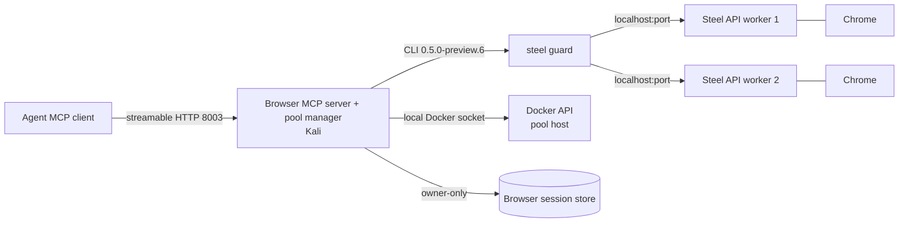

# Steel pool MCP system design

Date: 2026-11-05.
Status: design spec.
Decisions: `docs/design/steel-pool-mcp-decisions.md`.
Plan: `docs/design/steel-pool-mcp-workstream-plan.md`.

## 1. Scope

The browser pool gives polymerhus agents concurrent browsers.
The browser MCP server and the pool manager are one component on Kali.
The Steel API containers are owned by an external operator.
The component discovers them through a local Docker socket.
The component never creates or removes a Steel API container.

The browser session is a durable entity in a store owned by the component.
The live Steel API session is ephemeral.
The component mounts a stored session on any leased worker.

## 2. Topology



The operator owns the Steel API containers and the SSH tunnels.
The eval host is the jump host.
The pool manager sees a local Docker socket and local `localhost:<port>` endpoints.
The pool manager has no SSH logic.

## 3. Components

### 3.1 Browser MCP server

FastMCP 2.14.7 on port 8003.
Streamable HTTP transport.
One MCP session is one browser client.
The MCP session id is the lease key.

Tools:

- `browser_start(name, url=None)`
- `browser_exec(command)`
- `browser_end()`

There is no `browser_status`, no `pool_status`, and no `release_owner`.

### 3.2 Pool manager

Runs in the browser MCP server process.
Reads the Docker API through `STEEL_POOL_DOCKER_SOCKET`.
Selects containers with `STEEL_POOL_LABEL`.
Reads the published API port and the container name.
Builds the worker URL `http://localhost:<port>`.
Checks `GET /v1/health` before use.
Counts reachable workers against `STEEL_POOL_SIZE`.
Raises a warning when the reachable count is lower.

The pool manager never creates, starts, stops, or removes a container.

### 3.3 Browser session store

A directory owned by the browser MCP server.
The path comes from `STEEL_SESSION_STORE` through `SessionStore.from_env`.
The store refuses to guess a root when the variable is unset.
A new root is created with mode 0700.
An existing root with group or other permission bits fails loud.
A symlinked root fails loud.
Record files are mode 0600.
Writes are atomic: a same-directory temp file, `fsync`, rename, parent `fsync`.
Reads do not follow symlinks.
The record validates every field at construction, so the store never writes a
record it would reject on load.
The agent never reads the files.

### 3.4 CLI adapter

The pinned CLI is `0.5.0-preview.6`.
The CLI runs through `kali/steel_guard.py`.
The guard keeps the existing command sanitization, live-session check,
classification, and trace.
The adapter passes the worker `--api-url` and the bound session.
The adapter never exposes the worker to the agent.

### 3.5 Steel API worker contract

Image `steel-browser-api:v0.5.5-beta`.
`--no-nginx`.
`ENABLE_COMMANDS_API=true`.
`HOST=0.0.0.0`.
`DOMAIN=localhost:<port>`.
`CDP_DOMAIN=localhost:<port>`.
The operator publishes the API port on the pool host loopback.
The 9222 CDP port stays internal.
The operator labels the container with the pool label.

## 4. Data model

### 4.1 Browser session record

```json
{
  "name": "polymerhus-hunt-abc",
  "account": "alice",
  "cookies": [],
  "localStorage": {},
  "sessionStorage": {},
  "indexedDB": {},
  "createdAt": "2026-11-05T12:00:00+00:00",
  "updatedAt": "2026-11-05T12:00:00+00:00"
}
```

`name` is the stable handle and the store key.
The store grammar is `[A-Za-z0-9][A-Za-z0-9_-]{0,127}`.
It is deliberately stricter than the CLI `--session` argument, which accepts
any string, because the name is also a file name.
The MCP layer rejects a name outside the grammar before the store.
`account` is the auth-store reference.
`cookies` and `localStorage` are the restorable fields.
`sessionStorage` and `indexedDB` are evidence fields.

### 4.2 Lease record

In memory only.

- `mcp_session_id`
- `session_name`
- `worker_id`
- `worker_url`
- `steel_session_id`
- `state`
- `last_activity`
- `last_heartbeat`
- `created_at`

### 4.3 Worker record

- `container_id`
- `container_name`
- `api_port`
- `url`
- `healthy`
- `lease`

## 5. Lifecycle

### 5.1 Start

1. Validate the session name.
2. If the MCP session already has a lease, return it.
3. Acquire a free healthy worker.
4. Load the stored record for `name`, if present.
5. Create the Steel API session on the worker with `sessionContext` from
   cookies and localStorage.
6. Attach the CLI 0.5.0-preview.6 to the new session id.
7. Record the lease.
8. Start the heartbeat task.
9. Optionally navigate to `url`.
10. Return the session name and Steel session id.

If the API create fails, free the worker.
If the CLI attach fails, release the API session and free the worker.

### 5.2 Execute

1. Resolve the lease for the MCP session.
2. Reject the command when no lease is active.
3. Pass the command through the guard.
4. Run the CLI with the worker `--api-url` and the bound session.
5. Reset `last_activity`.
6. Return the CLI envelope.

### 5.3 End

1. Capture the API session context.
2. Save the record atomically.
3. Stop the CLI session.
4. Release the API session.
5. Cancel the heartbeat.
6. Free the worker.

Capture failure does not block the stop or the release.
The record is saved only when the capture succeeds.

### 5.4 Heartbeat

One task per active lease.
Period: 120 seconds.
Command: CLI `get url`.
The task runs only when the lease is idle.
Every browsing command resets the idle clock.
The task updates `last_heartbeat`.

### 5.5 Lease TTL

TTL: 600 seconds.
The TTL is authoritative.
If no browsing command and no heartbeat for 600 seconds, the lease is ended.
The end path captures, stops, and releases.
The TTL is the backstop when the MCP server cannot observe the client.

### 5.6 Release signals

- Explicit `browser_end`.
- MCP session close.
- FastMCP session-close hook.
- MCP server shutdown or project stop.
- TTL.

CLI daemon death is not in scope.
CDP sidecar death is not a release.
Worker session gone is not in scope.

## 6. State machines

### 6.1 Worker

`free` -> `leased` -> `draining` -> `free`
`free` -> `quarantined`

A worker is quarantined after a failed health check or a failed release.
A quarantined worker is not leased again in the same run.

### 6.2 Lease

`acquiring` -> `mounting` -> `active` -> `ending` -> `released`
`acquiring` -> `released` on pool exhaustion or create failure
`mounting` -> `released` on attach failure
`active` -> `released` on TTL or MCP close

### 6.3 MCP session

`open` -> `leased` -> `closed`
The close hook ends the lease.

## 7. Failure and compensation

| Failure | Effect | Compensation |
| --- | --- | --- |
| Pool exhausted | Start fails | Typed `pool_exhausted` after the bounded wait |
| Docker discovery down | No workers | Warning and failed start |
| Worker unhealthy | Worker skipped | Quarantine |
| Store corrupt | Start fails closed | No API create |
| Store root not owner-only | Store construction fails | Deployment fixes the root |
| Store root is a symlink | Store construction fails | Deployment fixes the root |
| API create fails | No session | Free worker |
| CLI attach fails | Orphan API session | Release API and free worker |
| Command fails | Lease stays active | Guard envelope |
| Capture fails | State not saved | Stop and release anyway |
| MCP close | Lease active | Capture, stop, release |
| Server shutdown | All leases active | Capture, stop, release all |
| Heartbeat stops | TTL expires | Capture, stop, release |
| TTL fires | Lease active | Capture, stop, release |

## 8. Configuration

- `STEEL_MCP_PORT=8003`
- `STEEL_POOL_DOCKER_SOCKET`
- `STEEL_POOL_LABEL=polymerhus.steel-pool=true`
- `STEEL_POOL_SIZE=4`
- `STEEL_POOL_WAIT_S=30`
- `STEEL_POOL_HEALTH_S=30`
- `STEEL_HEARTBEAT_S=120`
- `STEEL_LEASE_TTL_S=600`
- `STEEL_SESSION_STORE=/var/lib/steel/sessions`
- `STEEL_CLI=/opt/localbin/.steel/steel`
- `STEEL_GUARD=/opt/kali/steel_guard.py`
- `STEEL_WORKER_API_SUFFIX=/v1`

## 9. Security

- The pool manager reads the Docker socket through the operator's tunnel.
- The component has no Docker write logic.
- The worker API is reachable only through the operator's loopback forward.
- The worker CDP port is not exposed.
- The session store is owner-only.
- The agent never reads store files.
- The store name is the access key.
- The command passes through the existing guard.
- No secret is logged.
- No service is exposed to the internet.

## 10. Observability

Structured JSON events:

- `pool.discovered`
- `pool.warning`
- `lease.acquire`
- `lease.mount`
- `lease.exec`
- `lease.heartbeat`
- `lease.release`
- `lease.ttl`
- `lease.error`
- `session.close`
- `server.shutdown`

Each event includes the lease id, MCP session id, worker id, and session name.
No cookies, tokens, or worker URLs are logged.

## 11. Compatibility

- API: v0.5.5-beta.
- CLI: 0.5.0-preview.6.
- The stable 0.4.4 CLI is not supported with this API.
- The future CLI main is the upgrade path.
- The v0.5.5 API does not restore sessionStorage or indexedDB.
- The API root WebSocket proxy is the CLI CDP transport.
- The 9223 nginx proxy is not used.

## 12. E2E

- Eval host: 46.224.225.245.
- Pool host: `dj-viscon-workshop-1.vsos.ethz.ch`.
- The eval host is the jump host.
- The operator forwards the SSH agent and uses one ControlMaster.
- No key pairs are stored on the eval host or the pool host.
- No service is exposed to the internet.
- White Jotter covers the pool, CLI, and CDP path.
- ComfyUI covers the `steel_crawl` path.
- The E2E uses v0.5.5 and the 0.5.0-preview.6 CLI.

## 13. Out of scope

- Container creation and lifecycle.
- Multiple simultaneous projects.
- Project-id typing.
- Admin or owner tools.
- The 0.4.4 CLI.
- The 9223 nginx proxy.
- UI and live-view integration.
- `steel_crawl` changes before the last work item.
