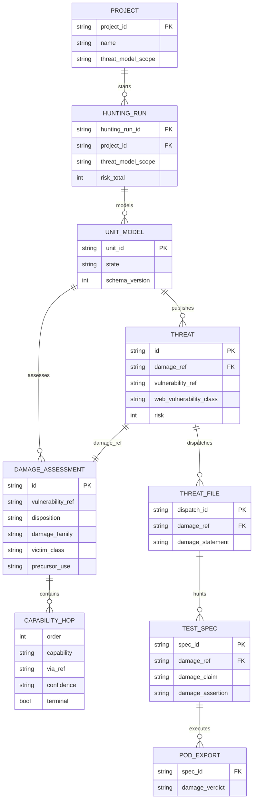
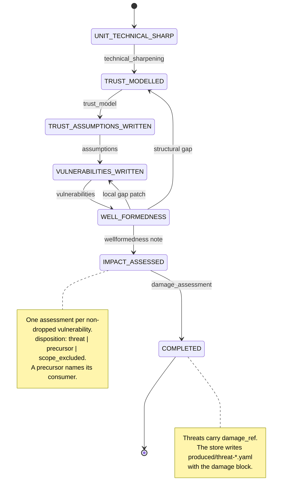
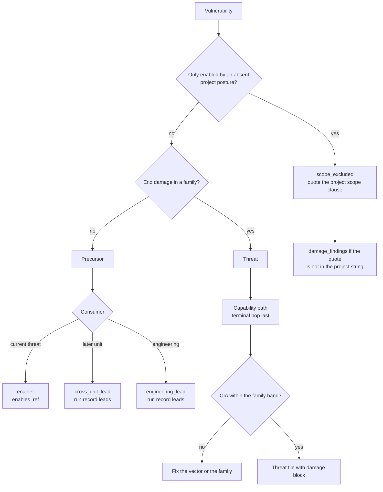
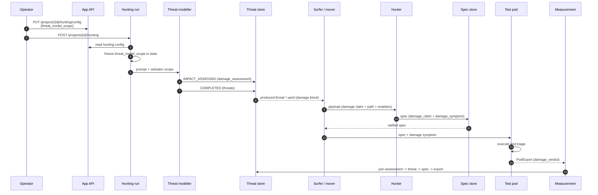
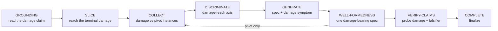
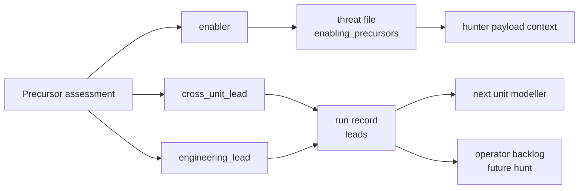

# Change requirement: damage-bearing threat definition and precursor disposition

*Status: superseded 2026-10-26 by `docs/design/impact-assessment-system-spec.md` and `docs/design/impact-assessment-system-prototype.md`.*
*The new spec wins where this document and the new spec disagree.*
*This document is kept as the design history of the damage-first change.*
*Owner: operator.*
*Scope: the threat modeller workflow, the unit threat model schema, the run record, and the measurement.*
*Related: iteration B results, tickets 424-430, `docs/design/threat-model-impact-elicitation-adr.md`.*

## 1. Problem

The current artifact named `threat` admits directions that carry no end damage.
The model can score reconnaissance or a latent capability as confidentiality and integrity loss.
The hunter then receives a damage claim it cannot test, and it produces specs that confirm the pivot rather than the damage.

This is a contract problem, not an agent problem.
`CONTEXT.md` defines a threat as a "ranked research row and dispatch grain: fault -> web vulnerability class -> end impact -> combined risk".
The prompt repeats that definition.
The agent follows the contract.
The contract must change.

### 1.1 Evidence from iteration B

The five cited samples, replayed with the current impact table.

| Sample | Class | CIA | Sub-score | Weight | Risk | Observed end damage | Defect |
|---|---|---|---:|---:|---:|---|---|
| `RESTApi:api/threat-1` | `bfla-alternate-path` | M/M/N | 0.5775 | 3 | 9 | An unauthorized route executes and returns a generic envelope. No data read, no state change. | A capability is scored as damage. |
| `RESTApi:api/threat-2` | `information-disclosure` | H/L/L | 0.7323 | 3 | 9 | The route table is read. Heap and thread dump handles are listed but not fetched. | The claim mixes reconnaissance with an inferred confidentiality path. |
| `RESTApi:api/threat-3` | `broken-function-level-authorization` | M/M/N | 0.5775 | 3 | 9 | A false authentication verdict is returned. No actor, no data, no state change. | A capability is scored as damage. |
| `Service:sign-in/threat-1` | `rate-limit-bypass` | H/M/N | 0.7140 | 3 | 9 | Account takeover is possible after guessing. The throttle is absent. | The damage is real, but the enabling condition is a deployment artifact. |
| `Service:sign-in/threat-4` | `information-disclosure` | H/M/N | 0.7140 | 3 | 6 | A plaintext observer captures a password and a session. | The damage is real, but the channel is a deployment artifact. |

The arithmetic is the first failure.
`C=medium` and `I=medium` produce a sub-score of 0.5775.
The ordinal weight is 3.
The risk is `3 * 3 = 9`.
The account takeover in `Service:sign-in/threat-1` also scores 9.
The model cannot distinguish a latent authorization capability from an account takeover.

The current metric calls every threat with weight at least 3 "severe".
That definition includes the two latent samples.
The severe share in iteration B was 10 of 26, or 38.5%.
Two of those ten are the latent authorization capabilities.
The metric overstates the severe mass.

### 1.2 The downstream evidence

`RESTApi:api/threat-2` produced this spec:
`hunting/hunter/test-specs/RESTApi-api__threat-2/consumed/information-disclosure__endpoint-index-and-telemetry__json-document__anonymous-get.yaml`.

The spec's verification symptoms are:
- `GET /actuator` returns HTTP 200 and names management endpoint families.
- The index advertises at least one family outside the caller's prior knowledge.

Those symptoms confirm the pivot.
They do not confirm credential or session exposure.
The spec is a correct instance of the threat as written, because the threat's end impact mixes the route-table read with the heap-dump path.
The hunter selected the weakest conjunct.
This is not a hunter defect.
It is a propagation defect.

### 1.3 The prompt teaches the failure

The current prompt says "A threat is a research direction" (line 6).
The low-yield contrast says a soft-404 divergence "is recorded as a threat with `VC = VI = VA = none`" (line 328).
The worked SSRF example ends with "the attacker gains internal reach and can chain the metadata credential into the cloud account" (line 324).
That is a capability chain in prose, not a damage claim with a victim and a terminal effect.
The prompt's own examples permit the failure the operator observed.

### 1.4 The metric consequence

I replayed all 26 stored threats with the proposed dispositions.

| Population | Threats | Green narrow | Green broad | Weight at least 3 | Risk total |
|---|---:|---:|---:|---:|---:|
| All stored | 26 | 10 (38.5%) | 15 (57.7%) | 10 (38.5%) | 122 |
| Damage gate only | 24 | 8 (33.3%) | 13 (54.2%) | 8 (33.3%) | 104 |
| Damage gate plus scope policy | 22 | 8 (36.4%) | 13 (59.1%) | 6 (27.3%) | 89 |

The damage gate lowers the green share.
The two latent samples are green classes.
Removing them removes green numerator and denominator.
The green gate rewards latent green threats.
The gate is a class-mass measure, not a damage measure.

The damage gate also lowers the risk total from 122 to 104.
The `HUNT_RISK_THRESHOLD=110` halt would not have fired after `Service:library-catalog`.
The modeller would have continued to the next units.
The correctness fix buys coverage.

This is the decisive finding.
The operator's damage-first change is correct for artifact quality, but it makes the current headline metric worse.
The metric must be re-based, or the change will look like a regression.

## 2. Root-cause analysis

### 2.1 Hypotheses

**H1. The artifact definition permits a damage-less research direction.**
- Supports: `CONTEXT.md` defines a threat as a ranked research row and dispatch grain.
- Supports: the prompt says "A threat is a research direction".
- Supports: the low-yield contrast stores a zero-impact direction as a threat.
- Conflicts: the completion section already asks for a literal end damage.
- Assessment: confirmed. The definition wins over the later instruction.

**H2. The impact scoring collapses distinct damage into one ordinal.**
- Supports: `C=medium` and `I=medium` yield weight 3, the same weight as the account takeover.
- Supports: the severe metric is `weight >= 3`, so it cannot separate latent from realized damage.
- Conflicts: the ordinal is a ranking device, not a damage classifier.
- Assessment: confirmed. The ranking device is being used as a classifier.

**H3. The end-impact claim is not atomic.**
- Supports: `RESTApi:api/threat-2` mixes a route-table read with a heap-dump path in one string.
- Supports: `RESTApi:api/threat-1` states a capability and a conditional consequence in one string.
- Conflicts: the model has a `canonical_class` and a `vulnerability_ref`, so the pivot is already identified.
- Assessment: confirmed. One free-text field carries several claims, and the weakest one survives downstream.

**H4. The damage claim does not propagate to the spec contract.**
- Supports: the actuator spec tests the index, not the credential exposure.
- Supports: the spec contract has no damage field.
- Conflicts: the hunter receives the end impact in its prompt.
- Assessment: confirmed. The impact is context, not an acceptance criterion.

**H5. Deployment artifacts are not separated from application faults.**
- Supports: the rate-limit sample is enabled by the test deployment's absent throttle.
- Supports: the plaintext sample is enabled by the test deployment's HTTP origin.
- Conflicts: both are legitimate classes in a real deployment.
- Assessment: confirmed as a scope problem, not the root cause.

### 2.2 Root hypothesis

The root cause is the conjunction of H1, H2, and H3.
The contract calls a research direction a threat.
The scoring turns a medium-medium capability into a severe impact.
The claim shape lets several damages share one string, so the weakest conjunct reaches the hunter.
H4 is the propagation failure that makes the root cause visible downstream.
H5 is a scope decision that the contract currently hides.

### 2.3 What the current contract says

- `CONTEXT.md`: a threat is "fault -> web vulnerability class -> end impact -> combined risk".
- `CONTEXT.md`: a threat is "a research direction in the variant and manifestation space".
- `CONTEXT.md`: end impact is "the attacker capability gained, the application state reached, and the literal damage".
- The prompt: "Retention first. The hypothesis is stated broadly at the trust-agreement level; vectors and payloads belong to the hunters."
- The prompt: "A drop requires ONE of two findings: the data is not attacker-influenced; the trust agreement is misspecified."

The retention rule protects recall.
It does not require damage.
The change must keep the recall protection for the trust model, and move the damage test to the artifact boundary.

## 3. Change requirement

### 3.1 Definitions

**Threat.**
A threat is a claim of end damage to the application, its users, or its infrastructure, plus the evidenced fault that enables it.
A threat is broad in the technique and precise in the damage.
The hunter owns the technique.
The modeller owns the damage and the capability path.

**Precursor.**
A precursor is an evidenced capability that does not reach an end damage by itself.
A precursor is recorded in the unit model, linked to the damage it can enable, and never dispatched as a threat.
A precursor consumes no risk budget.

**Capability path.**
A capability path is the ordered set of capabilities that connects the modelled vulnerability to the terminal damage.
Each hop names what the attacker gains and which modelled vulnerability or observed surface provides it.
A hop never names a request, a payload, a parameter, a tool, or a procedure.
The path is not an attack plan.
It is a damage-reachability argument.

**Scope exclusion.**
A scope exclusion is a run-level policy entry that removes a class or an assumption kind from threat modelling.
The exclusion is recorded on the unit model and on the run record.
The prompt never carries a hidden exclusion.

### 3.2 Damage families and victims

The `damage_family` is a closed enum.
The `victim_class` is a closed enum.
The `victim_asset` is a short noun phrase.

| Family | End damage | Typical victim assets |
|---|---|---|
| `none` | No end damage. The record is a precursor. | The surface, the route table, a capability. |
| `data_confidentiality` | Read access to data the attacker should not read. | User PII, application data, logs, traces, metrics. |
| `data_integrity` | Create, change, or delete data or persisted state the attacker should not change. | Persisted content, user records, configuration, audit data. |
| `availability` | Deny or degrade the application or a user's access. | Service availability, a tenant's access, a user's account access. |
| `code_execution` | Execute code or commands in the application or its infrastructure. | The application host, the runtime, the container, the network. |
| `account_takeover` | Control another principal's account or session. | A user account, an administrator account, a service identity. |

| Victim class | Meaning |
|---|---|
| `user` | An end user's data, account, or access. |
| `application` | The application's data, state, telemetry, or availability. |
| `infrastructure` | The host, runtime, network, or cloud account the application depends on. |

`code_execution` and `account_takeover` are compound damages.
They are allowed to carry several CIA effects.
They still name one terminal effect and one victim.

### 3.3 The damage assessment record

The modeller writes one `damage_assessment` section at the new `IMPACT_ASSESSED` gate.

```yaml
damage_assessment:
  - id: DA-1
    vulnerability_ref: V-1
    disposition: threat            # threat | precursor | scope_excluded
    damage_family: data_confidentiality
    victim_class: user
    victim_asset: "user PII in application logs"
    damage_statement: "The attacker reads another user's PII from the application logs."
    capability_path:
      - order: 1
        capability: "reach the log viewer"
        via_ref: V-1
        confidence: OBSERVED
        evidence_refs: ["exec:probe-12"]
        terminal: false
      - order: 2
        capability: "read another user's PII"
        via_ref: V-1
        confidence: INFERRED
        evidence_refs: ["http_01..."]
        terminal: true
    confidence: INFERRED
    precursor_use: enabler        # enabler | cross_unit_lead | engineering_lead
    enables_ref: DA-2
    cross_unit_lead: null
    engineering_note: ""
    exclusion_ref: ""
```

Field rules:
- `id` is `DA-<n>`, unique in the unit.
- `vulnerability_ref` resolves to a non-dropped `V-*`.
- `disposition=threat` requires a non-`none` family, a terminal hop, and a non-empty statement.
- `disposition=precursor` requires `damage_family=none`, at least one hop, and one `precursor_use`.
  - `precursor_use=enabler` requires `enables_ref` to a `threat` assessment in the same unit.
  - `precursor_use=cross_unit_lead` requires `cross_unit_lead={unit_id, capability}`.
  - `precursor_use=engineering_lead` requires a non-empty `engineering_note`.
  No precursor is left without a consumer.
- `disposition=scope_excluded` requires `damage_family=none`, a resolvable `vulnerability_ref`, and an `exclusion_ref` of the form `scope:<quoted clause>`.
  The quoted clause must appear verbatim in the project scope string.
  A mismatch is a non-blocking `damage_findings` signal.
- `damage_statement` is one sentence.
  It names the victim and the effect.
  It does not name a request, a payload, or a tool.
- `capability_path` has one to four hops.
  Exactly one hop is terminal, and it is the last hop.
  The terminal capability is the damage statement's effect.
- Every hop carries a confidence degree and at least one evidence reference.
- `confidence` is the minimum of the hop confidences.
- `cross_unit_lead` names the target unit and the capability gained.
  It is a lead, not a threat.
  It is never dispatched.

`Threat` gains one field:
```yaml
damage_ref: DA-1
```
`Threat.impact.end_impact` copies `damage_statement` verbatim.
The store checks the copy, never re-derives it.

#### 3.3.1 Precursor consumers

A precursor is not a discarded threat.
It is a capability that has not reached an end damage yet.
Every precursor names one consumer, so it is never stale.

| `precursor_use` | Consumer | Artifact | Behaviour |
|---|---|---|---|
| `enabler` | The damage-bearing threat in the same unit. | The threat file's `enabling_precursors` list. | The hunter receives the precursor as context for the terminal damage. It is not dispatched as a separate hunt. |
| `cross_unit_lead` | The modeller of the target unit. | The run record's `leads` list. | When the target unit is modelled, the run injects the lead into the modeller prompt as prior insight. It is not dispatched as a threat. |
| `engineering_lead` | The operator and the attack-engineering backlog. | The run record's `leads` list. | It is exported in the run report with the capability, the evidence, and the candidate damage families. It is never dispatched automatically. |

The `enabler` precursor rides the threat file.
The threat file's `enabling_precursors` is a list of `{assessment_id, capability, evidence_refs}`.
The hunter payload renders it under `## Enabling capabilities`.
The hunter uses it to choose the path to the terminal damage, not to test the precursor as a damage claim.

The `cross_unit_lead` and `engineering_lead` precursors ride the run record.
The run record's `leads` is a list of `{unit_id, assessment_id, use, capability, target_unit, evidence_refs, engineering_note}`.
The measurement reports the use split.
The operator can promote an `engineering_lead` into a future ticket or a later run.
The model is not mutated after COMPLETED.

This answers the "what is a precursor for" question without adding a second dispatch type.
The precursor has three named consumers: the current threat, the next unit's modeller, and the engineering backlog.

### 3.4 The capability path and the ownership boundary

The ownership boundary is the level of abstraction, not the presence of a sequence.

| The modeller writes | The hunter writes |
|---|---|
| The capability gained at each hop. | The request, payload, parameter, and tool. |
| The modelled vulnerability or observed surface that provides the hop. | The technique, bypass, and variant. |
| The terminal damage and its victim. | The test procedure and the verification symptoms. |
| The confidence and the evidence for each hop. | The falsification experiment. |

A hop that needs a request, a payload, or a tool to be understood is too deep.
A hop that names only "the attacker does X" without a `via_ref` is too vague.

The path is limited to the unit.
A cross-unit chain is a `cross_unit_lead`.
It names the target unit and the capability.
It does not invent the target unit's model.

### 3.5 CIA consistency bands

The bands are consistency checks, not severity floors.
A low-severity real damage remains a threat.

| Family | Consistency rule |
|---|---|
| `none` | `C`, `I`, and `A` are all `none` or `low`, and at most one is `low`. |
| `data_confidentiality` | `C` is at least `low`. |
| `data_integrity` | `I` is at least `low`. |
| `availability` | `A` is at least `low`. |
| `code_execution` | `I` is at least `medium` or `A` is at least `medium`. |
| `account_takeover` | `C` is at least `medium` and `I` is at least `medium`. |

The band is a backstop.
The capability path is the primary check.
A threat with a `data_confidentiality` family and `C=medium` still passes the band.
The terminal hop must show how the data is reached.

### 3.6 Workflow: the sixth gate

The state machine becomes six gates.

| # | State | Section | Exit |
|---|---|---|---|
| 1 | `UNIT_TECHNICAL_SHARP` | `technical_sharpening` | One gate write. |
| 2 | `TRUST_MODELLED` | `trust_model` | One gate write. |
| 3 | `TRUST_ASSUMPTIONS_WRITTEN` | `assumptions` | One gate write. |
| 4 | `VULNERABILITIES_WRITTEN` | `vulnerabilities` | One gate write. |
| 5 | `IMPACT_ASSESSED` | `damage_assessment` | One gate write. |
| 6 | `COMPLETED` | `threats` | One gate write. |

The well-formedness loop runs after `VULNERABILITIES_WRITTEN` and before `PRIOR_ART`.
The loop can add assumptions and vulnerabilities.
The assessment must cover the final vulnerability set.
The well-formedness note remains the exit memory of that loop.
The `IMPACT_ASSESSED` gate carries its own exit note, kind `damage`.

The harness stays passive.
A gate write is accepted in any order.
The state is monotonic.
The trajectory records the gate.
The completion check reports the findings.
The existing `validation.valid` contract is the dispatch gate.

### 3.7 Completion and dispatch semantics

`check_completion` gains a damage check.
The blocking findings land in the existing lists, so `validation.valid` becomes false when the damage contract is broken.
A dead-end precursor is a non-blocking `damage_findings` signal, beside `class_findings`.
A precursor is a valid terminal disposition, not an incomplete threat.

`missing`:
- `assessment:<id>.<field>` for a missing required field.
- `assessment:<id>.capability_path` for a missing path or a missing terminal hop.
- `assessment:<id>.precursor_use` for a precursor with no consumer.
- `assessment:<id>.engineering_note` for an `engineering_lead` with no handoff note.
- `threat:<id>.damage_ref` for a missing or unresolved reference.
- `threat:<id>.impact.end_impact` when it does not copy the assessment statement.
- `threat:<id>.impact.band` when the CIA vector violates the family band.

`unclosed`:
- `vulnerability:<id>.damage_assessment` when a non-dropped vulnerability has no assessment.
- `assessment:<id>.threat` when a `threat` assessment has no threat.
- `assessment:<id>.exclusion` when a scope exclusion names no project scope clause.

`damage_findings` (non-blocking):
- `assessment:<id>.exclusion` when the quoted clause is not a verbatim substring of the project scope string.
  This is a scope-audit signal, not a contract breach.

`Validation` gains one list, `damage_findings`, beside `class_findings`.
It never makes the model invalid.
`check_completion` takes an optional `project_scope: str | None`.
The store receives the run-frozen scope at construction, beside the suite index.

`referential_errors`:
- `assessment:<id>.vulnerability_ref` when it does not resolve.
- `capability_path:<n>.via_ref` when it does not resolve to a vulnerability or an evidence reference.
- `assessment:<id>.enables_ref` when it does not resolve to a `threat` assessment in the same unit.
- `assessment:<id>.cross_unit_lead` when the target unit id is empty or equal to the current unit.
- `threat:<id>.damage_ref` when the assessment's `vulnerability_ref` differs from the threat's `vulnerability_ref`.

The existing `is_consumable` predicate is unchanged.
A model with `validation.valid=false` is not consumable, is not dispatched, and does not enter the risk total.
The pass already treats an invalid COMPLETED model as degraded.
No new dispatch mechanism is needed.

Precursors and scope exclusions are `DamageAssessment` records.
They are not `Threat` records.
They are not written to `produced/threat-*.yaml`.
They are not dispatched.
They do not enter `risk_profile` or `risk_total`.

The run record gains the precursor consumers.

```yaml
stats:
  threat_model_scope: "<the frozen project string>"
  damage_bearing: 8
  precursors: 2
  scope_excluded: 2
  precursor_uses:
    enabler: 1
    cross_unit_lead: 1
    engineering_lead: 0
  leads:
    - unit_id: RESTApi:api
      assessment_id: DA-7
      use: cross_unit_lead
      capability: "read the management route table"
      target_unit: Service:library-catalog
      evidence_refs: ["exec:api-36"]
      engineering_note: ""
```

`ModelSum` gains `damage_bearing`, `precursors`, `scope_excluded`, `precursor_uses`, and `damage_families`.
The run record's `leads` is the union of the `cross_unit_lead` and `engineering_lead` assessments.
The `enabler` assessments ride the threat file instead.
The measurement reports the use split and the lead count.

### 3.8 Project scope attribute

Add one attribute to the project domain model.

```python
class Project:
    project_id: str
    name: str
    created_at: datetime
    threat_model_scope: str
```

`threat_model_scope` is a free-text posture statement.
It is not a structured exclusion list.
It describes the security posture the target is assumed to have.
The modeller must exclude the threats that only exist because that posture is absent.

The persistence is `settings.hunting.threat_model_scope`.
The existing hunting settings already own the run-frozen configuration (`pipeline_sync`, `risk_threshold`), the deep-merge partial PUT, and the REST surface.
A new `projects` column would need a migration and a second write path.
The domain attribute is the same either way.
The storage choice is the settings blob.

The REST surface is the existing hunting config pair.

```http
GET /projects/{project_id}/hunting/config
PUT /projects/{project_id}/hunting/config
Content-Type: application/json

{"threat_model_scope": "The target is assumed to have ..."}
```

- The PUT is a partial deep merge.
  A PUT that sets only `threat_model_scope` never drops `pipeline_sync` or `risk_threshold`.
- `HuntingConfigUpdate` gains `threat_model_scope: str | None`, with `extra="forbid"`.
- The GET returns the stored string, or `""`.
- The project read may expose the field read-only.
  The hunting config is the authoritative surface.

The run reads the string once at start.
It freezes the string in the run record as `stats.threat_model_scope`.
It appends the string verbatim to the threat modeller prompt under `## Project scope (verbatim)`.
The prompt never paraphrases the string.
An empty string appends nothing.

The unit model records every `scope_excluded` assessment with `exclusion_ref`.
The `exclusion_ref` is `scope:` followed by the quoted clause that justifies the exclusion.
The measurement reports the project string, the exclusion count, and the quoted clauses.

Example string:

```text
The target is assumed to have a minimally robust application security posture.
Transport encryption, rate limiting, anti-automation controls, and secure
credential handling are presumed present and correct.
Do not model a threat whose only enabling condition is the absence of one of
those controls. Model only the threats that survive that posture.
```

The string is a project assumption, not a hidden evaluation detail.
It is visible to the operator, the model, and the measurement.
It is the honest form of the operator's request to exclude the deployment-artifact classes.
The damage gate already demotes the latent authorization samples.
The project scope is the lever for the posture-dependent classes.

### 3.9 Prompt changes

The prompt must change in six places.

1. **The definition.**
   Replace "A threat is a research direction: fault -> web vulnerability class -> end impact -> combined risk" with the damage-bearing definition.
   State that a damage-less direction is a precursor.

2. **The six states.**
   Add `IMPACT_ASSESSED` and its gate.
   Move the well-formedness loop before the assessment.

3. **The damage section.**
   Add the family table, the victim table, the atomic claim rule, the capability path rule, and the ownership boundary.
   Put it after the vulnerability citation and before the well-formedness section.

4. **The completion section.**
   Replace "state the attacker capability gained, the application state reached, and the literal end damage" with the assessment fields.
   Add the closure rules.
   Keep the "never author a score" rule.

5. **The low-yield contrast.**
   Replace "recorded as a threat with `VC = VI = VA = none`" with "recorded as a precursor with `damage_family=none`; it is not a threat and it does not enter the dispatch queue".

6. **The worked SSRF example.**
   Rewrite the impact as one damage claim with one victim and a terminal hop.
   Mark the terminal hop's confidence.
   Explain that the hunter tests the terminal damage, not the SSRF reachability alone.

The exact replacement text is in section 3.9.1.

#### 3.9.1 Replacement text

**Definition.**

> A threat is a claim of end damage to the application, its users, or its infrastructure, plus the evidenced fault that enables it.
> A threat is broad in the technique and precise in the damage: it names the capability path and the terminal damage, and it leaves the request, payload, and procedure to the hunter.
> A direction that yields only discovery, or a capability with no end damage, is a precursor, not a threat.
> A precursor is recorded in the damage assessment and is never dispatched as a threat.

**The damage section.**

> ## Damage assessment (IMPACT_ASSESSED)
>
> Assess every non-dropped vulnerability before you write the threats.
> For each one, name one damage family, one victim, and one damage statement.
> The statement is one sentence. It names the victim and the effect. It does not name a request, a payload, or a tool.
>
> The damage families are `none`, `data_confidentiality`, `data_integrity`, `availability`, `code_execution`, and `account_takeover`.
> `none` is a precursor. It has no end damage and it does not enter the risk total.
>
> When the damage is real, record the capability path that reaches it.
> Each hop names the capability gained and the vulnerability or observed surface that provides it.
> Each hop carries a confidence degree and its evidence.
> The last hop is terminal and carries the damage statement's effect.
> The path has at most four hops and stays inside this unit.
> A path that needs the next unit is a `cross_unit_lead`, not a threat.
>
> If the damage is only discovery, record a precursor.
> Do not invent a chain to satisfy the assessment.
> A capability that does not reach damage is still useful: link it to the threat it enables, or record the cross-unit lead.
>
> The hunter owns the technique. You must not write a request, a payload, a parameter, a tool, or a procedure in the capability path.

**The low-yield contrast.**

> **Low-yield contrast.** A soft-404 contract divergence is a precursor with `damage_family=none`.
> It is recorded in `damage_assessment` and is not a threat.
> It does not enter the risk total or the dispatch queue.

**The SSRF example.**

> **Damage assessment.** `DA-1`: `data_confidentiality`, victim `infrastructure`, asset "another tenant's cloud objects".
> The statement is "The attacker reads another tenant's objects from the cloud object store."
> The path is: reach the metadata endpoint (`OBSERVED`), read the instance credential (`INFERRED`), read another tenant's objects (`ASSUMED`, terminal).
> The threat confidence is `ASSUMED`, so the likelihood is lowered.
> The hunter tests the metadata read and the credential use, not the SSRF reachability alone.

### 3.10 Downstream contract (companion)

The threat change alone is not sufficient.
The actuator spec proves the hunter can test the pivot.
This section maps every downstream contract and workflow change.

#### 3.10.1 The threat file

The threat file is the dispatch record.
It gains a denormalised `damage` block, so the hunter does not need the model document for the damage fields.

```yaml
threat_id: threat-2
unit_id: RESTApi:api
dispatch_id: RESTApi-api__threat-2
damage:
  damage_ref: DA-2
  damage_family: data_confidentiality
  victim_class: infrastructure
  victim_asset: "the service credential and session material"
  damage_statement: "The attacker reads live credential material from the process dump."
  capability_path:
    - order: 1
      capability: "read the management route table"
      via_ref: V-10
      confidence: OBSERVED
      evidence_refs: ["exec:api-36"]
      terminal: false
    - order: 2
      capability: "reach the heap-dump handle"
      via_ref: V-10
      confidence: INFERRED
      evidence_refs: ["exec:api-35"]
      terminal: false
    - order: 3
      capability: "read live session material"
      via_ref: V-10
      confidence: ASSUMED
      evidence_refs: []
      terminal: true
  enabling_precursors: []
threat:
  impact:
    confidentiality: high
    integrity: medium
    availability: none
    end_impact: "The attacker reads live credential material from the process dump."
  damage_ref: DA-2
```

The `damage` block is copied from the assessment at the COMPLETED write.
The `threat.impact.end_impact` copies the statement verbatim.
The store checks the copy.

#### 3.10.2 The hunter payload

`materialise_hunter_payload` adds one key.

```python
{
    "damage": {
        "damage_ref": "DA-2",
        "damage_family": "data_confidentiality",
        "victim_class": "infrastructure",
        "victim_asset": "the service credential and session material",
        "damage_statement": "The attacker reads live credential material from the process dump.",
        "capability_path": [...],
        "enabling_precursors": [
            {"assessment_id": "DA-1", "capability": "read the route table", "evidence_refs": ["exec:api-36"]}
        ],
    },
    ...
}
```

`_compose_grounding` renders two new sections:
- `## Damage claim`: the family, victim, asset, statement, and the terminal capability.
- `## Enabling capabilities`: the precursor records, when present.

The payload still carries no request, payload, or procedure.
The capability path is the abstraction the hunter deepens.

#### 3.10.3 The spec contract

`DamageSymptom` is a typed model.

```python
class DamageSymptom(BaseModel):
    claim_ref: str          # DA-*
    victim_asset: str       # copied from the assessment
    assertion: str          # the observation that proves the terminal damage
    falsifier: str          # the observation that would refute it
    evidence_kind: Literal["http", "session", "data", "log", "other"]
```

`SpecWrite` gains three fields:
- `damage_claim: str`: copied verbatim from the threat's `damage_statement`.
- `damage_symptom: DamageSymptom | None`.
- `provenance.damage_ref: str`.

`SpecProvenance` gains `damage_ref: str`.

The rules:
- A `hypothesised` draft may omit the damage fields.
- A `ratified` spec must carry all three.
- `damage_claim` equals the bound threat's `damage_statement`.
- `provenance.damage_ref` equals the bound threat's `damage_ref`.
- `damage_symptom.claim_ref` equals `provenance.damage_ref`.
- `damage_symptom.victim_asset` equals the assessment's `victim_asset`.
- `damage_symptom.assertion` and `.falsifier` are non-empty.
- The spec identity is unchanged: `<class>__<value>__<value>`.
  The damage fields never enter the file stem.
- A `dropped` spec needs no damage fields, but its drop reason must say why.

The bound values come from the hunter tool construction.
The tool already binds the `hunt_key`.
It also binds the expected `damage_ref` and `damage_statement`.
The store compares the spec fields to the bound values, so the hunter cannot link a different assessment.

#### 3.10.4 The spec-set gate

A `ratified` set is acceptable only when:
- every `ratified` spec carries the damage fields;
- at least one `ratified` spec has a `damage_symptom` whose `assertion` targets the terminal damage;
- no `ratified` spec's `damage_symptom` merely restates the pivot.

The first two are deterministic.
The third is a judgement the pod triager and the assessment own.
The set gate records a coded rejection when the first two fail.
It records a `damage_findings` signal when the set looks pivot-only by the structured fields.
The prompt teaches the judgement.

The deterministic checks cannot prove that an assertion is semantically a damage.
The typed fields make the claim explicit and auditable.
The pod verdict makes it falsifiable.

#### 3.10.5 The hunter workflow

The eight passes do not change.
The acceptance criteria change.

| Pass | New obligation |
|---|---|
| GROUNDING | Read the damage claim, the capability path, and the enabling precursors. |
| SLICE | The slice must reach the terminal damage. A pivot-only slice is not a valid slice. |
| COLLECT | Collect the instances that separate damage-bearing variants from pivot-only variants. Collect the evidence for the victim asset. |
| DISCRIMINATE | At least one axis must separate damage reach, for example `damage-reach`. Do not vary one primary axis inside a single damage class. |
| GENERATE | Every spec carries the damage claim and the damage symptom. |
| WELL-FORMEDNESS | The set covers the damage claim. At least one spec tests the terminal damage. No spec is pivot-only. |
| VERIFY-CLAIMS | Probe the damage claim and the falsifier, not only the pivot. |
| COMPLETE | Finalize only when every spec is `ratified` or `dropped` and the damage fields are present on every `ratified` spec. |

`hunter_state` adds one signal, `damage_symptom_present`.
It is not a new pass.
It refines the `VERIFY-CLAIMS` and `COMPLETE` acceptance.
`hunter_graph` keeps its topology.

#### 3.10.6 The pod contract

The pod reads the spec.
The runner and triager prompts render the `damage_symptom`.

`PodExport` gains two fields:

```python
damage_verdict: Literal["confirmed", "refuted", "inconclusive"] = "inconclusive"
damage_evidence_refs: list[str] = Field(default_factory=list)
```

- `verdict` stays the spec verdict: `successful` or `unsuccessful`.
- `damage_verdict` is the terminal-damage judgement.
- A `successful` spec with `damage_verdict=refuted` is a valid and useful outcome.
  The pivot worked, the damage did not.
- The `to_envelope` evidence carries both fields.
- The surfer's terminal gate is unchanged.
  The export is still the terminal signal.

#### 3.10.7 The measurement join

The measurement joins four artifacts:
- the unit model's `damage_assessment`;
- the threat file's `damage` block;
- the spec's `damage_claim` and `damage_symptom`;
- the pod export's `damage_verdict`.

It reports:
- `damage_bearing`, `precursors`, `scope_excluded`;
- `damage_confirmed`, `damage_refuted`, `damage_inconclusive`;
- the spec coverage of the damage claim;
- the precursor use split and the leads;
- the 2x2 of damage-bearing and green.

The official assessment reads the damage verdicts.
A `refuted` damage verdict is a narrowing result, not a failed hunt.

#### 3.10.8 The artifact lifecycle

1. The modeller writes `IMPACT_ASSESSED`.
2. The modeller writes `COMPLETED`.
3. The store writes `produced/<unit>/threat-*.yaml` with the `damage` block.
4. The mover consumes the threat file and materialises the hunter payload.
5. The hunter writes `test-specs/<hunt_key>/produced/<spec>.yaml` with the damage fields.
6. The mover consumes the spec and dispatches the pod.
7. The pod writes `test-executor-pod/<spec_id>/<run_id>.yaml` with the damage verdict.
8. The surfer advances the unit.
9. The measurement joins the four artifacts.

The identity chain is:
`UnitThreatModel -> DamageAssessment -> Threat -> ThreatFile -> TestSpec -> PodExport`.

The `damage_ref` is the join key from the assessment to the threat and the spec.
The `dispatch_id` remains the dispatch key.
The spec identity remains the class-and-discriminator key.

This is the full downstream map.
It is a companion ticket.
It must land before the next A/B, or the A/B repeats the actuator-spec failure.

### 3.11 Measurement rebase (companion)

The measurement must report two axes, not one.

- `damage_bearing`: the number of threats with a non-`none` family.
- `precursors`: the number of `none` assessments not scope-excluded.
- `scope_excluded`: the number of policy exclusions.
- `green_share_damage_bearing`: green threats over damage-bearing threats.
- `green_share_all`: green over all stored directions, for continuity.
- `weight_at_least_3_damage_bearing`: the severe share over damage-bearing threats.
- `risk_total_damage_bearing`: the risk total over damage-bearing threats.

The report must show the 2x2 of damage-bearing and green.
The 90% gate must be re-based before the next run.
The iteration B result must be recomputed and reported beside the old result.

The current result is:
- All stored: 10 of 26 green, 38.5%.
- Damage-bearing: 8 of 24 green, 33.3%.
- Damage-bearing plus scope: 8 of 22 green, 36.4%.
- Risk total: 122, 104, and 89.

The gate fails under every definition.
The honest number is lower, and the coverage is higher.

### 3.12 Migration

- `SCHEMA_VERSION` becomes 3.
- The new fields are required for a v3 COMPLETED model.
- No legacy model is migrated.
- A legacy model remains readable and consumable under its stored `validation.valid`.
- A new run uses fresh projects, as the failure-mode removal did.
- The measurement reads v2 and v3.
- The historical docs keep the v2 vocabulary.
- `CONTEXT.md` gains `threat` (revised), `precursor`, `damage family`, `capability path`, and `scope exclusion`.
- `CONTEXT.md` keeps the `_Avoid_: chain` note.
  The term is `capability path`, not `kill chain`.

### 3.13 Tests and acceptance criteria

**Unit tests.**
- The family enum and the victim enum.
- The band table for each family.
- A `none` assessment with `C=medium` fails.
- A `threat` assessment with `C=medium` and `I=medium` passes only when the family is `data_confidentiality` or `data_integrity` and the path is terminal.
- A precursor with no `precursor_use` fails.
- A precursor with `enabler` and an unresolved `enables_ref` fails.
- A precursor with `cross_unit_lead` and an empty target unit fails.
- A precursor with `engineering_lead` and no handoff note fails.
- A `scope_excluded` with no `exclusion_ref` fails.
- A `scope_excluded` whose quote is absent from the project scope yields a `damage_findings` signal, not an invalid model.
- A path with a repeated hop, an unresolved `via_ref`, or more than four hops fails.
- A terminal hop that is not last fails.
- A threat whose `end_impact` does not copy the statement fails.
- A threat whose `damage_ref` does not resolve fails.

**Hunter and pod tests.**
- A `ratified` spec without `damage_claim`, `damage_symptom`, or `provenance.damage_ref` is refused.
- A spec whose `damage_claim` differs from the bound threat statement is refused.
- A spec whose `damage_symptom.claim_ref` differs from `provenance.damage_ref` is refused.
- A `hypothesised` draft may omit the damage fields.
- A `ratified` set with no damage-bearing spec is refused at finalize.
- A pod export carries `damage_verdict` and `damage_evidence_refs`.
- A `successful` pod with `damage_verdict=refuted` is a valid terminal.
- The measurement joins the assessment, the threat file, the spec, and the pod export.

**Store tests.**
- `IMPACT_ASSESSED` is a tracked gate.
- A COMPLETED model with a damage finding has `validation.valid=false`.
- An invalid model is not consumable and is not dispatched.
- A precursor is stored in the model and not written as a `threat-*.yaml`.
- A precursor does not enter `risk_profile` or `risk_total`.

**Prompt tests.**
- The six states are named.
- The definition says "claim of end damage".
- The low-yield contrast says "precursor".
- The SSRF example carries a damage family and a terminal hop.
- The prompt does not say "A threat is a research direction".
- The prompt does not say "recorded as a threat with `VC = VI = VA = none`".

**Regression corpus.**
Build five synthetic fixtures with the shape of the cited samples:
- A latent authorization capability with `C=medium` and `I=medium` becomes a precursor.
- A false-authentication oracle with `C=medium` and `I=medium` becomes a precursor.
- A mixed route-table and heap-dump claim becomes a `data_confidentiality` threat with an `INFERRED` or `ASSUMED` terminal hop.
- A rate-limit claim becomes a threat, or a `scope_excluded` record when the policy excludes `rate-limit-bypass`.
- A cleartext credential claim becomes a threat, or a `scope_excluded` record when the policy excludes the cleartext assumption kind.

**Run-lifecycle tests.**
- `model_sum` reports `damage_bearing`, `precursors`, `scope_excluded`, and `damage_families`.
- `risk_total` sums damage-bearing threats only.
- A 26-threat fixture with the cited dispositions yields risk 89, not 122.
- The run record's `trajectory` contains the `IMPACT_ASSESSED` gate.

**Acceptance criteria.**
1. No damage-less direction is stored as a `Threat`.
2. Every `Threat` has one family, one victim, one statement, one damage ref, and a terminal capability path.
3. The five cited samples replay to the expected dispositions.
4. A damage-invalid model is not consumable and is not dispatched.
5. `risk_total` excludes precursors and scope exclusions.
6. The run record reports the three disposition counts and the damage families.
7. The prompt states the six states and the revised definition.
8. The low-yield contrast and the SSRF example no longer teach a damage-less threat.
9. `tests/attack` and `tests/eval` pass.
10. The next white-jotter run reports the damage-bearing green share and the 2x2.

### 3.14 Prototype

This section is the implementation-shaped view.
It covers the typed structures, the artifact layout, the two agent workflows, and the lifecycle.

#### 3.14.1 Typed structures

```python
class Project(BaseModel):
    project_id: str
    name: str
    created_at: datetime
    threat_model_scope: str = ""


class DamageFamily(StrEnum):
    NONE = "none"
    DATA_CONFIDENTIALITY = "data_confidentiality"
    DATA_INTEGRITY = "data_integrity"
    AVAILABILITY = "availability"
    CODE_EXECUTION = "code_execution"
    ACCOUNT_TAKEOVER = "account_takeover"


class DamageDisposition(StrEnum):
    THREAT = "threat"
    PRECURSOR = "precursor"
    SCOPE_EXCLUDED = "scope_excluded"


class VictimClass(StrEnum):
    USER = "user"
    APPLICATION = "application"
    INFRASTRUCTURE = "infrastructure"


class PrecursorUse(StrEnum):
    ENABLER = "enabler"
    CROSS_UNIT_LEAD = "cross_unit_lead"
    ENGINEERING_LEAD = "engineering_lead"


class CapabilityHop(BaseModel):
    order: int
    capability: str
    via_ref: str
    confidence: Confidence
    evidence_refs: list[str]
    terminal: bool = False


class CrossUnitLead(BaseModel):
    unit_id: str
    capability: str


class DamageAssessment(BaseModel):
    id: str
    vulnerability_ref: str
    disposition: DamageDisposition
    damage_family: DamageFamily
    victim_class: VictimClass
    victim_asset: str
    damage_statement: str
    capability_path: list[CapabilityHop]
    confidence: Confidence
    precursor_use: PrecursorUse | None = None
    enables_ref: str = ""
    cross_unit_lead: CrossUnitLead | None = None
    engineering_note: str = ""
    exclusion_ref: str = ""


class Threat(BaseModel):
    id: str
    fault_ref: str
    vulnerability_ref: str
    canonical_class: str
    web_vulnerability_class: str
    likelihood: Likelihood
    likelihood_rationale: str
    risk_factors: RiskFactors
    confidence: Confidence
    evidences: list[Evidence]
    impact: Impact
    damage_ref: str
    impact_weight: int = 0
    risk: int = 0


class DamageSymptom(BaseModel):
    claim_ref: str
    victim_asset: str
    assertion: str
    falsifier: str
    evidence_kind: Literal["http", "session", "data", "log", "other"]


class SpecWrite(BaseModel):
    status: str
    discriminators: list[Discriminator]
    verification_symptoms: list[str] = Field(default_factory=list)
    assumptions: list[str] = Field(default_factory=list)
    rationale: str = ""
    skills: list[str] = Field(default_factory=list)
    skill_concretised_procedure: SkillConcretisedProcedure | None = None
    provenance: SpecProvenance = Field(default_factory=SpecProvenance)
    damage_claim: str = ""
    damage_symptom: DamageSymptom | None = None


class SpecProvenance(BaseModel):
    run_id: str = ""
    threat_id: str = ""
    unit_id: str = ""
    damage_ref: str = ""
    canonical_class: str = ""
    web_vulnerability_class: str = ""
    baseline_ref: str = ""
    source_recon_refs: list[str] = Field(default_factory=list)
    assumption_ref: str = ""
    playbook: str = ""


class PodExport(BaseModel):
    verdict: Literal["successful", "unsuccessful"] = "unsuccessful"
    terminal_reason: str = "no-symptom-evidence"
    iterations: int = 0
    clean: bool = False
    init_validation: list[str] = Field(default_factory=list)
    variant_specs: list[dict] = Field(default_factory=list)
    raw_observations: list[dict] = Field(default_factory=list)
    interpretations: list[dict] = Field(default_factory=list)
    error: str | None = None
    damage_verdict: Literal["confirmed", "refuted", "inconclusive"] = "inconclusive"
    damage_evidence_refs: list[str] = Field(default_factory=list)


class ModelSum(BaseModel):
    unit_id: str
    total: int
    breakdown: dict[str, int]
    impact_breakdown: dict[str, int]
    damage_bearing: int
    precursors: int
    scope_excluded: int
    precursor_uses: dict[str, int]
    damage_families: dict[str, int]
```

#### 3.14.2 Artifact layout

```text
data/<project_id>/hunting/
├── threat_modeller/
│   ├── produced/<unit>/<unit>.yaml            # model + damage_assessment
│   ├── produced/<unit>/threat-*.yaml          # dispatch record + damage block
│   ├── consumed/<unit>/<unit>.yaml
│   ├── consumed/<unit>/threat-*.yaml
│   └── abandoned/<unit>/<unit>.yaml
├── hunter/
│   └── test-specs/<unit>__<threat>/
│       ├── produced/<class>__<value>__<value>.yaml
│       ├── consumed/<class>__<value>__<value>.yaml
│       └── terminal.yaml
└── test-executor-pod/
    └── <spec_id>/<run_id>.yaml                # PodExport + damage_verdict
```

#### 3.14.3 Data model



#### 3.14.4 Modeller workflow



#### 3.14.5 Damage disposition



#### 3.14.6 Hunting sequence



#### 3.14.7 Hunter workflow



#### 3.14.8 Precursor consumers



#### 3.14.9 Walkthrough

1. The operator sets `threat_model_scope` on the project.
   The hunting config stores it in `settings.hunting`.
2. The operator starts a hunting run.
   The run freezes the string in `stats.threat_model_scope`.
3. The modeller receives the string verbatim.
   It models the unit through the six gates.
4. At `IMPACT_ASSESSED`, the modeller writes one assessment per non-dropped vulnerability.
   A vulnerability with real damage becomes a `threat` with a terminal capability hop.
   A capability with no damage becomes a `precursor` with a named consumer.
   A posture-dependent vulnerability becomes `scope_excluded` with a quoted clause.
5. At `COMPLETED`, the store writes the threat files.
   Each threat file carries the `damage` block and the `damage_ref`.
6. The mover materialises the hunter payload from the model and the threat file.
   The payload carries the damage claim, the capability path, and the enabling precursors.
7. The hunter writes specs.
   Each `ratified` spec carries the damage claim, the damage symptom, and the `damage_ref`.
   The spec set contains at least one terminal-damage spec.
8. The pod executes the spec and writes `damage_verdict`.
   A `successful` pivot with a `refuted` damage verdict is a narrowing result.
9. The measurement joins the four artifacts.
   It reports the damage-bearing green share, the precursor use split, and the leads.

## 4. Risks and mitigations

### 4.1 Goodhart on "severe"

A rule that demands severe damage invites a fabricated chain.
The requirement avoids the demand.
It demands a damage family and a grounded path.
A low-severity real damage remains a threat.
A damage-less capability remains a precursor.
The path confidence and the evidence refs make fabrication visible.
The measurement audits the path lengths and the confidence mix.

### 4.2 Over-restriction

The requirement could demote a real but low-severity finding.
The `data_confidentiality` family accepts `C=low`.
The `data_integrity` family accepts `I=low`.
The `availability` family accepts `A=low`.
The threat stays in the risk ranking with a low weight.
The requirement removes damage-less directions, not low-severity damage.

### 4.3 Unit scope and cross-unit chains

The unit is the modelling grain.
A cross-unit chain cannot be closed by one unit model.
The `cross_unit_lead` records the target unit and the capability, and nothing else.
The run-level layer may surface the lead as a later modelling hint.
It is never dispatched as a threat in this change.
This boundary is deliberate.

### 4.4 Cost

The new gate adds one modeller turn per unit.
The assessment is mostly a restatement of the existing end impact and the existing vulnerability set.
The path hops reuse the existing assumption and vulnerability evidence.
The token cost should be small.
The coverage gain from the lower risk total is larger than the gate cost.

### 4.5 Naming

`CONTEXT.md` retires the name `chain` because it collides with attack kill chains.
The requirement uses `capability path`.
The requirement uses `precursor`, not `direction`.
The requirement keeps `threat` for the damage-bearing artifact.
The vocabulary change is part of the contract change.

## 5. Why this is better than the prompt-only proposal

### 5.1 Where the proposal is right

- The diagnosis is correct. The threat concept admits damage-less directions.
- The damage-first orientation is correct.
- The ownership concern is correct. The modeller must not write the hunter's procedure.
- The environmental-artifact concern is real.
- The "zoom out" intuition is correct, but it needs a bounded, grounded form.

### 5.2 Where the proposal is insufficient

| # | Proposal | Evidence it does not cover | Refined requirement |
|---|---|---|---|
| 1 | Add a prompt instruction to score recon as none. | The current prompt already asks for a literal end damage, and the model still scored `C=medium` and `I=medium`. | A schema field, a band check, and a validation gate. |
| 2 | Rely on the model's prose to separate recon from damage. | `RESTApi:api/threat-2` mixes both in one string. | One family, one victim, one statement, one terminal hop. |
| 3 | Require a chain when the damage is not severe. | A real low-severity finding would be forced into a fabricated chain. | A three-way disposition: threat, precursor, scope exclusion. The precursor names a consumer. |
| 4 | Exclude rate-limit and plaintext in the prompt. | A prompt exclusion is invisible to the run record and cannot be audited. | Your project attribute: `Project.threat_model_scope`, REST-configurable, frozen in the run, appended verbatim, quoted per exclusion. |
| 5 | Keep the 90% green gate. | The damage gate lowers the green share to 33.3%. | A two-axis metric: damage-bearing and green. |
| 6 | Change only the modeller. | The actuator spec tests the pivot, not the damage. | The full downstream map: threat file, payload, spec, pod export, measurement. |
| 7 | Call it a kill chain. | `CONTEXT.md` retires `chain` to avoid the attack-plan collision. | Call it a capability path and bound it to the unit. |
| 8 | Classify precursors and leave them. | A precursor with no consumer is stale material. | A `precursor_use` enum with three named consumers: enabler, cross-unit lead, engineering lead. |
| 9 | No state tracking. | The assessment would be invisible in the run record. | A sixth gate, a `damage` note, run-record disposition counts, and the leads list. |

### 5.3 The decisive difference

The proposal treats the failure as a prompt-wording problem.
The evidence shows a contract problem:
- the artifact definition permits damage-less threats;
- the scoring turns medium-medium into severe;
- the claim shape lets the weakest conjunct reach the hunter;
- the spec contract never tests the damage;
- the headline metric rewards latent green threats.

A prompt change can improve the next sample.
A contract change improves the class of samples.
The refined requirement changes the contract and keeps the prompt honest.

The refined requirement is also cheaper than it looks.
The store already refuses to dispatch an invalid COMPLETED model.
The damage checks ride the existing `validation.valid` gate.
The new gate is one enum member and one section.
The downstream spec field is the only cross-module addition.

## 6. Decisions needed

1. **Ratify the families and the bands.**
   The table in section 3.2 and section 3.5 is a proposal.
   The operator must ratify it before the schema lands.

2. **Re-base the primary metric.**
   The current 90% green gate is a class-mass gate.
   The next run should report `green_share_damage_bearing` and the 2x2.
   Confirm whether the 90% gate applies to the damage-bearing denominator.

3. **Decide the terminal-hop confidence.**
   The proposal accepts an `ASSUMED` terminal hop, with a lowered likelihood.
   The stricter alternative requires an `OBSERVED` or `INFERRED` terminal hop.
   The stricter rule improves evidence and costs recall.

4. **Confirm the project scope storage.**
   The domain attribute is `Project.threat_model_scope`.
   The proposed persistence is `settings.hunting.threat_model_scope`.
   A first-class `projects` column is the alternative.
   The settings blob is cheaper and already owns the run-freeze and REST surface.
   Confirm the storage choice.

5. **Confirm the precursor handoff.**
   The proposal gives every precursor one consumer: enabler, cross-unit lead, or engineering lead.
   Confirm whether the engineering lead is a run-report export only, or whether it also opens a backlog ticket.

6. **Confirm the cross-unit boundary.**
   The proposal records a `cross_unit_lead` and injects it into the target unit's modeller prompt.
   It never dispatches the lead as a threat.
   Confirm that cross-unit chain modelling is a later change.

7. **Confirm the downstream companion.**
   The spec, pod export, and measurement changes are required before the next A/B.
   Confirm that they land in the same change window as the modeller schema.

## 7. Evidence appendix

- `RESTApi:api/threat-1`: `hunting/threat_modeller/consumed/RESTApi-api/threat-1.yaml`.
- `RESTApi:api/threat-2`: `hunting/threat_modeller/consumed/RESTApi-api/threat-2.yaml`.
- `RESTApi:api/threat-3`: `hunting/threat_modeller/consumed/RESTApi-api/threat-3.yaml`.
- `Service:sign-in/threat-1`: `hunting/threat_modeller/consumed/Service-sign-in/threat-1.yaml`.
- `Service:sign-in/threat-4`: `hunting/threat_modeller/consumed/Service-sign-in/threat-4.yaml`.
- The actuator spec: `hunting/hunter/test-specs/RESTApi-api__threat-2/consumed/information-disclosure__endpoint-index-and-telemetry__json-document__anonymous-get.yaml`.
- The current prompt: `src/polymerhus/attack/hunting/prompts/threat-modeller.md`.
- The current schema: `src/polymerhus/attack/hunting/threat_model.py`.
- The current store: `src/polymerhus/attack/hunting/threat_model_store.py`.
- The current pass: `src/polymerhus/attack/hunting/threat_modeller.py`.
- The current run record: `src/polymerhus/attack/hunting/run_lifecycle.py`.
- The iteration B result: `docs/experiments/hunt-enhancement/iteration-b-white-jotter-2026-10-25/RESULTS.md`.
- The iteration B measurement: `docs/experiments/hunt-enhancement/iteration-b-white-jotter-2026-10-25/artifacts/measurements.md`.
