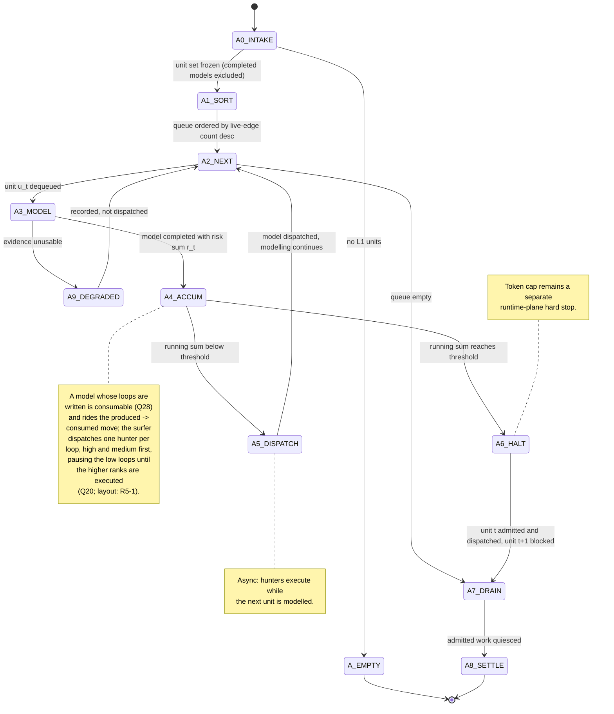
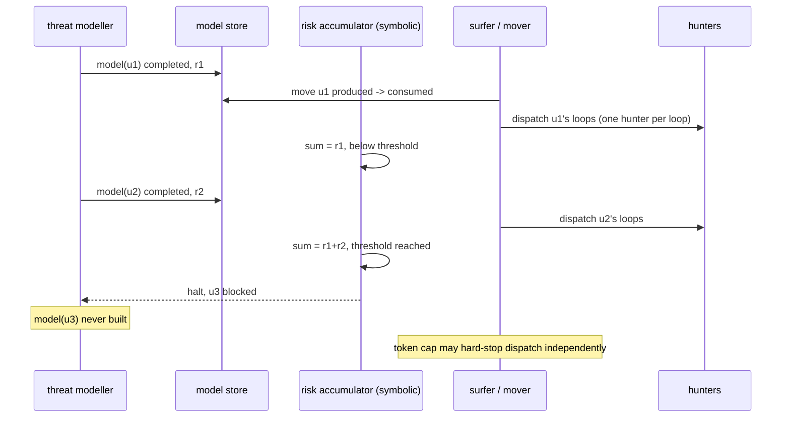

# Unit threat model - grilling workbench

> **Vocabulary note (2026-10-25).** The artifact called a **loop** in this historical document is now a **threat** in the module and the current documentation.

> **Superseded 2026-10-25.** The likelihood-only risk score (Q33, R3-1) and the failure-mode artifact are amended by `docs/design/threat-model-impact-elicitation-adr.md`. The impact is now first-class (`VC/VI/VA`), the risk is `likelihood_weight * impact_weight`, and the failure modes are removed.


- Change: the hunt-orchestrator (fault-space breadth explorer) is rewritten in place into the threat modeller, which publishes a formal unit threat model per discretely testable unit.
- Branch: `design/unit-threat-model`.
- Worktree: `/Users/diekgbbtt/.claude/worktrees/unit-threat-model`.
- Base: `dev` at `454233c`.
- Status: in grilling. Round 1 decided 2026-10-15 (Q1-Q5). Round 2 opened 2026-10-15 (Q6-Q9); Q6 was answered the same day (model identity settled; the modeller workflow specified and prototyped). Round 2 continued asked 2026-10-15 (Q10-Q17); answered the same day, together with the operator's review feedback on the prototype (section 1.7). Two live-target trials ran 2026-10-15 (`docs/experiments/unit-threat-model-prototype/trials/`); their review is recorded in section 8 and `trial-report-comfyui.md`. Round 3 (Q18-Q32) asked 2026-10-15 and answered 2026-10-16: the hunter payload, the store surface and paths, dispatch sequencing in scope, the drop-semantics reframe (retention by default, fundamental infeasibility only), the risk-scoring research dispatch, the validation seam (no schema gate; per-step verbatims), and the alpha-omega deferral (R4-4 ticketed). The operator's post-trial refinement of the drops is recorded in section 1.7. Rounds 6-8 (2026-10-17/18): the Q33-Q40 answers (confidence degree, CVSS-inspired 5-level scoring, Design B, validation seam, the materialisation retirement, the enum `none/low/medium/high/critical`), the TestImplementationSpecs QA measurement (complete; `docs/experiments/unit-threat-model-testimplspecs-qa.md`), the production hunter prompt redesign (R8-1), and the two new grilling frontiers (R8-2 hunter harness FSM refactor, R8-3 test-executor-pod contract). The Q38 abduction research was delivered (R4-3: boundary abduction recommended); the operator ordered its empirical evaluation before adoption (R8-4, complete 2026-10-18: pre-registered verdict KILL - GT anchor lost, retention short, two orthogonal disciplines preserved).
Round 9 (Q41-Q43) closed 2026-10-18: the KILL is accepted, the TBSG exploration continues as ticket `#371`, both orthogonal disciplines are adopted.
Round 10 (Q44-Q48) asked and answered 2026-10-18: the hunter harness FSM refactor decided with the proxy-signal matrix (R8-2) and the test-executor-pod contract reframe (R8-3).
Round 11 (Q49-Q53) answered 2026-10-18 the same day: the grounding exit and its explore/exploit loop, the signal-acceptance rule, the phase-summary note label, and the consistent 3-state vocabulary `{hypothesised, ratified, dropped}`; R8-2 and R8-3 fully decided.
Round 12 (Q54) answered 2026-10-18: close the design residuals first; the workstream lifecycle is recorded (grill -> /to-spec -> /to-tickets -> /tdd -> /to-assertions, closed by a wide critical adversarial review); Round 13 (Q55-Q60) answered 2026-10-18: R3-6/R3-7 decided, R2-6/R3-3/R4-1/R3-4 closed, R4-2 closed (ordering-halt ADR written, CONTEXT pass done, remaining doc tasks recorded); no open design decisions remain - the design phase is ready for the spec.
- Naming: "unit threat model" and "threat modeller" are settled terms (landed in `src/polymerhus/attack/hunting/CONTEXT.md`). The phase-2 attack-tree relationship is inspirational only, never a compatibility contract (R1-1). The ranked rows are keyed **loops** (2026-10-15; "chain" and "direction" are retired as names, see R2-2).
- Documents of record: `docs/design/unit-threat-model-workflow.md` (the modeller workflow contract; the Q6 answer, extended by Q10-Q14), `docs/design/unit-threat-model-tools-adr.md` (the tool-binding decision and its lacks/risks, 2026-10-15), `docs/design/threat-modeling-system-design.md` (phase-2 reference, not a parent contract), `docs/design/evolution-paradigm.md` (phase-1 to phase-2 contract), `src/polymerhus/attack/hunting/CONTEXT.md` (as-built glossary), `docs/design/hunting-orchestrator-candidates-rewrite-spec.md`, `docs/design/hunting-pipeline-wiring-adr.md`, `docs/design/hunting-66-fault-kb-spec.md`, `docs/design/eval-bugs-map.md`, `docs/design/modelling-trust-boundaries-notes.md`, `docs/design/modelling-dynamic-states-trust-notes.md`.
- Prototype 2026-10-15: the workflow was executed on `Service:article-publishing` (White Jotter; dossier `docs/experiments/unit-threat-model-prototype/inputs/sample-unit-dossier.md`); model and trajectory in `docs/experiments/unit-threat-model-prototype/output/`; review and the operator's feedback in section 1.7.
- Trials 2026-10-15: two live-target trials against the running comfyui deployment (`http://46.224.225.245:44177`), one service (`Service:model-download`) and one system (`WebPresentation:custom-node-catalog::manager-shell`), with probing and episodic notes embedded in the workflow input; inputs in `docs/experiments/unit-threat-model-prototype/trials/`; the review is recorded in `trial-report-comfyui.md` and section 8.

## 1. System overview

### 1.1 The system as built

*Pre-redesign baseline (2026-10-15).*
It records the pipeline the design replaces; the implementation landed in T1-T10 (#374-#383, #397).
The `HuntConfig`/hunt-store vocabulary below is the motivating baseline, not the live contract.

The polymerhus hunting pipeline turns a tested target into a queue of configured hunts.
Recon and analysis produce the L1 substrate: Services and Systems with typed projections, service contracts, aggregated endpoints, and the trust-relevant edges among them (the DataItem layer was retired on 2026-10-15; see the fact base in section 8).
The hunt-orchestrator consumes that substrate as a per-run planner.
It schedules fault classes from the fault knowledge base (`data/hunting/fault-kb.yaml`, 170 CWE entries), orders them by an operator-authored risk tier, and iterates each unit-fault pair through three phases: hypothesise, ratify, note.
The hypothesise phase already elicits one or more vulnerability classes at the locus, and one `HuntConfig` file is minted per distinct class under `data/<project>/hunting/orchestration/hunt_configs/`.
The surfer and mover dispatch one hunter per ratified config.
Hunters decompose the fault class into concrete faults, write test implementation specs, and pods execute them against the live target.
Agent-sole writes are the persistence rule, the dispatch node is removed from the orchestrator graph (G12), and the budget stage is removed (G7).
Spending is owned by the runtime plane and the pod.

### 1.2 The measured defect

The defect is navigational, not instrumental.
In the white-jotter evaluation the pipeline never covered stored XSS, RCE, SQLi, or arbitrary file read.
The consumed configs were entirely access-control and hygiene families, because the risk-descending schedule spent its whole run on the early tiers before the validation tiers were reached.
A second, independent cause lived upstream: the SPA API endpoints were never collected, so those loci never entered the graph.
Surface recovery stays owned by recon and analysis and is out of scope for this change.
The operator framing is that the fault space is too wide and that units differ: a product-submission service can vector a payload into a victim context, so stored or reflected XSS is inherently likely there; an API that interfaces a file-upload primitive makes RCE inherently likely there.
The ordering must therefore be unit-specific and probability-first, not a global fault-class sweep.

### 1.3 The change

The breadth-exploration role becomes a threat modeller (rewritten in place; R1-2).
For each discretely testable unit it publishes a formal unit threat model with a risk profile.
The profile maps hypothesised programming faults to the web vulnerability classes that could characterise the application at that unit, and each mapped loop closes with one or more runtime failure modes (Q15: a vulnerability may have 1:n failure modes), or is dropped only on a fundamental technical-infeasibility finding (below).
Breadth is a feature of this phase, by operator decision: the phase maps as many research directions as possible, and the hunters deepen them; the kept set is not pruned for taste.
Each kept loop is ranked for likelihood, with the impact factor deliberately excluded; the likelihood scale is qualitative and the risk-scoring framework is a functional requirement (Q14, R3-2).
The likelihood is grounded in the unit's technical characteristics, the technical feasibility of the hypothesised fault, the observed defences that would mitigate the failure mode, and training priors on high-yield bugs for that kind of surface and service.
Faults are hypothesised from the trust model the modeller builds, and the fault knowledge base is out of the modeller's loop: the fault-risk tier ordering and the orchestrator-side materialisation render and fold families are withdrawn with the rewritten pass (R1-5 amendment; Q17(a)); the hunter-side materialisation grounding is retired fully (Q39, 2026-10-18; R2-16).
The process is the five-state workflow with a store write at each gate (grounding -> trust mapping in two branches -> assumptions each naming a programming fault -> vulnerability citation through the skills suite -> failure-mode map-back with drops); the contract is `docs/design/unit-threat-model-workflow.md`.
The five uppercase states ARE the persisted state (Q10): the harness tracks them passively and the model's state is structural - vulnerabilities are promoted to loops or degraded as unfeasible or duplicate inside the content, with no separate status lifecycle and no dropped models (every unit yields a model).
The threat model IS the store object: a model whose loops are written is consumable (Q28), rides the produced -> consumed move, and the surfer dispatches one hunter per loop in its risk profile (R1-3; Q10; no separate `HuntConfig` entity is minted - the per-loop dispatch payload is materialised at dispatch time, Q19).
The model persists one per unit (`<unit_id>.yaml`; Q6) and never evolves; a new run excludes units whose model is already completed and records the exclusion in the run (Q10).
The model carries `evidences` per claim - request records, HTTP-history entry ids, notes, previous threat models - instead of a citations block, and no probe-plan artifacts: probing is phase activity, attack engineering belongs to the hunters (Q11).
The drop rule (Q11/W4, reframed 2026-10-16): a vulnerability hypothesis is retained by default and the modeller stays broad - the hypothesis is stated at the trust-agreement level, and vectors and payloads belong to the hunters; a probe that falsifies a vector lowers the likelihood instead of dropping; a drop needs a fundamental technical-infeasibility finding (the mechanics the failure mode relies on are absent, or the data is not attacker-influenced, so the trust agreement was misspecified), and that finding corrects the interface and trust agreements it was mapped from (a backward effect); drops are recorded in place (failure modes stay in the formal model, kept for debugging, and are never named downstream; Q15, Q30).
Resource control becomes progressive and structural: units are consumed in live-edge-count-descending order (both directions, retired edges excluded; R1-4), a symbolic running risk sum accumulates per completed model over this run's models, and when the sum reaches the threshold unit t is admitted and dispatched while unit t+1 is never modelled (mechanics settled by Q16: symbolic accumulator, checked at each model completion, >= comparison, crossing unit completed and dispatched, blocked unit recorded in the run; reconciliation with G7 holds because the accumulator is symbolic run state, not an orchestrator graph stage).
Low-ranked loops stay dispatchable and are never dropped for ranking; cross-unit dispatch sequencing is in scope (Q20): the surfer dispatches the high and medium loops first and pauses the low ones until those are executed; the store layout this forces (per-loop files versus a per-loop consumption attribute) is assessed in R5-1.
The token spending cap remains a separate, runtime-plane hard stop, and it is the only execution-wide cap; no probe budget is scoped to the modeller alone (Q14).

### 1.4 The reasoning model

The modeller reasons in two symmetric worlds, sequenced by the workflow contract (`docs/design/unit-threat-model-workflow.md`; Machine B).
World 1, grounding: the L1 unit is sharpened from the unit projection - the service contract for a Service, the system technical description for a System, whose kind defaults carry the grounding - together with the L1 application-surface overview (the new L1 entity, core features and canonical user journeys, landing shortly in the bootstrapped typed surface), the linked endpoints and services-systems, an optional grep of the notes store and the previous threat models (the same systems and implementation patterns recur inter-service), and live interaction (Q14).
The grounding inputs are data; HTTP-history reads and probes are grounding actions whose records become claim evidence (Q14).
The sharpening completes when the modeller can define formally the technical interface agreements between the involved components, the control flows, and the data flows (state UNIT_TECHNICAL_SHARP).
Trust mapping follows in two sequential branches: first the interface agreements are translated into trust agreements over data attributes, application contexts, and principal privileges; then the unit is analysed from the application-states-flow perspective and dynamic state trust is modelled (EFSM stages 1-4), surfacing race conditions (TOCTOU), multi-step business-logic bypass, and forced state transitions (state TRUST_MODELLED).
The trust branches consume only the interface agreements, the OBSERVED/INFERRED/ASSUMED layers of the request-handling stack or the application workflow protocol, and the agreements among them; the probes were amended upstream in the grounding (Q14).
Assumptions come next, each named by induction from or to a technical programming fault a developer could have made; the result is a cohesive set of faults (state TRUST_ASSUMPTIONS_WRITTEN).
Fault abduction follows developer-perspective reasoning: open-ended questions, absolute-word heuristics, nested why chains, reverse engineering from observed HTTP as a behavioural oracle, attacker cause-effect chains, and a self-questioning loop bounded by explicit termination conditions.
World 2 is abduction, not deduction: from each mapped programming fault the modeller names the vulnerability classes freely from the canonical taxonomy, then maps each named class onto the unspurious web-vulnerability skills suite class that covers it (the stored value equals a suite class directory name; the control plan binds that skill to the downstream hunter prompts; Q11/Q14).
A map-back deduction then closes the loop: each vulnerability must re-produce one or more runtime failure modes grounded in the sharpening (state COMPLETED); feasibility assesses the fundamental mechanics the failure mode relies on, and an unproven vector only moves the likelihood - the vulnerability stays a broad hypothesis; only a fundamental infeasibility finding drops it, as a backward correction of the agreements it was mapped from (Q11/W4, reframed 2026-10-16).
Failure modes exist strictly for the technical feasibility assessment and for likelihood scoring; they stay in the formal model - kept for debugging in the loop, never fed forward to the hunters - so they cannot restrict the hunters' research directions (Q15, Q30).
The dispatch grain is the loop; breadth is preserved by design and weak loops are sequenced rather than dropped (R2-14; sequencing in scope, Q20).
Every claim carries a confidence degree - OBSERVED (witnessed by a probe or a request record), INFERRED (reasoned from observed facts plus technology defaults), ASSUMED (an unprobed hypothesis); renamed from `rung` 2026-10-17, R6-1 - and the degrees direct the probing: ASSUMED claims are the probe targets, a pure-falsification probe certifies the claim robust and promotes it or rewrites it in place (Q11); the loop's own confidence degree grades its load-bearing premise, and the full lifecycle is recorded in the workflow contract (section 2.1).
Evidence acquisition and the exec/HTTP-history tools are referenced explicitly in the workflow states (Machine B) and in the evidence rules (R3-3); the tool-binding decision and its lacks/risks are the ADR `docs/design/unit-threat-model-tools-adr.md`.

### 1.5 Constraints and boundaries

The setting is black-box: no source code, no internal documentation, only contracts, the observed surface, HTTP history, probes, and framework-default knowledge.
The threat modeller's tool surface is settled (R1-5): the store tools, HTTP-history reads, `exec` for target probes, the auth store, and the per-project skill; `graph_view` is not bound initially, and the fault-KB aid tool is withdrawn.
The exec probe budget and the side-effect rules are decided (Q55-Q57, 2026-10-18): the budget is unbounded at the role level, the cost bound is the execution-wide token budget plus the risk budget, and mutating probes are allowed with best-effort restoration and never destructive or exfiltrating (R3-6).
Surface recovery is out of scope; the change consumes whatever surface the recon and analysis phases produced.
Impact is excluded from the risk score; the ordering optimises research yield per unit, not damage.
Research quality is validated by execution downstream, so the risk score orders work rather than proving it.

### 1.6 Goal and acceptance outline

The goal is optimal navigation of the fault space per unit, and lower token expenditure from fewer and better-ranked directions.
Acceptance scenarios are listed in section 6.

### 1.7 Prototype and critical review (2026-10-15)

The workflow was executed on the sample unit `Service:article-publishing` (White Jotter; dossier `docs/experiments/unit-threat-model-prototype/inputs/sample-unit-dossier.md`; output in `docs/experiments/unit-threat-model-prototype/output/`).
The run produced 8 interface agreements, 6 control flows, 7 data flows, 9 probe plans, 8 trust agreements, an EFSM of 8 states and 11 transitions with 6 violations, 9 assumptions each naming a fault, 14 vulnerabilities across 6 faults, 14 failure modes (2 dropped, with the upstream fault retired in place), and 12 kept chains ranked high to low.
Review verdict: the state chain gates real content; the map-back performs genuine filtering (the two dropped chains cite the sharpening, not taste); the trajectory trace demonstrates the harness-tracked passivity requirement; every claim carries a rung and probe plans never masquerade as observations; the top chain is stored XSS, which matches acceptance scenario 1.
Weaknesses found: the headline interface (the submission request) is unevidenced, so much of the fault set rests on induction a single probe could invalidate; the kept set is broad (12 chains for one unit, including low-likelihood hygiene-adjacent rows kept for completeness); the cover-reference reading misses the SSRF angle when the reference resolves server-side; the drop rule does not distinguish "infeasible in mechanism" from "unevidenced in this sharpening"; and the degree of pruning a low-quality kept set can receive is unspecified (no confirmation-stage pruning rule).
These weaknesses become question material: the schema home for probe plans and the drop/retire rule (Q11), and the direction grain and the fate of weak entries (Q15).

Operator feedback and dispositions (2026-10-15):

- W1 (headline interface unevidenced): the factual rationale proof joins the tool-binding ADR (`docs/design/unit-threat-model-tools-adr.md`); live trials with embedded probing actions were dispatched against the running comfyui deployment (one service, one system; `docs/experiments/unit-threat-model-prototype/trials/`), probing iteratively until the assumption space is sufficiently explored.
- W2 (breadth): breadth is a feature of this phase, not a defect - the phase maps as many research directions as possible and the hunters deepen them; recorded as a design decision (section 1.3).
- W3 (cover-reference SSRF): "unsafe upload" is the final impact, `TOCTOU` a fault, and `SSRF` the technique that exploits the vulnerability the fault yields (an arbitrary URL resolving to an unsafe file), with further failure modes such as arbitrary requests to internal endpoints; recorded as LACK-1 in the ADR, to map to a risk in the design spec.
- W4 (drop rule): the criterion is evidence collectability - a chain drops only when no evidence can be collected from the HTTP-history store or from target interaction; "no evidence in the sharpening" is not a verdict (section 1.4).
- W5 (weak entries): low-ranked loops stay dispatchable; the surfer sequencing high and medium first while pausing low ones is the explored cross-unit enhancement (R2-14). The ranked rows are keyed **loops**, since "chain" collides with attack kill chains.

Critical re-evaluation of the two drops (operator asked whether the SSTI and server-render drops are correct as baked by facts):
The prototype dropped FM13 (V2, server-render sanitising bypass) and FM14 (V3, SSTI) as "not technically feasible from this perspective", citing "no server-side render step" and "no template engine evidenced", with re-entry on PP-4.
Verdict: the drops are NOT correct under the sharpened criterion.
- The verdict rests on absence of evidence in the sharpening, not on infeasibility of evidence collection, and the discriminating evidence is collectable: the submission request record in the HTTP-history store (whether the payload carries markdown and html, and which representation the server consumes), a differential render probe at the submission and read paths (submit a benign marker and compare the served html against the client-side render), and template-expression probes against the render input.
- The leap from "the contract saves both markdown and html" to "the SPA is the only evidenced html producer" is an economy argument, not a feasibility fact; a server regenerate-from-markdown remains open, and the template-engine absence was never probe-tested.
- Disposition: both loops are reinstated as ASSUMED-rung candidates whose probe targets are the discriminators above; they were dropped while their own re-entry probe (PP-4) was still pending.
- Environment note: the prototype ran on an offline dossier with no live target and no HTTP-history database, which explains the outcome but does not justify it; the live comfyui trials are the counterpart that exercises the corrected rule.

Operator refinement of the drop semantics (2026-10-16, with the Q18-Q32 answers):
The two trial drops are a DROP-DECISION FACT ERROR of a specific kind: the modeller over-narrowed the vulnerability analysis to specific vectors or classes of vectors, then declassed the hypothesis when those vectors were falsified.
The correct shape is broad and modelling-oriented: "potential server side request forgery given that the trust agreement might be assuming that the url is trusted, or checks that it is trusted at submission time assuming it will also be at consumption (TOCTOU); the vectors and specific failure modes of the url sanity check component have not been diagnosed".
Vectors and payloads are the hunter's ownership; probe falsification of a vector does not drop the vulnerability hypothesis, because the trust-boundary assumption remains legitimate - it lowers the likelihood and the risk score instead.
Only a fundamental technical-feasibility finding drops: the mechanics the failure mode relies on are absent, or the data is not user-controlled, so it was not part of the trust agreement in the first place and the agreement was misspecified.
A technical-feasibility assessment therefore has a backward effect on the interface and trust agreements: it tries to falsify what they describe, and a fundamental finding corrects them.
The failure mode is kept in the loop for debugging but is never fed forward to the hunter; the retained broad hypothesis yields a more engineered attack procedure, because the hunter keeps the room to reason over failure modes, vectors and payload types, and the lower likelihood then reflects the unproven vectors.

## 2. Machine A - run-level FSM (progressive, streaming)



| ID | Transition | Guard / trigger | Owner | Open ref |
|---|---|---|---|---|
| A-01 | start -> A0_INTAKE | run row created | runtime | - |
| A-02 | A0 -> A_EMPTY | no L1 units | runtime | - |
| A-03 | A0 -> A1_SORT | unit set frozen from the L1 inventory; units whose threat model is already completed are excluded from intake and the exclusion is recorded in the run (Q10) | runtime | - |
| A-04 | A1 -> A2_NEXT | queue ordered by live-edge count desc (both directions; retired edges excluded) | symbolic | R2-5 (decided Q16; ADR written 2026-10-18) |
| A-05 | A2 -> A3_MODEL | unit dequeued | runtime | - |
| A-06 | A2 -> A7_DRAIN | queue empty | runtime | - |
| A-07 | A3 -> A4_ACCUM | model completed with risk sum r_t; consumable at COMPLETED and moved to consumed by the surfer (Q10) | modeller | R2-1, R2-5 (decided) |
| A-08 | A3 -> A9_DEGRADED | evidence unusable | modeller | R3-6 |
| A-09 | ~~A3 -> A10_ESCALATED~~ RETIRED (Q55-Q58, 2026-10-18) | no validation bound exists; the escalated path is removed | - | R3-7 (decided) |
| A-10 | A4 -> A5_DISPATCH | running sum below threshold | symbolic | R2-5 (decided Q16; ADR written 2026-10-18) |
| A-11 | A4 -> A6_HALT | running sum reaches threshold | symbolic | R2-5 (decided Q16; ADR written 2026-10-18) |
| A-12 | A5 -> A2_NEXT | model dispatched, modelling continues | symbolic | R2-6 |
| A-13 | A6 -> A7_DRAIN | unit t admitted and dispatched; unit t+1 never modelled | symbolic | R2-5 (decided Q16; ADR written 2026-10-18) |
| A-14 | A7 -> A8_SETTLE | dispatch quiesced | runtime | - |
| A-15 | A8 -> end | run terminal | runtime | - |
| A-16 | ~~A8 -> A0~~ RETIRED (R1-3, 2026-10-15) | model evolution suppressed; a new run is a new A-01 | - | - |
| A-17 | token cap tripped | runtime-plane hard stop (the only execution-wide cap; no probe cap scoped to the modeller, Q14) | runtime | R2-5 (decided) |

FSM delta 2026-10-15 (R1-3, R1-4): A-16 retired (no model evolution); A-13 wording settled (admitted AND dispatched); A-04 counts live edges only, both directions; the A4_ACCUM note records the per-model produced -> consumed consumption.
FSM delta 2026-10-15 (Q10, Q16): A-07 is "model completed" (the COMPLETED write is when the model becomes consumable; no separate confirmation state); A-03 records the cross-run intake exclusion of completed models; the accumulator mechanics are settled (symbolic, checked at each model completion, `>=` comparison).
FSM delta 2026-10-16 (Q18-Q32): the A-07/A4_ACCUM consumption condition is "loops written" (Q28); per-loop dispatch with high/medium-first sequencing is in scope (Q20; layout R5-1); the drop node is retention-first (section 1.7 refinement).

## 3. Machine B - unit-level FSM (the modeller workflow, as specified 2026-10-15)

The five named states are harness-tracked loop states (passive trajectory keeping, as in the current hunt-orchestrator implementation); each gate is a threat model store write-tool command.
No schema-validation gate is added at the consumption seam (Q28): the trajectory keeping is guaranteed by per-step verbatims injected alongside the gate-write tool responses (the hunter-harness phase-transition verbatim pattern); the remaining mechanical checks are the reframed R5-2 question.
The workflow contract of record is `docs/design/unit-threat-model-workflow.md`; the earlier draft machine (B_ACQUIRE, W1/W2, B1-B10) is superseded.
Demand-driven evidence acquisition now lives inside the grounding and trust-branch activities (R1-5); the degraded path stays; the escalated path is retired; the termination and probe rules are decided (R3-6, R3-7).

```mermaid
stateDiagram-v2
    [*] --> B0_LOAD
    B0_LOAD --> B_GROUND: unit dispatched (projection, contract or technical description)
    B_GROUND --> UNIT_TECHNICAL_SHARP: gate: store write initialising the model
    UNIT_TECHNICAL_SHARP --> B_TRUST_A: branch a: interface agreements to trust agreements (data attributes, application contexts, principal privileges)
    B_TRUST_A --> B_TRUST_B: branch b: dynamic state trust (EFSM stages 1-4; TOCTOU, multi-step bypass, forced transitions)
    B_TRUST_B --> TRUST_MODELLED: gate: store write extending with both branches' outcomes
    TRUST_MODELLED --> B_ASSUME: assumptions from both angles, each named by induction from or to a programming fault
    B_ASSUME --> TRUST_ASSUMPTIONS_WRITTEN: gate: store write extending with assumptions and faults
    TRUST_ASSUMPTIONS_WRITTEN --> B_ABDUCE: world 2 abduction: fault classes to web vulnerability classes (named freely first, then mapped to the skills suite)
    B_ABDUCE --> VULNERABILITIES_WRITTEN: gate: store write extending with vulnerabilities
    VULNERABILITIES_WRITTEN --> B_MAPBACK: deduction: each vulnerability to a runtime failure mode grounded in the sharpening
    B_MAPBACK --> COMPLETED: gate: store write with failure modes and ranked loops; drops only on fundamental infeasibility
    COMPLETED --> [*]: consumable by the surfer (no separate confirmation step, Q10)
```

| ID | Transition | Guard / trigger | Owner | Open ref |
|---|---|---|---|---|
| B-01 | start -> B0_LOAD | unit dispatched to the modeller | runtime | - |
| B-02 | B0_LOAD -> B_GROUND | unit projection, contract or technical description, available | modeller | R2-3 |
| B-03 | B_GROUND -> UNIT_TECHNICAL_SHARP | exhaustive sharpening; interface agreements, control flows, data flows defined; gate write initialises the model | modeller | R2-1 (decided), R3-3 (inputs decided Q14) |
| B-04 | UNIT_TECHNICAL_SHARP -> B_TRUST_A | branch a translates interface agreements into trust agreements (data attributes, application contexts, principal privileges) | modeller | R3-5 |
| B-05 | B_TRUST_A -> B_TRUST_B | branch b models dynamic state trust (EFSM stages 1-4) | modeller | R3-5 |
| B-06 | B_TRUST_B -> TRUST_MODELLED | gate write extends the model with both branches' outcomes | modeller | R2-1 (decided) |
| B-07 | TRUST_MODELLED -> B_ASSUME | assumptions written from both angles, each named by induction from or to a programming fault | modeller | R3-1, R3-3 |
| B-08 | B_ASSUME -> TRUST_ASSUMPTIONS_WRITTEN | gate write extends the model with assumptions and faults | modeller | R2-1 (decided) |
| B-09 | TRUST_ASSUMPTIONS_WRITTEN -> B_ABDUCE | world 2 abduction: fault classes to web vulnerability classes (named freely, then mapped to the suite) | modeller | R3-5, R3-8 (mapping decided Q14) |
| B-10 | B_ABDUCE -> VULNERABILITIES_WRITTEN | gate write extends the model with vulnerabilities | modeller | R2-1 (decided) |
| B-11 | VULNERABILITIES_WRITTEN -> B_MAPBACK | each vulnerability mapped to one or more runtime failure modes grounded in the sharpening (1:n allowed, Q15) | modeller | R3-8 |
| B-12 | B_MAPBACK -> COMPLETED | drops only on fundamental infeasibility, recorded as a backward correction (reframed 2026-10-16); gate write extends with failure modes and ranked loops | modeller | R3-8 (decided Q29), R3-9 (decided) |
| B-13 | COMPLETED -> end | consumable once the model features the loops (Q28); no separate confirmation step (Q10) | runtime | R2-1 (decided) |
| B-14 | any -> degraded | evidence unusable | modeller | R3-6 (decided); the escalated path is retired (no validation bound, Q55-Q58) |

FSM delta 2026-10-15 (Q6): Machine B replaced by the operator-specified workflow; the previous draft (B_ACQUIRE, W1/W2, B1-B10, B11_ESCALATE) is retired; demand-driven evidence acquisition rides the grounding and trust-branch states (R1-5); the ranked-loop output rides the COMPLETED write (scale and calibration: R3-2).
FSM delta 2026-10-15 (Q10, Q11, Q14): the COMPLETED write is the consumption point (no confirmation state); the evidence rules (evidences attribute, rungs, no probe plans, drop rule, failure-mode role) are decided and ride the gates; the grounding consumes the unit projection plus the L1 application-surface overview plus the optional notes and previous-models grep, while HTTP-history reads and probes are phase actions.
FSM delta 2026-10-16 (Q18-Q32): the drop node is retention-first (fundamental infeasibility only); consumption keys on "loops present" (Q28); no schema gate at the consumption seam - the per-step verbatims ride the gate tool responses; the store layout under per-loop consumption is R5-1.

## 4. Cross-machine interleave



R1-4 settled the intake order (live-edge count desc, both directions, retired edges excluded; ties by aggregated endpoint count then unit id; recorded in the run).
The interleave makes the halt set a function of that order; the ordering-halt coupling ADR is written (R1-4, R2-5; `docs/design/unit-threat-model-ordering-halt-adr.md`, 2026-10-18).
The accumulator mechanics are settled by Q16: a symbolic accumulator held by the run, checked at each model completion, `>=` threshold comparison, the crossing unit completed and dispatched, the blocked unit recorded in the run; G7 stands because the accumulator is symbolic run state, not an orchestrator graph stage.
The crossing unit is fully modelled and dispatched before the halt; only the next unit is never modelled.
No confirmation step stands between COMPLETED and the produced -> consumed move (Q10: the COMPLETED write makes the model consumable; Q28: once the model features the loops it can be consumed).
Low-ranked loops stay dispatchable and are never dropped for ranking; cross-unit dispatch sequencing is in scope (Q20) - the surfer dispatches the high and medium loops first and pauses the low ones until those are executed (R2-14; layout and mechanics: R5-1).

## 5. Open design decisions

Status markers: `[OPEN]` needs a decision; `[DIR]` operator direction given, details open; `[DECIDED]` settled by the operator, decision recorded; `[RESEARCH]` needs a fact; `[WITHDRAWN]` no longer asked; `[OOS]` out of scope.
Each item lists its dependencies; a question whose prerequisite is open in an earlier round belongs to the later round.

### Round 1 - architecture roots (decided 2026-10-15)

The Q1-Q5 answers are recorded as R1-1 to R1-5; no separate verbatim record exists.

**R1-1 `[DECIDED]` Paradigm position and scope cut.**
Decision 2026-10-15: this is a self-standing, discretely testable unit threat model system.
The phase-2 attack-tree document is not a compatibility contract: the two paradigms abduct in opposite directions (end-impact-sourced versus root-cause-sourced), so no hard recyclability is required and this design is not oriented toward the tree.
Two insights are extracted anyway: the shared shape `fault -> vulnerability class -> failure mode` plus `fault -> observable symptom`; and a hypothesis (not a commitment) that splitting the phase-2 reasoning stretch into two sub-stretches may add modularity.
Confirmed vulnerabilities could feed a later hunting phase rather than update a threat model, which by definition never changes (R1-3).
"Lighter" excludes the attack-tree DAG, the recursive verification pods, roll-up, capability objects, and the `{fault, emitted-object}` identity; it keeps the flat ranked direction table, the trust-boundary and assumption material, the likelihood score with impact excluded, and the map-back field.
Name: **unit threat model**; agent role renamed to **threat modeller** (R1-2); both terms landed in `CONTEXT.md`.
Depends on: none.
Blocks: R1-2, R2-1, R4-2.

**R1-2 `[DECIDED]` Threat modeller location and agent topology.**
Decision 2026-10-15: rewrite the hunt-orchestrator in place; no new submodule and no role split.
`ratify` is repurposed into model validation (its model-validation role rides R3-7; the status question it was tied to is decided by Q10), `note` into model-level dedup and reflection; the surfer and mover dispatch are unchanged; the `#317` three-submodule primitive is preserved.
`CONTEXT.md` renames the role to **threat modeller**; the runtime role key stays `orchestrator` for now, and the rename is an R4-2 hygiene item.
Depends on: R1-1.
Blocks: R2-4, R2-6, R4-2.

**R1-3 `[DECIDED, amended]` Control plane and lifecycle.**
Decision 2026-10-15: reuse the actor runtime and the per-run session thread; one per-run modeller session.
A model is published per unit as it completes and persisted per project (physical home and path detail: R2-8; document contract: Q11 decided).
The lifecycle is terminal at COMPLETED, where the model is consumed (Q10: no separate confirmation status; a new run excludes units whose model is completed).
Model evolution, change-driven re-model, and the version pin (graph revision plus HTTP window) are suppressed at the root.
What survives is only that a model carries `evidences` for the claims where the fault is scoped - HTTP-history records (possibly several), the request context, the principal privilege (contract: Q11).
The surfer moves the completed model produced -> consumed and dispatches one hunter per loop (Q10, Q15; config-entity relation: R2-4).
Resume semantics after a stopped run remain an implementation detail of the run lifecycle; with evolution suppressed, a resumed pass cannot update a completed model.
Depends on: R1-1.
Blocks: R2-5, R2-6, R2-8.

**R1-4 `[DECIDED]` Unit intake and ordering by edge count.**
Decision 2026-10-15: count L1 edges in both directions; live edge families only (retired edges excluded; the count must also exclude the retired edges).
Tie-break by aggregated endpoint count, then unit id; for a System the aggregated endpoint count is the sum of the endpoints aggregated to the Services connected to it (the Services' `AGGREGATES` out-degree).
The order is recorded in the run, and it is also the halt order: with the progressive halt, intake order defines the halt set and therefore which units ever get modelled.
The ordering-halt coupling gets its own ADR (`docs/design/unit-threat-model-ordering-halt-adr.md`, written 2026-10-18), not the sort key.
Side output: ticket `#354` files the missing `EVIDENCED_BY` writer (mechanism_typist) with the header-material, CSP, and JWT-storage use cases.
Depends on: none.
Blocks: R2-5.

**R1-5 `[DECIDED, amended]` Tool surface and capabilities.**
Decision 2026-10-15, amended the same day: `hunts_store` and `notes` survive; the workflow actions around the fault-unit analysis do not change, only the target object (the unit threat model).
HTTP-history reads (search and get, never replay) and `exec` are required tools, and they must be referenced explicitly in specific phases of the workflow DAG and reasoning model: the modeller gains factual evidence over the trust boundaries, and with the retired DataItem model the boundary and assumption material comes from live environment interaction and the HTTP-history database.
The auth store and the project-specific skill are made accessible by replicating the recon-orchestrator coupling strictly: the shared auth tool plus a concise verbatim in the system prompt on when and how to use it, and `load_skill` for the skill.
`graph_view` is not bound initially: the agent is already fed sufficient data about the graph concerning the unit under analysis.
The fault-KB aid tool is withdrawn (amendment): fault hypothesisation is driven purely by the trust model, never from an outside repository; the residual KB disposition is decided (Q17(a), R2-7).
No recon requests: the back-edge is out (standing operator ruling 2026-08-22).
`query_lightrag` is the testing-methodology KB (`#207`) and stays with the hunters and the pod.
Depends on: R1-1, R1-2.
Blocks: R2-3, R2-7, R3-3.

### Round 2 - contracts and control flow

Round 2 was answered 2026-10-15 in two passes: Q6-Q9 (identity, workflow), then Q10-Q17 (status semantics, document contract, store surface and skills, reference material, per-state inputs, loop entity, budget mechanics, KB disposal).
All answers are folded into the items below, together with the operator's review feedback (section 1.7). Two live-target trials were dispatched the same day.
Round 3 (Q18-Q32) answered 2026-10-16 closed R2-3, R2-4, R2-8 (home decided; notes/memory successor residual), R2-15, R2-17, R3-5, R3-8, R3-9, R3-10 and the R4-1 scope; R2-6 and R2-14 are in scope with the store layout under assessment (R5-1); R2-16 is re-posed for a primitive answer; R3-2/R3-4 await the dispatched risk-scoring research; R3-7 is reframed; R4-4 is deferred and ticketed.

**R2-1 `[DECIDED]` Threat model artifact contract.**
Decision 2026-10-15 (operator, Q6 + Q10 + Q11): one model per unit, file `<unit_id>.yaml`; the unit id IS the model id.
The model is consumable once it features the loops (Q10, refined Q28): no persisted status lifecycle; the five uppercase workflow states are exactly what the harness passive tracking persists; state is structural - vulnerabilities are promoted to loops or degraded inside the content (retention-first: a falsified vector lowers the likelihood, only a fundamental infeasibility finding drops); every unit yields a model, no model-level drops.
A new run excludes units with a completed model from intake and records the exclusion in the run (Q10).
The document contract (Q11): a per-record `evidences` attribute replaces citations and the citations block (request records e.g. `GET <endpoint path>`, http_history entry identifiers, notes, previous threat models); `probe_plans` and their ids are removed fully (attack engineering belongs to the hunters); rungs stay with their role specified (probe direction and feasibility gating, section 1.4); `skill class` is renamed `web vulnerability class` and its value must equal a skills-suite class directory name (the control plan binds that skill to the hunter prompts).
Drops are recorded in place; the drop rule is retention-first (reframed 2026-10-16, section 1.4).
Depends on: R1-1, R1-3.

**R2-2 `[DECIDED]` Loop entity model and identity.**
Decision 2026-10-15 (operator, Q15), replacing the Q7 direction model:
- The ranked rows are **loops**: fault -> vulnerability class -> failure mode assessment -> likelihood. "Chain" and "direction" are retired as names (chain collides with attack kill chains).
- vulnerability:failure-mode may be 1:n.
- Failure modes drive the technical feasibility assessment and the likelihood scoring; they must not restrict the hunters' research directions and are never fed forward; they remain in the formal model, kept in the loop for debugging.
- Loop ids are assigned symbolically at the COMPLETED write, in ranked order (`loop-1` = highest likelihood).
- Low-ranked loops stay dispatchable; cross-unit sequencing is in scope (R2-6, R2-14, R5-1).
Depends on: R1-1, R1-5.

**R2-3 `[DECIDED]` Hunter data contract delta.**
Decision 2026-10-16 (operator, Q18(a)): the hunter consumes one loop record per dispatch - fault, vulnerability class, suite class, likelihood with rationale, and evidence pointers - replacing `rationale`, `research_direction`, `preconditions`, and `observed_defences`; the per-loop payload is materialised at dispatch time (Q19).
The rationale stays vulnerability-level and must not bias the hunter toward a specific deepening direction: no failure-mode detail and no narrowed vector, so the hunter keeps the room to engineer its own attack procedure (Q29 and the Q18-Q32 prelude).
Residual (implementation, change spec): the exact prompt seams in `_compose_grounding` and `prompts/hunting-agent.md`, and the `surface_context` compatibility.
Depends on: R1-5, R2-1 (decided), R2-2 (decided).

**R2-4 `[DECIDED]` Config entity relation.**
Decision 2026-10-16 (operator, Q19): no `HuntConfig` entity is minted; the threat modeller progressively mints THE threat model, which eventually carries the risk profile over its loops; the model is the persisted artifact and the surfer materialises the per-loop dispatch payload at dispatch time.
The store is `data/<project_id>/hunting/threat_modeller/` with `produced/` and `consumed/` subdirectories (Q21); file names sanitise `:` and `/` to `-` (the document id stays authoritative; trial ids contain colons).
The mover's consumption and the surfer's dispatch now operate per loop, not per model; with the Q20 sequencing this forces a layout decision (per-loop files versus a per-loop consumption attribute), assessed in R5-1.
Residual (implementation, change spec): the hunter session-id shape for per-loop dispatch (existing scheme pattern).
Depends on: R1-2, R2-1 (decided), R2-2 (decided).

**R2-5 `[DECIDED]` Progressive risk budget control.**
Decision 2026-10-15 (operator, Q16, "perfect read" - the recommended mechanics stand):
- The accumulator is symbolic run state, not an orchestrator graph stage (G7 reconciliation holds).
- It accumulates per completed model over this run's models and is checked at each model completion.
- The comparison is inclusive (`>=` threshold); the crossing unit t completes and is dispatched; unit t+1 is never modelled; the blocked unit is recorded in the run.
- The token cap remains a separate runtime-plane hard stop and is the only execution-wide cap; no probe cap is scoped to the modeller alone (Q14); the threat-modelling cap is the risk budget, whose functional requirement is a qualitative risk-scoring framework with scales (R3-2).
The ordering-halt coupling ADR is written (R1-4; `docs/design/unit-threat-model-ordering-halt-adr.md`, 2026-10-18).
Depends on: R1-3, R1-4.
Blocks: R3-2.

**R2-6 `[DECIDED 2026-10-18 (Q59); AMENDED 2026-10-23]` Dispatch interleave.**
Dispatch per admitted unit while modelling continues; the quiesce predicate changes in `surfer.run_work_remaining` and `_ratified_config`; run stop and resume semantics with models in flight.
As of the pipeline-sync decision (ADR `hunting-pipeline-sync-adr.md`), the interleave is the `parallel` sync mode only: the default `batched` (and `serial`) model the whole risk budget before any downstream dispatch, so the per-unit sequencing described below survives inside a batch/queue rather than across the modelling pass.
Operator direction 2026-10-16 (Q20): cross-unit dispatch sequencing is IN SCOPE - the surfer dispatches the high and medium loops first and pauses the low ones until those are executed; the implementation design (store layout, mover deduction, execution-completion detection) is assessed in R5-1 and the mechanics land here.
Closure (Q59): the direction is decided (Q20) and the layout plus sequencing design is settled by R5-1 (design B); the quiesce-predicate changes, the stop/resume mechanics, and the execution-completion detection ride the change spec.
Depends on: R1-2, R1-3, R2-4 (decided), R5-1.

**R2-7 `[DECIDED]` KB disposal.**
Decision 2026-10-15 (operator, Q17(a)): the `fault_risk` tier ordering is withdrawn with the modeller pass; the orchestrator-side materialisation render and fold families are withdrawn with the rewritten pass; the hunter-side materialisation is retired fully (Q39, 2026-10-18).
The hunter-side materialisation grounding remains flagged by the operator as ambiguous - a possible capability debt (R2-16).
Depends on: R1-5.

**R2-8 `[DECIDED, one residual]` Model lifecycle record.**
Cross-run behaviour is decided (Q10): units with a completed model are excluded from intake and the exclusion is recorded in the run; the model never evolves (R1-3).
Physical home decided 2026-10-16 (Q19/Q21): `data/<project_id>/hunting/threat_modeller/` with `produced/` and `consumed/` subdirectories, replacing the orchestrator's config area; file names sanitise `:` and `/` to `-`; the dir/file layout under per-loop consumption is R5-1.
Residual (implementation, change spec): whether a notes and memory successor exists, and how prior insights feed a re-model (a re-model is a new run over a new model).
Depends on: R1-3, R2-1 (decided).

**R2-9 `[DECIDED]` Model lifecycle and consumption.**
Decision 2026-10-15 (operator, Q10): no persisted status lifecycle; the harness tracks the five uppercase workflow states passively and the model's state is structural (promotions and degradations live in the content).
The model is consumable once it features the loops (refined Q28); the surfer moves it produced -> consumed and dispatches one hunter per loop (high and medium first, low paused until those are executed - Q20, mechanics R5-1).
Cross-run: units with a completed model are excluded from intake, recorded in the run.
Depends on: R1-3, R2-1 (decided).

**R2-10 `[DECIDED]` Threat model document data contract.**
Decision 2026-10-15 (operator, Q11): as recorded in R2-1 - `evidences` per record replaces citations and the citations block; `probe_plans` removed fully; rungs kept with their role specified (section 1.4); `web vulnerability class` value must equal a skills-suite class directory name; notes keep the model-level dedup/reflection role.
The five gates extend the same document; drops are recorded in place per the retention-first rule (reframed 2026-10-16).
Depends on: R2-1 (decided).

**R2-11 `[DECIDED]` Store command surface and skill tools (typed surfaces).**
Decision 2026-10-15 (operator, Q12): option 1.b for the store surface - one generic store-write command surface that extends the model document at each gate, not a typed command per state; option 2.a for the trajectory - the harness-tracked passive loop-state keeping stays as today.
The skills logic lands in the parallel worktree and short-merges; the client components and the modeller's tools are written here per the established patterns, assuming the `skill_list` / `skill_load` names and data contracts.
Depends on: R1-5, R2-1 (decided).

**R2-12 `[DECIDED]` Workflow reference material as technical dependencies.**
Decision 2026-10-15 (operator, Q13): the two modelling-notes documents are removed from production as standalone documents, but their material is embedded into the specific phases of the prompts.
The skills-suite binding itself is out of scope of this change (delivered by the suite workstream); the suite will be added to all hunter agents and to the threat modeller.
Depends on: R1-5.

**R2-13 `[DECIDED]` Per-state data dependencies and acquisition cost.**
Decision 2026-10-15 (operator, Q14):
- Grounding inputs: the unit projection (the shape fed to the hunt-orchestrator today, carrying either the contract or the technical description), the L1 application-surface overview (a new L1 entity covering the core features and canonical user journeys, landing shortly in the bootstrapped typed surface; R2-15), and an optional grep of the notes store and the previous threat models (systems and patterns recur across units).
- HTTP-history reads and probes are phase activities, not input artifacts; the probes are amended upstream in the grounding and their records become evidence.
- Trust branches consume the interface agreements, the OBSERVED/INFERRED/ASSUMED layers of the request-handling stack or of the application workflow protocol, and the agreements among them.
- Vulnerability naming: free induction on the canonical taxonomy first, then a suite consultation that maps each named class to a suite class name; no suite names hardcoded in frontmatter.
- Completion needs nothing beyond context (re-query the model if compression evicted it).
- Costs: no modeller-scoped cap; the execution-wide cap is the token budget; the threat-modelling cap is the risk budget (qualitative risk-scoring framework with scales, R3-2).
Depends on: R1-5, R2-1 (decided).

**R2-14 `[IN SCOPE, mechanics via R5-1]` Cross-unit dispatch sequencing.**
Operator direction 2026-10-15 (with Q15) and 2026-10-16 (Q20): low-ranked loops stay dispatchable and are never dropped for ranking; sequencing is in scope for v1 - the surfer dispatches the high and medium loops first and pauses the low ones until those are executed.
Open details (assessed in R5-1, mechanics land in R2-6): who tracks per-loop execution state, the pause and resume mechanics, and the interaction with the R2-6 interleave and the R2-5 halt.
Depends on: R2-2 (decided), R2-6.

**R2-15 `[DECIDED]` L1 application-surface overview entity.**
Q14 makes the grounding consume a new L1 entity: an overview of the application service surface covering the core features and the canonical user journeys.
Decision 2026-10-16 (operator, Q22(a)): it lands as a new L1 node kind (aggregated at the project level), projected into the unit projection; the modeller's grounding prompt consumes the projected form.
This is a cross-workstream dependency of this change on the L1 workstream.
Depends on: none here.

**R2-16 `[DECIDED 2026-10-18 (Q39): RETIRED]` Hunter-side materialisation grounding.**
Decision 2026-10-18 (operator, Q39): retire the fault-KB materialisation fully - it is not part of the new hunting system domain model.
The retirable surfaces are the prompt-builder render (`llm.py::_render_materialisation`), the `HuntConfig.materialisation` slot, and the symptom-seam fallback consumption; the change spec executes the removal.
Prior record follows.
Operator note 2026-10-15 (in the Q16 answer): the hunter-side materialisation grounding is ambiguous - a possible capability debt; Q23 asked whether to fact-find now, and the operator asked for the question to be described more extensively and primitively.
Primitive description (facts verified 2026-10-16):
- The materialisation facet is the fault-KB artifact's LLM-consumed side (`data/hunting/fault-kb.yaml`): per-CWE rich content (description, extended description, alternate terms, related attack patterns, likelihood-of-exploit, consequences, mitigations, functional areas), addressed by `fault_id` through `load_materialisation`.
- Two consumers exist today: (1) the current hunt-orchestrator's symbolic render (#135) puts the matched entry into the gate prompt and into the `HuntConfig` payload, and the prompt-builder (`llm.py::_render_materialisation`) renders a "Fault materialisation (CWE-xx):" block into the hunter prompt as probe-materialisation grounding; (2) the symptom-technique seam (`symptom_kb.py`) degrades to this same content when the external KB is not ready.
- Both consumers key on a KB `fault_id` that the orchestrator's matching step produced; in the new design the matching step is gone (the modeller hypothesises faults from the trust model, with no KB read), so the pipeline that delivered materialisation into the hunter prompts has no producer: the loop names a fault in the modeller's own words, and the dispatch payload carries no KB key.
- The ambiguity is what should happen to this capability: keep it (re-introduce a KB key on the loop), re-specify it (for example render it from the loop's fault when the modeller maps that fault to a KB id, or move the content into the web-vulnerability skills), or retire it (the hunters lose the CWE content block).
- A fact-finding pass would inspect the prompt-builder render path, the KB loader contract, the symptom seam's fallback, and what the dispatch payload can carry; it would then report a keep / re-specify / retire recommendation with concrete seams.
Re-posed question (Q36, in the reply of 2026-10-16): run the fact-find now in this design session, or schedule it into the change spec?
Answered 2026-10-18 (Q39, folded at the top of this item): the materialisation is retired fully; no fact-find remains.
Carried from R2-3 and R2-7.
Depends on: R2-7 (decided).

**R2-17 `[DECIDED]` Gate cadence.**
T2 wrote gate content at each state transition (one note per state, at gate time); T1 ran the whole probe campaign first and wrote gates 1-5 and all 9 notes afterwards; model quality was high in both cases.
Decision 2026-10-16 (operator, Q24(a)): the cadence is a prompt-level instruction only; the harness stays passive (no enforced sequential writes, no schema gate); the metrics record the observed cadence, so batching stays visible.
Depends on: R2-9, R2-11.

### Round 3 - risk and reasoning

Asked 2026-10-15 (Q18-Q32, together with the Round 2 and Round 4 carry-overs); answered 2026-10-16, folded below.

**R3-1 `[DIR]` Risk criterions.**
Likelihood of the hypothesised fault from the unit's technical characteristics, such as stored or reflected output, a file-upload primitive, query composition, template rendering, command execution, or deserialization; technical feasibility; observed defences as mitigators; training priors on high-yield bugs for the surface and service kind.
Note 2026-10-15 (R1-5 amendment): the fault KB is out of the modeller's loop; no KB grounding term.
Impact is excluded (operator decision; the likelihood-only ranking stands).
Depends on: R2-2 (decided).

**R3-2 `[DECIDED 2026-10-17 (Q33)]` Metrics, formula, calibration.**
Operator requirement 2026-10-15 (Q14): a qualitative risk-scoring framework with scales is a functional requirement; the threat-modelling cap is the risk budget.
Operator order 2026-10-16 (Q25): a research agent investigates the optimal solution over all proposals - 3-level ordinal weights, a 5-level extension, an LLM numeric score, a CVSS v4.0-based scheme parametrising only the likelihood-relevant base metrics (attack vector, attack requirements, privileges required, complexity), and a CVSS-style hybrid - scored against five factors: low technical complexity, low overhead, modularity, low agent-context impact, and score accuracy.
Boundary conditions: likelihood only; unfeasible or falsified directions are retained with score 0 and a rationale, never dropped (Q28); a deterministic aggregation the accumulator can sum.
Deliverable returned 2026-10-16: `docs/design/unit-threat-model-risk-scoring-research.md`. Recommendation: adopt the 3-level ordinal class (`low`/`medium`/`high` = 1/2/3) plus a `none` class (0) for retained-but-dead directions; integer per-unit sum against a constant threshold held in harness configuration; keep the 5-level extension as a documented upgrade path after a calibration trial; reject the LLM numeric score (unanchored, biased in adjacent-domain evidence); reject the CVSS v4.0 pipeline (verified: no likelihood-only output exists - the Base score always includes impact, and the operator's metric list omits UI); defer the CVSS-style hybrid.
Calibration note (research): replay the recorded models to pick the threshold; T2's 9 loops (1 high, 5 medium, 3 low) already sum to 16 under the weights, crossing the example constant 12.
Decision 2026-10-17 (operator, Q33): adopt a CVSS 4.0-inspired variant whose scoring function uses only **attack vector**, **environmental requirements (attack requirements)**, **required privileges**, and **complexity**; the decision mandates a brief ontology of formal definitions covering primarily the metrics and state attributes that parametrise each attribute, injected into the threat modeller's risk-scoring step of the chain of thought; the **5-level scale is adopted from the start** (no 3-level interim); a factually unfeasible loop stays recorded with score `none`.
Rationale (operator): future-version CVSS 4.0 scoring is a first-class citizen of the shared global vulnerability and threat-triaging module; the simpler variant collects the insights and samples that feed it; the full CVSS base-metric adoption including the impact assessment is deferred to enhancement ticket `#368` (filed 2026-10-17), which cites this item.
Note 2026-10-17 (QA measurement): both loops whose sets claimed exhaustive coverage while the withheld failure modes held more regions (t2-loop-3) are documented; exhaustiveness verification is a structural limitation.
Enum update 2026-10-18 (operator, Q40(b)): ratify the CVSS-style enum `none / low / medium / high / critical` with **monotonic weights** (strictly increasing; the exact weight table and the threshold constant land with the change spec).
Residuals that land with the change spec against the recorded models: the threshold calibration owner and basis, the per-level weights, breadth coupling, and `none` visibility to hunters.
No KB grounding term and no impact term: the variant stays likelihood-only within the modeller (R3-1).
Depends on: R2-5 (decided), R3-1.

**R3-3 `[DECIDED 2026-10-18 (Q59)]` Evidence per criterion.**
What each claim and score term cites: the unit projection (spine plus live edge families), aggregated endpoints, HTTP-history records, exec probe records, notes, previous threat models, framework defaults.
Note 2026-10-15 (Q11/Q14): the evidence kinds are settled (`evidences` attribute); the rung role is specified (section 1.4: OBSERVED / INFERRED / ASSUMED, directing probing and gating the feasibility judgement); the data-ed edges are retired; acquisition rides the grounding and trust-branch states (B-03 to B-05).
Closure (Q59): the evidence kinds are settled; the per-claim and per-score-term citation mapping is prompt material and lands with the change spec.
Depends on: R1-5, R3-1.

**R3-4 `[DEFERRED]` Unreliability risks.**
LLM score variance, inflation, hallucinated primitives, and weak priors; the calibration set; the audit trail; and which parts of scoring are symbolic versus LLM-judged.
Operator 2026-10-16 (Q26): addressed in function of the risk-scoring research outcome (R3-2) - the chosen scheme determines where the symbolic/LLM split sits.
The returned research note carries the adjacent-domain evidence (scale sensitivity, central-tendency compression, unanchored-score instability); the remaining splits follow the adopted scheme.
Closed as deferred (Q59, 2026-10-18): the adopted scheme (Q33/Q40) settles the symbolic/LLM split; the calibration set and the audit trail ride the change spec or post-calibration.
Depends on: R3-2, R3-3.

**R3-5 `[DECIDED, one residual]` W2 abduction and coverage.**
The generation rules for vulnerability classes per fault and then failure modes; dedup across units.
Note 2026-10-15 (Q15): failure modes prune feasibility and duplicates only and never restrict the hunters' research directions.
Decision 2026-10-16 (operator, Q27(a)): dedup is a loose check - it must reason over all runtime failure modes a vulnerability could yield, and when those are not fully overlapping the row is kept; the check prefers structurally promoting entries over making tight cuts, and it accepts the risk of false overlap rather than losing research directions.
Residual (implementation, change spec): the cross-unit dedup mechanics ride R2-6/R2-14 (sequencing) at dispatch time.
Depends on: R2-2 (decided).

**R3-6 `[DECIDED 2026-10-18 (Q55-Q57)]` Termination conditions.**
The per-unit dig bounds (depth, question count, token slice, saturation), the stop rules, and the model's cost bound.
Note 2026-10-15 (Q14): no modeller-scoped cap - termination is saturation-based (probe until every probeable ASSUMED claim is resolved and a further pass yields no new assumption branches, as the trials frame it); the cost bound is the execution-wide token budget plus the risk budget.
Decision (Q55(a)): ratify that framing as the termination contract - the stop is saturation (every probeable ASSUMED claim resolved and a full further pass yields no new assumption branches); no depth or question-count cap; the cost bound is the execution-wide token budget plus the risk budget.
Decision (Q56(a)): the modeller's exec probe budget is unbounded at the role level, like the hunter's; the saturation stop, the execution-wide token budget, and the risk budget bound the run; the probe cadence is telemetried as the gate cadence is (R2-17).
Decision (Q57(a)): mutating probes are allowed for evidence; every probe and its side effect is recorded in `evidences`; restoration is best-effort where the surface offers it; probes are never destructive or data-exfiltrating - the modeller checks mechanics, it does not exploit. Recorded in the workflow doc section 2.2.
Depends on: R2-2 (decided).

**R3-7 `[DECIDED 2026-10-18 (Q58)]` Validation gates and closure policy.**
Decided (operator, Q28): NO schema-validation gate at the consumption seam; the trajectory keeping is guaranteed by per-step verbatims injected alongside the gate-write tool responses (the hunter-harness phase-transition verbatim pattern: the verbatim selects on the write's state attribute, module constants, never the system prompt); consumption needs only that the model features the loops.
Decided: the alpha-omega projection (the OBSERVED ladder, the closure constraint, the security-critical and silence floors, strict versus relaxed policy, the ratifying authority, probe-forcing, the repair and escalate path, the open-questions section) is deferred until after the first eval cycles as a post-first-version enhancement - captured in the ticketed R4-4.
Boundary from the same answer: unfeasible directions are kept in the model with risk score 0 and a rationale once the scoring framework lands, rather than being lost (feeds R3-2's research).
The reframed question (what remains mechanically checked, and the loop-rung derivation) is R5-2.
Decision (Q58(a)): `ratify` becomes the completion-time whole-model validation call - it runs the loose necessary-attribute checker across the model, records the non-blocking outcome, and finalises the COMPLETED write; the per-phase loose checks ride the gate writes (R5-2). Recorded in the workflow doc section 2.2.
Depends on: R1-5, R3-3.

**R3-8 `[DECIDED]` Map-back validation.**
Decision 2026-10-16 (operator, Q29(b)): the failure mode is a required part of the map-back (it drives the feasibility assessment and the likelihood); the boundary-or-contract statement is optional.
The map-back rationale must not bias the hunter toward a specific deepening direction: a written-out failure mode in the forwarded rationale would narrow the hunter to few engineering attacks, so the forwarded rationale stays vulnerability-level (ties R2-3); the failure mode stays in the model for debugging only.
This is the soundness check that closes the two worlds.
Depends on: R2-2.

**R3-9 `[DECIDED, reframed]` Vulnerability retention and the drop decision node.**
Both trials dropped a direction whose carrier write path was never probed (T2 V-10; T1 VUL15/FM16), and the session confirmed the live target accepts the probe one GET away; the operator reframed the verdict 2026-10-16: this is a DROP-DECISION FACT ERROR caused by over-narrowing the vulnerability analysis to specific vectors - the vectors' absence is acceptable (the hunters find vectors), the drop is not.
Reframed semantics (operator, 2026-10-16): retention by default; the modeller stays broad and modelling-oriented at the trust-agreement level (for example "potential SSRF: the URL may be trusted, or checked at submission time and not at consumption (TOCTOU); the vectors and failure modes of the URL sanity check are not diagnosed"); probe falsification of a vector lowers the likelihood, it never drops; a drop requires a fundamental technical-infeasibility finding (the mechanics the failure mode relies on are absent, or the data is not attacker-influenced, so the trust agreement was misspecified); a drop is a backward correction - it corrects the interface and trust agreements it was mapped from.
The failure mode is kept in the loop for debugging and is never fed forward to the hunter; an unprobed carrier keeps its loop at confidence degree ASSUMED (Q30; renamed from `rung` 2026-10-17, R6-1).
The two trial drops are reinstated as retained, lower-likelihood directions; recorded as prototypical in section 1.7 and the trial report.
Depends on: R2-2 (decided), R3-3.

**R3-10 `[DECIDED]` Live-authority rule.**
T1 declared and exercised the discipline "live target responses are the evidence; upstream source material is a hypothesis generator only, and divergences are recorded"; T2's drop defect violated it.
Decision 2026-10-16 (operator, Q31(a)): adopt the rule, written into the workflow and the prompt phases as a hard discipline clause; the operator sharpened its purpose - it serves the technical-feasibility judgement of the fault's implementation as mapped from the trust assumption, checking whether the fundamental mechanics the failure mode relies on are effectively there (not vector-level).
Depends on: R1-5, R3-3.

### Round 4 - integration and hygiene

**R4-1 `[NARROWED, rides the change spec]` Eval coupling.**
Eval fixtures, trial records, assessor and diagnoser prompts, and the challenge-location mapping; white-jotter and comfyui acceptance runs.
Note 2026-10-15: two live comfyui trials ran as prototype instruments (`docs/experiments/unit-threat-model-prototype/trials/`).
Operator 2026-10-16 (Q32): model scoring stays OUT of scope - the hunting module is modular and its sub-phases can be launched and stopped singularly, so model evals run externally, outside the eval system.
What remains in scope is a translation requirement: anything in eval assessment artifacts, and in the assessor and diagnoser prompts, that refers to hunt configs must be translated to the threat-model counterpart.
Closure (Q59, 2026-10-18): the design item is closed; the remaining translation requirement lands with the change spec.
Depends on: R2-1 (decided), R2-3 (decided).

**R4-2 `[DECIDED 2026-10-18 (Q60)]` Docs and supersessions.**
`CONTEXT.md` terms to add or sharpen, `docs/design/domain-model.md` and `evolution-paradigm.md` updates, a G7 amendment if the accumulator is symbolic (R2-5 decided it is; check whether G7 needs the amendment), `#166` and G10 if verdict feedback returns, `#298` if the payload changes, and the ADR list.
ADR list status 2026-10-18: the tool-binding ADR is written (`docs/design/unit-threat-model-tools-adr.md`); the ordering-halt coupling ADR is written (`docs/design/unit-threat-model-ordering-halt-adr.md`, 2026-10-18).
Hygiene batch (2026-10-15): rename the runtime role key `orchestrator`; remove the stale back-edge residue in `hunting-67-orchestrator-spec.md` and `OrchestratorTools.back_edge`; re-check the "chain"/"direction" wording in docs touched after the loop rename.
Closure 2026-10-18 (Q60(a)):
- The ordering-halt coupling ADR is written: `docs/design/unit-threat-model-ordering-halt-adr.md`.
- The `CONTEXT.md` term pass is done; the 2026-10-18 hunter redesign note carries the decided R8-1/R8-2/R8-3 deltas and the consistent state vocabulary.
- G7: no amendment needed (the accumulator is symbolic run state, not an orchestrator graph stage).
- `#166` and `#298` are both CLOSED upstream; their conditionals are moot unless their subject returns (verdict feedback; the payload identity seam).
- The remaining doc tasks ride the change spec: the `domain-model.md` update; the evolution-paradigm update, minimal - it cites that the phase-1 system now has a threat model feature with a different design model from attack-tree-based models, and that the development of the latter should draw inspiration from the insights emerging from the former's usage; and the hygiene batch (the runtime role-key rename, the back-edge residue removal, the chain/direction wording re-check).
Depends on: all prior rounds.

**R4-3 `[RESEARCH DELIVERED 2026-10-18]` Research grounding.**
Ground W2 abduction and the map-back in TRACE, TBSAM, and the assumption studies, or keep the method inductive and cite the phase-2 document.
Unblocked 2026-10-16: R3-5 and R3-8 are decided; the question moves to the next round.
Answered 2026-10-18 (operator, Q38): run the research with the intent to identify an **abduction reasoning model the threat modeller may adopt**; starting point the TBSAM paper (`https://arxiv.org/html/2607.01711v1`); dive deeply into the TBSG/TBSAM analysis system; minimal design touching all integration components; anticipated pitfall - limited expression capability for state-transition trust assumptions; constraint - no symbolic verification algorithm, the research identifies the reasoning model only.
Delivered 2026-10-18: `docs/design/unit-threat-model-abduction-research.md` (283 lines, primary-source grounded, blocked claims flagged). Recommendation: **boundary abduction** - per trust boundary, a typed boundary record (crossing artifact, `establishes` = the checks' assertions `Phi`, `requires` = the receiving domain's requirement `R`); abduce, per the Identity / Spatial / Temporal / Interpretation dimension, the unestablished property; name the developer assumption and programming fault as today; walk the propagation rule (local versus propagated gaps). Stage 4 mitigations, the P1/P2/P3 labels, and any automation are not adopted. The state-transition pitfall is resolved by reading each EFSM transition as a boundary crossing (guard = `Phi`; post-state invariant plus trust-transition agreement = `R`) with transition-sequence propagation; the extension was checked against the six dynamic-notes examples without a fifth dimension. The five states and gates are unchanged; only the written content changes (typed-surface delta in the note's section 6.3); the two notes documents stay retired with their material re-sited into the prompts; nothing symbolic is added.
The note carries 12 open questions (section 8) queued for the next grilling round: vocabulary and attribution; placement of the record and the abduction across TRUST_MODELLED/TRUST_ASSUMPTIONS_WRITTEN; the explicit `requires` field; priority labels (recommendation: only the local/propagated distinction); the hunter-payload rendering of the dimension and the unestablished property; necessary attributes in the loose checker; transition-record scope; composition-depth cost bound; replay-validation timing; the unidentified "TRACE"/assumption-studies leads; the dimension's exclusion from the risk score; and the no-validation recording rule.
Blocked claims (flagged in the note): the NIST SP 800-228 sentence could not be verified verbatim; no peer-reviewed TBSAM version or replication artifact exists; web search tooling was unavailable to the research agent, so verification used direct fetches and the arXiv API.
Depends on: none for the fact.

**R4-4 `[DEFERRED, ticketed]` Alpha-omega projection ratification.**
A research subagent delivered a full black-box specification: section outline, evidence ladder, a 16-dimension contract matrix, entity mapping, a disposition set with precedence, an abduction loop with depth-K termination, and a risk register; the delivery was never persisted to a file, so this workbench record is its home.
Its open operator questions: version binding; closure policy and ratifying authority; a fourth operator rung; the `VALID-HARDENING` status; the disposition target; the probe budget; cadence; fault vocabulary; the boundary with `FaultSource`; the canonical artifact; non-findings feeding; the retirement rule; the floors; identity per unit kind; locus granularity.
Decision 2026-10-16 (operator, Q28): deferred until after the first eval cycles, as a post-first-version enhancement; captured now in ticket `#355` (enhancement).
Depends on: R3-7 (reframed).

**R4-5 `[OOS]` Surface recovery.**
Out of scope; owned by recon and analysis (chunk-map `#185` and successors).
Record only the interface expectation that the modeller reads whatever surface exists and may probe via `exec`.

### Round 5 - carried questions (2026-10-16)

**R5-1 `[DECIDED 2026-10-17 (Q34)]` Sequencing and partial-consumption design.**
Operator order 2026-10-16 (Q20, carried as Q34 for ratification): assess the technical complexity and implementation of the two remedies for partial loop consumption - (A) one model file with a per-loop consumption attribute, (B) a layout change to a per-unit directory holding one file per loop - and suggest the better one.
Assessment (session, 2026-10-16):
- Design A: the model file stays the single artifact; each loop gains a consumption attribute written back after execution; the mover changes from a pure file move to a read-modify-write of loop records; the file lingers in `produced/` while any loop is unconsumed (the misleading state the operator flagged stays, by construction); the quiesce predicate and the execution-completion write need content reads and a second writer on the model document.
- Design B: `produced/<unit_name>/` holds the model document and one file per loop (`loop-<rank>.yaml`); consumption moves each loop file to `consumed/<unit_name>/`; the existing move primitive and the "move is the consumption marker" invariant survive unchanged; the sequencing filter lives in the mover's deduction (dispatch high and medium, leave the low files in place until the higher ranks are executed); the pause survives restarts trivially (filesystem state); the model document moves when its last loop file is consumed.
- Complexity: A is a small schema delta plus a medium-to-high state-machine change (content mutations, execution-completion writes, quiesce rework); B is a one-time layout and gate-write emission change plus a small deduction filter, and it keeps a single simple consumption invariant.
- Recommendation: B, because consumption grain should equal dispatch grain (the loop), and the produced/consumed directories then always tell the truth; A's lingering-file problem is structural, not incidental.
Decision 2026-10-17 (operator, Q34): Design B ratified as recommended - one per-unit directory holding the model document plus one file per loop; the model document moves with its last loop file; loop files are named `loop-<rank>.yaml` (ids assigned at the COMPLETED write as today).
Depends on: R2-4 (decided), R2-6, R2-14.

**R5-2 `[DECIDED 2026-10-17 (Q35)]` Validation seam after the no-schema-gate decision.**
With the schema validation gate removed (Q28), the question (asked as Q35) was what remains mechanically checked at the write and consumption seams, and where the per-step verbatims live.
Decision 2026-10-17 (operator, Q35): parseability only at the gate write - fail-safe and loud on an unparseable write; consumption-time parsing is surfer-driven: the surfer parses what is parsable and feeds the parsed object to the next layer, which accepts a non-strict schema and translates it into the object rendered in the hunter prompt; each chain-of-thought phase's transition gate carries a formal data contract of core/necessary plus optional attributes, and a loose schema checker verifies only the necessary attributes; the loop is authored on its confidence degree (R6-1), which is one factor of the risk scoring (R3-2).
No blocking schema gate exists anywhere: semantic quality is not mechanically enforced; the loose checker only surfaces missing necessary attributes.
Depends on: R3-7.

### Round 6 - the 2026-10-17 answers (Q33-Q36)

Asked 2026-10-17; answered the same day.
Folded in place where an item existed: R3-2 (risk-scoring adoption, Q33), R5-1 (Design B ratification, Q34), R5-2 (validation seam, Q35), R2-16 (status note only).
The two genuinely new decisions are below.

**R6-1 `[DECIDED]` Confidence degree (the `rung` rename, its extended content profile, and the falsification-nature lifecycle).**
Operator 2026-10-17 (Q35): the rung is accepted as an attribute of every formal claim, but it is reminted as **confidence degree**.
Content profile (extended): a confidence-degree entry features references to the grounding probes or requests that produced it, and the attribute is repeatable and indexable when written as a list - a claim may carry several entries, each indexing its own grounding.
Values stay `OBSERVED` / `INFERRED` / `ASSUMED`; the loop carries its own confidence degree, authored at the COMPLETED write (R5-2 decided the authoring question).
Lifecycle (falsification-nature, operator Q35): a promotion probe must have a **pure falsification nature** - it is an accurate proxy signal to a falsification claim on the claim under test; when the proofs do not back the falsification claim, the claim is **certified robust** and promoted from `ASSUMED` to `INFERRED` or `OBSERVED` depending on the accuracy delta of the proxy signal.
The same loose fail-open principle as the drop rule (R3-9) applies: only a strong technical proof contradicting the trust agreement's properties or elements drops the loop.
The former term `rung` in this workbench's older round records means `confidence degree`; the living sections use the new term.
Depends on: R3-3, R3-9.

**R6-2 `[DECIDED]` Hunter feed-forward contract (loop-payload respecification).**
Operator 2026-10-17 (Q36): respecify the hunter contract for the loop payload.
- System prompt: a brief ontology over the loop entities (unit, technical sharpening, trust model, the abduction chain, confidence degree, the failure-modes-space slice), plus how to reason to engineer attacks.
- Human message: a rendering of the abduction components - the technical interface agreement overview, or the application dynamic-state evolution -> the trust boundary agreement, or the dynamic-state transition trust -> the respective programming faults -> the vulnerabilities that characterise the application if the faults are effectively implemented.
- **No failure-mode rendering** (R3-8 stands: failure modes are debugging-only and never fed forward).
- The loop is a research direction in the failure-modes space; the hunter is an attacks engineer minting concretised variants of the direction, reasoning on the web-vulnerability class skill and parametrising at execution time from the attack-surface graph, the knowledge base, and the HTTP history.
- Discrimination axes: (1) chaining attacks / advanced techniques (skill ontology entities, sometimes missing - the workflow handles them structurally), (2) specific technology misconfiguration failure, (3) payload vectors / proxy techniques; the discrimination boundary is typically a subset of variables with a narrow/broad trade-off.
- Well-formedness of a spec set: no overlap plus exhaustive coverage of the slice of the failure-modes space over the trust agreement or the dynamic-state trust that yielded the hypothesis.
- The decision tree may change; the outcome stays `TestImplementationSpecs`.
Depends on: R2-3, R2-16 (materialisation retired 2026-10-18), R3-8.

**R6-3 `[COMPLETED 2026-10-17]` TestImplementationSpecs QA measurement, and the next round.**
Operator order 2026-10-17: measure the quality of the TestImplementationSpecs sets the respecified contract yields, before the change is built, following `/measure-experiment-results`.
- Measurement document: `docs/experiments/unit-threat-model-testimplspecs-qa.md` - ground truth frozen before dispatch; results documented (S6).
- Plan: `docs/design/unit-threat-model-qa-plan.md` (S1-S9; S1-S8 complete).
- Artifacts: payloads, mock package, outputs, grading notes, and the mechanical checker under `docs/experiments/unit-threat-model-prototype/qa/`.
- Method: two mock subagents (T1 13 loops, T2 9 loops), file-loaded skills suite, no `lightrag_query`, no pod execution; dispatched via background sessions after free-tier rate limits forced a provider move.
- Outcome: primary metric 22/22 well-formed and grounded (bar met); W2 20/22 full anchors, 2 partial (t2-loop-2 `id` field evidence gap; t2-loop-3 withheld redress region); 0 overlap pairs; guardrails pass; 61 specs total.
- Amendments (answered 2026-10-18, Q37): A1 **not adopted**; A2 documented as a **structural limitation of the contract** (exhaustiveness verification is too complex to check systematically and reliably); A3 kept as an unticketed workstream note; A4 unchanged (no decision-tree change indicated).
- Fed Round 7 (Q37-Q40), answered 2026-10-18.
Depends on: R6-2.

### Round 7 - asked 2026-10-17, answered 2026-10-18 (Q37-Q40)

**Q37 `[ANSWERED]` QA amendments.** Operator 2026-10-18: A1 is **not adopted** - the payload-completeness rule stays out. A2: systematically and reliably verifying exhaustiveness is a very complex problem, so the withheld-failure-mode coverage ceiling is documented as a **structural limitation of the contract** for the moment (no wording rule, no breadth signal).
Also answered: ticket `#354` is **not** relabelled; the A3 skill-gap list is **not** ticketed (kept as a workstream note in the measurement report).

**Q38 `[ANSWERED, research dispatched]` Abduction grounding (R4-3).** Operator 2026-10-18: run the research with the intent to identify an **abduction reasoning model the threat modeller may adopt** for the step "trust agreement -> trust assumptions on boundaries", covering interfaces and state transitions. Starting point given by the operator: the TBSAM paper (`https://arxiv.org/html/2607.01711v1`) - the operator assesses its domain model as well-formed, its abduction well structured, and its outcome document (trust assumptions on boundaries typed surface) as minimally leverageable in the threat model. The research must dive deeply into the TBSG/TBSAM analysis system and propose a minimal design that integrates seamlessly with the current threat model design across all integration components. Anticipated pitfall: limited expression capability for trust assumptions on state transitions. Constraint: no symbolic verification algorithm (complexity blow-up); the design stays LLM-reasoning-led, the research identifies the reasoning model only.
Research dispatched 2026-10-18 (deliverable `docs/design/unit-threat-model-abduction-research.md`).

**Q39 `[ANSWERED]` Hunter-side materialisation (R2-16).** Operator 2026-10-18: **retire the fault-KB materialisation fully** - it is not part of the new hunting system domain model. R2-16 closed. The same answer carries the production hunter prompt feedback, recorded as R8-1.

**Q40 `[ANSWERED]` Scoring enum and weights.** Operator 2026-10-18: option (b) - the CVSS-style enum `none / low / medium / high / critical` with **monotonic weights** (strictly increasing; the exact table is fixed with the change spec). The threshold-calibration basis stays a change-spec residual.

### Round 8 - the production hunter prompt redesign and the new frontiers (2026-10-18)

**R8-1 `[DECIDED, implementation pending]` Production hunter prompt (the Q39 feedback).**
The mocked prompt is explicitly NOT the production prompt; the operator orders a dedicated work phase for it, run through multiple `refine -> adversarial review` loop iterations.
The decisions recorded from the feedback:
- **Role framing**: the agent is aware of its role in the hunting process only, explicitly "engineering web vulnerability tests". No mention of the wider codebase position, no hunter system versions.
- **Decision tree**: the current (original) hunter tree's navigation stays; the new workflow integrates into it seamlessly, not replacing it.
- **Loop ontology**: replicated as-is in a dedicated paragraph of the prompt.
- **Discipline**: the mock's end discipline paragraph extends the wider discipline paragraph already present in the current system prompt.
- **Grounding phase**: CLASS-SKILL and PARAMETRISE fold into the original grounding pass, keeping its explore-exploit decision (D1-D3) - ground on the target surfaces first, then the class skill, then other insightful sources (primarily the hacking knowledge DB (lightrag), the HTTP-history DB, notes, the hunt store, the auth-context store). Round 11 refinement: in this phase the hacking KB is used just to ground on the target technology configurations; mining specific instances of the entities to discriminate on is COLLECTION's job.
- The tree's exhaustiveness question over "specific faults of this class" is **removed** (the reflection objects are no longer programming faults); the hunter grounds on **the technical failure modes of the trust agreements in an interface or in a state transition**; the collection phase adds the attack primitives.
- New **SLICE** phase: yields the slice definition (the region of the failure-modes space the loop opens).
- New **COLLECTION** phase: queries the hacking knowledge DB, previous hunt stores, and notes for as many instances as possible of the axis the hunter will later discriminate on:
  - **advanced techniques**: proxies that ease attack complexity or yield a specific execution mode that could manifest a particular vulnerability symptom;
  - **chaining with other low-hanging vulnerabilities beforehand**: whether to test for a specific vulnerability; non-baseline adversarial capabilities (privileges, application context) must be gained; which vulnerability can be exploited beforehand to reach them;
  - **technology-specific failure modes**: such as configured failover when the default configuration is used;
  - **payload vectors**: different classes discriminated on the effective request item that carries the vector, the communication protocol, and behaviours (redirects, indirect deliveries); **the encoding scheme is not a discrimination variable**.
- **DECOMPOSE becomes the DISCRIMINATE** (splitting the slice over the axis instances); **GENERATE** becomes the combinatorial function over the axis instances. The attributes `supports`, `conflicts`, and `test` are **removed** (they are structural from the threat model).
- The exhaustiveness check stays and may yield a new loop iteration (**[D2]**) = **AGGREGATE + CHECK**, renamed **WELL-FORMEDNESS** (Round 10: the state the harness tracks before VERIFY-CLAIMS).
- The original **second DISCRIMINATE phase is removed**; an on-the-fly **likelihood-based risk ranking** replaces it.
- **VERIFY-CLAIMS** stays, scoped to assumption-falsification probes only (as in the threat modeller): when a strong technical requirement comes from a broad assumption (advanced-technique or chained-preliminary-vulnerability feasibility, technology-configuration evidence), the hunter may execute probes that try to gain evidence **contradicting** the technical requirement; payload vectors may not yield these probes; the posture stays fail-open and loose.
- **EVALUATE, CONCLUDE, and the [G] decision node are removed** completely (no pod map-back exists today).
- Passes, memory, and examples change accordingly.
- **Typed surface (TestImplementationSpec), same semantics, reframed:**
  - `verification_symptoms` are the **failure modes of the interface or state-change technical agreements**, yielded from the exploited assumption on the trust agreement on interfaces or on dynamic-state transitions; they stay the ground truth for whether the vulnerability has manifested (for the pod).
  - `variants` stay variants, reframed as a **combination of the subset of entities of the skills ontology** (the `variants` bullet refers to the pod's `VariantSpec`; the hunter's spec set is not a variant set - S3 8.6) (the older "mutation of one flexible attribute of a spec" is ambiguous now that discrimination rides on the skills-ontology entities rather than on dissimilarity of manifestations alone). The hunter discriminates (in the new DISCRIMINATE phase, formerly DECOMPOSE) on those skills-ontology entities.
  - **Retired attributes**: `payload_vector_space`, `interpretation_guidance` (Round 8); `testing_pattern` (Round 10, Q48: the procedural knowledge already lives in the skill consumed by the target (Testing Methodology), and the skill is not the main driver of the pod workflow - another workstream refactors it toward skills synergy).
  - **Wrong mock attributes, removed**: `narrow_broad_tradeoff`, `boundary`, `concretisation`, `axes_used`, and the whole `discrimination` and `class_skill_parametrisation` blocks.
  - Principle: the typed surface stays simple and execution-oriented for the test-executor pod; attribute values are deep plain extended prose the executor can extend from; they remain fundamental engineering primitives and are conveyed to the pod (useful for debugging too).
- The workflow change forces a rebuild of the hunter's passive state tracking - R8-2 - and propagates into the pod contract - R8-3.

**R8-2 `[DECIDED 2026-10-18; open points carried to Round 11]` Hunter harness FSM refactor.**
The passive tracker is refactored onto the new pass chain with **proxy-signal transition gates**.
Q44 correction (operator): the tracker is not limited to status verbatims - that is merely the emerged implementation pattern.
The harness may track the execution state as an FSM from the sequence of tool calls, or from a specific tool call at a specific time.
The states below are correct; for every state the transition gate is the proxy signal recorded in the matrix.
The machine stays passive throughout (no-block invariant): it never gates a call and never rejects a transition.
Where a phase ends in no accurate write and no reliable tool-call terminus, the workflow forces an **interposed episodic persistence**: a very brief phase-end summary note through the hunter's existing `notes` tool (G6 surface) - the reasoning/interaction session executed for that phase.

**States and proxy-signal matrix.** States in order:
GROUNDING -> SLICE -> COLLECT -> DISCRIMINATE -> GENERATE -> WELL-FORMEDNESS -> VERIFY-CLAIMS -> COMPLETE.
`WELL-FORMEDNESS` is the new name of the former AGGREGATE + CHECK (operator, Q44).
START -> GROUNDING is implicit (the hunt begins ungrounded).

| # | State | Exit to | Proxy signal | Why the signal is accurate |
|---|---|---|---|---|
| 1 | GROUNDING | SLICE | Interposed episodic note (the grounding summary) - ratified (Q49a) | Grounding is read-only exploration (target surfaces, class skill, hacking KB, HTTP history, graph, notes); the number of queries varies and no write or tool call is a reliable terminus, so the phase-end note is the only explicit terminus. The loop itself is explore/exploit (Q53): explore inside the loop, exploit = the exit, finalised by persisting the note. |
| 2 | SLICE | COLLECT | Interposed episodic note (the slice definition) | The failure-mode slice of the space is prose reasoning only; it ends in no spec and no store write (operator-ratified). |
| 3 | COLLECT | DISCRIMINATE | Interposed episodic note (broad description of all collected discrimination-axis instances) | Collection is a variable-length run of LightRAG queries over the axis; the last query is indistinguishable from a mid-sequence query, so the phase-end note is the only accurate terminus (operator-ratified). |
| 4 | DISCRIMINATE | GENERATE | Interposed episodic note (the discrimination outcome) | The discrimination analysis produces no artifact; the phase-end note is the explicit terminus (operator-ratified). |
| 5 | GENERATE | WELL-FORMEDNESS | Store write: all TestImplementationSpecs written with status `hypothesised` (as-is) | A real store write carrying a lifecycle status that already exists; unambiguous (operator-ratified). |
| 6 | WELL-FORMEDNESS | VERIFY-CLAIMS | Interposed episodic note (what was dropped/merged, or the general confirmation) | The pass assesses the spec set in prose; the [D2] iteration does not move the tracked state; the exit is the confirmation note (operator-ratified). |
| 7 | VERIFY-CLAIMS | COMPLETE | Store write: the final write to the spec store - promote the surviving specs to `ratified`; drop (declass) those verified unfeasible | The terminal commit; a real store write, unambiguous (operator-ratified). The probe iterations do not move the tracked state. |
| - | COMPLETE | - | - | Terminal: the hunt ends on the finalized spec set. |

**Loop discipline (Q45).** Loops exist at GROUNDING, WELL-FORMEDNESS (the exhaustiveness check yielding a new loop iteration), and VERIFY-CLAIMS (the assumption-falsification probe loop).
The harness does not track inner-loop states: it stays in the looping state until that state's exit signal fires (operator-ratified); inner-loop calls are trail material, not transitions.
GROUNDING is an explore/exploit loop (Q53): explore inside the loop; exploit = the exit, finalised by persisting the grounding episodic note.
**Signal-acceptance rule (Q50a).** The machine advances only on the current state's declared exit signal; a later state's signal (a skipped note) still advances the state as a reality-restoring forward jump, with the skipped states noted in the trail; an earlier state's signal (inner-loop re-execution) appends to the trail and never moves the state back.

**Injected gate hints (Q46a).** The single `TRANSITION_HINTS` table shape stays, one hint per transition gate; the gate mapping:
SLICE -> COLLECT (write the slice note, then collect); COLLECT -> DISCRIMINATE (close the collection with the instances note); DISCRIMINATE -> GENERATE (persist the discrimination outcome, then generate); GENERATE -> WELL-FORMEDNESS (specs written as hypothesised - now run the well-formedness check over the slice; this hint absorbs the removed class-exhaustiveness question in its new form); WELL-FORMEDNESS -> VERIFY-CLAIMS (well-formedness confirmed - record the drops/merges, then verify claims); VERIFY-CLAIMS -> COMPLETE (promote the surviving specs, declass the unfeasible).
Wording is drafted in the design and finalised in the prompt work phase; the operator flags the hints as the **hunter loop drivers**: they need strong trajectory-keeping guarantees and surgical specification quality, implemented in the implementation phase through a creator plus critical adversarial review loop.

**Removal scope (Q47b).** EVALUATE, CONCLUDE, and the [G] node leave the tree, and the now-unused harness surfaces are removed in this refactor: `derive_verdict` (`hunting_agent.py`; already marked STALE - its wiring lives in the out-of-scope verdict graph) and the `SpecItem.experiment_ref` pod-result link, plus the dead verdict/pod-result residue the change spec enumerates. The pod dispatch path itself stays.

**Vocabulary re-derivation (Q52a).** The state values are consistent across all hunting artifacts: exactly `{hypothesised, ratified, dropped}` - the operator flags the former inconsistency as a design smell.
`verified` is retired (there is no intermediate write during VERIFY-CLAIMS); the spec terminal status is `ratified` (not `specified`); the declass of an unfeasible spec is `dropped`.
The old phases `{grounding, hypothesised, evaluating, concluded}` are re-derived onto the new state chain; the detected writes are the GENERATE draft write (`hypothesised`), the WELL-FORMEDNESS exit note, and the VERIFY-CLAIMS terminal write.
Ripple (inside this refactor): the surfer's dispatch gate, `hunt_store`, the tool descriptions, and the tests.
**Phase-summary note label (Q51a).** A dedicated kind `phase_summary` is added to the shared note-kinds enum; the phase rides the name (`phase:<state>`); on a loop re-iteration the same-phase note is rewritten (`update`, latest wins).
**D3_HINT (Q53).** Resolved by the operator's reframe: grounding is an explore/exploit loop, and the in-loop retrieval-gap check survives as its rider, re-worded for the new workflow (it rides a grounding `kb_query`; the exploit exit is the grounding note). It is not a transition.
Open points: none carried (Round 11 closed).

**R8-3 `[DECIDED 2026-10-18; open points carried to Round 11]` Test-executor-pod contract.**
D4 surface after the reframe: `target_identity` + `verification_symptoms` + `assumptions` + NL `rationale` + lineage stay;
**retired**: `payload_vector_space`, `interpretation_guidance` (R8-1) and `testing_pattern` (Q48) - the procedural knowledge already lives in the skill consumed by the target (Testing Methodology), and the skill is not the main driver of the pod workflow (another workstream refactors it toward skills synergy).
`verification_symptoms` semantics confirmed: the concrete observable failure modes of the trust agreement (over an interface or over a state transition).
**The INIT gate stays** (Q48): a symbolic-layer loader that would systematically inject the configured target URL was considered and rejected - it risks misleading the pod on targets that expose assets via multiple URLs; the hunter must think on the correct baseUrl (it can read the graph through `graph_view`).
The gate then ranges over the reduced typed base: non-empty `target_identity.url` + non-empty `verification_symptoms`; the exact mandatory set is fixed with the change spec.
**Variant minting reworked onto the new entities (in scope, Q48).** With the domain model moved from bare fault classes to trust assumptions on boundaries plus the skills-grounded testing-procedure ontology, the triager's minting thought process is reworked: the triager mints a following spec from an executed one when it assesses that more kill chains could have been executed, by **diffing the procedure covered in the skill against the effective executed procedure** - gap classes: a different vulnerability-specific recon action; an untried bypass technique; insufficient grounding on the target technology (no sharp payloads or vectors attempted for it); no pro tips done; no advanced technique leveraged; no chaining with a preliminary vulnerability exploitation; the interpretation failed in a common pitfall. If no procedure gap exists, the triager reasons on the additional observable failure modes (the current symptoms-based reasoning). It also mints when the runner execution failed or diverged completely from the spec.
Surfaces: the triager decision's `declined_attribute` (and its `VariantSpec` recording in `mint_variant`) moves from the declined spec attribute to the new reasoning objects; the triager prompt's mining section and decision output are rewritten; the pod memory variant records keep their shape.
Open point: the exact naming of the new variant-basis entities (change spec).

**R8-4 `[COMPLETE 2026-10-18]` TBSG boundary-abduction empirical evaluation (operator order, 2026-10-18).**
The operator ordered an empirical evaluation of the boundary-abduction reasoning model before any adoption decision: integrate all impacted threat-modeller components (prompt and threat_model typed surface), repeat one threat-modelling session with a subagent on a unit already modelled before (`Service:model-download`), and compare the trust boundaries and their assumptions/faults on exhaustiveness, sophistication, well-formedness (duplicates/overlaps), and depth precision, plus a token-tax axis (generated-token difference).
The comparison adopts the `measure-experiment-results` methodology for the report and the critical-thinking discipline for the assessment; the model choice follows the outcome, and the outcome plus the research note's open questions advance the next grilling round.
Package: `docs/experiments/unit-threat-model-abduction-trial/` (`input.md` = the integrated run book; `typed-surface.md` = the surface delta; `assessment-plan.md` = the pre-registered rubric, blind protocol, confounds, and decision rules).
Control: the 2026-10-15 T1 baseline model and its session (`ses_ebe86bcf1ffe7QLa1dwK0yp3zp`).
Target: redeployed 2026-10-18 via `targetctl up comfyui` on the eval server (same image `pentestbench-comfyui:v0.3.76-isolated`, id `sha256:1f2968d5...`, build 2026-10-02; fresh seed; live origin `http://46.224.225.245:47745`).
Outcome 2026-10-18 (report `docs/experiments/unit-threat-model-abduction-eval.md`): pre-registered verdict **KILL**.
The treatment lost the unit's ground-truth SSRF anchor (invalid probe-based drop; re-verified live: `.safetensors` + arbitrary URL accepted and fetched) and repeated the invalid channel-carrier drop (malformed probe value); baseline-region retention 46.7% full / 73.3% including partials (the blind assessor's stricter mapping 33.3% / 66.7%).
Sophistication mixed (treatment higher T2 share, control more absolute T2); depth saturated (tie - measurement limitation); well-formedness mixed (treatment complete assumption-to-loop closure and no substantive overlaps; control fewer structural defects); token tax favourable (generated tokens -41.7%, provider-tier caveat).
Two orthogonal prompt disciplines are evidenced independent of the abduction model: the drop-decision discipline (R3-9 semantics plus a named discriminating probe for every drop) and the assumption-to-loop closure check.
Operator 2026-10-18 (Round 9): the KILL is accepted; the TBSG exploration continues as ticket `#371` (the evaluated prototype's low quality bounds the verdict to this implementation); the two orthogonal disciplines are adopted (Q43).

### Round 9 - asked and answered 2026-10-18 (Q41-Q43)

**Q41 `[ANSWERED]` Workstream sequencing.** Operator 2026-10-18: option (a) in principle - the frontier round first, then the production hunter prompt work phase. Qualification: R8-2 and R8-3 (and the feature's work items generally) are implementation work items of the wide workstream; when the design phase exits into implementation, each gets a dedicated ticket through the `to-tickets` process. No implementation tickets are opened while the design phase lasts.

**Q42 `[ANSWERED]` Abduction verdict.** Operator 2026-10-18: the KILL is accepted. Because the evaluated prototype has inherently low quality (single unit, single run, subagent-mocked, probe-design errors), the exploration of the abduction improvement on trust boundaries stays open as a research/enhancement item: ticket `#371` filed (labels `enhancement`/`needs-triage`), carrying the research notes, the experiment artifacts, the confounds, and candidate directions (higher-fidelity re-evaluation, hypothesis-space extension, drop discipline, referential integrity, state-transition expressiveness).

**Q43 `[ANSWERED]` Orthogonal disciplines.** Operator 2026-10-18: option (a) - adopt both the drop-decision discipline (R3-9 retention-first semantics; every drop names its infeasibility proof and the discriminating probe shape) and the assumption-to-loop closure check at the completion gate. They land with the modeller prompt material in the change spec.

### Round 10 - asked 2026-10-18 (Q44-Q48): the hunter harness FSM refactor (R8-2) and the pod contract (R8-3)

Recon before asking: the passive tracker (`hunter_graph.py`, `hunter_state.py`) is fault-centric - statuses `{hypothesised, verified, dropped, specified}`, phases `{grounding, hypothesised, evaluating, concluded}`, four push nodes, four injected hints (D2, commit-specification, next-fault, next-iteration) plus D3 riding `kb_query`; the pod's D4 (`pod/types.py`) is `target_identity` + `verification_symptoms` + `testing_pattern` + `assumptions` + `payload_vector_space` + NL (`rationale`, `interpretation_guidance`) + lineage; the INIT gate (`pod/verification.py`) requires `url`, non-empty `verification_symptoms`, non-empty `testing_pattern`, and a dict `payload_vector_space`.

- **Q44** R8-2 observability: which passes persist writes (and so can be tracked), and the resulting state/list vocabulary - full per-pass re-derivation vs minimal (spec-set write only) vs re-labelled fault lifecycle.
- **Q45** R8-2 loop-back: how the [D2] AGGREGATE+CHECK iteration is modelled (a `checked` status with the outcome payload and an implicit loop-back; no check state; or an explicit `reiterated` status).
- **Q46** R8-2 veratims: draft the new gate hints now vs in the prompt work phase; the gate-hint mapping; the removed D2 coverage question re-sited to the check gate in its new form; D3_HINT retired with the grounding absorption.
- **Q47** R8-2 removal scope: prompt-side removal of EVALUATE/CONCLUDE/[G] only, or also the harness's pod-dispatch/verdict surfaces (`derive_verdict`, `experiment_ref`) in this refactor.
- **Q48** R8-3 D4 delta and gate: delete the two retired fields from the surface + gate, keep the rest; whether the pod's variant machinery aligns with the reframed hunter variants; the resulting mandatory-field set.

Answers 2026-10-18 (operator), recorded into R8-2 and R8-3:
- **Q44** - the wrong assumption corrected: the harness is not limited to status verbatims; it may track the FSM on proxy signals (a tool-call sequence, or a specific tool call at a specific time), and may interpose an episodic `notes` write at phases without an accurate write. The states are correct; the gates are re-derived in the R8-2 matrix. AGGREGATE + CHECK is renamed **WELL-FORMEDNESS**.
- **Q45** - the harness stays in the looping state until that state's exit signal (VERIFY-CLAIMS for the well-formedness loop); no inner-loop tracking, likewise for every looping state.
- **Q46** - (a) adopted; the gate hints are the hunter loop drivers: strong trajectory-keeping guarantees, surgical quality, implemented through a creator plus critical adversarial review loop in the implementation phase.
- **Q47** - (b): the now-unused harness surfaces are removed in this refactor.
- **Q48** - `testing_pattern` also retired; `verification_symptoms` confirmed (observable failure modes of the trust agreement); the INIT gate kept (the systematic target-URL loader rejected: multi-URL targets; the hunter configures the baseUrl); the variant minting reworked onto the new entities (skill-procedure diff, failure-mode fallback, runner failure/divergence) - in scope.

### Round 11 - asked and answered 2026-10-18 (Q49-Q53): the R8-2 open points

- **Q49** GROUNDING exit signal -> **(a)**: the phase-end grounding summary note (the general rule applied to the read-only phase).
- **Q50** signal-acceptance rule -> **(a)**: expected-exit firing, with reality-restoring forward jumps and trail-only backward signals.
- **Q51** phase-summary note label -> **(a)**: dedicated kind `phase_summary`, phase in the name (`phase:<state>`), update-on-re-iteration.
- **Q52** spec terminal literal and declass verb -> **(a)**: the spec terminal is `ratified`; the declass is `dropped`; `verified` is retired. Operator: inconsistent state values across the hunting artifacts were a design smell - the state values are consistent across all hunting artifacts: exactly `{hypothesised, ratified, dropped}`.
- **Q53** D3_HINT fate -> resolved by reframe (the question was ambiguous): grounding is still a loop, modelled as explore (inside the loop) and exploit (exit the loop), finalised by persisting the grounding episodic note; the in-loop retrieval-gap check survives as its rider, re-worded. Refinement recorded into R8-1: in the grounding phase the hacking KB (lightrag) is used just to ground on the target technology configurations; mining specific instances of the entities to discriminate on is COLLECTION's job.

### Round 12 - asked and answered 2026-10-18 (Q54)

- **Q54** next work phase -> **(b)**: close the design residuals first, then the production hunter prompt work phase.
- Operator 2026-10-18: the project's workstream lifecycle is `grill -> /to-spec -> /to-tickets -> /tdd -> /to-assertions`, closed with a wide critical adversarial review (recorded in section 7). This is the design-phase residual-closing round.

Residual inventory (2026-10-18, the state before Round 13):
- **R3-6** `[OPEN]` termination conditions: the stop rule, the exec probe budget, and the side-effect rules - the last genuine design decisions (Round 13).
- **R3-7** `[OPEN, reframed]` validation gates: decided except the repurposed `ratify` model-validation role (Round 13).
- **R2-6** `[OPEN, sequencing in scope]` dispatch interleave: the direction is decided (Q20) and the mechanics are settled by R5-1 (Design B); the remaining quiesce/stop/resume mechanics ride the change spec - closure proposed (Round 13).
- **R3-3** `[OPEN]` evidence per criterion: the evidence kinds are settled (Q11/Q14); the per-claim citation mapping is prompt material - closure proposed (Round 13).
- **R4-1** `[OPEN, narrowed]` eval coupling: narrowed to the eval-artifact translation requirement (Q32) - rides the change spec; closure proposed (Round 13).
- **R3-4** `[DEFERRED]` unreliability risks: addressed by the adopted scoring scheme (Q33/Q40); the remaining splits (calibration set, audit trail, symbolic/LLM) ride the change spec or post-calibration - closure proposed as deferred (Round 13).
- **R4-2** `[OPEN]` docs and supersessions: the work package - the ordering-halt coupling ADR (declared, unwritten), the `CONTEXT.md` terms, the domain-model and evolution-paradigm updates, the hygiene batch (role-key rename, back-edge residue removal, chain/direction wording), the G7 check (stands: the accumulator is symbolic run state, no amendment), and the conditionals `#166`/`#298` (both CLOSED upstream: moot unless their subject returns) (Round 13).

### Round 13 - asked and answered 2026-10-18 (Q55-Q60): the residual closures

- **Q55** R3-6 termination contract -> **(a)**: ratify the Q14 framing - no modeller-scoped cap; the saturation stop; the cost bound is the execution-wide token budget plus the risk budget.
- **Q56** R3-6 exec probe budget -> **(a)**: unbounded at the modeller level, like the hunter's; the saturation stop, the execution budget, and the risk budget bound the run; the cadence is telemetried.
- **Q57** R3-6 side-effect rules -> **(a)**: mutating probes allowed for evidence; recorded in `evidences`; best-effort restoration; never destructive or data-exfiltrating.
- **Q58** R3-7 `ratify` role -> **(a)**: completion-time whole-model validation (loose necessary-attribute checker, non-blocking, finalises COMPLETED); the per-phase checks ride the gate writes.
- **Q59** closure package -> **(a)**: R2-6, R3-3, R4-1, R3-4 closed as proposed (mechanics/prompt-material/change-spec rides).
- **Q60** R4-2 work plan -> **(a)**, with the caveat: the evolution-paradigm update is minimal - it cites that the phase-1 system now has a threat model feature with a different design model from attack-tree-based models, while the development of the latter should draw inspiration from the insights emerging from the former's usage.

With Round 13 the design phase's grilling closes: no open design decisions remain; the change spec takes the recorded decisions, the residuals that ride it, and the implementation work items (R8-1 prompt phase, R8-2 harness FSM refactor, R8-3 pod contract) through the workstream lifecycle.

### Withdrawn

- Coverage guarantee (per-family floor): withdrawn.
  The goal is unit-specific optimal navigation; the replacement is the per-unit ranking sanity in section 6.
- Store round-trip breakage as an objection: withdrawn.
  Identity is a design choice in R2-2.
- Modelling-cost circularity as an objection: withdrawn.
  Progressive accumulation and continued dispatch make the control flow structural, not circular.
- Model evolution (change-driven re-model, version pin): withdrawn 2026-10-15 (R1-3 amendment).
  A confirmed model never evolves; the cross-run behaviour over the same unit is decided (Q10: completed models are excluded from intake); the model carries `evidences` instead (Q11).
- The fault-KB aid tool for the modeller: withdrawn 2026-10-15 (R1-5 amendment).
  Fault hypothesisation is trust-model driven; the residual disposition is decided (Q17(a): tier ordering and orchestrator-side materialisation withdrawn; the hunter-side materialisation grounding is retired fully (Q39, 2026-10-18; R2-16 closed).
- The separate "confirmed" status and the persisted status lifecycle: withdrawn 2026-10-15 (Q10).
  The COMPLETED write is the consumption point; the harness tracks the five uppercase states passively.
- Probe plans as model content: withdrawn 2026-10-15 (Q11).
  Probing is phase activity; attack engineering belongs to the hunters; unrun probes live in the trace only.
- "Chain" and "direction" as entity names: withdrawn 2026-10-15 (Q15).
  The ranked rows are **loops**; loop ids are assigned symbolically at the COMPLETED write in ranked order.
- The `graph_view` binding for the modeller: not needed initially (R1-5).
  The agent is fed the graph data for the unit under analysis.
- Surface recovery in this change: moved to R4-5.

## 6. Acceptance scenarios

- A product-submission unit must rank stored or reflected XSS high because it can vector a payload into a victim context.
- An API unit with a file-upload primitive must rank RCE high.
- A unit whose running sum reaches the threshold is admitted and dispatched; the next unit is never modelled, and its absence is recorded in the run.
- The white-jotter configs (access-control and hygiene families, XSS, SQLi, RCE missed) must not recur under the new ranking and halt semantics.

## 7. Session protocol notes

- The workbench is updated in place as decisions land; it is the durable record of the grilling.
- `CONTEXT.md` updates happen inline in every worktree file the session touches, per the domain-modeling skill.
- ADRs are offered only when a decision is hard to reverse, surprising without context, and a real trade-off.
- Every change to the hunting module ends with the documentation pass required by `CLAUDE.md` before its commit; the workbench is not that commit, it is its input.
- The workstream lifecycle (operator, 2026-10-18): `grill -> /to-spec -> /to-tickets -> /tdd -> /to-assertions`, closed with a wide critical adversarial review.
- The change reaches prod through a pull request against `main`; the design branch is a workbench, not an integration path.

## 8. Fact base (verified 2026-10-15, dev at `454233c`)

Substrate (L1 graph):
- Live edge families: `AGGREGATES` (Service -> L0 endpoint), `EVIDENCED_BY` (System -> L0 header, technology, or certificate; declared and read, but NO writer - ticket `#354`), and ten intra-L1 Service -> System families (EXPOSED_VIA, IDENTIFIED_BY, AUTHENTICATED_BY, AUTHORIZED_BY, FRONTED_BY, PROTECTED_BY, ROUTED_BY, SHAPES_DATA_OF, ON_REQUEST_PATH, DEPENDS_ON).
- Retired 2026-10-15: DataItem, SURFACES_AT, CONSUMES/PRODUCES, DATA_RELATIONSHIP, and trust boundary or trust assumption as L1 nodes; the `AGGREGATES` confidence member also removed.
- Operator note: the data-modeller removal is an experiment and is currently misplaced on `dev`; treat the retirement as the working base here, but expect churn.
- `edge_degree` is computed on read and counts OUTGOING edges only; the intake today is `read_l1_inventory` (alphabetical Services then Systems) with no ranking and no score. The per-unit projection carries per-family edge counts and aggregated endpoint detail.

Runtime (pre-redesign baseline):
- Three agent roles with per-role gates (`#317`: orchestrator, hunter, pod; the role is `threat_modeller` since T10); run bootstrap and the surfer are runtime infrastructure, not roles.
- One orchestrator pass per run, one actor per run on the session thread; session id `hunting:<run_id>:orchestrator`.
- Run lifecycle: `running -> complete | stopped | failed | interrupted`; startup reconcile; quiesce = orchestrator settled + no dispatchable produced item + no live pod + no hunter mid-graph.
- Stores: `data/<project_id>/hunting/orchestration/` with `hunt_configs/produced|consumed/` and `memory.yaml`; atomic writes (`#340`); bounded whole-file stores (`#341`); snowball bound on nested prior insights; harness-owned fields injected on the write seam.
- Workflow states (Q6): UNIT_TECHNICAL_SHARP, TRUST_MODELLED, TRUST_ASSUMPTIONS_WRITTEN, VULNERABILITIES_WRITTEN, COMPLETED; each gate is a store write-tool command; the trajectory is tracked passively as in today's orchestrator loop states.

Tools and evidence:
- Today the orchestrator's surface is exactly `hunts_store`, `notes`, `graph_view` (`G3`); no exec, no HTTP-history verbs, no auth store (the role is binding-exempt), no skills (the redesign binds the web-vulnerability skills suite to the modeller, Q13: the suite is added to all hunter agents and the threat modeller).
- `exec` is the kali MCP `execute_command`; bounded-budget precedent: the analysis typist's exec (default 6, env `ANALYSIS_TYPIST_EXEC_BUDGET`); the hunter's exec is deliberately unbounded.
- Auth store: per-project `data/<project_id>/auth/` (credentials plus login mechanisms), consumed by exec through the auth-feed seam (headers and cookies; Steel profiles).
- HTTP history: per-project `history.sqlite3` plus body blobs; the artifact record carries `artifact_id`, `capture_context` (session id, run id, spec id, ...), and request/response timestamps; ordered by `(created_at, artifact_id)`; the hunter holds a read pair (search and get), the pod holds `replay`.
- Back-edge to recon: removed by standing operator ruling 2026-08-22 (recorded in four docs); stale residue in `hunting-67-orchestrator-spec.md` and `OrchestratorTools.back_edge` belongs on the R4-2 cleanup list.
- Fault KB (`#66`): matching and materialisation facets; today the pass loads it once for the gate. Disposition decided 2026-10-15 (Q17(a)): the `fault_risk` tier ordering and the orchestrator-side materialisation are withdrawn with the pass; the hunter-side materialisation grounding is retired fully (Q39, 2026-10-18; R2-16 closed). `query_lightrag` is the testing-methodology KB (`#207`) and stays with the hunters and the pod.
- Materialisation consumption facts (verified 2026-10-16, for R2-16): the current pass's symbolic render (#135) renders the matched entry into the gate prompt and the `HuntConfig.materialisation` slot; the prompt-builder (`llm.py::_render_materialisation`) renders the "Fault materialisation (<fault_class>):" block into the hunter prompt; `symptom_kb.py` degrades to `load_materialisation` when the external symptom-technique KB is not ready. All three key on a KB `fault_id` that the orchestrator's matching step produced - the step the rewritten pass removes.
- `HTTP window` appeared only in this workbench's draft and was retired with model evolution (R1-3); the surviving need is per-model citations of HTTP-history records.

Skills suite (external dependency):
- The unspurious web-vulnerability suite lives in the `feat-skills-suite` worktree: `/Users/diekgbbtt/polymerhus/.claude/worktrees/feat-skills-suite/skills-unspurious/` (30 kept class skills plus 101 nested variants per its inventory; each `SKILL.md` carries `name` and `description` frontmatter); it is about to merge into `dev`.
- Planned binding: `skill_list` (frontmatter listing) and `skill_load`, bounded to the agents; the nested variant layout is not loadable until its loader stream lands (interim behaviour decided, Q13: the suite is added to the hunter agents and the threat modeller; the client components are written here against the assumed names and contracts).

Prototype (2026-10-15):
- Dossier `docs/experiments/unit-threat-model-prototype/inputs/sample-unit-dossier.md`: White Jotter `Service:article-publishing` plus connected systems, extracted from `data/ed6283f5-ced1-40b9-a810-38e3afad7147/hunting/orchestration/hunt_configs/consumed/` in the main checkout; no HTTP-history database present in that checkout, so its HTTP reads were recorded as probe plans.
- Output: `docs/experiments/unit-threat-model-prototype/output/threat-model-article-publishing.yaml` (14 vulnerabilities, 12 kept chains, 2 drops) and `trace.md` (five states with gate commands); review and the operator's feedback in section 1.7.
- Review outcome: the two drops (server-render sanitising bypass, SSTI) are reinstated as ASSUMED-rung candidates per the then-current rule (section 1.7); the probe plans are removed from the model per Q11; the rule is since reframed retention-first (section 1.7 refinement, 2026-10-16).

Trials (2026-10-15, live comfyui):
- Inputs: `docs/experiments/unit-threat-model-prototype/trials/t1-service-model-download/input.md` and `.../t2-system-catalog-manager-shell/input.md`; each embeds the five-state workflow, the bound-in operator feedback (breadth, drop rule, evidences, rungs, loops, failure-mode role, suite mapping), the unit projection, probes, episodic notes, and the output contract; outputs under each trial's `output/`.
- Target: the running comfyui deployment on the eval server (`http://46.224.225.245:44177`; container `web_comfyui-comfyui-manager-1`), with the `ssrf-listener` callback oracle (`docker exec web_comfyui-ssrf-listener-1 tail /tmp/ssrf_hits.log`).
- Unit bases: the GT corpus L1 profiles (`comfyui-005`, `comfyui-006`) and the curated L1 surface in the eval KB (`/Users/diekgbbtt/polymerhus/.claude/worktrees/eval-data-dependencies/eval-data-dependencies/eval/kbs/comfyui/l1-surface.yaml`); the local seeded project `12da8565-a266-4610-9968-9ebfb86dd563` in Neo4j carries the older curation (single `WebPresentation __singleton__`, no per-service shells), noted as churn.
- Review (both complete 2026-10-15, `trial-report-comfyui.md`): T1 reproduced the GT SSRF end-to-end (listener oracle hits; loop-1 high) and found ten further loops beyond the GT, but dropped the channel-write direction on the same unprobed-carrier reasoning as T2; T2 grounded the GT sink chain exactly but dropped its GT carrier (the channel-URL write) after exercising only built-in channel names. Both drops are invalid under W4: the session confirmed live that `?value=<url>` accepts and persists (200, read-back `selected: "custom"`, restore verified). T1 batches the gate writes; T2 interleaves them (cadence question, R2-17). T1's model-tree residue was cleaned by the session.
- Trial-spec fix 2026-10-15: both inputs' suite path was corrected (the path missed the `/polymerhus` segment).
- Session verification 2026-10-15: `GET /manager/channel_url_list?value=http://127.0.0.1:9/review-probe` -> 200, read-back `selected: "custom"`, restore `default` verified - the deployed patch's arbitrary-channel write is live; T1's `t1-*` model-tree residue was cleaned via the eval server.

ADR (2026-10-15): `docs/design/unit-threat-model-tools-adr.md` - the tool-binding decision, the prototype rationale proof, and the LACK-1/LACK-2 items to map into the design spec.

Eval:
- white-jotter: the WebExploitBench Spring Boot + Shiro + Vue SPA target; the starvation defect spent the whole run on access-control and hygiene tiers while XSS, SQLi, RCE, and arbitrary-file-read were never scheduled; comfyui shows the same tier-0 starvation in `eval-bugs-map.md`.
